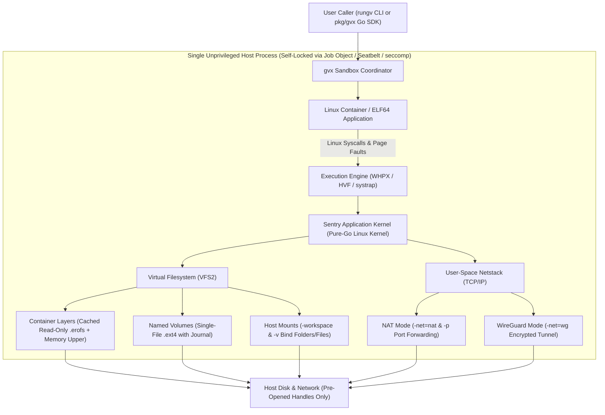
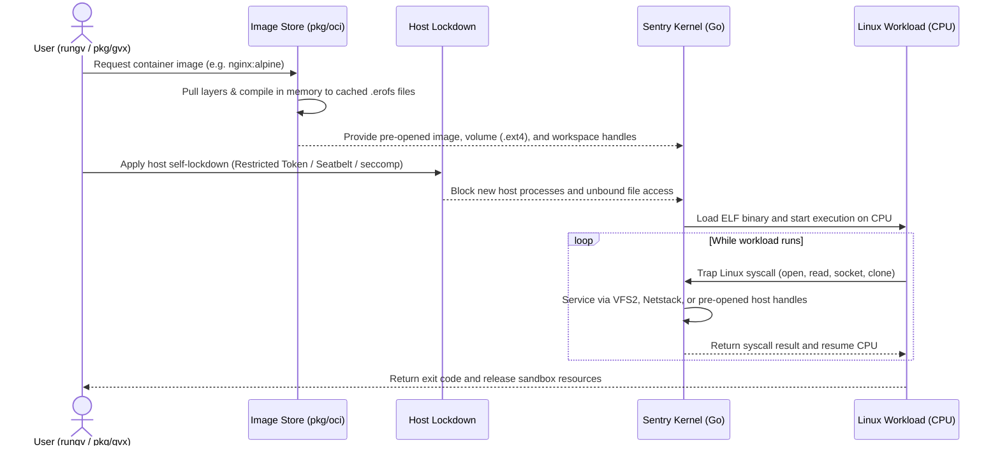

# `gvx`

`gvx` runs unmodified Linux containers (OCI images) and Linux ELF64 binaries directly on Windows, macOS, and Linux. Built on Google's [gVisor](https://github.com/google/gvisor) user-space kernel, it executes Linux workloads inside a single unprivileged host process through the `rungv` CLI or the `pkg/gvx` Go SDK. You get fast startup, strong sandbox isolation, and Docker-compatible workflows without booting a Linux virtual machine, installing kernel drivers, or requiring administrator or `root` privileges.

---

## 1. Why `gvx`?

Running Linux containers on Windows or macOS usually requires a Linux virtual machine and a background daemon, such as WSL2 or Docker Desktop. Full system emulators like QEMU avoid the VM daemon, but they translate every CPU instruction in software.

`gvx` takes a lighter approach. Instead of booting a guest Linux OS, `gvx` runs the Linux kernel boundary in user space as a regular host program. Guest code runs natively on your CPU, while `gvx` intercepts Linux system calls and translates them into host operations on Windows, macOS, or Linux.

| Runtime | Host OS | Cold Start | Memory Footprint | Admin or `sudo` Needed | Requires Background VM Daemon | Direct OCI Image Run |
| :--- | :--- | ---: | ---: | :--- | :--- | :--- |
| **`gvx` (`whpx` / `hvf`)** | Windows (`amd64`, `arm64`) & macOS (`arm64`) | `~20 ms` | `~16 MiB` | No | No | Yes |
| **`gvx` (`systrap`)** | Windows (`amd64`, `arm64`) & Linux (`amd64`, `arm64`) | `~25 to 65 ms` | `~16 MiB` | No | No | Yes |
| **WSL2 / Docker Desktop** | Windows & macOS | `800 to 2500 ms` | `> 512 MiB` | Yes (Initial Setup) | Yes | Requires Daemon |
| **QEMU (Full System)** | Windows & macOS | `1500 to 4000 ms` | `> 256 MiB` | No | No | Requires Disk Image |

---

## 2. How It Works

When you start a container with `rungv` or the `pkg/gvx` SDK, `gvx` creates an isolated sandbox inside the current process. The Linux program runs at native CPU speed. Every Linux system call (`open`, `read`, `write`, `connect`, `fork`, `mmap`) traps into the pure-Go Sentry kernel instead of the host OS kernel.



### 2.1 Container Lifecycle

Every `rungv run` command prepares its image layers, storage handles, and network sockets up front. It then locks down the host process and starts the Linux program. When the program exits, the sandbox cleans up all memory and temporary state automatically, just like `docker run --rm`.



### 2.2 Key Design Principles

`gvx` solves five practical problems that normally make Linux containers difficult to run directly on Windows and macOS.

| Component | How `gvx` Works | Why It Matters to Users |
| :--- | :--- | :--- |
| **Execution Engines (`whpx`, `hvf`, `systrap`)** | Uses hardware virtualization (`WinHvPlatform.dll` on Windows, `Hypervisor.framework` on macOS) for 4KB guest pages. Linux `systrap` traps syscalls via `seccomp`; Windows `systrap` uses user-mode patching under token containment and requires `-platform=systrap` or `-allow-unconfined-systrap`. | Runs standard Linux binaries, dynamic linkers (`glibc`, `musl`), and JIT runtimes at native CPU speed. Untrusted workloads on Windows require `whpx`. |
| **In-Memory Image Compilation (`pkg/oci`)** | Streams `.tar.gz` and `.tar.zst` image layers in memory and compiles them into read-only `.erofs` image files in the local cache. | Avoids extracting Linux files onto Windows NTFS or case-insensitive macOS APFS, which preserves case-sensitive filenames, permissions, and reserved names like `CON` or `AUX`. |
| **Container Storage (`ext4lite` & `hostfs`)** | Keeps container rootfs changes in memory (`tmpfs`), stores named volumes (`-v data:/var/lib/data`) inside a single journaled `<name>.ext4` file on the host, and mounts host project directories (`-workspace`) through pinned directory handles. | Gives databases and stateful apps full POSIX filesystem behavior inside one portable `.ext4` host file while letting you edit code live from your host IDE. |
| **Driverless Networking (`nat` & `wg`)** | Runs a complete TCP/IP stack in memory. Standard NAT mode (`-net=nat`) forwards ports with `-p` and maps `host.docker.internal` to the host. WireGuard mode (`-net=wg`) encrypts all container traffic over a single UDP socket. | Works without kernel TAP/TUN drivers (`WinTun.dll` or `/dev/tun`) and can isolate untrusted workloads from your local network. |
| **Unprivileged Self-Lockdown (`pkg/hostlockdown`)** | Opens all required files and sockets before starting the container, then restricts its own process using Windows Restricted Tokens and Job Objects, macOS Seatbelt, or Linux `seccomp`. | Prevents a compromised workload from spawning host processes or accessing files outside mounted directories. |

---

## 3. Quickstart

You can run Linux containers from the terminal with the `rungv` CLI or embed a sandbox inside your own Go program with `pkg/gvx`.

### 3.1 Build `rungv`

Build the standalone `rungv` binary with Go 1.27.4 or newer, or download a prebuilt archive from the releases page.

> [!IMPORTANT]
> On macOS, sign the binary with `entitlements.plist` so it can access `Hypervisor.framework`. On Windows, enable "Windows Hypervisor Platform" for `whpx`; untrusted workloads require `whpx`, and fallback to `systrap` requires `-allow-unconfined-systrap` or `-platform=systrap`. On Linux, build with `CGO_ENABLED=0`.

1. Run `scripts/repro-build.sh` to build a deterministic `rungv` binary for your operating system.
2. Apply the hypervisor entitlement signature when building on macOS.

```bash
# macOS (Apple Silicon arm64)
./scripts/repro-build.sh ./rungv ./cmd/rungv
codesign --sign - --entitlements entitlements.plist --force ./rungv

# Windows (amd64 or arm64, in Git Bash)
./scripts/repro-build.sh ./rungv.exe ./cmd/rungv

# Linux (amd64 or arm64)
./scripts/repro-build.sh ./rungv ./cmd/rungv
```

### 3.2 Run Containers with `rungv`

`rungv` uses familiar Docker-style commands and flags without needing a background daemon. See [`docs/cli.md`](docs/cli.md) for the complete command and flag reference.

1. Run a quick command inside an Alpine Linux container.
2. Start a web server with port forwarding (`-p`), a persistent volume (`-v`), and a shared host workspace (`-workspace`).
3. Run a workload over an encrypted WireGuard tunnel (`-net=wg`) to block local LAN access.
4. Run a trusted container without a hypervisor on Windows or Linux using `-platform=systrap`.

```bash
# 1. Run a command in an OCI image
./rungv run alpine:3.20 uname -a

# 2. Run Nginx with port forwarding, a named .ext4 volume, and a shared workspace folder
./rungv run -p 8080:80 -v appdata:/var/lib/nginx -workspace=./my-site nginx:alpine

# 3. Run Python over a WireGuard tunnel (no host LAN access, no kernel TUN driver)
./rungv run -net=wg -wg-conf=./sandbox-wg.conf python:3.12-alpine \
  python3 -c "import urllib.request; print(urllib.request.urlopen('https://example.com').status)"

# 4. Run a trusted workload on Windows or Linux without a hypervisor (prints a stderr warning on Windows)
./rungv run -platform=systrap alpine:3.20 sh -c "echo hello from systrap"
```

To use `gvx` as a Docker Engine for the `docker` command of your host, follow [`docs/docker-engine.md`](docs/docker-engine.md).
To run an unmodified `k3s` node in a sandbox, follow [`docs/kubernetes.md`](docs/kubernetes.md).

The table below lists the available `rungv` subcommands.

| Command | Synopsis | Description |
| :--- | :--- | :--- |
| `run` | `rungv run [flags] IMAGE [COMMAND [ARG...]]` | Run a command inside an OCI image or a local Linux ELF64 binary (`-bin`). |
| `pull` | `rungv pull [flags] IMAGE` | Download an image and compile its layers into the local cache. |
| `images` | `rungv images [-a] [-q] [--digests] [--format json]` | List cached images and their compiled sizes. |
| `inspect` | `rungv inspect IMAGE [IMAGE...]` | Print the configuration and layer metadata of cached images as JSON. |
| `tag` | `rungv tag SOURCE_IMAGE[:TAG] TARGET_IMAGE[:TAG]` | Create a new tag for a cached image. |
| `rmi` | `rungv rmi [-f] IMAGE [IMAGE...]` | Remove an image tag and clean up unused layer files. |
| `save` / `load` | `rungv save -o FILE IMAGE...` / `rungv load -i FILE` | Export images to a `.tar` archive or import them on another machine. |
| `login` / `logout` | `rungv login [SERVER]` / `rungv logout [SERVER]` | Save or remove registry credentials in the Docker config store. |
| `stub` | `rungv stub` | Check whether the `systrap` engine is ready on the current host. |
| `tune` | `rungv tune list` | List the host-side tunables that `--tune` and `--tune-file` set. |
| `version` / `license` | `rungv version` / `rungv license` | Print build version information or embedded open-source license notices. |

### 3.3 Embed in Go (`pkg/gvx`)

Use the `pkg/gvx` package to run isolated Linux workloads directly inside your own Go application.

| `gvx.Config` Field | Type | Purpose |
| :--- | :--- | :--- |
| `Platform` | `gvx.PlatformType` | `PlatformAuto` (selects `whpx` on Windows, `hvf` on macOS, or `systrap` on Linux; Windows fallback requires `AllowUnconfinedSystrap`), `PlatformWHPX`, `PlatformHVF`, or `PlatformSystrap`. |
| `AllowUnconfinedSystrap` | `bool` | Permits `PlatformAuto` on Windows to fall back to `systrap` when `whpx` is unavailable. Untrusted Windows workloads require `whpx`. |
| `OCIImage` / `BinaryPath` / `ELFBytes` | `string` / `string` / `[]byte` | Container image reference (`alpine:3.20`), path to a local Linux ELF64 binary, or raw ELF bytes. |
| `Argv` / `Envv` / `WorkDir` | `[]string` / `string` | Command arguments, `KEY=VALUE` environment variables, and working directory inside the container. |
| `WorkspacePath` / `Mounts` | `string` / `[]gvx.Mount` | Host directory mounted at `/workspace`, plus additional bind, volume, or `tmpfs` mounts. |
| `NetworkMode` / `PortForwards` | `gvx.NetworkMode` / `[]gvx.PortForward` | `NetModeNAT` (with optional TCP/UDP port forwards), `NetModeWireGuard`, or `NetModeNone`. |
| `Resources` | `gvx.Resources` | Optional `MemoryBytes` limit and `CPUMillis` CPU quota. |

> [!CAUTION]
> Always call `sb.Close()` after `sb.Run()` finishes. Skipping `sb.Close()` leaks hypervisor mappings, open image and volume handles, and host sandbox resources. Defer `sb.Close()` right after `gvx.New()` returns.

1. Create a `gvx.Config` with your image, command, network mode, and mounts.
2. Call `gvx.New(ctx, cfg)` to initialize the sandbox and lock down the process.
3. Call `sb.Run(ctx)` to run the workload and read its exit code.

```go
package main

import (
	"context"
	"fmt"
	"os"

	"z.gfire.dev/gvx/pkg/gvx"
)

func main() {
	ctx := context.Background()
	sb, err := gvx.New(ctx, gvx.Config{
		Platform:      gvx.PlatformAuto,
		NetworkMode:   gvx.NetModeNAT,
		OCIImage:      "alpine:3.20",
		WorkspacePath: "./repo",
		Argv:          []string{"/usr/bin/git", "status"},
		Stdout:        os.Stdout,
		Stderr:        os.Stderr,
	})
	if err != nil {
		fmt.Fprintf(os.Stderr, "init sandbox: %v\n", err)
		os.Exit(1)
	}
	defer sb.Close()

	exitCode, err := sb.Run(ctx)
	if err != nil {
		fmt.Fprintf(os.Stderr, "run sandbox: %v\n", err)
		os.Exit(1)
	}
	os.Exit(exitCode)
}
```

### 3.4 Install from Release Archives

Each GitHub release provides prebuilt archives for all five supported platforms, a `SHA256SUMS` file, and a Sigstore build provenance bundle (`rungv-TAG.sigstore.json`). Each release also publishes `rungv-TAG-linux-arm64v8.2.tar.gz` with inline LSE atomics for ARMv8.2+ Linux hosts.

> [!IMPORTANT]
> The macOS release binary uses an ad-hoc signature with the hypervisor entitlement rather than Apple notarization. Clear the macOS quarantine attribute with `xattr` after downloading the archive in a browser.

1. Download the archive for your platform and `SHA256SUMS` from the release page.
2. Verify the build provenance with `gh attestation verify` and check the SHA-256 checksum.
3. Extract the archive and clear the quarantine attribute on macOS.
4. Run `rungv version` to confirm the binary works.

```sh
gh attestation verify rungv-v0.2.0-darwin-arm64.tar.gz --repo gfire-sigs/gvx \
  --signer-workflow gfire-sigs/gvx/.github/workflows/release.yml \
  --source-ref refs/tags/v0.2.0 --deny-self-hosted-runners
shasum -a 256 -c SHA256SUMS --ignore-missing
tar -xzf rungv-v0.2.0-darwin-arm64.tar.gz
cd rungv-v0.2.0-darwin-arm64
xattr -d com.apple.quarantine rungv 2>/dev/null || true
./rungv version
```

---

## 4. Supported Platforms

`gvx` runs Linux containers whose architecture matches the host CPU (`linux/amd64` on `amd64` hosts and `linux/arm64` on `arm64` hosts).

| Host Platform | Primary Engine | Fallback Engine (`systrap`) | Host Requirements |
| :--- | :--- | :--- | :--- |
| **Windows `amd64`** (Intel / AMD) | `whpx` (`WinHvPlatform.dll`) | `systrap` (Runs without a hypervisor) | Windows 10 (2004+) or Windows 11. Runs `linux/amd64` workloads. |
| **Windows `arm64`** (Snapdragon X) | `whpx` (`WinHvPlatform.dll`) | `systrap` (Runs without a hypervisor) | Windows 11 24H2+ for `whpx`, or any Windows 11 ARM64 host for `systrap`. Runs `linux/arm64` workloads. |
| **macOS `arm64`** (Apple Silicon M1 to M5) | `hvf` (`Hypervisor.framework`) | None (`hvf` required) | Apple Silicon Mac with the `com.apple.security.hypervisor` entitlement. Runs `linux/arm64` workloads. |
| **Linux `amd64` & `arm64`** | Upstream `systrap` / `kvm` | Upstream `systrap` | 64-bit Linux kernel. Runs native `linux/amd64` or `linux/arm64` workloads. |

---

## 5. Documentation

Refer to the guides below for full CLI flag documentation, release notes, security reporting, and internal architecture details.

| Document | Description |
| :--- | :--- |
| [`docs/cli.md`](docs/cli.md) | Complete `rungv` command reference, `rungv run` flags, mount and volume rules, and differences from Docker. |
| [`docs/docker-engine.md`](docs/docker-engine.md) | Run a Docker Engine in a sandbox with an `ext4lite` volume and control it from the host through a Docker context. |
| [`docs/kubernetes.md`](docs/kubernetes.md) | Run an unmodified `k3s` node in a sandbox, alone or in a cluster with several nodes. |
| [`docs/architecture.md`](docs/architecture.md) | Internal subsystem design, Windows and macOS kernel bindings, and contributor development guide. |
| [`docs/gvisorlint.md`](docs/gvisorlint.md) | Run the gVisor analyzers `checklocks`, `checkconst`, and `checklinkname`, and fix their findings. |
| [`CHANGELOG.md`](CHANGELOG.md) | Release notes, new features, and known limitations for each version. |
| [`SECURITY.md`](SECURITY.md) | Security boundaries, supported versions, and private vulnerability reporting instructions. |

---

## License

`gvx` is licensed under the Apache License, Version 2.0. See [`LICENSE`](LICENSE) for the full license text.

### Third-party and upstream licenses

The `rungv` binary contains the components below. The generator `tools/licenses` collects their licenses, and the table comes from the same data.

- `gvx` is licensed under the Apache License, Version 2.0.
- The code derived from [google/gvisor](https://github.com/google/gvisor) is licensed under the Apache License, Version 2.0, Copyright The gVisor Authors. The pinned upstream commit is in [`UPSTREAM_COMMIT`](UPSTREAM_COMMIT).
- The Go standard library is licensed under the BSD-3-Clause license, Copyright The Go Authors.
- The module embeds a modified copy of the `unix` package of `golang.org/x/sys` in `internal/xsys/unix`. The copy stays under the BSD-3-Clause license of that module, whose text is in `internal/xsys/LICENSE`.

The third-party Go modules that `rungv` links are listed by SPDX identifier.

| SPDX identifier | Third-party modules |
| :--- | :--- |
| `Apache-2.0` | `github.com/distribution/reference` v0.6.0, `github.com/google/btree` v1.1.2, `github.com/opencontainers/image-spec` v1.1.1 |
| `Apache-2.0 AND BSD-3-Clause AND MIT` | `github.com/klauspost/compress` v1.18.0 |
| `BSD-3-Clause` | `golang.org/x/arch` v0.32.0, `golang.org/x/crypto` v0.57.0, `golang.org/x/exp` v0.0.0-20250711185948-6ae5c78190dc, `golang.org/x/mod` v0.41.0, `golang.org/x/net` v0.60.0, `golang.org/x/sync` v0.23.0, `golang.org/x/sys` v0.48.0, `golang.org/x/text` v0.42.0, `golang.org/x/time` v0.15.0, `google.golang.org/protobuf` v1.36.11 |
| `MIT` | `golang.zx2c4.com/wintun` v0.0.0-20230126152724-0fa3db229ce2, `golang.zx2c4.com/wireguard` v0.0.0-20261006164505-2631ce99a06f |
| `NOASSERTION` | `github.com/opencontainers/go-digest` v1.0.0 |

`rungv license` prints every license text of the binary, and `rungv license -list` prints the component list.
