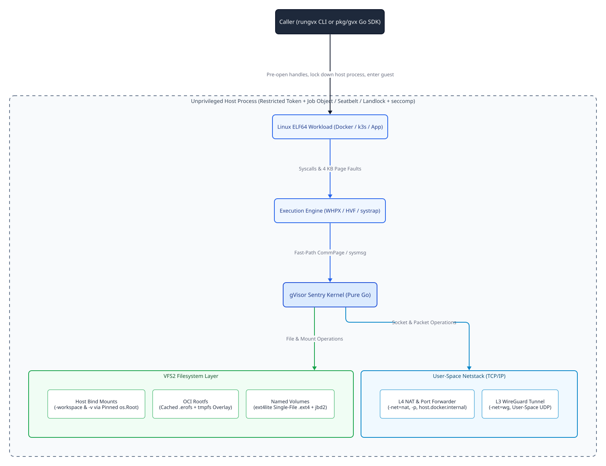

# gvx

`gvx` runs unmodified Linux containers and ELF64 programs inside one unprivileged process on Windows, macOS, Linux, and Android. The runtime boots no virtual machine, installs no kernel driver, and requires no background daemon.

Guest code executes directly on the host processor while a memory-safe Go kernel derived from [gVisor](https://github.com/google/gvisor) intercepts Linux system calls. Because `gvx` tracks upstream gVisor continuously, kernel compatibility fixes reach users without maintaining a diverging fork.

Run containers with the `rungvx` CLI, embed Linux sandboxes in Go via `pkg/gvx`, or ship `gvx-android.aar` in Android apps.

---

## 1. Quickstart: Install and First Run

Follow these steps to install `rungvx` and run verified Linux containers from an empty directory.

### Host Prerequisites

Confirm your host meets the platform requirements before downloading or building `rungvx`.

| Host OS | Requirements |
| :--- | :--- |
| **macOS** (`darwin/arm64`) | Apple Silicon required; Intel Macs are unsupported. Clear quarantine with `xattr -d com.apple.quarantine ./rungvx`, or sign source builds with `entitlements.plist`. |
| **Windows** (`windows/amd64`, `windows/arm64`) | Requires Windows 10 2004+ (`amd64`) or Windows 11 24H2 (Build `26100.3915+`, `arm64`). Enable WHP via `Enable-WindowsOptionalFeature -Online -FeatureName HypervisorPlatform -All`, restart, then run `Unblock-File .\rungvx.exe`. |
| **Linux** (`linux/amd64`, `linux/arm64`) | Requires no root privileges, kernel modules, or hypervisor devices. Supports 4 KiB and 16 KiB host pages; build statically with `CGO_ENABLED=0`. |

### Install Prebuilt Binary

Grab the latest release tag from [GitHub Releases](https://github.com/gfire-sigs/gvx/releases) and assign it to `VERSION`. Each tag publishes seven archives, `SHA256SUMS`, and a Sigstore bundle.

macOS and Linux archives use `rungvx-<VERSION>-<OS>-<ARCH>.tar.gz` (`darwin-arm64`, `linux-amd64`, `linux-arm64`, `linux-arm64v8.2`, `android-arm64`). Windows archives use `rungvx-<VERSION>-windows-<ARCH>.zip` (`amd64` or `arm64`).

#### macOS and Linux

1. Set `VERSION` to the release tag and `TARGET` to your platform.
2. Download the archive, `SHA256SUMS`, and Sigstore bundle, then verify checksums and provenance.
3. Extract `rungvx`, clear macOS quarantine if needed, and print the binary version.

```sh
VERSION=<release-tag>
TARGET=darwin-arm64
ARCHIVE="rungvx-${VERSION}-${TARGET}.tar.gz"
BASE="https://github.com/gfire-sigs/gvx/releases/download/${VERSION}"

curl -fsSLO "${BASE}/${ARCHIVE}" "${BASE}/SHA256SUMS" "${BASE}/rungvx-${VERSION}.sigstore.json"
grep " ${ARCHIVE}\$" SHA256SUMS | shasum -a 256 -c -   # use sha256sum -c on Linux

gh attestation verify "${ARCHIVE}" \
  --bundle "rungvx-${VERSION}.sigstore.json" \
  --repo gfire-sigs/gvx \
  --signer-workflow gfire-sigs/gvx/.github/workflows/release.yml \
  --source-ref "refs/tags/${VERSION}" --deny-self-hosted-runners

tar -xzf "${ARCHIVE}"
mv "rungvx-${VERSION}-${TARGET}/rungvx" /usr/local/bin/rungvx
xattr -d com.apple.quarantine /usr/local/bin/rungvx 2>/dev/null || true
rungvx version
```

#### Windows (PowerShell)

1. Set `$Version` to the release tag and `$Target` (`windows-amd64` or `windows-arm64`).
2. Download the archive and `SHA256SUMS`, then verify the SHA-256 hash.
3. Extract `rungvx.exe`, run `Unblock-File`, and print the binary version.

```powershell
$Version = "<release-tag>"
$Target = "windows-amd64"
$Archive = "rungvx-$Version-$Target.zip"
$Base = "https://github.com/gfire-sigs/gvx/releases/download/$Version"

Invoke-WebRequest "$Base/$Archive" -OutFile $Archive
Invoke-WebRequest "$Base/SHA256SUMS" -OutFile SHA256SUMS
$Expected = (Select-String -Path SHA256SUMS -Pattern " $Archive$").Line.Split(" ")[0]
if ((Get-FileHash $Archive -Algorithm SHA256).Hash.ToLower() -ne $Expected) { throw "SHA-256 mismatch" }

Expand-Archive -Path $Archive -DestinationPath . -Force
Unblock-File ".\rungvx-$Version-$Target\rungvx.exe"
.\rungvx-$Version-$Target\rungvx.exe version
```

### Run Your First Containers

Run each example below from an empty working directory. Note that `-v SRC:DST` creates missing host directories before lockdown, whereas `-workspace DIR` requires `DIR` to exist beforehand.

1. Run `uname -a` inside an unmodified Alpine Linux container.
2. Serve a local website directory through `nginx:alpine` and verify HTTP access with `curl`.
3. Checkpoint a running sandbox from a second terminal and restore it in a new process.

```sh
# 1. Print the guest kernel identity
rungvx run alpine:3.20 uname -a
# Expected: Linux gvx 4.19.0-gvisor #1 SMP Sun Jan 10 15:06:54 PST 2016 <arch> Linux

# 2. Serve a host directory with nginx and a persistent ext4lite volume
mkdir -p ./my-site
printf '<h1>Served from gvx</h1>\n' > ./my-site/index.html
rungvx run -p 8080:80 -v appdata:/var/lib/nginx -v "$PWD/my-site:/usr/share/nginx/html:ro" nginx:alpine
# In a second terminal:
curl http://127.0.0.1:8080/

# 3. Checkpoint and restore across two terminals
# Terminal 1: start the sandbox with pre-opened control socket and checkpoint directory
mkdir -p ./snap
rungvx run -S ./ctrl.sock -checkpoint-dir ./snap alpine:3.20 sh -c "sleep 300"

# Terminal 2: save state (which stops Terminal 1) and restore in a new process
rungvx checkpoint -S ./ctrl.sock -checkpoint-dir ./snap
rungvx restore -checkpoint-dir ./snap
```

### Install with Go or Build from Source

Install `rungvx` using Go 1.27.4 or newer, or build deterministically from a source checkout.

> [!IMPORTANT]
> Sign any macOS binary built with `go install` or `repro-build.sh` using `entitlements.plist`. Without `com.apple.security.hypervisor`, `Hypervisor.framework` refuses to create a virtual machine.

1. Install with `go install` (set `CGO_ENABLED=0` on Linux).
2. Clone the repository and run `scripts/repro-build.sh` for a deterministic source build.
3. Sign the resulting binary with `entitlements.plist` on macOS.

```sh
CGO_ENABLED=0 go install z.gfire.dev/gvx/cmd/rungvx@latest   # Option A: Go proxy
./scripts/repro-build.sh ./rungvx ./cmd/rungvx              # Option B: source checkout
codesign --sign - --entitlements entitlements.plist --force ./rungvx   # macOS only
```

---

## 2. How gvx Runs Linux Without a Virtual Machine

Desktop container tools on Windows and macOS typically boot a persistent Linux virtual machine and background daemon. `gvx` runs one unprivileged host process per sandbox instead.

Guest user-space code runs directly on the host CPU while gVisor's memory-safe Go kernel serves Linux system calls. Host lockdown then seals the process against spawning children, opening unbound paths, or opening unauthorized sockets before guest entry.

The architecture diagram below shows how layers, storage drivers, networking, and lockdown fit inside one sandbox.



Three execution backends run guest machine code across supported hosts:

- **`hvf` (`darwin/arm64`)**: Executes guest code through Apple's `Hypervisor.framework` using 4 KiB guest page tables over 16 KiB host pages.
- **`whpx` (`windows/amd64`, `windows/arm64`)**: Runs guest instructions inside a Windows Hypervisor Platform partition using 4 KiB Extended Page Tables or Stage-2 mappings.
- **`systrap` (Linux, Android, opt-in Windows)**: Executes guest instructions inside isolated stub processes. Linux and Android trap system calls via `seccomp`; Windows uses opt-in binary rewriting for trusted workloads only.

Pass `--backend` (`auto`, `whpx`, `hvf`, or `systrap`) to choose the execution engine, and `--platform linux/ARCH` (`linux/amd64` or `linux/arm64`) to select the image architecture.

| Property | `gvx` (`hvf` / `whpx`) | `gvx` (`systrap`) | WSL2 / Lima / Docker Desktop |
| :--- | :--- | :--- | :--- |
| **Host OS** | macOS (`arm64`), Windows (`amd64`, `arm64`) | Linux (`amd64`, `arm64`), Android (`arm64`), Windows (opt-in) | Windows, macOS |
| **Background VM / Daemon** | None (one process per sandbox) | None (one process plus stub processes) | Persistent Linux VM and daemon |
| **Runtime Privileges** | Standard user account | Standard user account | Initial VM or driver setup |
| **Guest Kernel** | User-space Go kernel (Sentry) | User-space Go kernel (Sentry) | Full Linux kernel in VM |
| **Guest Architecture** | Matches host CPU only | Matches host CPU only | Cross-arch via QEMU or Rosetta |
| **Untrusted Code Isolation** | Hardware page tables + lockdown | Linux/Android: `seccomp` + lockdown; Windows: trusted only | Hardware VM boundary |

### Measured Micro-Benchmarks

Automated benchmarks run via `GVX_E2E_BENCH=1 go test -count=1 -v -run TestE2EMicroBench ./e2e/` and publish medians to [`bench-results`](https://github.com/gfire-sigs/gvx/tree/bench-results). The table lists medians from GitHub runners (`d77169d3`, 2026-11-24) and an Apple Silicon host (`ce792c97`, 2026-11-10). Note that `windows/amd64` `whpx` ran under nested CI virtualization, and WSL2, Lima, and Docker Desktop are not benchmarked here.

| Target | Backend | `host_new` | `getpid` | `open_close` | `fork_wait` | `fork_exec_true` |
| :--- | :--- | ---: | ---: | ---: | ---: | ---: |
| `darwin/arm64` | `hvf` | 11.39 ms | 1.3 us | 5.2 us | 0.94 ms | 0.23 ms |
| `linux/amd64` | `systrap` | 47.75 ms | 2.8 us | 8.9 us | 1.80 ms | 0.41 ms |
| `linux/arm64` | `systrap` | 1.77 ms | 3.2 us | 10.7 us | 1.89 ms | 0.70 ms |
| `windows/amd64` | `whpx` (nested VM) | 12.24 ms | 12.4 us | 29.0 us | 0.99 ms | 1.12 ms |
| `windows/amd64` | `systrap` | 42.43 ms | 0.43 us | 3.1 us | 6.72 ms | 4.66 ms |
| `windows/arm64` | `systrap` | 104.34 ms | 0.96 us | 6.0 us | 17.63 ms | 12.62 ms |

---

## 3. Embed in Go (pkg/gvx)

Go applications can execute untrusted Linux binaries and OCI images directly in process through `pkg/gvx`. Each sandbox isolates guest memory, filesystems, and network traffic without running an external daemon.

Default builds compile with pure Go (`CGO_ENABLED=0`) and zero C dependencies on every target host. Callers configure mounts, NAT policies, and resource ceilings through typed fields on `gvx.Config`.

Initialize a new module and run the self-contained example below from an empty directory.

1. Create a working directory, initialize a Go module, fetch `z.gfire.dev/gvx`, and create `./repo`.

```sh
mkdir gvx-demo && cd gvx-demo
go mod init example.com/gvx-demo
go get z.gfire.dev/gvx
mkdir -p repo
```

2. Save the following program as `main.go`.

> [!CAUTION]
> Call `defer sb.Close()` immediately after `gvx.New` or `gvx.Restore` succeeds. Omitting `Close` leaks hypervisor partitions, memory mappings, and host file descriptors.

```go
package main

import (
	"context"
	"fmt"
	"os"

	"z.gfire.dev/gvx/pkg/gvx"
)

func main() {
	ctx := context.Background()
	sb, err := gvx.New(ctx, gvx.Config{
		Platform:      gvx.PlatformAuto,
		NetworkMode:   gvx.NetModeNAT,
		OCIImage:      "alpine/git:latest",
		WorkspacePath: "./repo",
		Argv:          []string{"sh", "-c", "git init /workspace && git -C /workspace status"},
		Stdout:        os.Stdout,
		Stderr:        os.Stderr,
	})
	if err != nil {
		fmt.Fprintf(os.Stderr, "init sandbox: %v\n", err)
		os.Exit(1)
	}
	defer sb.Close()

	exitCode, err := sb.Run(ctx)
	if err != nil {
		fmt.Fprintf(os.Stderr, "run sandbox: %v\n", err)
		os.Exit(1)
	}
	os.Exit(exitCode)
}
```

3. Build and run the program (signing with `entitlements.plist` before execution on macOS).

> [!IMPORTANT]
> Build and sign the binary with `entitlements.plist` before running on macOS. Unsigned binaries lack `com.apple.security.hypervisor` and fail virtual machine creation.

```sh
go build -o gvx-demo .
# On macOS only (fetch entitlements.plist from the repo root if running outside a clone):
codesign --sign - --entitlements entitlements.plist --force ./gvx-demo
./gvx-demo
```

---

## 4. What Runs Today and Known Limits

Automated end-to-end tests verify `gvx` across Alpine, BusyBox, `nginx`, Python 3.12, Node.js 22 (V8), OpenJDK 21 (HotSpot), and Git. The suite also verifies unmodified `docker:dind`, single-node and multi-node `rancher/k3s` with Flannel and Calico, live checkpoint/restore, and host NAT policies.

Continuous `pjdfstest` runs validate POSIX semantics against both `ext4lite` volumes and `hostfs` bind mounts. Five core subsystems implement image loading, storage, networking, and pre-execution confinement inside the runtime.

Review the subsystems and principal limits below, and consult [`docs/compatibility.md`](docs/compatibility.md) for the complete compatibility reference.

### Core Subsystems

- **In-memory OCI compiler (`pkg/oci`)**: Streams `.tar.gz` and `.tar.zst` layers into cached EROFS images without extracting files onto host NTFS or APFS.
- **Single-file ext4 volumes (`ext4lite`)**: Stores each volume (`-v`) or root overlay (`-rootfs-volume`) in one `.ext4` file with a JBD2 journal and 16 MiB groups.
- **Pinned host directories (`hostfs`)**: Anchors bind mounts to an `os.Root` handle, blocks symlink escape, encodes incompatible names, and bridges host events to `inotify`.
- **Driverless networking (`pkg/netbackend`)**: Connects Netstack to unprivileged host sockets (`-net=nat`, `-p`, `--auto-publish`) or an in-memory WireGuard tunnel (`-net=wg`) without TUN drivers.
- **Pre-execution lockdown (`pkg/hostlockdown`)**: Confines the host process before guest entry via Windows Restricted Tokens and Job Objects, macOS Seatbelt, or Linux Landlock and `seccomp-bpf`.

### Principal Limits

- **Same-architecture execution only**: Guest binaries must match the host CPU architecture (`linux/arm64` or `linux/amd64`).
- **Intel Macs unsupported**: `darwin/amd64` is unsupported; macOS support requires Apple Silicon (`darwin/arm64`).
- **Omitted kernel subsystems**: Loadable kernel modules (`insmod`), eBPF programs, `io_uring`, and `nftables` are unsupported; use legacy iptables (`IPTABLES_MODE=legacy`).
- **Windows `systrap` boundaries**: `--backend=systrap` serves trusted workloads only. AddressSanitizer and 64-bit Wine fail there, and default Microsoft Defender behavior remains untested.
- **Unverified databases and browsers**: Relational databases (PostgreSQL, SQLite) and browsers (Chromium, Playwright, Electron) lack `e2e/` coverage; host GPU acceleration is unimplemented.

See [`docs/compatibility.md`](docs/compatibility.md) for full details on verified workloads, unverified targets, and platform constraints.

---

## 5. Deliverables and Documentation

The repository builds four deliverables and splits documentation into user guides and contributor specifications.

| Deliverable | Audience | Entry Point |
| :--- | :--- | :--- |
| `rungvx` | Developers running Linux containers, Docker Engine, or local `k3s` without a VM. | Section 1 above; [`docs/cli.md`](docs/cli.md) |
| `pkg/gvx` | Go developers embedding isolated Linux execution inside a host application. | Section 3 above; `go get z.gfire.dev/gvx` |
| `gvx-android.aar` | Android developers packaging Linux execution inside an app (`android/arm64`). | [`docs/components/android.md`](docs/components/android.md) |
| `containerd-shim-gvx-v2` | Integrators testing the optional containerd v3 control-plane adapter (no guest execution yet). | [`docs/architecture.md`](docs/architecture.md#310-optional-containerd-control-adapter) |

### For Users

| Document | Contents |
| :--- | :--- |
| [`docs/cli.md`](docs/cli.md) | Complete `rungvx` subcommand reference, flags, tunables, mounts, checkpointing, and Android operation. |
| [`docs/compatibility.md`](docs/compatibility.md) | Canonical compatibility matrix of verified workloads, unverified targets, and platform limits. |
| [`docs/troubleshooting.md`](docs/troubleshooting.md) | Symptom-to-remedy guide covering installation, signing, exit code 137, Docker, `k3s`, and DNS. |
| [`docs/glossary.md`](docs/glossary.md) | Concise definitions of subsystems, backends, filesystems, extensions, and deliverables. |
| [`docs/recipes/docker-engine.md`](docs/recipes/docker-engine.md) | Step-by-step recipe to run Docker Engine (`docker:dind`) inside `gvx` from host `docker`. |
| [`docs/recipes/kubernetes.md`](docs/recipes/kubernetes.md) | Step-by-step recipe for single-node and multi-node `k3s` clusters with Flannel or Calico. |
| [`SECURITY.md`](SECURITY.md) | Security boundaries, documented operational limits, provenance checks, and vulnerability reporting. |

Release history lives in [`CHANGELOG.md`](CHANGELOG.md).

### For Contributors

| Document | Contents |
| :--- | :--- |
| [`CONTRIBUTING.md`](CONTRIBUTING.md) | First-contribution workflow, deliverables map, local build and test commands, and review standards. |
| [`docs/architecture.md`](docs/architecture.md) | System architecture, package boundaries, upstream isolation tiers, kernel interfaces, and CI matrix. |
| [`docs/control-protocol.md`](docs/control-protocol.md) | Wire framing, authentication, capability policy, and RPC reference for `gvx-ctrl/2`. |
| [`docs/systrap-windows.md`](docs/systrap-windows.md) | Measured behavior, binary patching design, fast path, limits, and probes for Windows `systrap`. |
| [`docs/extensions-plan.md`](docs/extensions-plan.md) | Architecture and rollout plan for the Extension SPI, nested `ext/` submodule, and `rungvx` plugins. |
| [`docs/moonshots.md`](docs/moonshots.md) | Unimplemented research proposal for confined host GPU acceleration in browser and GUI guests. |
| [`AGENTS.md`](AGENTS.md) | Repository operating manual, upstream sync rules, writing standard, and release versioning rules. |

Component specifications live under `docs/components/`: [`hypervisors.md`](docs/components/hypervisors.md), [`ext4lite.md`](docs/components/ext4lite.md), [`hostfs.md`](docs/components/hostfs.md), [`netbackend.md`](docs/components/netbackend.md), [`oci.md`](docs/components/oci.md), [`hostlockdown.md`](docs/components/hostlockdown.md), and [`android.md`](docs/components/android.md). Community guidelines reside in [`CODE_OF_CONDUCT.md`](CODE_OF_CONDUCT.md).

---

## 6. Upstream Tracking and Licensing

`gvx` is licensed under the Apache License, Version 2.0 ([`LICENSE`](LICENSE)) and tracks the `go` branch of [google/gvisor](https://github.com/google/gvisor) pinned in [`UPSTREAM_COMMIT`](UPSTREAM_COMMIT). Host bindings live in Tier 1 packages and OS-suffixed Tier 2 sibling files (`*_windows.go`, `*_darwin.go`, `*_xplat.go`), keeping upstream Tier 3 changes below 5.0%.

The root Go module remains pure Go with zero extension dependencies, while optional extensions live in the nested `ext/` submodule (`ext/go.mod`). Every CI run audits the upstream boundary ceiling with `go run ./tools/upstream -mode=audit`.

Run `rungvx license` (or `rungvx license -list`) to print embedded notices for `gvx`, upstream gVisor, Go, and the third-party modules tabulated below.

| SPDX identifier | Third-party modules |
| :--- | :--- |
| `Apache-2.0` | `github.com/distribution/reference` v0.6.0, `github.com/google/btree` v1.1.2, `github.com/opencontainers/image-spec` v1.1.1 |
| `Apache-2.0 AND BSD-3-Clause AND MIT` | `github.com/klauspost/compress` v1.20.5 |
| `BSD-3-Clause` | `golang.org/x/arch` v0.32.0, `golang.org/x/crypto` v0.57.0, `golang.org/x/exp` v0.0.0-20250711185948-6ae5c78190dc, `golang.org/x/mod` v0.41.0, `golang.org/x/net` v0.60.0, `golang.org/x/sync` v0.23.0, `golang.org/x/sys` v0.48.0, `golang.org/x/text` v0.42.0, `golang.org/x/time` v0.15.0, `google.golang.org/protobuf` v1.36.11 |
| `MIT` | `golang.zx2c4.com/wintun` v0.0.0-20230126152724-0fa3db229ce2, `golang.zx2c4.com/wireguard` v0.0.0-20261006164505-2631ce99a06f, `gopkg.in/yaml.v3` v3.0.1 |
| `NOASSERTION` | `github.com/opencontainers/go-digest` v1.0.0 |
