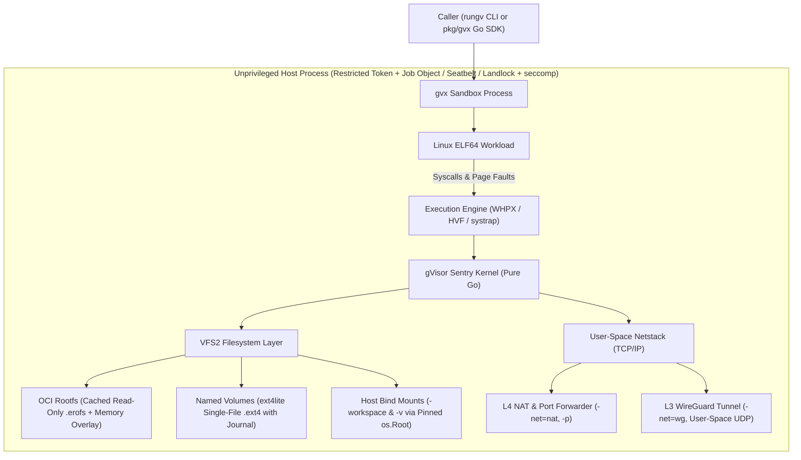

# `gvx`

`gvx` runs unmodified Linux containers (OCI images) and Linux ELF64 binaries on Windows, macOS, and Linux inside a single unprivileged host process. It does not boot a Linux virtual machine, install a kernel driver, or run a background daemon.

It is built on Google's [gVisor](https://github.com/google/gvisor) user-space application kernel (`Sentry` and `netstack`), ported to Windows (`amd64`, `arm64`) and macOS (`arm64`) alongside Linux (`amd64`, `arm64`) while modifying less than `5.0%` of upstream gVisor files (`4.12%` at [`UPSTREAM_COMMIT`](UPSTREAM_COMMIT)). Guest Linux code runs directly on the host CPU, and `gvx` intercepts Linux system calls in user space through the `rungv` CLI or the `pkg/gvx` Go SDK.

```bash
# Run an Alpine container directly on Windows, macOS, or Linux (no daemon, no sudo)
./rungv run alpine:3.20 uname -a

# Run Nginx with port forwarding, a persistent .ext4 volume, and a live host directory
./rungv run -p 8080:80 -v appdata:/var/lib/nginx -workspace=./my-site nginx:alpine

# Checkpoint a running sandbox to disk and restore it later
./rungv checkpoint -control-socket ./ctrl.sock -checkpoint-dir ./snap
./rungv restore -checkpoint-dir ./snap
```

---

## 1. How It Compares to WSL2, Lima, and Upstream gVisor

Upstream gVisor (`runsc`) is an OCI runtime for Linux hosts. On Windows and macOS, tools like Docker Desktop, WSL2, Lima, and Podman Desktop run Linux containers by booting a persistent Linux utility VM in the background.

`gvx` takes the opposite approach: it ports gVisor's user-space Linux kernel to run directly as a normal Windows or macOS process. Despite running without a Linux VM, `gvx` provides a complete enough Linux kernel boundary to run unmodified `dockerd` (`docker:dind`), single-node and multi-node Kubernetes clusters (`rancher/k3s`), `containerd`, `runc`, and Calico CNI with `NetworkPolicy` enforcement.

| Property | `gvx` (`whpx` / `hvf`) | `gvx` (`systrap`) | WSL2 / Lima / Docker Desktop |
| :--- | :--- | :--- | :--- |
| **Host OS** | Windows (`amd64`, `arm64`), macOS (`arm64`) | Linux (`amd64`, `arm64`), Windows (`amd64`, `arm64`) | Windows, macOS |
| **Background VM / Daemon** | None (single process per sandbox) | None (single process per sandbox) | Persistent Linux VM + daemon |
| **Admin / `root` Required** | No | No | Yes (initial VM/driver setup) |
| **Typical Cold Start** | `~20 ms` (cached EROFS layer) | `~25 to 65 ms` (cached EROFS layer) | `800 to 2500 ms` (if VM is cold) |
| **Base Memory Overhead** | `~16 MiB` per sandbox process | `~16 MiB` per sandbox process | `512 MiB+` reserved for the utility VM |
| **Workload Coverage** | CLI tools, databases, `dockerd`, full `k3s` + Calico CNI | CLI tools, databases, `dockerd`, full `k3s` + Calico CNI | Full Linux kernel inside the VM |
| **Cross-Arch Emulation** | Host CPU arch (`amd64` or `arm64`) | Host CPU arch (`amd64` or `arm64`) | Via QEMU `binfmt_misc` / Rosetta |

### What `gvx` Unlocks

- **Full Docker Engine and Kubernetes (`k3s` + Calico CNI) in a single process**: `gvx` implements cgroup v2 (`memory.max`, `cpu.max`), `overlayfs`, `pivot_root`, netfilter/iptables (`addrtype`, `conntrack`, `xt_recent`, `rpfilter`, `set`), `ipset`, VXLAN, and kernel WireGuard netlink (`wg0`). An unmodified `rancher/k3s` server or multi-node cluster boots inside `gvx`, passes Kubernetes `sonobuoy` conformance checks (`Quick` and `[sig-network] Services`), and enforces pod `NetworkPolicy` rules with either `flannel` (`wireguard-native`) or Calico VXLAN.
- **Portable, journaled single-file volumes (`ext4lite`)**: Databases (`PostgreSQL`, `SQLite`), `dockerd`, and `k3s` require real POSIX filesystem semantics (`overlayfs` whiteouts, xattrs, hard links, atomic rename, and `fsync` durability) that break on Windows NTFS or case-insensitive macOS APFS. `ext4lite` stores each named volume (`-v data:/var/lib/data`) as a standard Linux `ext4` image file (`<name>.ext4`) with a `jbd2` journal and dynamic 16 MiB block groups. Volumes start small, grow on demand, survive crashes via journal replay, and mount unmodified with `mount -o loop` on any Linux machine.
- **Embedding Linux sandboxes in Go applications (`pkg/gvx`)**: Launch isolated Linux containers or ELF binaries directly from a Go library call without shipping a VM image or requiring Docker Desktop on the user's machine.
- **Lockdown-safe Checkpoint and Restore (`rungv checkpoint` / `restore`)**: Snapshot a running sandbox's task graph, memory pages, `ext4lite` volumes, and child network namespaces to a directory bundle and resume execution in milliseconds.

### Scope and Trade-offs

- **User-space application kernel vs. hardware kernel**: `gvx` serves system calls in user space rather than booting a hardware Linux kernel image. Kernel modules (`insmod`), eBPF programs (such as Cilium's eBPF datapath), `io_uring`, and `nftables` are not supported; `dockerd`, `k3s`, and Calico run using the `iptables-legacy` backend (`IPTABLES_MODE=legacy`).
- **Same-architecture execution**: Guest binaries run natively on the host CPU without instruction translation (`linux/arm64` on Apple Silicon and Windows ARM64; `linux/amd64` on x86_64 Windows and Linux).
- **Windows `whpx` vs. `systrap`**: On Windows, hardware-assisted `whpx` (`WinHvPlatform.dll`) is the default engine. When Hyper-V / WHPX is unavailable, `gvx` offers a user-mode `systrap` engine (`-platform=systrap` or `-allow-unconfined-systrap`) for trusted workloads. Because the Windows kernel does not provide an unprivileged syscall filter like Linux `seccomp`, always use `whpx` for untrusted code on Windows.

---

## 2. Architecture Overview

When you start a container with `rungv` or `pkg/gvx`, the host process compiles OCI image layers into cached `.erofs` files, opens all host file handles and sockets up front, locks down its own OS process privileges, and enters the guest execution loop.



### How the Host OS Gaps Are Bridged

1. **CPU Ring and 4 KB Paging (`whpx`, `hvf`, `systrap`)**:
   - On macOS (`arm64`), `pkg/sentry/platform/hvf` runs guest code inside an Apple `Hypervisor.framework` vCPU with 4 KB Stage-1 guest pages mapped over 16 KB macOS host pages.
   - On Windows (`amd64`, `arm64`), `pkg/sentry/platform/whpx` runs guest code inside a Windows Hypervisor Platform (`WinHvPlatform.dll`) partition with 4 KB EPT / Stage-2 mappings.
   - On Linux (`amd64`, `arm64`) and Android (`arm64`, including 16 KB page kernels), `gvx` uses `systrap` (`seccomp` + shared-memory trampolines + 4 KB sub-block paging).
2. **In-Memory OCI-to-EROFS Compilation (`pkg/oci`)**:
   - Extracting a Linux container `.tar` layer onto Windows NTFS or default macOS APFS breaks case-sensitive filenames (`Makefile` vs `makefile`), device nodes, and Windows reserved names (`CON`, `AUX`, `NUL`).
   - `pkg/oci` never extracts container layers onto the host filesystem. It streams `.tar.gz` and `.tar.zst` layers in memory and compiles them directly into read-only `<sha256>.erofs` images cached on disk, mounted under an in-memory `tmpfs` upper layer.
3. **Single-File Journaled `ext4` Volumes (`pkg/sentry/fsimpl/ext4lite`)**:
   - Named volumes (`-v appdata:/var/lib/data`) are backed by `ext4lite`, a pure-Go VFS2 driver that formats and mounts a single `<name>.ext4` file on the host.
   - `ext4lite` organizes disk space into self-contained 16 MiB block groups with extent trees, inline data for small files, directory indexing, extended attributes (`security.*`, `trusted.overlay.*`), and an ordered metadata journal (`jbd2`). On filesystems where sparse hole punching (`FSCTL_SET_ZERO_DATA` or `F_PUNCHHOLE`) is unavailable or exhausted, `ext4lite` falls back cleanly to dense block allocation and compacts unused tail groups on unmount.
4. **Pinned Host Directory Sharing (`pkg/sentry/fsimpl/hostfs`)**:
   - When you mount a host directory with `-workspace` or `-v ./src:/src`, `hostfs` opens every path relative to a pinned `os.Root` directory handle (`NtCreateFile` with `FILE_OPEN_REPARSE_POINT` on Windows; `openat` with `O_NOFOLLOW` on macOS and Linux). It encodes Windows-invalid characters and case collisions with a stateless `~gvx~` prefix and bridges host filesystem events into guest `inotify` watches.
5. **Driverless Networking (`pkg/netbackend`)**:
   - `-net=nat` runs gVisor's user-space TCP/IP stack (`netstack`) and translates outbound guest TCP/UDP flows into unprivileged host Go `net` sockets, supporting port ranges (`-p`), host Unix domain socket forwarding (`-p unix:path:port`), and `host.docker.internal` (`10.0.2.2`).
   - `-net=wg` routes L3 packets from `netstack` through an in-memory `wireguard-go` endpoint over a single unprivileged host UDP socket, requiring no `WinTun.dll` or `/dev/tun` driver.
6. **Pre-Execution Host Self-Lockdown (`pkg/hostlockdown`)**:
   - Before executing the first guest instruction, `gvx` opens all required `.erofs` layers, `.ext4` volume files, workspace directory handles, and listeners, then calls `hostlockdown.Apply()`.
   - Linux installs a Landlock filesystem ruleset restricting path access to mounted directories, followed by a `seccomp-bpf` filter.
   - macOS applies a Seatbelt profile (`sandbox_init`) denying `process-fork` and unbound `file-*` paths.
   - Windows applies a Restricted Token, Low Mandatory Integrity, and a Job Object (`JOB_OBJECT_LIMIT_ACTIVE_PROCESS = 1`, `JOB_OBJECT_UILIMIT_ALL`), routing legitimate post-lockdown workspace opens through an in-process pre-lockdown handle broker without mutating host directory ACLs.

---

## 3. Quickstart

### 3.1 Install or Build `rungv`

Download a prebuilt archive from [Releases](https://github.com/gfire-sigs/gvx/releases) or build from source with Go 1.27+.

> [!IMPORTANT]
> On macOS, sign the binary with `entitlements.plist` so it can call `Hypervisor.framework`. On Windows, enable the "Windows Hypervisor Platform" optional feature for `whpx` execution. On Linux, build with `CGO_ENABLED=0`.

1. Run `scripts/repro-build.sh` to build `rungv`.
2. Sign the binary with `entitlements.plist` on macOS.

```bash
# macOS (Apple Silicon arm64)
./scripts/repro-build.sh ./rungv ./cmd/rungv
codesign --sign - --entitlements entitlements.plist --force ./rungv

# Windows (amd64 or arm64, in Git Bash)
./scripts/repro-build.sh ./rungv.exe ./cmd/rungv

# Linux (amd64 or arm64)
./scripts/repro-build.sh ./rungv ./cmd/rungv
```

### 3.2 Common `rungv` Commands

See [`docs/cli.md`](docs/cli.md) for the complete command and flag reference, [`docs/docker-engine.md`](docs/docker-engine.md) to run `dockerd` inside `gvx`, and [`docs/kubernetes.md`](docs/kubernetes.md) to run a single-node or multi-node `k3s` Kubernetes cluster.

1. Run a command in an OCI image.
2. Run a service with port forwarding (`-p`), a persistent `.ext4` volume (`-v`), and a shared workspace (`-workspace`).
3. Run a sandbox with a pre-bound checkpoint socket, snapshot it to disk, and restore it.
4. Route container traffic through a WireGuard tunnel (`-net=wg`).

```bash
# 1. Run an interactive or one-shot container
./rungv run alpine:3.20 uname -a

# 2. Run Nginx with port forwarding, a named .ext4 volume, and a host workspace
./rungv run -p 8080:80 -v appdata:/var/lib/nginx -workspace=./my-site nginx:alpine

# 3. Checkpoint a running container and restore it from disk
./rungv run -control-socket ./ctrl.sock -checkpoint-dir ./snap alpine:3.20 sh -c "sleep 300" &
./rungv checkpoint -control-socket ./ctrl.sock -checkpoint-dir ./snap
./rungv restore -checkpoint-dir ./snap

# 4. Run Python over a user-space WireGuard tunnel (blocks local LAN access)
./rungv run -net=wg -wg-conf=./sandbox-wg.conf python:3.12-alpine \
  python3 -c "import urllib.request; print(urllib.request.urlopen('https://example.com').status)"
```

| Command | Synopsis | Description |
| :--- | :--- | :--- |
| `run` | `rungv run [flags] IMAGE [COMMAND [ARG...]]` | Run a command inside an OCI image or a local Linux ELF64 binary (`-bin`). |
| `checkpoint` / `restore` | `rungv checkpoint -control-socket PATH` / `rungv restore -checkpoint-dir DIR` | Save a running sandbox (`snapshot`) or resume a saved bundle (`resume`). |
| `pull` / `images` / `rmi` | `rungv pull IMAGE` / `rungv images` / `rungv rmi IMAGE` | Pull, list, or remove cached OCI images and compiled `.erofs` layers. |
| `inspect` / `tag` | `rungv inspect IMAGE` / `rungv tag SRC DST` | Inspect image configuration JSON or retag a cached image. |
| `save` / `load` | `rungv save -o FILE IMAGE...` / `rungv load -i FILE` | Export images to an OCI `.tar` archive or import them offline. |
| `login` / `logout` | `rungv login [SERVER]` / `rungv logout [SERVER]` | Store or remove registry credentials in the Docker config store. |
| `stub` / `tune` | `rungv stub` / `rungv tune list` | Probe `systrap` host readiness or list runtime tunables. |
| `version` / `license` | `rungv version` / `rungv license` | Print version metadata or embedded open-source licenses. |

### 3.3 Embed in Go (`pkg/gvx`)

Use `pkg/gvx` to launch and control sandboxes directly from Go without shelling out to a CLI binary.

> [!CAUTION]
> Always `defer sb.Close()` immediately after `gvx.New()` or `gvx.Restore()` succeeds. Omitting `sb.Close()` leaks hypervisor partitions, shared memory mappings, and open file handles.

1. Construct a `gvx.Config` with the image, command, mounts, and network mode.
2. Call `gvx.New(ctx, cfg)` to prepare resources and lock down the host process.
3. Call `sb.Run(ctx)` (or `sb.Start(ctx)` followed by `sb.Checkpoint(ctx, opts)`).

```go
package main

import (
	"context"
	"fmt"
	"os"

	"z.gfire.dev/gvx/pkg/gvx"
)

func main() {
	ctx := context.Background()
	sb, err := gvx.New(ctx, gvx.Config{
		Platform:      gvx.PlatformAuto,
		NetworkMode:   gvx.NetModeNAT,
		OCIImage:      "alpine:3.20",
		WorkspacePath: "./repo",
		Argv:          []string{"/usr/bin/git", "status"},
		Stdout:        os.Stdout,
		Stderr:        os.Stderr,
	})
	if err != nil {
		fmt.Fprintf(os.Stderr, "init sandbox: %v\n", err)
		os.Exit(1)
	}
	defer sb.Close()

	exitCode, err := sb.Run(ctx)
	if err != nil {
		fmt.Fprintf(os.Stderr, "run sandbox: %v\n", err)
		os.Exit(1)
	}
	os.Exit(exitCode)
}
```

---

## 4. Supported Platforms

`gvx` runs Linux binaries and OCI images matching the host CPU architecture (`linux/amd64` on `amd64`, `linux/arm64` on `arm64`).

| Host OS & CPU | Primary Engine | Fallback Engine | Notes |
| :--- | :--- | :--- | :--- |
| **macOS `arm64`** (Apple Silicon M1 to M5) | `hvf` (`Hypervisor.framework`) | None | Requires `com.apple.security.hypervisor` code-signing entitlement. |
| **Windows `amd64`** (Intel / AMD) | `whpx` (`WinHvPlatform.dll`) | `systrap` (opt-in) | `whpx` requires Windows Hypervisor Platform. `systrap` requires `-platform=systrap` or `-allow-unconfined-systrap`. |
| **Windows `arm64`** (Snapdragon X) | `whpx` (`WinHvPlatform.dll`) | `systrap` (opt-in) | `whpx` on Windows 11 24H2+; `systrap` runs without a hypervisor for trusted workloads. |
| **Linux `amd64` & `arm64`** | `systrap` / `kvm` | `systrap` | Supports both 4 KB and 16 KB host page kernels (including Android 15/16 `arm64`). |

---

## 5. Guides and Internal Documentation

| Document | Contents |
| :--- | :--- |
| [`docs/cli.md`](docs/cli.md) | Complete `rungv` command reference, flags, mounts, checkpoint/restore, containerd shim, and Android usage. |
| [`docs/docker-engine.md`](docs/docker-engine.md) | Recipe: Run `dockerd` inside a `gvx` sandbox with an `ext4lite` volume and connect your host `docker` CLI. |
| [`docs/kubernetes.md`](docs/kubernetes.md) | Recipe: Run single-node or multi-node `k3s` Kubernetes clusters (with flannel or Calico CNI) inside `gvx`. |
| [`docs/architecture.md`](docs/architecture.md) | Internal architecture, Tier 1/2/3 upstream isolation model, memory/handle ownership, and contributor guide. |
| [`docs/systrap-windows.md`](docs/systrap-windows.md) | Engineering deep dive and measurements for the Windows user-mode `systrap` engine. |
| [`docs/moonshots.md`](docs/moonshots.md) | Future architecture proposals (`virtgpu` and confined host GPU renderer for browser and GUI guests). |
| [`SECURITY.md`](SECURITY.md) | Threat model, security boundaries per platform, and vulnerability reporting policy. |
| [`CHANGELOG.md`](CHANGELOG.md) | Release notes for each version. |

---

## 6. Upstream gVisor Tracking and License

`gvx` is licensed under the Apache License, Version 2.0. See [`LICENSE`](LICENSE) for the full text.

### Upstream Traceability (`< 5.0%` Upstream Diff Budget)

`gvx` tracks the official `go` branch of [google/gvisor](https://github.com/google/gvisor) (Apache License 2.0, Copyright The gVisor Authors) and pins the exact synced commit SHA in [`UPSTREAM_COMMIT`](UPSTREAM_COMMIT) (`tools/upstream/sync_manifest.json`). Rather than maintaining a diverging hard fork, `gvx` enforces a strict three-tier isolation boundary verified on every CI run by `go run ./tools/upstream -mode=audit -max-ratio=0.05`:

- **Tier 1 (Additive Packages, `0.0%` upstream overlap)**: Windows/macOS hypervisor engines (`whpx`, `hvf`, `hvcommon`), `ext4lite`, `hostfs`, `pkg/oci`, `pkg/netbackend`, `pkg/hostlockdown`, `pkg/gvx`, `cmd/rungv`, and `tools/gostateify` live in standalone packages that never collide with upstream gVisor.
- **Tier 2 (OS-Specific Sibling Files)**: Platform bindings live in `*_windows.go`, `*_darwin.go`, and `*_xplat.go` sibling files alongside unmodified upstream `*_linux.go` files.
- **Tier 3 (Minimal Upstream Seams, `< 5.0%`)**: Fewer than `5.0%` of upstream gVisor files (`104 / 2,526` files, **`4.12%`**) contain build-tag expansions or hook seams, and `tools/upstream -mode=sync` performs automated 3-way merges (`git merge-file`) across upstream releases.

Run `rungv license` to print the full license texts of `gvx`, upstream gVisor, the Go standard library, and all linked third-party Go modules, or `rungv license -list` for the SPDX summary table.

| SPDX identifier | Third-party modules |
| :--- | :--- |
| `Apache-2.0` | `github.com/distribution/reference` v0.6.0, `github.com/google/btree` v1.1.2, `github.com/opencontainers/image-spec` v1.1.1 |
| `Apache-2.0 AND BSD-3-Clause AND MIT` | `github.com/klauspost/compress` v1.18.0 |
| `BSD-3-Clause` | `golang.org/x/arch` v0.32.0, `golang.org/x/crypto` v0.57.0, `golang.org/x/exp` v0.0.0-20250711185948-6ae5c78190dc, `golang.org/x/mod` v0.41.0, `golang.org/x/net` v0.60.0, `golang.org/x/sync` v0.23.0, `golang.org/x/sys` v0.48.0, `golang.org/x/text` v0.42.0, `golang.org/x/time` v0.15.0, `google.golang.org/protobuf` v1.36.11 |
| `MIT` | `golang.zx2c4.com/wintun` v0.0.0-20230126152724-0fa3db229ce2, `golang.zx2c4.com/wireguard` v0.0.0-20261006164505-2631ce99a06f |
| `NOASSERTION` | `github.com/opencontainers/go-digest` v1.0.0 |
