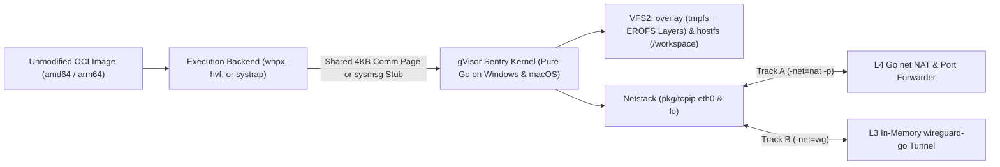

# `gvx`

`gvx` ports the gVisor user-space Linux kernel to Windows, macOS, and Linux on `amd64` and `arm64`. It runs Linux ELF64 programs and OCI images without booting a Linux kernel. Windows uses an AppContainer for Sentry and a separate broker for WHPX and permitted sockets. macOS and Linux retain their existing host containment. `rungv` and `pkg/gvx` require no administrator or `root` privileges.

---

## 1. Architecture and Capability Overview

Running Linux binaries or container images on Windows and macOS usually forces a heavy compromise. WSL2, Docker Desktop, and Apple `Virtualization.framework` boot a full Linux virtual machine that consumes hundreds of megabytes of RAM and requires background virtualization daemons. QEMU emulates an entire motherboard and CPU in software.

`gvx` takes a direct user-space approach. About 65% of upstream `google/gvisor` (`pkg/sentry/kernel`, `pkg/sentry/arch`, `pkg/ring0`, `pkg/sentry/vfs`, `pkg/sentry/fsimpl/{erofs,overlay,tmpfs}`, and `pkg/tcpip`) is OS-agnostic Go code supporting both `amd64` and `arm64`. `tools/upstream` expands those build constraints to `linux || windows || darwin` automatically. Thin host packages bind to Windows (`WinHvPlatform.dll`, `WaitOnAddress`, `MapViewOfFile3`) and macOS (`Hypervisor.framework`, `__ulock_wait`, `mach_vm_remap`) primitives.

| Runtime Model | Host Targets | Cold Start | Memory Overhead | Admin / `sudo` Required | 4KB `mmap(MAP_FIXED)` | Direct OCI Image Run |
| :--- | :--- | ---: | ---: | :--- | :--- | :--- |
| **`gvx` / `rungv` (`whpx` / `hvf`)** | Windows & macOS (`amd64`, `arm64`) | `~20 ms` | `~30 MiB` | No (AppContainer / Seatbelt) | Hardware 4KB EPT / Stage-1 MMU | Yes (In-Memory Tar-to-EROFS) |
| **`gvx` / `rungv` (`systrap` Engine, M5)** | macOS `arm64` (`pagesize_16k` build); Windows ARM64; trusted Windows AMD64 | `~180 ms` | `~31 MiB` (Sentry only) | No (Seatbelt or AppContainer) | Native stub tasks | Yes (In-Memory Tar-to-EROFS) |
| **WSL2 / Docker Desktop** | Windows & macOS | `800-2500 ms` | `> 512 MiB` | Yes (VM Daemon / Services) | Guest Linux Kernel MMU | Requires VM Daemon |
| **QEMU (`tcg` Full System)** | Windows & macOS | `1500-4000 ms` | `> 256 MiB` | No | SoftMMU Emulation | Requires Disk Image Build |

The `gvx` rows come from `rungv run` on an Apple M1 with macOS 26 and the cached `busybox:1.36.1-musl` image. The registry was offline. A reachable registry adds about one second for the tag check. These timings describe `darwin/arm64` only. Native `windows/arm64` tests also verify WHPX with static and dynamic ELF files and the M2 and M3 image gates.



---

## 2. Quickstart (Procedural Module)

Run an unmodified OCI image or ELF binary from the CLI via `cmd/rungv`, or embed a sandbox in Go via `pkg/gvx`.

### 2.1 CLI Execution on Windows and macOS (`cmd/rungv`)

Use these steps to compile `rungv` and run an unmodified OCI image on Windows or macOS:

> [!IMPORTANT]
> On Windows, enable the "Windows Hypervisor Platform" feature for `whpx`. On Linux, build with `CGO_ENABLED=0`. The upstream systrap platform hangs in a cgo build. On macOS, sign the binary with the `com.apple.security.hypervisor` entitlement (`entitlements.plist`) for `hvf`. The `systrap` backend on macOS `arm64` needs the build tag `pagesize_16k`.

1. Build `rungv` with the standard Go 1.25+ toolchain (and apply ad-hoc signing on macOS for `hvf`).
2. Run an unmodified OCI image (`nginx:alpine`) with `-p 8080:80` port forwarding and `-net=nat` networking.
3. Pass `-net=wg` with a WireGuard configuration file when strict L3 host LAN isolation is required.
4. Select the guest architecture with `-arch`. The hardware backends accept only the host architecture.
5. Run `rungv stub` to probe the `systrap` engine. The command exits with status 1 and prints the typed error when the engine is unavailable.
6. Use the Docker flags `-e`, `-u`, `-v`, `-m`, `--cpus`, `-P`, `--read-only`, and `--tmpfs`, and the image commands `pull`, `images`, `inspect`, `tag`, `rmi`, `save`, `load`, `login`, and `logout`. The reference [`docs/cli.md`](docs/cli.md) lists every flag and every difference from Docker.

```bash
# Build on macOS (Apple Silicon arm64 or Intel amd64) and apply free ad-hoc hypervisor signature
go build -o rungv ./cmd/rungv
codesign --sign - --entitlements entitlements.plist --force ./rungv

# Or build on Windows (amd64 or arm64)
go build -o rungv.exe ./cmd/rungv

# Or build on Linux (amd64 or arm64); the guest runs on the upstream systrap platform
CGO_ENABLED=0 go build -o rungv ./cmd/rungv

# Track A: Zero-config L4 NAT mode with -p port forwarding and OCI Tar-to-EROFS caching
./rungv run -net=nat -p=8080:80 -image=nginx:alpine -workspace=./my-project

# Track B: Cryptographic L3 WireGuard mode (zero host LAN access, no WinTun.dll or /dev/tun required)
./rungv run -net=wg -wg-conf=./sandbox-wg.conf -image=python:3.12-alpine -workspace=./my-project \
  -- python3 -c "import urllib.request; print(urllib.request.urlopen('https://example.com').status)"

# systrap engine on macOS arm64 (needs the pagesize_16k build tag)
go build -tags pagesize_16k -o rungv ./cmd/rungv
codesign --sign - --entitlements entitlements.plist --force ./rungv
./rungv stub
./rungv run -platform=systrap -image=alpine:3.20 -- uname -m
```

`rungv run` confines Sentry before guest entry. Windows starts an AppContainer worker and keeps the caller outside its restrictions. Pass `-lockdown=false` only for debugging. The command then prints a warning.

### 2.2 Embeddable Go SDK (`pkg/gvx`)

Use `NewProcess` on Windows and `New` on macOS or Linux. Windows `New` returns `ErrProcessIsolationRequired` unless `DisableHostLockdown` is true. `NewProcess` starts a worker without changing the caller's token. Supply a self-contained worker executable that calls `ServeProcess`.

> [!CAUTION]
> Defer `Close` after either constructor succeeds.
> Call `Close` before the host program exits.

1. Construct `gvx.Config` with the image, network mode, and workspace.
2. Use `gvx.NewProcess` on Windows.
3. Add a worker entry point that calls `gvx.ServeProcess`.
4. Use `gvx.New` on macOS or Linux.
5. Call `Run` with a cancellation context.

```go
package main

import (
    "context"
    "fmt"
    "os"
    "runtime"

    "z.gfire.dev/gvx/pkg/gvx"
)

func main() {
    if len(os.Args) == 2 && os.Args[1] == "--gvx-worker" {
        if err := gvx.ServeProcess(context.Background(), gvx.WorkerOptions{}); err != nil {
            fmt.Fprintln(os.Stderr, err)
            os.Exit(1)
        }
        return
    }
    os.Exit(run())
}

func run() (code int) {
    ctx := context.Background()
    cfg := gvx.Config{
        NetworkMode: gvx.NetModeNAT,
        OCIImage:    "alpine:3.20",
        Argv:        []string{"/bin/uname", "-m"},
        Stdout:      os.Stdout,
        Stderr:      os.Stderr,
    }
    var sandbox interface {
        Run(context.Context) (int, error)
        Close() error
    }
    var err error
    if runtime.GOOS == "windows" {
        executable, pathErr := os.Executable()
        if pathErr != nil {
            fmt.Fprintln(os.Stderr, pathErr)
            return 1
        }
        sandbox, err = gvx.NewProcess(ctx, gvx.WorkerCommand{
            Executable: executable,
            Arguments:  []string{"--gvx-worker"},
        }, cfg)
    } else {
        sandbox, err = gvx.New(ctx, cfg)
    }
    if err != nil {
        fmt.Fprintln(os.Stderr, err)
        return 1
    }
    defer func() {
        if err := sandbox.Close(); err != nil {
            fmt.Fprintln(os.Stderr, err)
            code = 1
        }
    }()
    code, err = sandbox.Run(ctx)
    if err != nil {
        fmt.Fprintln(os.Stderr, err)
        return 1
    }
    return code
}
```

`NewProcess` accepts an optional `*os.File` for stdin. It forwards console input through the broker and copies output to the supplied writers. The caller owns these streams. `Close` cancels pending operations and removes the worker profile and its workspace entries.

---

## 3. Core Mechanics and Invariants (Descriptive Module)

`gvx` resolves six architectural differences between Linux, Windows, and macOS: 4KB vs. 64KB/16KB virtual memory alignment, system call interception latency, dual-track user-space networking, NTFS/APFS-safe OCI image execution, POSIX filesystem semantics, and unprivileged process lockdown.

### 3.1 Hardware and `systrap` Execution Backends (`whpx`, `hvf`, and `systrap`)

Windows enforces a 64KB alignment granularity on `VirtualAlloc(..., MEM_RESERVE, ...)`, while Apple Silicon macOS enforces a 16KB host page size (`vm_page_size = 16384`). Linux ELF loaders require 4KB alignment for `mmap(MAP_FIXED)`. The hardware backends keep 4KB guest pages. The `systrap` backend on macOS `arm64` cannot, so it needs 16KB guest pages.

`pkg/sentry/platform/whpx` (Windows `amd64`/`arm64`) and `pkg/sentry/platform/hvf` (macOS `arm64`/`amd64`) map guest pages from `pgalloc.MemoryFile` through `WHvMapGpaRange` and `hv_vm_map`. The EROFS image uses a read-only file descriptor, and `hv_vm_map` rejects it. `hvf` copies those pages into immutable slab pages. Stage-1 4KB translation granules (`arm64`) and Extended Page Tables (`amd64`) enforce `R/W/X` at 4KB boundaries.

Go generators emit the guest stubs for the Ring-0/EL1 vector and the fast-path syscall exit (`bluepill_*.go` in `hvf`, `stubgen_*.go` in `whpx`). `arch.Context64` holds the general and FP registers, and every `Switch` loads and stores them. `Hypervisor.framework` ties a vCPU to its host thread, so `hvf` runs each vCPU on a dedicated locked worker thread. Native tests execute `hvf` on `darwin/arm64` and `whpx` on `windows/arm64`. CI verifies `windows/amd64` where WHPX is available. `hvf` on `darwin/amd64` is compile-checked only.

ARM64 WHPX needs GICv3 configuration before partition setup and a redistributor address for each vCPU. Secondary vCPUs need their `StartupSuspend` bit cleared. The stub uses `HVC #1`, because Hyper-V consumes `HVC #0` through its own hypercall interface.

Direct WHPX sandboxes can map one partition per source process. `NewProcess` gives each sandbox a separate source process. NTFS still rejects directory renames while a descendant remains open.

`pkg/sentry/platform/systrap` (Fallback, Milestone M5) runs guest code natively in forked stub tasks. The Sentry shares `sysmsg` memory with each stub through `mach_vm_remap` and hands control over with `__ulock_wait`. A lazy page-trap patcher rewrites `svc #0` to a branch into a trampoline slot. It also rewrites `TPIDR_EL0`, `CTR_EL0`, and `x18` accesses inside ELF code sections. The Seatbelt profile of each stub denies every host system call that the stub does not need, so an unpatched `svc` kills the stub.

`systrap` runs on macOS ARM64 and Windows. The macOS engine needs `-tags pagesize_16k`. Without that tag, `systrap.New()` returns `*ErrUnsupportedPageSize`. It starts guest addresses above permanent host reservations. It cannot load an `ET_EXEC` image because ARM64 tasks reserve a 4GB `PAGEZERO`. `hvf` supports those images.

Windows systrap needs no hypervisor. It reserves a high window above 16 TiB and a low window from `0x10000` to `0x7FFE0000`. The low window supports `ET_EXEC` images at their linked addresses. Windows ARM64 seals native syscall instructions and confines Sentry and stubs in separate AppContainers. Windows AMD64 requires `-lockdown=false` and trusted guests. [`docs/systrap-windows.md`](docs/systrap-windows.md) defines these boundaries.

The project dropped the Rosetta 2 engine on macOS AMD64. A syscall-number Seatbelt filter on a translated task panicked the host kernel. Windows `-platform=auto` can select ARM64 systrap when WHPX is unavailable. `gvx` contains no instruction interpreter or guest JIT.

### 3.2 Dual-Track Netstack and Port Forwarding (`pkg/netbackend`)

Guest applications (`nginx`, `postgres`, `git`, `curl`, `omp`, `herdr`) invoke `socket()`, `connect()`, `bind()`, and `epoll_wait()` against gVisor's pure-Go `pkg/tcpip` (Netstack). Netstack implements a complete Linux `eth0` and `lo` TCP/UDP stack in memory. `pkg/netbackend` runs identically on Windows and macOS using two selectable modes.

In Track A (`-net=nat`, default), `tcp.NewForwarder` and `udp.NewForwarder` dial outbound streams through Go's `net.DialContext` (backed by Windows IOCP and macOS `kqueue`). Outbound connections to `10.0.2.2` (`host.docker.internal`) route to the host's `127.0.0.1`, while inbound `-p hostPort:guestPort` listeners forward host traffic into Netstack via `gonet.DialTCP`. Callers can attach host-side L4/L7 proxies for LLM API key injection or pass `-isolate-lan` when untrusted workloads require RFC1918 blocking.

In Track B (`-net=wg`), a Netstack `channel.Endpoint` pipes raw L3 IP packets directly in memory into `golang.zx2c4.com/wireguard/device` without `WinTun.dll` or `/dev/tun`. `wireguard-go` encrypts every packet in memory and transmits it through one pre-opened host UDP socket, physically blocking all access to the host LAN.

### 3.3 Unmodified Multi-Arch OCI Image Runner (`pkg/oci`)

Extracting Linux `.tar.gz` layers onto NTFS or APFS breaks case-sensitive files, fails on reserved names (`CON`, `AUX`, `NUL`, `:`), and loses POSIX modes and symlinks. `pkg/oci` resolves the `linux/amd64` or `linux/arm64` manifest and streams image layers in memory through `tar2erofs.go`. It writes content-addressed `<layer-sha256>.gvx-erofs-v3-b<block>.erofs` files into the host cache directory. `<block>` is the EROFS block size, which equals `hostarch.PageSize` (4096 by default, 16384 with `pagesize_16k`).

The runner verifies every layer digest and manifest digest. `github.com/klauspost/compress/zstd` decodes zstd layers under bounded window and output limits. Whiteouts become overlay whiteout nodes, and opaque directories carry the `trusted.overlay.opaque` xattr. At boot, Sentry's pure-Go `fsimpl/overlay` mounts those read-only `.erofs` files as lower layers and mounts `fsimpl/tmpfs` as the writable upper layer. Docker credential helpers and `xz` or `bzip2` layers are not supported.

### 3.4 Anti-TOCTOU Host Mounts (`pkg/sentry/fsimpl/hostfs`)

Instead of running an external file-server process (`lisafs`), `fsimpl/hostfs` mounts the host `/workspace` directory directly inside Sentry VFS2. `hostfs` anchors `/workspace` using Go 1.25+ `os.OpenRoot(hostWorkspacePath)` backed by `NtCreateFile` (`FILE_OPEN_REPARSE_POINT` on Windows) and `openat` (`O_NOFOLLOW | O_SYMLINK` on macOS).

On Windows, every open call sets `FILE_SHARE_READ | FILE_SHARE_WRITE | FILE_SHARE_DELETE` and executes atomic renames on open files via `SetFileInformationByHandle(FileRenameInfoEx)` with `FILE_RENAME_FLAG_POSIX_SEMANTICS`. On macOS, `hostfs` uses native `renameat` and `unlinkat`. On both platforms, an in-memory xattr table stores POSIX mode bits (`0755`), `uid/gid`, and intra-workspace symlinks, persisting them atomically to `.gvx_meta`.

### 3.5 Unprivileged Self-Lockdown (`pkg/hostlockdown`)

`rungv` enables host containment by default. On Windows, `NewProcess` prepares OCI layers and starts Sentry inside an AppContainer without network capabilities. The broker opens WHPX and maps worker pages through `WHvMapGpaRange2`. For ARM64 systrap, it creates separate AppContainer stubs and needs no hypervisor. The worker token restricts existing and new Go threads.

The broker supplies NAT sockets, declared port forwarders, and the single WireGuard socket. It denies every network operation in `none` mode. NAT enforces `IsolateLAN` in the broker. WireGuard pins both the peer address and port. The worker cannot open a direct host connection in any mode.

The worker removes privileges, retains Low integrity, disables win32k calls, and belongs to a job with an active process limit of one. Windows still permits AppContainer system resources and private profile storage. Workspace access uses its package SID. `Close` removes that SID from workspace entries.

The legacy Windows `hostlockdown.Apply` path restricts only threads that call `BindThread`. It reports `BoundThreadFileOpenBlocked`, while `UnboundFileOpenBlocked` stays false. The SDK rejects this partial boundary by default. `DisableHostLockdown` retains the explicit debugging path.

On macOS (`lockdown_darwin.go`), it sets `RLIMIT_NPROC = 0` and activates a `(deny default)` Seatbelt profile through `sandbox_init`. The profile denies process creation and new host file opens. After `Apply`, `getaddrinfo` and reads of `/etc/resolv.conf` fail, so `pkg/netbackend` reads the DNS resolvers before the lockdown.

On Linux (`lockdown_linux.go` and `pkg/gvx/syscallfilter_linux.go`), it installs the seccomp allowlist of the gVisor Sentry on every thread. A call outside the allowlist kills the process. The calls `execve`, `clone`, `openat`, and `socket` return `EPERM` instead, so that code in the embedding process sees an error. Seccomp reads no path. With a workspace, an `openat` relative to a directory descriptor can still open an absolute path, and `UnboundFileOpenBlocked` reports false. gVisor closes this gap with a mount namespace and `chroot`, which a library cannot create without privilege. Build with `CGO_ENABLED=0`. The upstream `systrap` platform hangs at startup in a cgo build, and `New` returns `ErrPlatformUnavailable`.

### 3.6 Upstream Tracking and Three-Tier Isolation

`gvx` tracks the `go` branch of `https://github.com/google/gvisor.git` (`upstream/go`) and pins the synced commit SHA in `UPSTREAM_COMMIT`. All Windows and macOS packages live either in dedicated directories (`cmd/rungv`, `pkg/gvx`, `pkg/oci`, `pkg/netbackend`, `pkg/sentry/platform/{whpx,hvf}`, `pkg/sentry/fsimpl/hostfs`, `pkg/hostlockdown`) or in `*_{windows,darwin,xplat}*` sibling files (`pkg/sentry/platform/systrap`).

`tools/upstream` widens `//go:build linux` tags on allowlisted Sentry files after each `git merge upstream/go`, and it fences Linux-only files from the new targets. `-mode=audit` compares the tree with the pinned upstream archive and checks the SPEC import boundaries.

The audit charges 22 of 2485 upstream files (0.89%) against the `< 5.0%` ceiling. It reports 604 Linux fences separately. Counted together with the fences, the modified share is 25%, so the strict reading of the ceiling is not met.

---

## 4. Documentation Index

Read the architecture plan and agent operating manual before modifying any package.

| Document | Audience | Scope Description |
| :--- | :--- | :--- |
| [`docs/architecture.md`](docs/architecture.md) | Engineers & AI Agents | Subsystem design, Windows/macOS `amd64`/`arm64` specs, upstream sync pipeline, and M1-M5 milestones. |
| [`docs/cli.md`](docs/cli.md) | Users & Engineers | Every `rungv` command, every flag of `rungv run`, the run rules, and the differences from Docker. |
| [`AGENTS.md`](AGENTS.md) | AI Coding Agents & Reviewers | Mandatory startup protocol, ASD-STE100 rules, package import boundaries, and verification gates. |

---

## 5. Build, Upstream Sync, and Verification (Procedural Module)

`gvx` builds with the standard Go 1.25+ toolchain (`go build` and `go test`) across Windows and macOS without requiring Bazel.

### 5.1 Build and Verification Steps

1. Cross-compile all packages across the four Priority-0 targets (`windows/amd64`, `windows/arm64`, `darwin/arm64`, `darwin/amd64`).
2. Run the unit test suite with the signing wrapper. The wrapper gives test binaries the `hvf` entitlement.
3. Audit the upstream diff against `UPSTREAM_COMMIT` to verify the `< 5.0%` modification ceiling.

```bash
# Compile across all four Priority-0 targets
GOOS=windows GOARCH=amd64 go build ./...
GOOS=windows GOARCH=arm64 go build ./...
GOOS=darwin  GOARCH=arm64 go build ./...
GOOS=darwin  GOARCH=amd64 go build ./...

# Run the tests and the upstream diff audit
go test -race -exec "$PWD/scripts/codesign-exec.sh" ./...
go run ./tools/upstream -mode=audit -max-ratio=0.05

# Run the systrap engine tests on macOS arm64
go test -race -tags pagesize_16k -exec "$PWD/scripts/codesign-exec.sh" ./pkg/sentry/platform/systrap/...
```

GitHub Actions verifies every change. The workflow `ci.yml` builds and vets all six targets, audits the upstream diff, and tests `linux/amd64`, `linux/arm64`, `darwin/arm64`, and `windows/amd64`. A hosted macOS runner has no hypervisor, so it runs the `systrap` suites with `-tags pagesize_16k`. The workflow `e2e-images.yml` pulls real images once a week.

### 5.2 Implementation Roadmap (`M1` to `M5`)

This table maps each implementation milestone to its deliverables and verification gate across Windows and macOS.

| Phase | Milestone | Target Workload and Verification Gate |
| :--- | :--- | :--- |
| **M1** | **Host Primitives & Pure-Go Sentry Compile** | `pkg/sync`, `pkg/memutil`, `pkg/fd`, `pgalloc`, `time`, `hostcpu`, `tools/upstream`, and `pkg/sentry/kernel` compile on `windows/{amd64,arm64}` and `darwin/{arm64,amd64}`. |
| **M2** | **WHPX & HVF Engines & Static ELF Execution** | Boot static `busybox` (`PID 1`) via `platform/whpx` (Windows) and `platform/hvf` (macOS) on `amd64` and `arm64` and reach an interactive `busybox ash` prompt. |
| **M3** | **Dynamic Linking, Dual-Track Netstack & OCI Runner** | Implement `clone`, `futex`, signals, TLS (`ARCH_SET_FS` & `TPIDR_EL0`), VDSO, `pkg/netbackend` (`-net=nat -p` & `-net=wg`), and `pkg/oci`. Boot `alpine:3.20` and `nginx:alpine`. |
| **M4** | **`hostfs` VFS2 Driver & Self-Lockdown** | Pass POSIX rename and unlink tests (`git rebase`, `bun install`) on `/workspace` and verify `pkg/hostlockdown` blocks child process spawning on Windows and macOS. |
| **M5** | **Unified `systrap` Fallback Engine (`darwinsystrap` and `winsystrap`)** | macOS: lazy page-trap `arm64asm` syscall patcher, trampoline islands, and `sysmsg` stub subprocesses. Windows: stub host, debug object, placeholder window, and the `x86asm` and `brk` patchers. Status: macOS `arm64` runs real guests and needs `pagesize_16k`. Windows `amd64` and `arm64` run real guests. The Rosetta 2 and Prism cross-arch engines are dropped. |

---

## License

`gvx` is licensed under the Apache License, Version 2.0. See [`LICENSE`](LICENSE) for the full license text.
