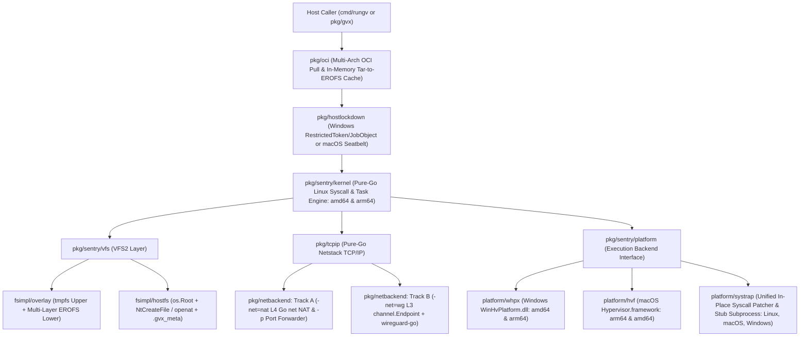
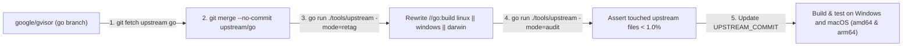
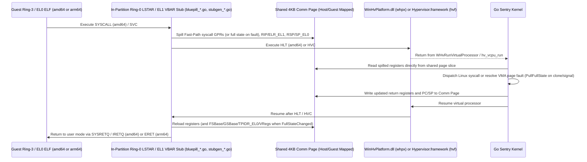
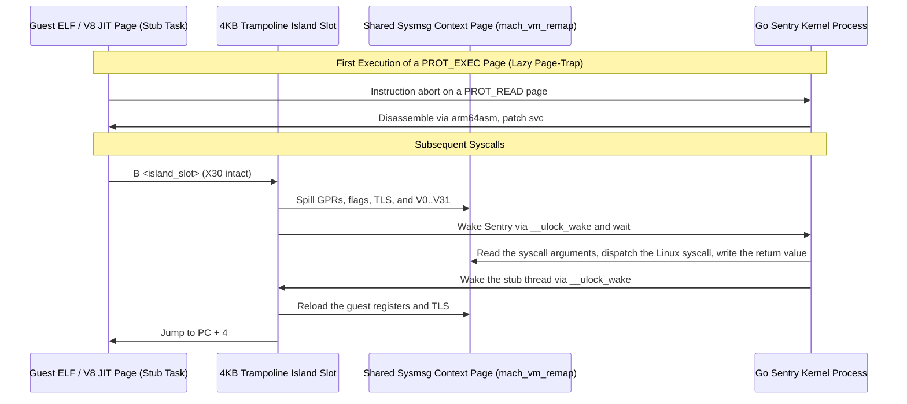
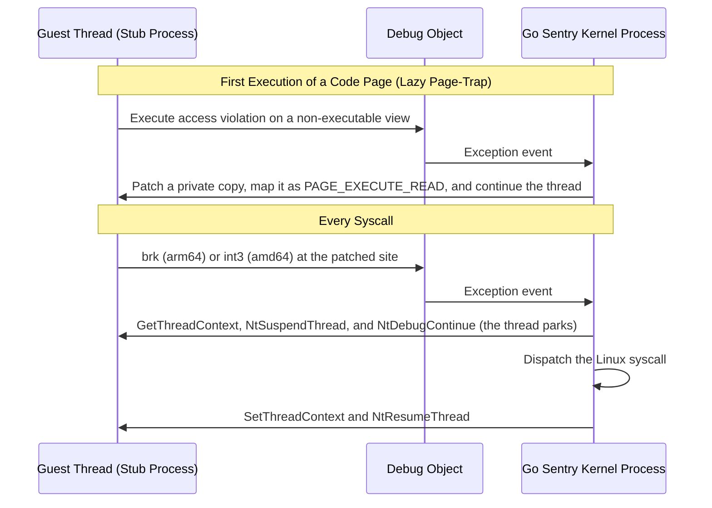
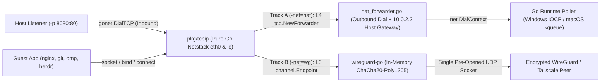
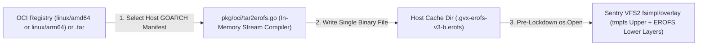
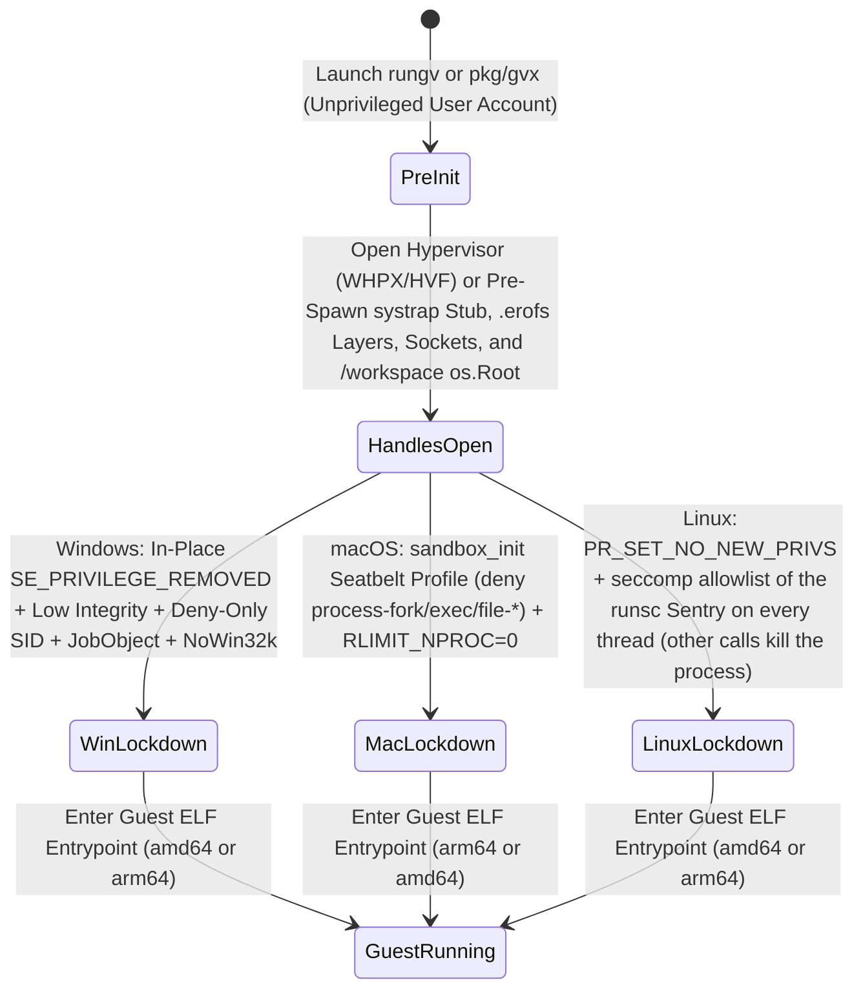

# `gvx` Architecture and Implementation Plan

`gvx` is an upstream-trackable fork of `google/gvisor` that ports the Sentry kernel to Windows (`windows/amd64`, `windows/arm64`) and macOS (`darwin/arm64`, `darwin/amd64`) as Priority-0 targets. Without booting a virtual machine, `gvx` runs Linux ELF64 binaries and OCI images inside an unprivileged sandbox via `cmd/rungv` or `pkg/gvx`. The runtime intercepts Linux system calls in Go and translates them into native Windows NT, macOS XNU, Go `net`, and user-mode hypervisor or `systrap` calls.

---

## 1. Executive Summary and Architectural Scope

This section defines the Priority-0 target matrix, execution backends, networking modes, OCI image pipeline, and upstream isolation rules for `gvx`. Every subsystem implementation must satisfy these baseline contracts before merging.

| Design Objective | Engineering Contract | Verification Boundary |
| :--- | :--- | :--- |
| **Priority-0 Dual-OS & Dual-Arch** | Targets `windows/amd64`, `windows/arm64`, `darwin/arm64`, and `darwin/amd64` from one codebase. | Compiles and runs native `linux/amd64` and `linux/arm64` ELF64 workloads on Windows and macOS. |
| **Zero Runtime Elevation** | Runs under a standard user account and locks down the host process before guest entry. | Requires no UAC prompts, no `sudo`/`root`, no kernel drivers/kexts, and no background daemons. |
| **Hardware 4KB Paging (`whpx` & `hvf`)** | Uses `WinHvPlatform.dll` (Windows) and `Hypervisor.framework` (macOS) with 4KB EPT and Stage-1/Stage-2 tables. | Bypasses the Windows 64KB `VirtualAlloc` limit and the Apple Silicon 16KB host page limit. |
| **Unified `systrap` Fallback (`systrap`)** | Exposes `pkg/sentry/platform/systrap` on Linux (upstream) and macOS `arm64` (`darwinsystrap`) using lazy in-place syscall patching and pre-spawned stub subprocesses. Windows (`winsystrap`) runs stub processes that a debug object controls. | Executes ELF64 binaries and JIT runtimes (V8) when hardware virtualization is disabled. The guest architecture must equal the host architecture. |
| **Dual-Track Netstack (`pkg/netbackend`)** | Connects `pkg/tcpip` to an L4 Go `net` NAT and port forwarder (`-net=nat -p`) or an L3 `wireguard-go` tunnel (`-net=wg`). | Supports inbound/outbound port forwarding (`-p`) and `host.docker.internal`, or cryptographic L3 isolation. |
| **Direct OCI Image Execution (`pkg/oci`)** | Streams OCI `.tar.gz`/`.tar.zst` layers in memory into cached `<sha256>.erofs` images mounted via `fsimpl/overlay`. | Runs unmodified multi-arch Docker/OCI images without extracting Linux files onto NTFS or APFS. |
| **Clean Upstream Boundary** | Isolates host logic behind `_windows.go` and `_darwin.go` files and platform interfaces. | Requires a charged upstream diff below 0.7% under Section 2.2 audit rules and Go 1.25+ builds without Bazel. |



### 1.1 Compatibility Matrix and Cross-Architecture Execution (Descriptive Module)

`gvx` pairs hardware virtualization (`whpx` and `hvf`) as the default Tier-1 engine with the `systrap` backend as the user-mode fallback. Linux uses the upstream gVisor platforms.

The `systrap` fallback runs on macOS `arm64` only, and it needs 16KB guest pages (`-tags pagesize_16k`). Windows `systrap` needs a C toolchain with a COFF linker for the stub. The project dropped the Rosetta 2 engine for `darwin/amd64`. A syscall-number Seatbelt filter on a translated process panicked the host kernel. A stub without that filter would let a guest issue host system calls. The guest architecture must equal the host architecture on every backend.

| Host Target | Primary Engine (`whpx` / `hvf`) | Fallback Engine (`systrap`) | Host Page & Allocation Granularity | Platform Requirements & Status |
| :--- | :--- | :--- | :--- | :--- |
| **`windows/amd64`** (Intel / AMD) | `platform/whpx` (`WinHvPlatform.dll` 4KB EPT) | `platform/systrap` (`winsystrap`: debug-object stops, `CC 90` syscall patch). | 4KB Page / 64KB `VirtualAlloc` Reserve | Windows 10 (2004+) and Windows 11 with the Windows Hypervisor Platform feature. Runs `linux/amd64` images. |
| **`windows/arm64`** (Snapdragon X) | `platform/whpx` (`Arm64Support` 4KB Stage-2) | `platform/systrap` (`winsystrap`: debug-object stops, `brk` patch). Runs on hosts without WHP. | 4KB Page / 64KB `VirtualAlloc` Reserve | Windows 11 24H2 (Build `26100.3915+`) required for ARM64 WHPX. Runs `linux/arm64` images. |
| **`darwin/arm64`** (Apple Silicon M1-M5) | `platform/hvf` (`Hypervisor.framework` Stage-1 4KB + Stage-2 16KB) | `platform/systrap` (`darwinsystrap`: 4B `B` Island Patch + `sys_icache_invalidate`), built with `-tags pagesize_16k`. | 16KB Host Page / 16KB Map Granularity | Entitlement `com.apple.security.hypervisor` for `hvf`. Runs `linux/arm64` images. |
| **`darwin/amd64`** (Intel Mac) | `platform/hvf` (`Hypervisor.framework` VT-x 4KB EPT) | Dropped. | 4KB Page / 4KB Map Granularity | Runs `linux/amd64` images on `hvf`. |
| **`linux/amd64`** | Upstream platforms (`kvm`, `systrap`). | Upstream `systrap`. | 4KB Page | CI builds and tests the packages that `gvx` owns. |
| **`linux/arm64`** | Upstream platforms (`kvm`, `systrap`). | Upstream `systrap`. | 4KB Page (host dependent) | CI builds and tests the packages that `gvx` owns. |

---

## 2. Repository Layout and Upstream Synchronization Architecture

`gvx` tracks the pre-generated `go` branch of `https://github.com/google/gvisor.git` (`upstream/go`). Upstream publishes `go_stateify` and `go_marshal` output for both `amd64` and `arm64` directly to `upstream/go`, so `gvx` compiles with `go build` without Bazel.

```text
gvx/ (Fork of google/gvisor@go)
 ├── AGENTS.md                              # [NEW] Mandatory agent instructions and ASD-STE100 gates
 ├── README.md                              # [NEW] Project overview, quickstart, and build guide
 ├── UPSTREAM_COMMIT                        # [NEW] Pinned commit SHA from google/gvisor (go branch)
 ├── entitlements.plist                     # [NEW] com.apple.security.hypervisor entitlement for hvf
 ├── .github/workflows/                     # [NEW] ci.yml (every push) and e2e-images.yml (weekly registry gates)
 ├── docs/
 │   └── architecture.md                    # [NEW] Authoritative architecture and milestone plan
 ├── scripts/                               # [NEW] codesign-exec.sh (signs test binaries) and sync-upstream.sh
 ├── third_party/
 │   └── x_sys/                             # [NEW] golang.org/x/sys with Darwin and Windows additions (go.mod replace)
 ├── tools/
 │   ├── shiminterop/                       # [NEW] Isolated SDK smoke tests
 │   └── upstream/                          # [NEW] Upstream sync, diff audit, import boundaries, and build-tag rewriter
 │       ├── main.go
 │       ├── patches.go
 │       ├── buildtag_allowlist.txt
 │       ├── boundaries.go
 │       ├── compare.go
 │       ├── sync.go
 │       └── diff_audit.go
 ├── cmd/
 │   ├── containerd-shim-gvx-v2/             # [NEW] Optional containerd control command
 │   │   └── main.go
 │   └── rungv/                             # [NEW] Standalone CLI runner (run, pull, stub)
 │       └── main.go
 ├── internal/                              # [NEW] gvxshim control adapter and test fixtures
 ├── pkg/
 │   ├── gvx/                               # [NEW] Embeddable Go library API for host tools
 │   │   ├── sandbox.go
 │   │   ├── config.go
 │   │   ├── image.go
 │   │   ├── kernel_runner.go
 │   │   ├── stdio_device.go
 │   │   └── platform_systrap_{native,other}.go
 │   ├── oci/                               # [NEW] Multi-arch OCI puller and Tar-to-EROFS compiler
 │   │   ├── pull.go
 │   │   ├── tar2erofs.go
 │   │   ├── erofs_layout.go
 │   │   └── cache.go
 │   ├── netbackend/                        # [NEW] Dual-track Netstack egress & port forwarder
 │   │   ├── nat_forwarder.go
 │   │   ├── port_forwarder.go
 │   │   ├── dns_relay.go
 │   │   ├── wireguard_endpoint.go
 │   │   ├── wireguard_tun.go
 │   │   └── wireguard_bind.go
 │   ├── hostarch/
 │   │   └── hostarch_darwin_arm64_16k.go   # [NEW] Opt-in 16KB page size (-tags pagesize_16k) for the macOS systrap engine
 │   ├── sync/
 │   │   ├── futex_linux.go                 # [NEW] Linux SYS_FUTEX implementation
 │   │   ├── futex_windows.go               # [NEW] WaitOnAddress / WakeByAddressSingle bindings
 │   │   └── futex_darwin.go                # [NEW] XNU __ulock_wait / __ulock_wake bindings
 │   ├── memutil/
 │   │   ├── memfd_linux_unsafe.go          # Unmodified upstream memfd_create / mmap wrappers
 │   │   ├── memutil_windows.go             # [NEW] CreateFileMappingW + MapViewOfFile3 wrappers
 │   │   └── memutil_darwin.go              # [NEW] mmap(MAP_ANON) + mach_vm_remap wrappers
 │   ├── fd/
 │   │   ├── fd_windows.go                  # [NEW] Unified HostHandle wrapping Win32 HANDLE
 │   │   └── fd_darwin.go                   # [NEW] Unified HostHandle wrapping Darwin FD
 │   ├── hostlockdown/
 │   │   ├── lockdown_windows.go            # [NEW] RestrictedToken, Low Integrity, JobObject, Win32k block
 │   │   ├── lockdown_darwin.go             # [NEW] Seatbelt sandbox_init SBPL profile & RLIMIT_NPROC=0
 │   │   └── lockdown_other.go              # [NEW] Returns ErrUnsupported on other hosts
 │   └── sentry/
 │       ├── hostcpu/
 │       │   ├── hostcpu_windows.go         # [NEW] GetCurrentProcessorNumber binding
 │       │   └── hostcpu_darwin.go          # [NEW] Darwin CPU number binding
 │       ├── time/
 │       │   ├── calibrated_clock_windows.go # [NEW] QueryPerformanceCounter clock calibration
 │       │   └── calibrated_clock_darwin.go  # [NEW] mach_continuous_time clock calibration
 │       ├── pgalloc/
 │       │   ├── memory_file_windows.go     # [NEW] DiscardVirtualMemory / MEM_RESET page reclaim
 │       │   └── memory_file_darwin.go      # [NEW] madvise(MADV_FREE) page reclaim
 │       ├── platform/
 │       │   ├── whpx/                      # [NEW] Windows Hypervisor Platform backend (amd64 & arm64)
 │       │   │   ├── whpx.go
 │       │   │   ├── address_space.go
 │       │   │   ├── vcpu_amd64.go
 │       │   │   ├── vcpu_arm64.go
 │       │   │   ├── stubgen_x86.go         # Go generator for the in-partition amd64 stub
 │       │   │   └── stubgen_a64.go         # Go generator for the in-partition arm64 stub
 │       │   ├── hvf/                       # [NEW] macOS Hypervisor.framework backend (arm64 & amd64)
 │       │   │   ├── hvf.go
 │       │   │   ├── address_space.go
 │       │   │   ├── vcpu_darwin_arm64.go
 │       │   │   ├── vcpu_darwin_amd64.go
 │       │   │   ├── bluepill_arm64.go      # Go generator for the in-guest EL1 stub
 │       │   │   └── bluepill_x86.go        # Go generator for the in-guest Ring-0 stub
 │       │   ├── hvcommon/                  # [NEW] Encoders, descriptors, and EL1 values that whpx and hvf share
 │       │   │   ├── a64.go                 # AArch64 encoders and EL1 constants
 │       │   │   └── x86.go                 # x86-64 selectors, GDT, TSS, IDT gate, and GS opcode emitters
 │       │   └── systrap/                   # Unified systrap backend (Linux upstream + macOS/Windows siblings)
 │       │       ├── systrap.go             # Unmodified upstream Linux systrap implementation
 │       │       ├── systrap_xplat.go       # [NEW] Shared types: ProbeInfo, ErrUnavailable
 │       │       ├── platform_darwin.go     # [NEW] macOS arm64 platform, stub pool, and guest address range
 │       │       ├── address_space_darwin.go # [NEW] mach_vm_remap mappings, page-trap patcher, trampoline islands
 │       │       ├── patcher_arm64_xplat.go # [NEW] Lazy page-trap arm64asm 4B B trampoline island patcher
 │       │       ├── trampoline_darwin_arm64.s
 │       │       ├── platform_windows.go    # [NEW] Windows platform, stub host client, debug object
 │       │       ├── address_space_windows.go # [NEW] 4KB placeholder window, lazy patching, private code pages
 │       │       ├── context_windows.go     # [NEW] Context.Switch over debug-object stops
 │       │       ├── systrap_darwin_amd64.go # [NEW] Returns ErrUnavailable
 │       │       └── stub/                  # [NEW] C and assembly sources and the signed arm64 stub binary
 │       └── fsimpl/
 │           └── hostfs/                    # [NEW] Secure os.Root + .gvx_meta host mount (Windows, macOS, and Linux)
 │               ├── hostfs.go
 │               ├── inode_windows.go
 │               ├── inode_darwin.go
 │               └── posix_rename_windows.go
 └── e2e/                                   # [NEW] Unified OS-agnostic end-to-end test suite
     ├── sandbox_e2e_test.go
     └── gate_*_test.go                     # Milestone gates M2, M3, and M4
```

### 2.1 Layered Subsystem Map and Import Directionality

Each package owns one architectural boundary. Enforce top-down import directionality to keep Windows and macOS host APIs out of the pure-Go Sentry kernel.

| Package | Single Responsibility | Allowed Internal Imports | Forbidden Imports |
| :--- | :--- | :--- | :--- |
| `cmd/containerd-shim-gvx-v2` | Dispatches the optional shim command. | `internal/gvxshim` | `pkg/*`, `runsc/*`, `shim/*` |
| `internal/gvxshim` | Owns bootstrap, local RPC controls, process lifetime, and safe cleanup. | None; public containerd types, ttRPC, protobuf, and host APIs are external dependencies. | `pkg/*`, `runsc/*`, `shim/*`, `cmd/*` |
| `tools/shiminterop` | Exercises real ShimManager `2.1.5` against the compiled shim in an isolated module. | None | Root runtime, command, and internal packages |
| `cmd/rungv` | Parses the Docker-style commands of [`cli.md`](cli.md) (`run`, `pull`, `images`, `inspect`, `tag`, `rmi`, `save`, `load`, `login`, `logout`, `stub`) and starts a sandbox instance. | `pkg/gvx` | `pkg/sentry/*`, `WinHvPlatform.dll` |
| `pkg/gvx` | Coordinates `pkg/oci`, `pkg/netbackend`, `pkg/hostlockdown`, and Sentry boot. | `pkg/oci`, `pkg/netbackend`, `pkg/hostlockdown`, `pkg/sentry/*`, `pkg/fd`, `pkg/tcpip` | `cmd/*`, `internal/gvxshim` |
| `pkg/oci` | Resolves `amd64`/`arm64` OCI manifests and compiles `.tar` layers into `.erofs` files. | `pkg/abi/linux` | `pkg/sentry/kernel`, `pkg/hostlockdown` |
| `pkg/netbackend` | Bridges `pkg/tcpip` to L4 Go `net` forwarders (`nat`) or L3 `wireguard-go` (`wg`). | `pkg/tcpip` | `pkg/sentry/kernel`, `WinHvPlatform.dll` |
| `pkg/hostlockdown` | Locks down the host process via Windows Tokens/JobObjects or macOS Seatbelt. | `golang.org/x/sys/windows`, `golang.org/x/sys/unix` | `pkg/sentry/*`, `pkg/tcpip` |
| `pkg/sentry/kernel` | Dispatches the OS-agnostic Linux task, signal, and syscall table (`amd64` & `arm64`). | `pkg/abi/linux`, `pkg/sentry/platform`, `pkg/sentry/vfs`, `pkg/sync` | `golang.org/x/sys/windows`, `pkg/hostlockdown` |
| `pkg/sentry/platform/whpx` | Executes guest Ring-3/EL0 code on Windows via `WinHvPlatform.dll` and 4KB EPT/Stage-2. | `pkg/sentry/platform`, `pkg/memutil`, `pkg/abi/linux`, `golang.org/x/sys/windows` | `pkg/sentry/kernel`, `pkg/sentry/vfs` |
| `pkg/sentry/platform/hvf` | Executes guest EL0/Ring-3 code on macOS via `Hypervisor.framework` and 4KB Stage-1/Stage-2. | `pkg/sentry/platform`, `pkg/memutil`, `pkg/abi/linux`, `golang.org/x/sys/unix` | `pkg/sentry/kernel`, `pkg/sentry/vfs` |
| `pkg/sentry/platform/systrap` | Executes guest code via in-place syscall patching, `sysmsg` shared memory, and isolated stub subprocesses across Linux, macOS, and Windows. | `pkg/sentry/platform`, `pkg/memutil`, `pkg/abi/linux`, `golang.org/x/arch/*` | `pkg/sentry/kernel`, `pkg/sentry/platform/whpx`, `pkg/sentry/platform/hvf` |
| `pkg/sentry/fsimpl/hostfs` | Mounts host `/workspace` via `os.Root`, `NtCreateFile`/`openat`, and `.gvx_meta`. | `pkg/sentry/vfs`, `pkg/abi/linux`, `pkg/fd`, `golang.org/x/sys/*` | `pkg/sentry/platform/*` |
| `pkg/sync`, `pkg/memutil`, `pkg/fd` | Provide host futexes, shared memory views, and host handles on Windows and macOS. | `golang.org/x/sys/windows`, `golang.org/x/sys/unix` | `pkg/sentry/*` |

`tools/upstream` enforces this table with `boundaries.go`. Sentry foundation packages such as `pkg/context`, `pkg/hostarch`, `pkg/usermem`, and `pkg/sentry/memmap` appear in every platform and VFS interface, so those packages import them. Each other import needs a reason-annotated exception in `boundaries.go`.

### 2.2 Three-Tier Upstream Isolation Model (Descriptive Module)

To prevent merge conflicts during continuous upstream pulls, `gvx` partitions all repository files into three strict isolation tiers.

| Isolation Tier | File Paths | Upstream Conflict Rate | Maintenance Mechanism |
| :--- | :--- | ---: | :--- |
| **Tier 1: Additive Directories** | `cmd/rungv/`, `cmd/containerd-shim-gvx-v2/`, `pkg/gvx/`, `pkg/oci/`, `pkg/netbackend/`, `pkg/hostlockdown/`, `pkg/sentry/platform/whpx/`, `pkg/sentry/platform/hvf/`, `pkg/sentry/platform/hvcommon/`, `pkg/sentry/fsimpl/hostfs/`, `pkg/sentry/fsimpl/ext4lite/`, `e2e/`, `internal/`, `scripts/`, `.github/`, `tools/upstream/`, `tools/shiminterop/`, `docs/` | `0.0%` | Owned exclusively by `gvx`; `upstream/go` never touches these paths. |
| **Tier 2: Sibling `_windows`, `_darwin`, & `_xplat` Files** | `pkg/sync/*_{windows,darwin,xplat}*`, `pkg/memutil/*_{windows,darwin,xplat}*`, `pkg/fd/*_{windows,darwin,xplat}*`, `pkg/{erofs,fdnotifier,syserr}/*_{windows,darwin,xplat}*`, `pkg/hostarch/*_darwin*`, `pkg/sentry/{kernel,mm}/*_xplat*`, `pkg/sentry/{pgalloc,time,hostcpu}/*_{windows,darwin}.go`, `pkg/sentry/platform/*_{windows,darwin,xplat}*`, `pkg/sentry/platform/systrap/*_{windows,darwin,xplat}*` | `0.0%` | Placed alongside unmodified `*_linux.go` files; Go selects the target file by `GOOS` and `GOARCH`. |
| **Tier 3: Build-Tag & Seam Patches** | Pure-Go files listed in `tools/upstream/buildtag_allowlist.txt` and `io_uring` `-ENOSYS` stubs | `< 1.0%` | Re-applied automatically by `tools/upstream` (`//go:build linux \|\| windows \|\| darwin`) after every `git merge upstream/go`. |

The audit charges a file against the 1.0% ceiling only when its content differs from upstream. A file that `gvx` adds inside an upstream directory is free when its name carries the token `windows`, `darwin`, or `xplat`. The audit then counts it as a Tier 2 sibling. It reports build-tag fences on Linux-only trees (`runsc`, `shim`, `pkg/sentry/fsimpl/gofer`) as a third number. A strict count that includes the fences is larger than the charged share, and the audit prints both.



### 2.3 Upstream Diff and Synchronization Procedure (Procedural Module)

Run this procedure to audit the current upstream diff or merge new commits from `google/gvisor`.

> [!WARNING]
> Do not hand-edit `*_linux.go` files or scatter ad-hoc changes across pure-Go Sentry files. Unrecorded edits in Tier 3 files cause merge conflicts during upstream synchronization and violate the 1.0% diff ceiling. Register every build-tag change in `tools/upstream/buildtag_allowlist.txt`.

1. Register the upstream gVisor repository as the `upstream` Git remote.
2. Fetch the latest `go` branch from `upstream`.
3. Inspect the modified upstream file count and verify the `< 1.0%` budget against `UPSTREAM_COMMIT`.
4. Merge `upstream/go` without committing.
5. Run `tools/upstream` in `retag` mode to apply `//go:build linux || windows || darwin` to allowlisted files.
6. Run `tools/upstream` in `audit` mode to assert zero unauthorized edits in `*_linux.go` files.
7. Record the merged `upstream/go` SHA in `UPSTREAM_COMMIT` and verify all four Priority-0 targets and both Linux targets.

```bash
git remote add upstream https://github.com/google/gvisor.git 2>/dev/null || true
git fetch upstream go

# Merge new upstream commits and re-apply build tags
git merge --no-commit upstream/go
go run ./tools/upstream -mode=retag
go run ./tools/upstream -mode=audit -max-ratio=0.01   # add -offline to reuse the cached upstream archive
git rev-parse upstream/go > UPSTREAM_COMMIT

# Verify all four Priority-0 host targets and both Linux targets compile cleanly
GOOS=windows GOARCH=amd64 go build ./...
GOOS=windows GOARCH=arm64 go build ./...
GOOS=darwin  GOARCH=arm64 go build ./...
GOOS=darwin  GOARCH=amd64 go build ./...
GOOS=linux   GOARCH=amd64 go build ./...
GOOS=linux   GOARCH=arm64 go build ./...
```

---

## 3. Subsystem Porting Specifications

This section specifies the Windows and macOS APIs, `amd64` and `arm64` transitions, 4KB memory mapping decouplers, `systrap` in-place binary patchers, register preservation rules, network backends, OCI loaders, and security invariants.

### 3.1 Host OS Primitives and Build-Tag Decoupling (Descriptive Module)

Approximately 65% of gVisor (`pkg/sentry/kernel`, `pkg/sentry/arch`, `pkg/ring0`, `pkg/sentry/vfs`, `pkg/sentry/fsimpl/tmpfs`, `pkg/sentry/fsimpl/erofs`, `pkg/sentry/fsimpl/overlay`, and `pkg/tcpip`) contains OS-agnostic Go code supporting both `amd64` and `arm64`. `tools/upstream` expands the build tags on these pure-Go files to `//go:build linux || windows || darwin`, while `_windows.go` and `_darwin.go` files implement the host primitives.

| gVisor Package | Current Linux Dependency | Windows Implementation (`_windows.go`) | macOS Implementation (`_darwin.go`) |
| :--- | :--- | :--- | :--- |
| **`pkg/sync`** | `SYS_FUTEX` (`FUTEX_WAIT`, `FUTEX_WAKE`) | `WaitOnAddress`, `WakeByAddressSingle`, `WakeByAddressAll` (`api-ms-win-core-synch-l1-2-0.dll`). | `__ulock_wait` and `__ulock_wake` (`UL_COMPARE_AND_WAIT` in `libSystem.B.dylib`). |
| **`pkg/memutil` & `pgalloc`** | `memfd_create`, `SYS_MMAP`, `MADV_DONTNEED`, `FALLOC_FL_PUNCH_HOLE` | `CreateFileMappingW(INVALID_HANDLE_VALUE, ...)`, `MapViewOfFile3`, and `DiscardVirtualMemory` (`MEM_RESET`). `MapViewOfFile3` is an export of `kernelbase.dll`, not `kernel32.dll`. `memutil` looks in `kernel32.dll`, so it uses the `MapViewOfFile` fallback on current hosts. | `mmap(MAP_ANON)`, `mach_vm_remap` (multi-view shared aliasing), and `madvise(MADV_FREE)`. |
| **`pkg/sentry/time` & `hostcpu`** | `clock_gettime(CLOCK_MONOTONIC)`, `getcpu` VDSO | `QueryPerformanceCounter` / `QueryPerformanceFrequency` and `GetCurrentProcessorNumber`. | `mach_continuous_time` / `clock_gettime_nsec_np` and `pthread_cpu_number_np`. |
| **`pkg/fd`** | Raw `int` FDs, `dup3`, `SCM_RIGHTS` | `HostHandle` wrapping `syscall.Handle` with explicit `Close()` ownership. | `HostHandle` wrapping Darwin file descriptors with `fcntl(F_DUPFD_CLOEXEC)`. |
| **`pkg/fdnotifier`** | `epoll` in edge-triggered mode (`fdnotifier.go`, Linux only). | One table of observed descriptors in `fdnotifier_portable.go`, with no goroutine and no event. `NonBlockingPoll` reports every requested event as ready. | The same table in `fdnotifier_portable.go`. `NonBlockingPoll` calls `poll` once without blocking. |
| **`pkg/tcpip`** | `af_packet` / `tun` host links | Pure-Go Netstack routed via `pkg/netbackend` (`-net=nat` or `-net=wg`). | Pure-Go Netstack routed via `pkg/netbackend` (`-net=nat` or `-net=wg`). |
| **`pkg/abi/linux` & `sentry/arch`** | Pure Go (`amd64` & `arm64`) | Retain 100% unchanged; supports Linux `x86_64` and `aarch64` ABIs natively. | Retain 100% unchanged; supports Linux `aarch64` and `x86_64` ABIs natively. |
| **`pkg/sentry/syscalls`** | `io_uring` host passthrough | Return `-ENOSYS` on `io_uring_setup` and `io_uring_enter` to select Sentry `epoll`. | Return `-ENOSYS` on `io_uring_setup` and `io_uring_enter` to select Sentry `epoll`. |

### 3.2 Primary Hardware Hypervisor Engines: `platform/whpx` (Windows) and `platform/hvf` (macOS)

`platform/whpx` (Windows `WinHvPlatform.dll`) and `platform/hvf` (macOS `Hypervisor.framework`) share one architectural design across `amd64` and `arm64`. Both backends decouple Linux 4KB `mmap(MAP_FIXED)` mappings from the Windows 64KB allocation granularity and the Apple Silicon 16KB host page granularity. Both also use an in-partition Ring-0 (`amd64`) or EL1 (`arm64`) shared communication page to avoid per-syscall register API calls.

| Hypervisor Operation | Windows (`platform/whpx` on `amd64` & `arm64`) | macOS (`platform/hvf` on `arm64` & `amd64`) |
| :--- | :--- | :--- |
| **Privilege / OS Requirement** | Standard user token; `windows/arm64` verifies Windows 11 24H2 (`Build >= 26100.3915`) and `WHvCapabilityCodeFeatures.Arm64Support`. | Standard user token with ad-hoc `com.apple.security.hypervisor` signature (`codesign -s -`). |
| **Partition Creation** | `WHvCreatePartition` + `WHvSetupPartition` | `hv_vm_create(NULL)` |
| **4KB Page Granularity Mapping** | Registers each 64MiB arena of `pgalloc.MemoryFile` with the partition once through `WHvMapGpaRange`. `MapFile` and `Unmap` then change only the guest page tables, which hold 4KB or 2MiB entries. | Maps each 1GiB chunk of a `pgalloc.MemoryFile` into Stage-2 IPA once with `HV_MEMORY_READ \| WRITE \| EXEC` via `hv_vm_map`. `MapFile` and `Unmap` then change only Stage-1 (`TTBR0_EL1` with `TCR_EL1.TG0 = 0b00` 4KB granule), which enforces `R/W/X` at 4KB. |
| **vCPU Execution Call** | `WHvRunVirtualProcessor(partition, vpIndex, ...)` | `hv_vcpu_run(vcpu)` on a dedicated worker thread per vCPU. The worker calls `runtime.LockOSThread()`, because a vCPU belongs to the thread that created it. |
| **Async Signal Preemption** | `WHvCancelRunVirtualProcessor(partition, vpIndex, 0)` | `hv_vcpus_exit(&vcpu, 1)` |
| **`amd64` Syscall Trap (`bluepill_x86.go`, `stubgen_x86.go`)** | Ring-3 `SYSCALL` enters Ring-0 `MSR_LSTAR`, spills syscall GPRs to `CommPage`, executes `HLT`. | Ring-3 `SYSCALL` enters Ring-0 `MSR_LSTAR`, spills syscall GPRs to `CommPage`, executes `HLT` / `VMCALL`. |
| **`arm64` Syscall Trap (`bluepill_arm64.go`, `stubgen_a64.go`)** | EL0 `SVC #0` enters EL1 `VBAR_EL1`, spills `X0..X8, SP_EL0, ELR_EL1, PSTATE` to `CommPage`, executes `HVC #0`. | EL0 `SVC #0` enters EL1 `VBAR_EL1`, spills `X0..X8, SP_EL0, ELR_EL1, PSTATE` to `CommPage`, executes `HVC #0`. |
| **Read-only File Mappings** | Maps read-only host views directly into the partition. | `hv_vm_map` rejects the read-only descriptor of an EROFS image. `hvf` copies those pages into immutable slab pages, and pgalloc memory files map directly. |
| **Unknown Exit Reason** | Not applicable. | `HV_EXIT_REASON_UNKNOWN` carries no information. The worker resumes the vCPU as it does after a cancellation, and `Switch` fails after 4096 consecutive unknown exits. |



#### Two-Stage 4KB Paging on Apple Silicon (`platform/hvf`) and 64KB-to-4KB Slicing on Windows (`platform/whpx`) (Descriptive Module)

Linux ELF64 binaries map `.text` (`R-X`) and `.data` (`RW-`) segments at 4KB (`0x1000`) file offsets and virtual address boundaries. On Windows, `VirtualAlloc(MEM_RESERVE)` and `MapViewOfFile3` require 64KB (`0x10000`) alignment. `platform/whpx` resolves this with 4KB entries in its own guest page tables. It registers each 64MiB arena of `pgalloc.MemoryFile` with `WHvMapGpaRange` once. Each arena has a read-only layer and a writable layer, and memory-file chunks always use the writable layer. The guest page tables give each 4KB page its permissions.

On Apple Silicon macOS (`darwin/arm64`), the host XNU kernel and `hv_vm_map()` operate on 16KB (`0x4000`) pages. `platform/hvf` resolves this using the two-stage ARM64 MMU (`GVA` to Stage-1 `TTBR0_EL1` 4KB, then `IPA` to Stage-2 `hv_vm_map` 16KB, then `HPA`). Stage-2 maps each 1GiB chunk of the memory file into IPA space once, with permissive `HV_MEMORY_READ | HV_MEMORY_WRITE | HV_MEMORY_EXEC` rights. Inside the vCPU, the `bluepill` stub configures `TCR_EL1.TG0 = 0b00` (4KB granule) and populates 4KB Stage-1 page table entries in `TTBR0_EL1` with exact `R-X` or `RW-` (`UXN=1`) permissions. Because the ARM64 MMU enforces the intersection of Stage-1 and Stage-2 permissions, the hardware traps permission violations at exact 4KB boundaries.

Both hardware backends register guest memory with the hypervisor once, and never on a page fault. `MapFile` and `Unmap` change only the guest page tables. A 4 MiB fault therefore makes one call into the page-table code and no call into the hypervisor. `Platform.MapUnit` returns 2 MiB on both backends. `SupportsAddressSpaceIO` returns false, so the Sentry reads and writes guest memory through its own mapping of the memory file. A write that the Sentry makes to a page that the guest already runs as code does not flush the guest instruction cache on `arm64`. A mapping with execute permission flushes it, so the ELF loader, `mprotect`, and copy-on-write stay correct.

`pkg/sentry/platform/hvcommon` holds the code that the architecture fixes and that the two backends share. This code is the AArch64 instruction encoders, the EL1 system-register values, the x86-64 selectors and descriptors, the TSS template, the IDT gate encoding, and the GS-relative opcode emitters. Each backend keeps its own `CommPage` layout and its own stub generator. Hyper-V and Hypervisor.framework exchange different state at a stop.

### 3.3 Unified User-Mode Fallback Engine: `pkg/sentry/platform/systrap` (`winsystrap` & `darwinsystrap`) (M5)

`pkg/sentry/platform/systrap` registers the `"systrap"` backend. Linux uses the upstream implementation. macOS `arm64` uses the `darwinsystrap` engine of `gvx`. Windows (`winsystrap`) uses the engine of `gvx` on `amd64` and `arm64`. The engine executes guest ELF64 code and in-guest JIT code (V8) directly on the host CPU at native speed without basic-block translation or instruction emulation.

[`systrap-windows.md`](systrap-windows.md) records the measured Windows behavior and the `winsystrap` design. The Windows cells in the table below follow that document.

#### Multi-Process Hardware Page-Table (`CR3` / `TTBR0_EL1`) Isolation and `sysmsg` IPC (Descriptive Module)

Running untrusted guest instructions inside the Sentry process without SFI masking would expose the Go runtime heap to arbitrary pointer writes. To preserve hardware MMU isolation (`CR3` on `amd64`, `TTBR0_EL1` on `arm64`) without a hypervisor, `platform/systrap` runs the guest in a stub process. The stub exists before `hostlockdown.Apply()` executes, or a process that exists then creates it.

On macOS, a template stub process (`gvx-stub-darwin-arm64`) forks one stub task for each address space. The stub contains no Go runtime, zero file descriptors, and zero network sockets, and it runs inside a Seatbelt profile. Sentry and the stub share a `sysmsg` region (`mmap` + `mach_vm_remap`). When guest code reaches a patched syscall site, the stub spills the guest registers into its per-thread `Sysmsg` slot and publishes the trap. The Sentry replies through the same word. Neither side needs a kernel socket or a pipe.

Each side spins on the state word before it sleeps. The stub spins for 1024 `yield` instructions, and the Sentry spins for 512 rounds of 4 `yield` instructions. A side sets its bit in `Sysmsg.Waiter` before it calls `__ulock_wait` and reads the state again. The other side calls `__ulock_wake` only when it sees that bit. A system call that the Sentry answers inside the spin needs no kernel call. The benchmark `BenchmarkSyscallRoundTrip` measured 4.1 microseconds for a round trip before this change and 0.19 microseconds after it on an M-series Mac.

`Platform.MapUnit` returns 256KiB on macOS. A page fault then maps up to 256KiB of its pma in one `MapFile` call, which uses one remap and one protection call for the whole range. A range that spans the block of a trampoline island skips that block, because the island keeps its own page.

The upstream package `usertrap` and the message types of `sysmsg` build on every host for `amd64`. The retag rules of `tools/upstream` widen eight files, and the other files of both packages stay Linux-only. No engine of `gvx` uses `usertrap.State`. Its trampolines write the thread state of the Linux stub into the `sysmsg` page, and it reads guest memory through `kernel.Task`. The Windows engine patches `syscall` sites with its own rewriter in `patcher_amd64_xplat.go`, which writes slots that follow the layout of `winSysmsg`.

On Windows, the `whpx` backend writes the root register of the address space on the host. The register is `CR3` on `amd64` and `TTBR0_EL1` on `arm64`. The write happens before a virtual processor runs with a recorded address space that differs from the current one. The reload stub in the guest loads the same value. A kick before the run, a cancel inside the reload stub, and `AddressSpace.Release` invalidate the recorded state of the virtual processor. The first fetch of the reload stub then never walks page tables that `Release` freed.

On Windows, a stub host starts before the lockdown. The host is a copy of the Sentry executable that runs only a request loop. It creates one stub process for each address space. The stub is a suspended copy of the executable, and its entry point never runs. It lives in a one-process job under a Low-integrity token and holds no handle. The Sentry attaches every stub to one debug object. A patched syscall site, a page fault, or a signal raises an exception, and the debug object delivers it to the Sentry. The Sentry reads and writes the registers of the thread, so the stub needs no handler and no shared region. A stop costs about 70 to 190 µs.

| `systrap` Subsystem | Windows (`winsystrap`: `amd64` & `arm64`), implemented | macOS (`darwinsystrap`): `arm64` implemented, `amd64` dropped |
| :--- | :--- | :--- |
| **Page Granularity** | Reserves the guest window as one placeholder with `VirtualAlloc2(MEM_RESERVE_PLACEHOLDER)` and maps memory-file pages as 4KB views with `MapViewOfFile3(MEM_REPLACE_PLACEHOLDER)`. The 64KB limit does not apply to such views. The guest sees 4KB pages. | Needs `hostarch.PageSize` equal to the 16KB host page, so it requires `-tags pagesize_16k`. A build without the tag returns `*ErrUnsupportedPageSize`. The guest sees 16KB pages, and `mach_vm_remap` maps memory-file ranges into the stub task. |
| **Guest Address Range** | A high window from `0x100000000000` (16TB) to `0x7edfffff0000`, and a low window from `0x10000` to `0x7ffe0000`. The Sentry reserves both before the loader runs, so the loader places stacks, heaps, and DLLs elsewhere. The engine pages occupy the top 64KB of the high window. The memory manager treats the range between the windows as a hole. A Linux `ET_EXEC` image at `0x10000` or `0x400000` loads in the low window. | The range starts above the permanent `PROT_NONE` reservations of the host, which the Sentry reads from the template task. It ends below the `sysmsg` blocks. A Linux `ET_EXEC` image does not load, because every `arm64` task has a 4GB `PAGEZERO`. `rungv` names `-platform=hvf` in its error. The prototype zone mode runs such an image. See section 3.3.1. |
| **Lazy Execute Page-Trap** | Maps original frames without execute permission. On an execute fault, the Sentry receives the exception through the debug object, patches a private copy of the page, and maps the copy as `PAGE_EXECUTE_READ`. A write to a writable and executable page maps the original frame again. The scan covers the executable sections of the backing ELF file. | Maps `PROT_EXEC` pages read-only. On an instruction abort, the Sentry patches a private copy, flushes the instruction cache with `sys_icache_invalidate`, and promotes the page to `PROT_READ \| PROT_EXEC`. It rewrites only words inside ELF executable sections, because a data word can look like an instruction. |
| **`amd64` Syscall Patching** | Replaces each decoded `0F 05` with the same-size trap `CC 90`. The scan decodes the page in 16 linear sweeps and patches a site when more than half of the sweeps agree. The Sentry emulates `SYSCALL` at the breakpoint. The patterns A, B, and C are not implemented. | Not applicable. |
| **`arm64` Trampoline Island & I-Cache Flush** | Replaces `svc #0`, `mrs xN, ctr_el0`, `msr tpidr_el0, xN`, and `ic ivau, xN` in place with `brk` instructions. Windows raises an illegal-instruction exception, and the Sentry emulates the instruction. The engine uses no island and no branch. | Reserves an island through `mm.MMap` within `±120 MB` of the patched page. It replaces `svc #0` with `B <island_slot>` without clobbering `X30 (LR)`. The same patcher rewrites `mrs` and `msr` of `TPIDR_EL0`, reads of `CTR_EL0`, and every instruction that names `X18`. |
| **Register Virtualization** | `amd64`: Windows resets the FS base at every context switch. The engine loads it through a trampoline at each start and repairs a faulting `%fs` access. `arm64`: Windows keeps `x18` and `TPIDR_EL0` across stops. A routine in the engine page writes `TPIDR_EL0`. | The kernel clobbers `TPIDR_EL0` on preemption and zeroes `X18` on every return from an exception. The `sysmsg` block holds both guest values, and patched slots read and write them there. |
| **Unpatched Syscall Safety Net** | Not installed. The kernel calls `ProcessInstrumentationCallback` only after it ran the NT service, so the hook cannot stop a missed site. On `arm64`, a scan of every aligned word in guest pages removes every `svc` before it can run. | Each stub task applies a strict Seatbelt profile that allows only the host system calls that the stub needs. The kernel kills the stub on any other call, and the Sentry reports a dead stub. A Mach exception port cannot replay an unpatched `svc #0`, because XNU runs it as a host system call. |
| **Cross-Arch Container Execution** | Running `GOARCH=amd64` `rungv` (`-platform=systrap`) on `windows/arm64` would invoke Windows 11 24H2 Prism. Not implemented. | Dropped. Rosetta 2 would run a translated stub, and a syscall-number Seatbelt filter on a translated process panicked the host kernel. |

The first diagram shows the macOS engine. The second diagram shows the Windows engine.





#### 3.3.1 Zone Mode for Fixed-Address Executables on macOS (Descriptive Module)

Every `arm64` task on macOS has a 4GB `PAGEZERO`. A Linux executable of type `ET_EXEC` links below 4GB, so it cannot map at its own addresses. The zone mode lets the macOS `systrap` engine run such an executable. It is a prototype, and the environment variable `GVX_SYSTRAP_FIXED_IMAGES=1` turns it on.

The guest sees the addresses that the linker chose. The stub task holds the range from `0x10000` to 4GB, the zone, at the same address plus `2^46`. The platform reports the range between the zone and the biased zone as an address hole. The memory manager then places every other mapping above the biased zone.

The patcher changes three classes of instruction in a code page. An `adr` or `adrp` with a target in the zone loads the guest address. A `br` or `blr` through a register adds the bias to a zone pointer. A load or a store through a zone pointer faults, and the Sentry replaces the instruction by a slot at the first fault. The slot tests bit 46 of the base register, adds the bias, runs the instruction, and removes the bias. Bit 46 is set in every address outside the zone.

A fetch at an unbiased address continues at the biased address. A fault inside a slot reports the guest address and the guest register. An unmap of a range that spans the hole skips the hole, because the biased zone lies in it. A guest instruction that names `x18` runs in an `x18` slot. The Sentry replaces the load or store inside that slot in the same way.

The Go runtime compares every return address with the code range in its module data. The zone mode therefore adds the bias to that range and to the base of the text section map. It also adds the bias to the function values in the section `.go.func`. The Sentry writes those words before the guest runs. An `adr` or `adrp` that yields a Go code address keeps the biased value. The adjustment follows the layout of Go 1.27, and other versions are untested.

The prototype has limits. Return addresses stay biased, so an unwinder that compares them with a function pointer finds no match. The slot adds two branches to each access of the image. The trap slot of the engine saves `x16` and `x17` 512 bytes below the guest stack pointer. Go assembly keeps live words just below it.

A `blr` slot biases a copy of the pointer in `x16`, so the pointer register keeps its guest value. A `br` slot changes the pointer register, because the slot cannot restore it after the jump. The Sentry writes a slot and then re-applies the permission of the stub mapping. It also asks the kernel to synchronize the instruction cache of the stub task. A store into a block that is both writable and executable restores the writable frame. When the store comes from the same block, the Sentry runs the store and writes both copies of the block.

The scan for `adr`, `adrp`, `br`, and `blr` recognizes instructions by bit pattern. A string at the start of the read-only data can share a block with the end of the code. A word of that string can look like an `adr`. The scan therefore skips every word outside the executable sections of the image when the section headers describe the block. An image without section headers keeps the whole block in the scan.

### 3.4 Register Preservation and Two-Tier Synchronization Contract (Linux ELF & Wine / WoW64 / ARM64EC) (Descriptive Module)

A Linux `syscall` (`amd64`) or `svc #0` (`arm64`) is a kernel trap, not a C function call. Guest compilers, `glibc`/`musl`, and Wine assume that every general-purpose register (except the return register and hardware-clobbered `RCX`/`R11` on `amd64` `syscall`) and every 128-bit/256-bit SIMD/FP vector register (`XMM`/`YMM`, `V0..V31`) remain 100% intact across system calls and page faults. Because the host Go runtime overwrites SIMD registers (`XMM`/`YMM` and `V0..V31`) during `copy`, `memmove`, and string operations, entering Go without isolating guest vector and TLS state causes silent memory corruption.

#### Mandatory Preserved Register Sets for `amd64` and `arm64` (Reference Module)

Every execution backend (`whpx`, `hvf`, and `systrap`) must preserve these architectural registers across transitions to support standard Linux ELF64 workloads, Ubuntu 24.04+ PAC binaries, and Wine (`wine64`, WoW64, and `arm64ec`).

| Architecture & Category | Register Set | Linux ELF & Wine / WoW64 / ARM64EC Preservation Rule |
| :--- | :--- | :--- |
| **`amd64` Syscall & Callee GPRs** | `RAX`, `RDI`, `RSI`, `RDX`, `R10`, `R8`, `R9`, `RBX`, `RBP`, `R12..R15`, `RIP`, `RSP`, `RFLAGS` | Sync syscall arguments/return on every syscall; preserve `RBX`, `RBP`, and `R12..R15` without modification across all transitions. |
| **`amd64` Trap-Clobbered GPRs** | `RCX`, `R11` | Hardware `syscall` clobbers `RCX` (`RIP`) and `R11` (`RFLAGS`), but page faults (`#PF`), asynchronous signals, and Wine `int 0x80` traps must preserve the original `RCX` and `R11` values. |
| **`amd64` Dual TLS & Segments** | `FSBase`, `GSBase` (`KernelGsBase`), `CS`, `SS`, `DS`, `ES`, `FS`, `GS` | `wine64` uses `FSBase` for Linux TLS and `GSBase` for the 64-bit Windows TEB; WoW64 switches between `CS=0x23` (32-bit compatibility mode) and `CS=0x33` (64-bit mode). Preserve both TLS bases and all segment selectors. |
| **`amd64` Vector, FP Control & Debug** | `XMM0..15`, `YMM0..15`, `x87 ST0..7`, `MXCSR`, `FCW`, `FSW`, `DR0..DR7` | Protect guest SIMD/x87 state and rounding/denormal control words (`MXCSR`, `FCW`) from the Go runtime; expose `DR0..DR7` for `ptrace` and Wine `GetThreadContext` / `SetThreadContext`. |
| **`arm64` General & Syscall GPRs** | `X0..X8`, `X9..X17`, `X19..X30 (LR)`, `SP (SP_EL0)`, `PC`, `PSTATE (NZCV)` | Although AAPCS64 treats `X9..X17` as caller-saved in C calls, `svc #0` and page faults must preserve all of `X1..X30` (`OrigR0` saved separately for syscall restart). |
| **`arm64` Platform Register `X18`** | `X18` | macOS and Windows ARM64 reserve `X18` on the host, while Windows ARM64 / Wine `arm64ec` stores the guest TEB pointer in `X18`. Isolate guest `X18` from host `X18` on every transition. |
| **`arm64` Dual TLS & PAC Keys** | `TPIDR_EL0`, `TPIDRRO_EL0`, `APIAKeyLo/Hi_EL1` (`HWCAP_PACA`) | Preserve both `TPIDR_EL0` (Linux TLS) and `TPIDRRO_EL0` (Wine/auxiliary thread ID). Mask `HWCAP_PACA`/`HWCAP_PACG` in `AT_HWCAP` or preserve PAC key registers so Ubuntu 24.04+ `paciasp`/`autiasp` instructions never fault with `SIGILL`. |
| **`arm64` Full 128-bit NEON/FP & Debug** | `V0..V31` (full 128-bit `Q0..Q31`), `FPCR`, `FPSR`, `DBGBVR/BCR0..15`, `DBGWVR/WCR` | Preserve all 32 128-bit vector registers (`512B`) plus `FPCR`/`FPSR` across syscalls and signals, and map hardware debug registers for `ptrace` and Wine thread contexts. |

#### Two-Tier Lazy Synchronization in `whpx` and `hvf` vs. Full Trampoline Save in `systrap` (Procedural Module)

Follow these synchronization rules in `platform/whpx`, `platform/hvf`, and `platform/systrap`:

> [!CAUTION]
> Always call `runtime.LockOSThread()` at the start of `Context.Switch()` before invoking `hv_vcpu_run`, `WHvRunVirtualProcessor`, or entering a `systrap` trampoline. Calling `hv_vcpu_run` from a migrated OS thread returns `HV_ERROR` immediately, and entering Go with guest `FSBase`, `GSBase`, `X18`, or `MXCSR` crashes the Go runtime.

1. In `platform/whpx` and `platform/hvf` Fast-Path transitions (standard system calls), read and write only the syscall argument/return GPRs, `PC`, `SP`, and `PSTATE`/`RFLAGS` in `CommPage` while leaving `XSAVE`/`V0..V31`, `FSBase`/`GSBase`, and `DR0..DR7` inside the hardware vCPU.
2. In `platform/whpx` and `platform/hvf` Medium/Cold-Path transitions (`PullFullState` and `FullStateChanged` on `clone`, signal delivery, page faults, `arch_prctl`, and `ptrace` / Wine context queries), synchronize all GPRs (`RCX`, `R11`, `X18`), dual TLS bases, segment selectors, full 512-byte `V0..V31` / `XSAVE` state (`ac.FloatingPointData()`), `FPCR`/`FPSR`/`MXCSR`/`FCW`, and debug registers.
3. In `platform/systrap` trampolines, spill all GPRs (`RAX..R15` including `RCX` and `R11` on `amd64`; `X0..X30` including `X18` on `arm64`), flags, dual TLS pointers, and vector state (`XSAVEOPT` on `amd64` or `STP Q0..Q31` on `arm64`) into the `Sysmsg` context before restoring host `FSBase`/`GSBase`/`X18`/`MXCSR` and waking the Sentry thread.

Two implementations deviate from this contract for stated reasons. `hvf` loads and stores the general and FP registers from `arch.Context64` on every `Switch`, because `Hypervisor.framework` ties a vCPU to its host thread. `systrap` on macOS keeps guest `X18` in the `sysmsg` block and rewrites each instruction that names it, because XNU zeroes `X18` on every return from an exception. `hvf` does not synchronize `TPIDRRO_EL0`, the PAC keys, or the debug registers.

### 3.5 Dual-Track Netstack Backend and Port Forwarding: `pkg/netbackend`

Guest applications (`nginx`, `postgres`, `git`, `curl`, `omp`, `herdr`) invoke `socket()`, `connect()`, `bind()`, and `epoll_wait()` against gVisor's pure-Go `pkg/tcpip` (Netstack). Netstack implements the virtual Linux network interface (`eth0`), loopback (`lo`), TCP 3-way handshakes, sliding windows, and packet retransmission in memory. `pkg/netbackend` is 100% OS-agnostic Go code and runs identically on Windows and macOS.

| Egress Attribute | Track A: Go `net` NAT & Port Forwarder (`-net=nat`, Default) | Track B: In-Memory WireGuard (`-net=wg`) |
| :--- | :--- | :--- |
| **Interception Layer** | L4 Transport Layer (`tcp.NewForwarder`, `udp.NewForwarder`, `gonet.DialTCP`) | L3 Network Layer (`channel.Endpoint` to `wireguard-go`) |
| **Packet / Stream Path** | Dials outbound via host `net.DialContext` and forwards inbound `-p host:guest` listeners via `gonet.DialTCP`. | Encrypts raw IP packets in memory and transmits via one pre-bound host UDP socket. |
| **Admin / Driver Needed** | None (Standard unprivileged host sockets on Windows IOCP and macOS `kqueue`) | None (Pure in-memory link; no `WinTun.dll` or `/dev/tun`) |
| **Local / LAN Access** | Permitted by default (maps `10.0.2.2` / `host.docker.internal` to host `127.0.0.1`; optional `-isolate-lan` flag). | Enforced cryptographically; packets exit only through the WireGuard tunnel. |
| **Primary Workload** | Unmodified OCI containers (`-p 8080:80`), local dev tools (`git`, `omp`), and L4/L7 API key proxies. | Enterprise LAN isolation, multi-sandbox mesh, and remote `herdr` cluster links. |



#### Track A: L4 Go `net` Forwarder and Bidirectional Port Forwarding (`nat_forwarder.go`, `port_forwarder.go`) (Descriptive Module)

In `-net=nat` mode, `nat_forwarder.go` registers `tcp.NewForwarder` and `udp.NewForwarder` handlers on the Netstack instance. When a guest process connects to an external address or local LAN host, Netstack completes the virtual TCP handshake and invokes the forwarder callback. Outbound connections to `10.0.2.2` (`host.docker.internal`) route to the host loopback (`127.0.0.1`). Guest `127.0.0.1` traffic remains isolated on the container's internal `lo` interface. Callers can pass the optional `-isolate-lan` flag when they wish to block RFC1918 and host loopback ranges.

For inbound port forwarding (`-p hostPort:guestPort`), `port_forwarder.go` binds host `net.Listener` and `net.PacketConn` sockets before `hostlockdown.Apply()` executes. When a host client connects to a published port (`127.0.0.1:8080`), `port_forwarder.go` calls `gonet.DialTCP` into Netstack (`10.0.2.15:80`) and relays both streams. Go's `internal/poll` runtime multiplexes host sockets over Windows IOCP and macOS `kqueue` without custom C socket loops. Optional L4/L7 stream interceptors attach at the outbound forwarder boundary to inject host-held LLM API keys without exposing secrets inside the guest environment.

A DNS relay (`dns_relay.go`) answers guest queries to `10.0.2.3` through the host resolvers. The relay reads the resolver addresses before `hostlockdown.Apply()` executes, because the macOS profile denies `getaddrinfo` and reads of `/etc/resolv.conf` afterwards. The relay has no fixed public resolver address.

#### Track B: L3 In-Memory WireGuard Tunnel (`wireguard_endpoint.go`) (Descriptive Module)

In `-net=wg` mode, `wireguard_endpoint.go` attaches a Netstack `channel.Endpoint` (MTU 1420) directly to `golang.zx2c4.com/wireguard/device` in Go memory. `wireguard_tun.go` adapts the endpoint to a `tun.Device`, and `wireguard_bind.go` adapts the pre-bound socket to a `conn.Bind`. Before `hostlockdown.Apply()` locks down the process, `wireguard_endpoint.go` opens one host UDP socket (`net.ListenPacket("udp", ":0")`) and passes it to the WireGuard bind interface. Outbound guest IP packets enter `wireguard-go` in memory for ChaCha20-Poly1305 encryption. Encrypted packets exit exclusively through that pre-bound UDP socket to the configured WireGuard or Tailscale peer.

### 3.6 Unmodified Multi-Arch OCI Image Runner: `pkg/oci`

Extracting Linux container layers (`.tar.gz`) directly onto Windows NTFS or case-insensitive macOS APFS breaks case-sensitive filenames (`xt_CONNMARK.h` vs. `xt_connmark.h`), fails on reserved Windows names (`CON`, `AUX`, `NUL`, `:`), discards POSIX `uid/gid` ownership, and requires elevated privileges for device nodes or symbolic links. `pkg/oci` runs unmodified OCI and Docker images on both Windows and macOS by compiling layer tarballs in memory into cached EROFS images.



#### Tar-to-EROFS Layer Compilation and Overlay Mount (Procedural Module)

Execute these steps in `pkg/oci` before calling `hostlockdown.Apply()`:

1. Resolve the OCI Image Index and select the manifest matching `linux/amd64` or `linux/arm64` for the target guest architecture. Verify the manifest digest and every layer digest.
2. Parse `Entrypoint`, `Cmd`, `Env`, `WorkingDir`, and `User` from the OCI image configuration JSON.
3. Stream each `.tar.gz` or `.tar.zst` layer in memory through `tar2erofs.go` without extracting files onto NTFS or APFS. Decode zstd with `github.com/klauspost/compress/zstd` under bounded window and output limits.
4. Convert OverlayFS whiteout markers (`.wh.<name>` and `.wh..wh..opq`) into native EROFS whiteout nodes and the `trusted.overlay.opaque` attribute on opaque directories.
5. Write each compiled layer to the non-TCC cache directory (`%LOCALAPPDATA%\gvx\cache\layers\` on Windows; `~/Library/Caches/gvx/layers/` on macOS). Name the file `<sha256>.gvx-erofs-v3-b<block>.erofs`. The block size equals `hostarch.PageSize`, which is 4096 by default and 16384 with `-tags pagesize_16k`. A `.sum` record next to the file proves its integrity.
6. Open read-only `os.File` handles for all cached `.erofs` layers before calling `hostlockdown.Apply()`.
7. Mount the `.erofs` handles as ordered read-only lower layers under Sentry's `fsimpl/overlay` with `fsimpl/tmpfs` as the writable upper layer.

An image reference follows the Docker grammar. `oci.ParseReference` splits it into a registry, a repository, a tag, and a digest. The credentials come from `credHelpers`, `credsStore`, or `auths` of the Docker configuration file. The layer cache doubles as the image store: one record for each image and one record for each name. `images`, `tag`, `rmi`, `inspect`, `save`, and `load` work on those records. [`cli.md`](cli.md) states the rules.

The sandbox applies the image settings with Docker rules. The `Entrypoint` and `Cmd` of the image compose the command. The caller environment merges over the `Env` of the image. The `User` resolves against the guest `/etc/passwd` and `/etc/group`. The `ExposedPorts` feed `-P`. The sandbox sets the mode of the guest root to 0755, because the tmpfs upper layer has the mode 01777.

### 3.7 Secure Host File System Driver: `pkg/sentry/fsimpl/hostfs`

`fsimpl/hostfs` replaces `pkg/sentry/fsimpl/gofer` (`lisafs`) to mount the host `/workspace` directory on Windows and macOS without spawning an external file-server process. It also runs on Linux, where it uses `os.Root` and `openat` in the same way. A run can mount many host directories. The mount at `/workspace` is one of them, and the `-v` bind mounts and the named volumes are the others. Each directory has its own `os.Root` handle and its own `.gvx_meta` writer.

#### Handle-Scoped Traversal and POSIX Adaptation (Descriptive Module)

`hostfs` anchors the workspace mount using Go 1.25+ `os.OpenRoot(hostWorkspacePath)` before sandbox lockdown. On Windows (`inode_windows.go`), every file open invokes `NtCreateFile` with `OBJECT_ATTRIBUTES.RootDirectory` pinned to the `os.Root` handle and enforces `FILE_OPEN_REPARSE_POINT`. On macOS (`inode_darwin.go`), `os.OpenRoot` uses `openat(dirfd, ..., O_NOFOLLOW | O_SYMLINK)` so the XNU kernel never traverses symbolic links or firmlinks pointing outside `/workspace`.

On Windows, `hostfs` sets `FILE_SHARE_READ | FILE_SHARE_WRITE | FILE_SHARE_DELETE` on every open. It implements `rename(2)` on open files via `NtSetInformationFile(FileRenameInformationEx)` with `FILE_RENAME_POSIX_SEMANTICS`, and `unlink(2)` via `FileDispositionInfoEx`. NTFS refuses to rename a directory that has an open descendant, and the guest then sees `EACCES`. On macOS, `hostfs` uses native `renameat` and `unlinkat` scoped to directory file descriptors. On both platforms, an in-memory xattr table stores virtual POSIX mode bits (`0755`), `uid/gid`, and intra-workspace symlinks. It persists this table atomically to `.gvx_meta`.

`hostfs` opens a child through a pinned handle of its parent directory, with `NtCreateFile` and `RootDirectory` on Windows and `openat` on Unix. A lookup of one name then makes one host call, and a path of depth `D` no longer walks from the root at each level. A `Workspace` owns the pinned handles, caps them at 256, and closes idle handles after 5 seconds. It closes the handles in a subtree before a directory rename or a directory removal. Windows refuses to rename or remove a directory with an open handle.

A lookup result stays valid for 1 second without a host call. A positive result and a missing name follow that rule. A guest mutation of the entry, of a hard link to it, or of its parent drops the result at once. A change by a host process shows up after 1 second at the latest. The Windows host reports the case of a name through `finalPathLeaf`, so `hostfs` skips the second case check there.

A guest `mmap` of a workspace file reads the file in 64KiB chunks. The hardware backends and the macOS `systrap` engine map a guest page by host pointer, so `hostfs` keeps each chunk on the Go heap. The upstream Linux `systrap` platform runs guest code in stub processes and maps a guest page by the descriptor of a memory file. On Linux, `pkg/gvx` therefore passes the kernel memory file to `Workspace.SetChunkMemory`, and `hostfs` allocates each chunk there. `hostfs` invalidates the mappings of a truncated file before it drops its reference to a chunk.

A `pread` writes back only the dirty chunks that overlap its byte range. It reads from the host file straight into the destination blocks of the caller, with one allocation for each call. A file with no guest mapping skips the write-back without a lock.

### 3.8 Host Self-Lockdown and Security Model: `pkg/hostlockdown`

`gvx` enforces a three-ring defense-in-depth security model against untrusted guest code.

| Security Ring | Boundary Owner | Enforced Invariant |
| :--- | :--- | :--- |
| **Ring 1: Execution Boundary** | `platform/whpx`, `platform/hvf`, `platform/systrap` | Isolates guest execution inside hardware 4KB EPT/Stage-1 tables or an untrusted `systrap` stub process (`CR3`/`TTBR0_EL1`) with zero direct host syscall access. |
| **Ring 2: Application Kernel** | `pkg/sentry/kernel`, `fsimpl/hostfs`, `pkg/netbackend` | Services ~250 Linux syscalls in memory-safe Go and scopes all `/workspace` opens to the `os.Root` handle. |
| **Ring 3: Host OS Containment** | `pkg/hostlockdown` (Windows NT, macOS XNU, and Linux seccomp) | Locks down the host process before guest entry so even a hypothetical Sentry compromise cannot spawn child processes or read/write unbound host files. The host directories of the mounts are the only bound files. |



#### Windows Lockdown Sequence (`lockdown_windows.go`) (Procedural Module)

Execute these steps in `lockdown_windows.go` before starting virtual processor or `systrap` execution:

> [!IMPORTANT]
> Open the WHPX partition handle (or pre-spawn the `systrap` stub subprocess and `sysmsg` mapping), cached `.erofs` layer handles, `-p` host listeners, the `-net=wg` UDP socket, and `/workspace` `os.Root` before calling `hostlockdown.Apply()`. Once `hostlockdown.Apply()` locks down the process token and sets `JOB_OBJECT_LIMIT_ACTIVE_PROCESS = 1`, the Windows kernel rejects new host file opens and child processes.

1. Apply an inheritable Low-Integrity ACE (`S-1-16-4096`) to writable `/workspace` directories so Windows MIC permits guest writes after token downgrade.
2. Open the live primary process token (`OpenProcessToken`) and call `AdjustTokenPrivileges` with `SE_PRIVILEGE_REMOVED` to delete all privileges in-place.
3. Call `SetTokenInformation(hPrimaryToken, TokenIntegrityLevel, ...)` to lower the live primary token integrity level to `Low` (`S-1-16-4096`) in-place.
4. Create a `DISABLE_MAX_PRIVILEGE` restricted token with `SE_GROUP_USE_FOR_DENY_ONLY` and bind it to each vCPU thread via `SetThreadToken`.
5. Create an anonymous Job Object with `CreateJobObjectW` and assign the current process via `AssignProcessToJobObject`.
6. Set `JOB_OBJECT_LIMIT_ACTIVE_PROCESS = 1` and `JOB_OBJECT_LIMIT_DIE_ON_UNHANDLED_EXCEPTION` on the Job Object to block child process creation (`cmd.exe`, `powershell.exe`).
7. Set `JOB_OBJECT_UILIMIT_HANDLES | JOB_OBJECT_UILIMIT_READCLIPBOARD | JOB_OBJECT_UILIMIT_WRITECLIPBOARD` to isolate host UI handles and the clipboard.
8. Call `SetProcessMitigationPolicy(ProcessSystemCallDisablePolicy, ...)` with `DisallowWin32kSystemCalls = 1` to block `win32kfull.sys` system calls.

#### macOS Lockdown Sequence (`lockdown_darwin.go`) (Procedural Module)

Execute these steps in `lockdown_darwin.go` after opening the `Hypervisor.framework` VM (or pre-spawning the `systrap` stub subprocess and Mach exception ports), cached `.erofs` layer descriptors, network sockets, and `/workspace` `os.Root` descriptor:

1. Call `setrlimit(RLIMIT_NPROC, &rlimit{Cur: 0, Max: 0})` to block `fork()` at the XNU kernel boundary.
2. Call `sandbox_init_with_parameters` with the Seatbelt `deny default` profile to block `process-fork`, `process-exec*`, and new host file opens.
3. Probe that each denial holds. `Apply` returns an error when a probe succeeds.

`rungv` and `pkg/gvx` enable the lockdown by default. The option `-lockdown=false` opts out and prints a warning. The `systrap` stub applies its own, stricter profile in each forked task. The profile allows the MIG routine `mach_exception_raise`, because macOS 15 counts the delivery of a guest fault to a signal handler as that routine.

#### Linux Lockdown Sequence (`lockdown_linux.go` and `syscallfilter_linux.go`) (Procedural Module)

Execute these steps after the `systrap` platform, the cached `.erofs` layer descriptors, the network sockets, and the `/workspace` directory exist. The lockdown reuses the seccomp allowlist of the gVisor Sentry in `runsc/boot/filter`. `pkg/hostlockdown` must not import the Sentry. Therefore `pkg/gvx` builds the program and passes it in `Options.InstallSyscallFilter`.

1. Build the rules with `config.Rules`. Pass the `SeccompInfo` of the `systrap` platform. Enable the host network rules for `-net=nat`. Enable the host filesystem rules when a workspace exists.
2. Merge the embedder rules of `gvx`. They allow `fcntl` with close-on-exec, `renameat`, and `sched_getaffinity`. NAT adds sockets with protocol 0. WireGuard adds `sendto` and `recvfrom`.
3. Add a last rule set that returns `EPERM` for `execve`, `execveat`, `clone`, `openat`, and `socket`. It applies only when no allow rule matched. Every other call outside the allowlist kills the process.
4. Install the program on every thread with `seccomp(SECCOMP_FILTER_FLAG_TSYNC)`. The call sets `PR_SET_NO_NEW_PRIVS` first.
5. Probe the result. `execve` and `clone` must fail with `EPERM`. An `openat` relative to the working directory must fail with `EPERM`. A TCP `socket` must fail unless the options allow outbound traffic.

#### Linux Lockdown Limits (Descriptive Module)

Seccomp reads no path. A workspace needs `openat` relative to a directory descriptor, and that call can open an absolute path. gVisor closes this gap with a mount namespace and `chroot`. A library cannot create them without privilege, because the Go runtime runs many threads. `Status.UnboundFileOpenBlocked` is therefore false on Linux when a workspace exists.

Seccomp cannot read a socket address. The filter cannot pin the WireGuard peer port the way the Seatbelt profile does. The `EPERM` rule set keeps the process alive where `runsc` kills it. Code in the embedding process then sees an error from `os/exec`, `os.Open`, or `net.Dial`. The Go runtime also opens cgroup files once a second to adjust `GOMAXPROCS`, and it accepts a failure.

The upstream `systrap` platform hangs while it starts in a cgo build. `New` returns `ErrPlatformUnavailable` there, and race builds use cgo. Build with `CGO_ENABLED=0`. A missing rule kills the process. Run `scripts/seccomp-audit.sh` to list the calls that the allowlist lacks. It builds with the tag `gvx_seccomp_log`, which logs those calls and allows them.

### 3.9 Optional Containerd Control Adapter (Descriptive Module)

The command `containerd-shim-gvx-v2` implements runtime identity `io.containerd.gvx.v2`. Its `internal/gvxshim` adapter adds the G3 control boundary beside M2, without changing the M1 through M5 runtime.
The daemon never calls `gvx.New`, starts a guest, or applies guest lockdown. The standalone SDK does not depend on it.

The launcher validates identity, serializes startup, starts a detached child, and probes the real Task endpoint. It emits JSON bootstrap version `3` only after readiness and keeps successful stderr empty.
The child remains provisional until an authorized external control RPC attaches. Private readiness probes do not attach it.
The default five-second timeout bounds startup, provisional handoff, shutdown drain, and executable cleanup. Attached serving has no lifetime timeout.

| RPC | Result | State effect |
| :--- | :--- | :--- |
| Task v3 `Connect` | Actual shim PID, task PID `0`, version `gvx-control-v1` | Attaches an external caller |
| Task v3 `Shutdown` | Empty success after registering the response obligation | Requests daemon shutdown |
| Sandbox `CreateSandbox` | Wire `Unimplemented` after namespace and ID validation | Attaches but creates no sandbox |
| Sandbox `ShutdownSandbox` | Empty success after registering the response obligation | Requests daemon shutdown |
| Other Task or Sandbox methods | Wire `Unimplemented` | No workload state |

Supported methods require matching namespace metadata and instance ID. The adapter registers no Task v2 service.
Executable `delete` emits the upstream Task v2 `DeleteResponse` encoding independently of the Task v3 RPC version. Nonempty runtime options and arbitrary socket overrides remain unsupported.

Identity combines the effective owner, normalized local containerd address, namespace, ID, and canonical bundle. A fixed-order JSON array and full SHA-256 digest derive endpoint names.
Linux and Darwin use `/tmp/gvx-shim-<euid>/<digest>/task` and `stop`, private directories, private sockets, and kernel peer credentials.
Windows uses local `\\.\pipe\gvx-shim-<digest>-task` and `-stop` pipes. Protected DACLs grant the current user and LocalSystem access; the transport rejects remote clients.
These controls do not isolate hostile callers that share the owner's credentials.

The bundle's `.gvx-shim` directory contains generation state, diagnostics, a command lock, and a lifetime lease. Each command pins directory identities and rejects unsafe links or replacement entries.
Delete captures one generation before waiting for the command lock. Its independent stop channel remains usable when the Task pathname disappears.
Delete waits for release of the same lease before removing admitted transient entries. It never signals a PID from metadata.
Delete preserves containerd-owned files, the bundle, and stable lock files. Containerd removes its own bundle after executable cleanup.
Conflicting resources or unresponsive serving loops cause an error and preserve evidence.

Shutdown closes listeners before draining accepted connections. The response barrier counts complete empty-success frames accepted by the underlying transport.
The drain deadline bounds blocked writes and closes retained connections directly. Transport acceptance does not prove that the peer consumed a response.

The root module retains containerd SDK `2.1.5`, API `1.10.0`, and ttRPC `1.2.7`. Bootstrap version `3` selects Task v3; the runtime-name suffix remains `v2`.
The isolated `tools/shiminterop` module compiles real SDK lifecycle code with compatible telemetry dependencies. Root telemetry dependencies remain unchanged.
The installed containerd `2.2.4` smoke verifies native creation rejection and cleanup only. It does not demonstrate a successfully created sandbox.
Containerd `2.3` binary bootstrap, CRI, guest workloads, and successful native sandbox creation remain outside this adapter.

---

## 4. Milestone Roadmap and Verification Criteria

Implementation proceeds across five sequential milestones (`M1` through `M5`) targeting both Windows (`amd64`, `arm64`) and macOS (`arm64`, `amd64`) as Priority-0 platforms. Linux (`amd64`, `arm64`) is an official platform that CI verifies on every push.

| Phase | Milestone | Key Deliverables | Verification Gate |
| :--- | :--- | :--- | :--- |
| **M1** | **Host Primitives & Pure-Go Sentry Compile** | `pkg/sync` (`WaitOnAddress` & `__ulock_wait`), `pkg/memutil` (`MapViewOfFile3` & `mach_vm_remap`), `pkg/fd`, `pgalloc`, `time`, `hostcpu`, `tools/upstream`, and Sentry build-tag expansion (`linux \|\| windows \|\| darwin`). | `go build ./pkg/sentry/kernel/...` and primitive unit tests pass on `windows/{amd64,arm64}` and `darwin/{arm64,amd64}`. |
| **M2** | **WHPX & HVF Engines & Static ELF Execution** | `pkg/sentry/platform/whpx` (Windows `amd64`/`arm64`), `pkg/sentry/platform/hvf` (macOS `arm64`/`amd64`), shared-page stubs generated in Go (`bluepill_*.go`, `stubgen_*.go`), `cmd/rungv`, and `pkg/gvx`. | Boot static `busybox` (`PID 1`) via `platform/whpx` on Windows and `platform/hvf` on macOS and execute commands at a `busybox ash` prompt. |
| **M3** | **Dynamic Linking, Dual-Track Netstack & OCI Runner** | `clone`, `futex`, signals, TLS (`ARCH_SET_FS` & `TPIDR_EL0`), VDSO, `pkg/netbackend` (`-net=nat -p` & `-net=wg`), and `pkg/oci` (multi-arch Tar-to-EROFS + `fsimpl/overlay`). | Run unmodified `alpine:3.20`, `nginx:alpine`, `python:3.12-alpine`, and `node:22-alpine` OCI images (`amd64` & `arm64`) on Windows and macOS. |
| **M4** | **`hostfs` VFS2 Driver & Self-Lockdown** | `pkg/sentry/fsimpl/hostfs` (`os.OpenRoot`, `NtCreateFile`/`openat`, `.gvx_meta`) and `pkg/hostlockdown` (Windows RestrictedToken/JobObject & macOS Seatbelt `sandbox_init`). | Pass POSIX rename/unlink torture tests (`git rebase`, `bun install`) on `/workspace`; verify subprocess creation fails on both Windows and macOS. |
| **M5** | **Unified `systrap` Fallback Engine (`darwinsystrap` and `winsystrap`)** | `pkg/sentry/platform/systrap`: the macOS files (`commit_mm_darwin.go`, `patcher_arm64_xplat.go`, trampoline islands, `sysmsg` stub tasks, and a Seatbelt profile for each stub), and the Windows files (the stub host, the debug object, the placeholder window, and the `x86asm` and `brk` patchers). Rosetta 2 / Prism support stays out of scope. | Execute static and dynamic ELF64 workloads via `-platform=systrap` on macOS `arm64` with `-tags pagesize_16k`, and on Windows `amd64` and `arm64`. macOS `amd64` returns `ErrUnavailable`. |

### 4.1 Host-Native-First Execution Order and Unified E2E Suite (Descriptive Module)

Within each milestone (`M1` through `M5`), engineers implement and verify `darwin/arm64` code paths (`*_darwin.go`, `*_arm64.s`, `platform/hvf`, `platform/systrap`) first on the Apple Silicon development host. Running `go test -race -exec "$PWD/scripts/codesign-exec.sh" ./...` natively on `darwin/arm64` validates the Sentry integration, VFS semantics, and OCI/Netstack pipelines immediately. Once `darwin/arm64` passes all tests, engineers implement the sibling `windows/{amd64,arm64}` (`*_windows.go`, `platform/whpx`, `platform/systrap`) and `darwin/amd64` bindings and verify cross-compilation across all four targets.

`gvx` enforces the Barbell Testing Model across two test layers:

| Test Layer | Package Scope | Build Constraints | Behavioral Contract Verified |
| :--- | :--- | :--- | :--- |
| **Bottom of Barbell: Host Primitive Unit Tests** | `pkg/sync`, `pkg/memutil`, `pkg/fd`, `pkg/hostlockdown`, `platform/{whpx,hvf,systrap}` | OS-specific (`*_darwin_test.go`, `*_windows_test.go`) | Verifies low-level OS syscalls (`__ulock_wait`, `WaitOnAddress`, `mach_vm_remap`, `MapViewOfFile3`, Seatbelt, JobObjects, in-place syscall patching, and 4KB Trampoline Islands) in isolation. |
| **Top of Barbell: Unified Black-Box E2E Suite** | `e2e/` (`sandbox_e2e_test.go`) | 100% OS-agnostic (`//go:build darwin \|\| windows \|\| linux`) | Invokes `pkg/gvx` and `cmd/rungv` with identical assertions across Windows, macOS, and Linux (`amd64` & `arm64`) and all backends (`hvf`, `whpx`, `systrap`). `-platform=auto` selects `systrap` on Linux. |

### 4.2 Continuous Integration and Verification Status (Procedural Module)

GitHub Actions runs the verification that the local host cannot run. The workflows live in `.github/workflows/`. Keep CI usage small: a new push cancels the older run, documentation-only changes skip it, and tests that pull images run once a week.

| Workflow and Job | Runner | What It Verifies |
| :--- | :--- | :--- |
| `ci.yml` build, vet, and audit | `ubuntu-24.04` | Formatting of the packages that `gvx` owns, a build of every package for six targets and for `-tags pagesize_16k`, `go vet` of the packages that `gvx` wrote, and the upstream audit. |
| `ci.yml` test linux | `ubuntu-24.04`, `ubuntu-24.04-arm` | `go test -race` of the owned packages. Without cgo: `pkg/hostlockdown`, `pkg/gvx`, and the whole `e2e` suite with the seccomp lockdown on. Guest runs on the upstream `systrap` platform with and without the lockdown. |
| `ci.yml` test darwin/arm64 | `macos-15` | The owned packages through `scripts/codesign-exec.sh`, then the `systrap` engine, the SDK, and the CLI with `-tags pagesize_16k`. |
| `ci.yml` test windows/amd64 | `windows-latest` | The owned packages, a report of the hypervisor state, and an attempt to boot a guest on `whpx`. |
| `e2e-images.yml` | `macos-15`, `ubuntu-24.04`, `ubuntu-24.04-arm`, `windows-latest`, `windows-11-arm` | The registry gates on the `systrap` engine, once a week. The Linux jobs run every gate with the seccomp lockdown. The Windows jobs run every gate on the Windows engine, and skip the host lockdown tests. |
| `diagnose.yml` | A chosen runner | A chosen test selection or script, started by hand. |

A hosted runner is a virtual machine. The macOS runner cannot create a nested VM, so it skips the `hvf` tests when `GVX_ALLOW_NO_HYPERVISOR=1`. The tests that pull images skip when `GVX_E2E_OFFLINE=1`. Windows runners expose the Windows Hypervisor Platform, so CI runs the real `whpx` tests.

The gate `TestE2EGateETExec` decides whether a backend runs an executable that links at a fixed address. It runs four programs: a static Go program, a static C program, `herdr api schema`, and the `herdr` server with one request. Each program must print the same output on every backend. The macOS `systrap` engine refuses these images by default, so its rows skip. The extra backend `systrap-zone` turns on the prototype zone mode and runs all four programs. The Go and `herdr` rows need `go` and a download of the `herdr` release file. The C row and the server row pull `alpine:3.20`.

| Platform | Verified By |
| :--- | :--- |
| `darwin/arm64` `hvf` | The Apple Silicon development host. A hosted runner has no hypervisor. |
| `darwin/arm64` `systrap` | The development host and CI. |
| `windows/amd64` and `windows/arm64` | CI builds both. CI runs `windows/amd64` tests, and `whpx` runs only where the runner has the Windows Hypervisor Platform. `windows/arm64` is compile-checked only. |
| `darwin/amd64` | Compile-checked only. |
| `linux/amd64` and `linux/arm64` | CI builds, vets, and tests both. |

### 4.3 Containerd Shim Verification (Reference Module)

Integration verification covers `0d0ef55` after the merge of upstream `5524535`. It does not establish compatibility for every incoming feature or change guest-runtime verification above.

The focused native runs selected `internal/gvxshim`, `cmd/containerd-shim-gvx-v2`, `tools/upstream`, `pkg/sentry/platform/hvcommon`, and `pkg/fdnotifier`. The command package has no tests; Linux `pkg/fdnotifier` also has none. The Windows runs also passed the `TestGvxFallocate` cases in `third_party/x_sys/unix`. The macOS run used `scripts/codesign-exec.sh`.

| Boundary | Executed result | Evidence limit |
| :--- | :--- | :--- |
| Linux command | JSON v3/ttRPC bootstrap, independent and repeated delete, child exit, and owned state and socket cleanup passed | No guest workload |
| Real SDK `2.1.5` | ShimManager shutdown and disconnect smoke passed | Library lifecycle, not an external daemon |
| External containerd `2.2.4` (`193637f7`) on Linux `amd64` | Native creation returned the intended unsupported error; cleanup passed | No successful native sandbox |
| Six production targets | Whole-root builds passed for Linux, Darwin, and Windows on `amd64` and `arm64`; Darwin `arm64` also built with `pagesize_16k` | Cross-compilation does not prove native behavior |
| Local Linux `amd64` | Race tests passed for `internal/gvxshim`, `tools/upstream`, and `pkg/sentry/platform/hvcommon`; focused vet passed | External containerd smoke passed separately with the actual binary |
| Native Linux `arm64` | Focused packages passed ([run](https://github.com/antegral/containerd-shim-gvx/actions/runs/39996017628)) | Focused diagnose run; opt-in external containerd test skipped |
| Native Darwin `arm64` | Focused packages passed ([run](https://github.com/antegral/containerd-shim-gvx/actions/runs/39996018107)) | Focused diagnose run, not the full CI workflow |
| Native Windows `amd64` | Focused packages and fallocate cases passed ([run](https://github.com/antegral/containerd-shim-gvx/actions/runs/39996017757)) | Focused diagnose run, not the full CI workflow |
| Native Windows `arm64` | Focused packages and fallocate cases passed ([run](https://github.com/antegral/containerd-shim-gvx/actions/runs/39996017707)) | Focused diagnose run, not the full CI workflow |
| Upstream isolation | Both protection regressions failed before the fix and passed afterward; the audit charged 16/2485 files (0.64%), below 0.70% | Charged share excludes Linux fences |

Darwin `amd64` remains compile-only. Workload creation and native sandbox creation remain unsupported; these results make no CRI or guest-execution claim.
The [README smoke procedure](../README.md#23-containerd-control-shim-procedural-module) reproduces the SDK and external-daemon boundaries without registry or rootfs dependencies.

