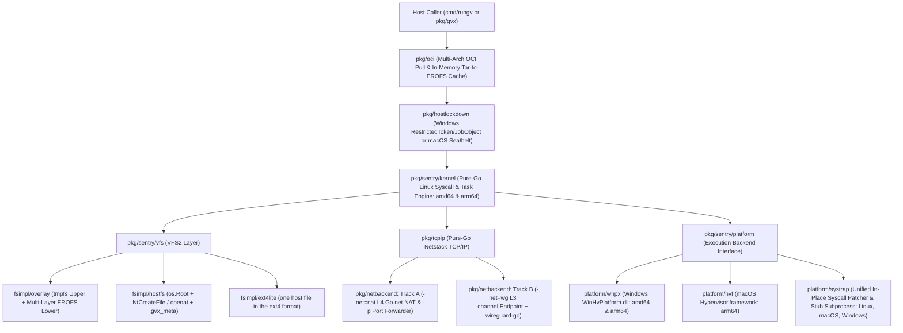
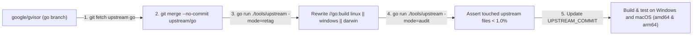
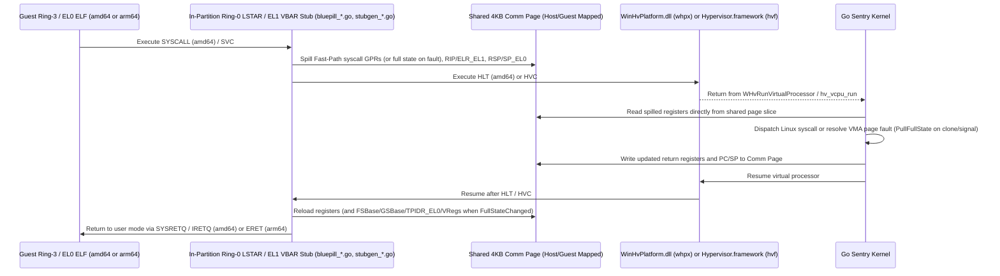
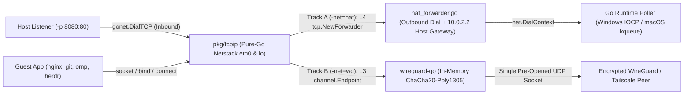
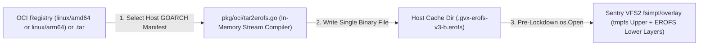
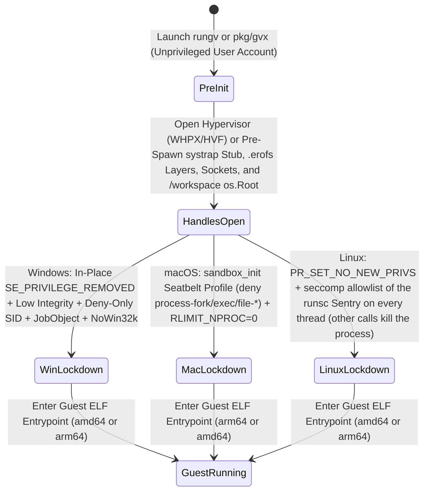

# `gvx` Architecture and Implementation Plan

`gvx` is an upstream-trackable fork of `google/gvisor` that ports the Sentry kernel to Windows (`windows/amd64`, `windows/arm64`) and macOS (`darwin/arm64`) as Priority-0 targets. Without booting a virtual machine, `gvx` runs Linux ELF64 binaries and OCI images inside an unprivileged sandbox via `cmd/rungv` or `pkg/gvx`. The runtime intercepts Linux system calls in Go and translates them into native Windows NT, macOS XNU, Go `net`, and user-mode hypervisor or `systrap` calls.

---

## 1. Executive Summary and Architectural Scope

This section defines the Priority-0 target matrix, execution backends, networking modes, OCI image pipeline, and upstream isolation rules for `gvx`. Every subsystem implementation must satisfy these baseline contracts before merging.

| Design Objective | Engineering Contract | Verification Boundary |
| :--- | :--- | :--- |
| **Priority-0 Dual-OS & Dual-Arch** | Targets `windows/amd64`, `windows/arm64`, and `darwin/arm64` from one codebase. | Compiles and runs native `linux/amd64` and `linux/arm64` ELF64 workloads on Windows and macOS. |
| **Zero Runtime Elevation** | Runs under a standard user account and locks down the host process before guest entry. | Requires no UAC prompts, no `sudo`/`root`, no kernel drivers/kexts, and no background daemons. |
| **Hardware 4KB Paging (`whpx` & `hvf`)** | Uses `WinHvPlatform.dll` (Windows) and `Hypervisor.framework` (macOS) with 4KB EPT and Stage-1/Stage-2 tables. | Bypasses the Windows 64KB `VirtualAlloc` limit and the Apple Silicon 16KB host page limit. |
| **Unified `systrap` Fallback (`systrap`)** | Exposes `pkg/sentry/platform/systrap` on Linux (upstream). Windows (`winsystrap`) runs stub processes from a small locked image with `winSysmsg` fast-path islands and debug-object stops. macOS has no `systrap` engine. | Executes ELF64 binaries and JIT runtimes (V8) when hardware virtualization is disabled. The guest architecture must equal the host architecture. |
| **Dual-Track Netstack (`pkg/netbackend`)** | Connects `pkg/tcpip` to an L4 Go `net` NAT and port forwarder (`-net=nat -p`) or an L3 `wireguard-go` tunnel (`-net=wg`). | Supports inbound/outbound port forwarding (`-p`) and `host.docker.internal`, or cryptographic L3 isolation. |
| **Direct OCI Image Execution (`pkg/oci`)** | Streams OCI `.tar.gz`/`.tar.zst` layers in memory into cached `<sha256>.erofs` images mounted via `fsimpl/overlay`. | Runs unmodified multi-arch Docker/OCI images without extracting Linux files onto NTFS or APFS. |
| **Clean Upstream Boundary** | Isolates host logic behind `_windows.go` and `_darwin.go` files and platform interfaces. | Requires a charged upstream diff below 1.0% under Section 2.2 audit rules and Go 1.25+ builds without Bazel. |



### 1.1 Compatibility Matrix and Cross-Architecture Execution (Descriptive Module)

`gvx` pairs hardware virtualization (`whpx` and `hvf`) as the default Tier-1 engine with the `systrap` backend as the user-mode fallback. Linux uses the upstream gVisor platforms.

The `systrap` fallback runs on Windows `amd64` and `arm64` with 4KB guest pages. The Windows engine starts its stubs from a generated 1 KB image, so it needs no C toolchain. The project removed the macOS engine (`darwinsystrap`) because it could not run executables with 4KB-aligned segments and non-PIE executables. Section 3.3 gives the reason. macOS runs on `hvf`. The project also dropped the Rosetta 2 engine and the whole `darwin/amd64` target. A syscall-number Seatbelt filter on a translated process panicked the host kernel. A stub without that filter would let a guest issue host system calls. The guest architecture must equal the host architecture on every backend.

| Host Target | Primary Engine (`whpx` / `hvf`) | Fallback Engine (`systrap`) | Host Page & Allocation Granularity | Platform Requirements & Status |
| :--- | :--- | :--- | :--- | :--- |
| **`windows/amd64`** (Intel / AMD) | `platform/whpx` (`WinHvPlatform.dll` 4KB EPT) | `platform/systrap` (`winsystrap`: `winSysmsg` fast path and debug-object stops, `jmp rel32` or `CC 90` patch). | 4KB Page / 64KB `VirtualAlloc` Reserve | Windows 10 (2004+) and Windows 11 with the Windows Hypervisor Platform feature. Runs `linux/amd64` images. |
| **`windows/arm64`** (Snapdragon X) | `platform/whpx` (`Arm64Support` 4KB Stage-2) | `platform/systrap` (`winsystrap`: `winSysmsg` fast path and debug-object stops, `B` or `brk` patch). Runs on hosts without WHP. | 4KB Page / 64KB `VirtualAlloc` Reserve | Windows 11 24H2 (Build `26100.3915+`) required for ARM64 WHPX. Runs `linux/arm64` images. |
| **`darwin/arm64`** (Apple Silicon M1-M5) | `platform/hvf` (`Hypervisor.framework` Stage-1 4KB + Stage-2 16KB) | None. The `darwinsystrap` engine was removed. `platform/systrap` builds a stub that returns `ErrUnavailable`. | 16KB Host Page / 16KB Map Granularity | Entitlement `com.apple.security.hypervisor` for `hvf`. Runs `linux/arm64` images. |
| **`darwin/amd64`** (Intel Mac) | None. | None. | None. | Not supported. The project dropped this target, because no Intel Mac ran the engine. |
| **`linux/amd64`** | Upstream platforms (`kvm`, `systrap`). | Upstream `systrap`. | 4KB Page | CI builds and tests the packages that `gvx` owns. |
| **`linux/arm64`** | Upstream platforms (`kvm`, `systrap`). | Upstream `systrap`. | 4KB Page (host dependent) | CI builds and tests the packages that `gvx` owns. |

---

## 2. Repository Layout and Upstream Synchronization Architecture

`gvx` tracks the pre-generated `go` branch of `https://github.com/google/gvisor.git` (`upstream/go`). Upstream publishes `go_stateify` and `go_marshal` output for both `amd64` and `arm64` directly to `upstream/go`, so `gvx` compiles with `go build` without Bazel.

```text
gvx/ (Fork of google/gvisor@go)
 ├── AGENTS.md                              # [NEW] Mandatory agent instructions and ASD-STE100 gates
 ├── README.md                              # [NEW] Project overview, quickstart, and build guide
 ├── UPSTREAM_COMMIT                        # [NEW] Pinned commit SHA from google/gvisor (go branch)
 ├── entitlements.plist                     # [NEW] com.apple.security.hypervisor entitlement for hvf
 ├── .github/workflows/                     # [NEW] ci.yml (every push) and e2e-images.yml (weekly registry gates)
 ├── docs/
 │   └── architecture.md                    # [NEW] Authoritative architecture and milestone plan
 ├── scripts/                               # [NEW] codesign-exec.sh (signs test binaries) and sync-upstream.sh
 ├── third_party/
 │   └── x_sys/unix/                        # [NEW] Embedded copy of golang.org/x/sys/unix with Darwin and Windows changes (docs/x-sys-unix.md)
 ├── tools/
 │   ├── shiminterop/                       # [NEW] Isolated SDK smoke tests
 │   └── upstream/                          # [NEW] Upstream sync, diff audit, import boundaries, and build-tag rewriter
 │       ├── main.go
 │       ├── patches.go
 │       ├── buildtag_allowlist.txt
 │       ├── boundaries.go
 │       ├── compare.go
 │       ├── sync.go
 │       └── diff_audit.go
 ├── cmd/
 │   ├── containerd-shim-gvx-v2/             # [NEW] Optional containerd control command
 │   │   └── main.go
 │   └── rungv/                             # [NEW] Standalone CLI runner (run, pull, stub)
 │       └── main.go
 ├── internal/                              # [NEW] gvxshim control adapter and test fixtures
 ├── pkg/
 │   ├── gvx/                               # [NEW] Embeddable Go library API for host tools
 │   │   ├── sandbox.go
 │   │   ├── config.go
 │   │   ├── image.go
 │   │   ├── kernel_runner.go
 │   │   ├── stdio_device.go
 │   │   └── platform_systrap_{native,other}.go
 │   ├── oci/                               # [NEW] Multi-arch OCI puller and Tar-to-EROFS compiler
 │   │   ├── pull.go
 │   │   ├── tar2erofs.go
 │   │   ├── erofs_layout.go
 │   │   └── cache.go
 │   ├── netbackend/                        # [NEW] Dual-track Netstack egress & port forwarder
 │   │   ├── nat_forwarder.go
 │   │   ├── port_forwarder.go
 │   │   ├── dns_relay.go
 │   │   ├── wireguard_endpoint.go
 │   │   ├── wireguard_tun.go
 │   │   └── wireguard_bind.go
 │   ├── hostarch/
 │   │   └── hostarch_darwin_arm64_4k.go    # [NEW] 4KB guest page constants for darwin/arm64
 │   ├── sync/
 │   │   ├── futex_linux_xplat.go           # [NEW] Linux SYS_FUTEX implementation
 │   │   ├── futex_windows.go               # [NEW] WaitOnAddress / WakeByAddressSingle bindings
 │   │   └── futex_darwin.go                # [NEW] XNU __ulock_wait / __ulock_wake bindings
 │   ├── memutil/
 │   │   ├── memfd_linux_unsafe.go          # Unmodified upstream memfd_create / mmap wrappers
 │   │   ├── memutil_windows.go             # [NEW] CreateFileMappingW + MapViewOfFile3 wrappers
 │   │   └── memutil_darwin.go              # [NEW] mmap(MAP_ANON) + mach_vm_remap wrappers
 │   ├── fd/
 │   │   ├── fd_windows.go                  # [NEW] Unified HostHandle wrapping Win32 HANDLE
 │   │   └── fd_darwin.go                   # [NEW] Unified HostHandle wrapping Darwin FD
 │   ├── hostlockdown/
 │   │   ├── lockdown_windows.go            # [NEW] RestrictedToken, Low Integrity, JobObject, Win32k block
 │   │   ├── lockdown_darwin.go             # [NEW] Seatbelt sandbox_init SBPL profile & RLIMIT_NPROC=0
 │   │   └── lockdown_other.go              # [NEW] Returns ErrUnsupported on other hosts
 │   └── sentry/
 │       ├── hostcpu/
 │       │   ├── hostcpu_windows.go         # [NEW] GetCurrentProcessorNumber binding
 │       │   └── hostcpu_darwin.go          # [NEW] Darwin CPU number binding
 │       ├── time/
 │       │   ├── calibrated_clock_windows.go # [NEW] QueryPerformanceCounter clock calibration
 │       │   └── calibrated_clock_darwin.go  # [NEW] mach_continuous_time clock calibration
 │       ├── pgalloc/
 │       │   ├── memory_file_windows.go     # [NEW] DiscardVirtualMemory / MEM_RESET page reclaim
 │       │   └── memory_file_darwin.go      # [NEW] madvise(MADV_FREE) page reclaim
 │       ├── platform/
 │       │   ├── whpx/                      # [NEW] Windows Hypervisor Platform backend (amd64 & arm64)
 │       │   │   ├── whpx.go
 │       │   │   ├── address_space.go
 │       │   │   ├── vcpu_amd64.go
 │       │   │   ├── vcpu_arm64.go
 │       │   │   ├── stubgen_x86.go         # Go generator for the in-partition amd64 stub
 │       │   │   └── stubgen_a64.go         # Go generator for the in-partition arm64 stub
 │       │   ├── hvf/                       # [NEW] macOS Hypervisor.framework backend (arm64)
 │       │   │   ├── hvf.go
 │       │   │   ├── address_space.go
 │       │   │   ├── vcpu_darwin_arm64.go
 │       │   │   └── bluepill_arm64.go      # Go generator for the in-guest EL1 stub
 │       │   ├── hvcommon/                  # [NEW] Encoders, descriptors, and EL1 values that whpx and hvf share
 │       │   │   ├── a64.go                 # AArch64 encoders and EL1 constants
 │       │   │   └── x86.go                 # x86-64 selectors, GDT, TSS, IDT gate, and GS opcode emitters
 │       │   └── systrap/                   # Unified systrap backend (Linux upstream + Windows siblings)
│       │       ├── systrap.go             # Unmodified upstream Linux systrap implementation
│       │       ├── systrap_xplat.go       # [NEW] Shared types: ProbeInfo, ErrUnavailable
│       │       ├── platform_darwin.go     # [NEW] macOS stub: New returns ErrUnavailable, because macOS runs on hvf
│       │       ├── patcher_amd64_xplat.go # [NEW] Page scan and patcher for amd64 (x86asm sweeps, island slots)
│       │       ├── patcher_arm64_xplat.go # [NEW] Lazy page-trap patcher for arm64 (B island slots)
│       │       ├── stubcode_*_xplat.go    # [NEW] Generated spill routines and trampolines
│       │       ├── stubimage_xplat.go     # [NEW] The 1 KB executable that every Windows stub runs
│       │       ├── platform_windows.go    # [NEW] Windows platform, stub host client, debug object
│       │       ├── stubhost_windows.go    # [NEW] Stub host process, confined token, one job for each stub
│       │       ├── stubimage_windows.go   # [NEW] Writes the image once and holds it open with read-only sharing
│       │       ├── address_space_windows.go # [NEW] 4KB placeholder window, lazy patching, private code pages
│       │       ├── context_windows.go     # [NEW] Context.Switch over debug-object stops
│       │       ├── fastpath_windows.go    # [NEW] winSysmsg fast path and spin windows
│       └── fsimpl/
 │           ├── hostfs/                    # [NEW] Secure os.Root + .gvx_meta host mount (Windows, macOS, and Linux)
 │           │   ├── hostfs.go
 │           │   ├── inode_windows.go
 │           │   ├── inode_darwin.go
 │           │   └── posix_rename_windows.go
 │           └── ext4lite/                  # [NEW] Volume file system: one host file in the ext4 format
 │               ├── ondisk.go              # Geometry and codecs
 │               ├── alloc.go               # Block and inode allocator
 │               ├── flush.go               # Snapshot of the dirty state and the write of a flush
 │               ├── gate.go                # Operation gate that makes the snapshot a cut between operations
 │               ├── jbd2.go                # JBD2 journal codecs
 │               ├── journal.go             # Journal commit, replay, and creation
 │               ├── orphan.go              # Orphan list of unlinked open files
 │               ├── fsck.go                # fsckLite for volumes without a journal
 │               ├── compact.go             # Unmount compaction
 │               └── storage_*.go           # Storage tiers A, B, and C
 └── e2e/                                   # [NEW] Unified OS-agnostic end-to-end test suite
     ├── sandbox_e2e_test.go
     └── gate_*_test.go                     # Milestone gates M2, M3, and M4
```

### 2.1 Layered Subsystem Map and Import Directionality

Each package owns one architectural boundary. Enforce top-down import directionality to keep Windows and macOS host APIs out of the pure-Go Sentry kernel.

| Package | Single Responsibility | Allowed Internal Imports | Forbidden Imports |
| :--- | :--- | :--- | :--- |
| `cmd/containerd-shim-gvx-v2` | Dispatches the optional shim command. | `internal/gvxshim` | `pkg/*`, `runsc/*`, `shim/*` |
| `internal/gvxshim` | Owns bootstrap, local RPC controls, process lifetime, and safe cleanup. | None; public containerd types, ttRPC, protobuf, and host APIs are external dependencies. | `pkg/*`, `runsc/*`, `shim/*`, `cmd/*` |
| `tools/shiminterop` | Exercises real ShimManager `2.1.5` against the compiled shim in an isolated module. | None | Root runtime, command, and internal packages |
| `cmd/rungv` | Parses the Docker-style commands of [`cli.md`](cli.md) (`run`, `pull`, `images`, `inspect`, `tag`, `rmi`, `save`, `load`, `login`, `logout`, `stub`) and starts a sandbox instance. | `pkg/gvx` | `pkg/sentry/*`, `WinHvPlatform.dll` |
| `pkg/gvx` | Coordinates `pkg/oci`, `pkg/netbackend`, `pkg/hostlockdown`, and Sentry boot. | `pkg/oci`, `pkg/netbackend`, `pkg/hostlockdown`, `pkg/sentry/*`, `pkg/fd`, `pkg/tcpip` | `cmd/*`, `internal/gvxshim` |
| `pkg/oci` | Resolves `amd64`/`arm64` OCI manifests and compiles `.tar` layers into `.erofs` files. | `pkg/abi/linux` | `pkg/sentry/kernel`, `pkg/hostlockdown` |
| `pkg/netbackend` | Bridges `pkg/tcpip` to L4 Go `net` forwarders (`nat`) or L3 `wireguard-go` (`wg`). | `pkg/tcpip` | `pkg/sentry/kernel`, `WinHvPlatform.dll` |
| `pkg/hostlockdown` | Locks down the host process via Windows Tokens/JobObjects or macOS Seatbelt. | `golang.org/x/sys/windows`, `golang.org/x/sys/unix` | `pkg/sentry/*`, `pkg/tcpip` |
| `pkg/sentry/kernel` | Dispatches the OS-agnostic Linux task, signal, and syscall table (`amd64` & `arm64`). | `pkg/abi/linux`, `pkg/sentry/platform`, `pkg/sentry/vfs`, `pkg/sync` | `golang.org/x/sys/windows`, `pkg/hostlockdown` |
| `pkg/sentry/platform/whpx` | Executes guest Ring-3/EL0 code on Windows via `WinHvPlatform.dll` and 4KB EPT/Stage-2. | `pkg/sentry/platform`, `pkg/memutil`, `pkg/abi/linux`, `golang.org/x/sys/windows` | `pkg/sentry/kernel`, `pkg/sentry/vfs` |
| `pkg/sentry/platform/hvf` | Executes guest EL0/Ring-3 code on macOS via `Hypervisor.framework` and 4KB Stage-1/Stage-2. | `pkg/sentry/platform`, `pkg/memutil`, `pkg/abi/linux`, `golang.org/x/sys/unix` | `pkg/sentry/kernel`, `pkg/sentry/vfs` |
| `pkg/sentry/platform/systrap` | Executes guest code via in-place syscall patching, `sysmsg` shared memory, and isolated stub subprocesses across Linux, macOS, and Windows. | `pkg/sentry/platform`, `pkg/memutil`, `pkg/abi/linux`, `golang.org/x/arch/*` | `pkg/sentry/kernel`, `pkg/sentry/platform/whpx`, `pkg/sentry/platform/hvf` |
| `pkg/sentry/fsimpl/hostfs` | Mounts host `/workspace` via `os.Root`, `NtCreateFile`/`openat`, and `.gvx_meta`. | `pkg/sentry/vfs`, `pkg/abi/linux`, `pkg/fd`, `golang.org/x/sys/*` | `pkg/sentry/platform/*` |
| `pkg/sentry/fsimpl/ext4lite` | Stores one named volume in one pre-opened host file in the ext4 format. | `pkg/sentry/vfs`, `pkg/abi/linux`, `pkg/fd`, `golang.org/x/sys/*` | `pkg/sentry/platform/*`, `cmd/*` |
| `pkg/sync`, `pkg/memutil`, `pkg/fd` | Provide host futexes, shared memory views, and host handles on Windows and macOS. | `golang.org/x/sys/windows`, `golang.org/x/sys/unix` | `pkg/sentry/*` |

`tools/upstream` enforces this table with `boundaries.go`. Sentry foundation packages such as `pkg/context`, `pkg/hostarch`, `pkg/usermem`, and `pkg/sentry/memmap` appear in every platform and VFS interface, so those packages import them. Each other import needs a reason-annotated exception in `boundaries.go`.

### 2.2 Three-Tier Upstream Isolation Model (Descriptive Module)

To prevent merge conflicts during continuous upstream pulls, `gvx` partitions all repository files into three strict isolation tiers.

| Isolation Tier | File Paths | Upstream Conflict Rate | Maintenance Mechanism |
| :--- | :--- | ---: | :--- |
| **Tier 1: Additive Directories** | `cmd/rungv/`, `cmd/containerd-shim-gvx-v2/`, `pkg/gvx/`, `pkg/oci/`, `pkg/netbackend/`, `pkg/hostlockdown/`, `pkg/sentry/platform/whpx/`, `pkg/sentry/platform/hvf/`, `pkg/sentry/platform/hvcommon/`, `pkg/sentry/fsimpl/chunkcache/`, `pkg/sentry/fsimpl/hostfs/`, `pkg/sentry/fsimpl/ext4lite/`, `e2e/`, `internal/`, `scripts/`, `.github/`, `tools/upstream/`, `tools/shiminterop/`, `tools/licenses/`, `docs/` | `0.0%` | Owned exclusively by `gvx`; `upstream/go` never touches these paths. |
| **Tier 2: Sibling `_windows`, `_darwin`, & `_xplat` Files** | `pkg/sync/*_{windows,darwin,xplat}*`, `pkg/memutil/*_{windows,darwin,xplat}*`, `pkg/fd/*_{windows,darwin,xplat}*`, `pkg/{erofs,fdnotifier,syserr}/*_{windows,darwin,xplat}*`, `pkg/hostarch/*_darwin*`, `pkg/sentry/{kernel,mm}/*_xplat*`, `pkg/sentry/{pgalloc,time,hostcpu}/*_{windows,darwin}.go`, `pkg/sentry/platform/*_{windows,darwin,xplat}*`, `pkg/sentry/platform/systrap/*_{windows,darwin,xplat}*` | `0.0%` | Placed alongside unmodified `*_linux.go` files; Go selects the target file by `GOOS` and `GOARCH`. |
| **Tier 3: Build-Tag & Seam Patches** | Pure-Go files listed in `tools/upstream/buildtag_allowlist.txt` and `io_uring` `-ENOSYS` stubs | `< 1.0%` | Re-applied automatically by `tools/upstream` (`//go:build linux \|\| windows \|\| darwin`) after every `git merge upstream/go`. |

The audit charges a file against the 1.0% ceiling only when its content differs from upstream. A file that `gvx` adds inside an upstream directory is free when its name carries the token `windows`, `darwin`, or `xplat`. The audit then counts it as a Tier 2 sibling. It reports build-tag fences on Linux-only trees (`runsc`, `shim`, `pkg/sentry/fsimpl/gofer`) as a third number. A strict count that includes the fences is larger than the charged share, and the audit prints both.



### 2.3 Upstream Diff and Synchronization Procedure (Procedural Module)

Run this procedure to audit the current upstream diff or merge new commits from `google/gvisor`.

> [!WARNING]
> Do not hand-edit `*_linux.go` files or scatter ad-hoc changes across pure-Go Sentry files. Unrecorded edits in Tier 3 files cause merge conflicts during upstream synchronization and violate the 1.0% diff ceiling. Register every build-tag change in `tools/upstream/buildtag_allowlist.txt`.

1. Register the upstream gVisor repository as the `upstream` Git remote.
2. Fetch the latest `go` branch from `upstream`.
3. Inspect the modified upstream file count and verify the `< 1.0%` budget against `UPSTREAM_COMMIT`.
4. Merge `upstream/go` without committing.
5. Run `tools/upstream` in `retag` mode to apply `//go:build linux || windows || darwin` to allowlisted files.
6. Run `tools/upstream` in `audit` mode to assert zero unauthorized edits in `*_linux.go` files.
7. Record the merged `upstream/go` SHA in `UPSTREAM_COMMIT` and verify all three non-Linux Priority-0 targets and both Linux targets.

```bash
git remote add upstream https://github.com/google/gvisor.git 2>/dev/null || true
git fetch upstream go

# Merge new upstream commits and re-apply build tags
git merge --no-commit upstream/go
go run ./tools/upstream -mode=retag
go run ./tools/upstream -mode=audit -max-ratio=0.01   # add -offline to reuse the cached upstream archive
git rev-parse upstream/go > UPSTREAM_COMMIT

# Verify the three non-Linux Priority-0 host targets and both Linux targets compile cleanly
GOOS=windows GOARCH=amd64 go build ./...
GOOS=windows GOARCH=arm64 go build ./...
GOOS=darwin  GOARCH=arm64 go build ./...
GOOS=linux   GOARCH=amd64 go build ./...
GOOS=linux   GOARCH=arm64 go build ./...
```

---

## 3. Subsystem Porting Specifications

This section specifies the Windows and macOS APIs, `amd64` and `arm64` transitions, 4KB memory mapping decouplers, `systrap` in-place binary patchers, register preservation rules, network backends, OCI loaders, and security invariants.

### 3.1 Host OS Primitives and Build-Tag Decoupling (Descriptive Module)

Approximately 65% of gVisor (`pkg/sentry/kernel`, `pkg/sentry/arch`, `pkg/ring0`, `pkg/sentry/vfs`, `pkg/sentry/fsimpl/tmpfs`, `pkg/sentry/fsimpl/erofs`, `pkg/sentry/fsimpl/overlay`, and `pkg/tcpip`) contains OS-agnostic Go code supporting both `amd64` and `arm64`. `tools/upstream` expands the build tags on these pure-Go files to `//go:build linux || windows || darwin`, while `_windows.go` and `_darwin.go` files implement the host primitives.

| gVisor Package | Current Linux Dependency | Windows Implementation (`_windows.go`) | macOS Implementation (`_darwin.go`) |
| :--- | :--- | :--- | :--- |
| **`pkg/sync`** | `SYS_FUTEX` (`FUTEX_WAIT`, `FUTEX_WAKE`) | `WaitOnAddress`, `WakeByAddressSingle`, `WakeByAddressAll` (`api-ms-win-core-synch-l1-2-0.dll`). | `__ulock_wait` and `__ulock_wake` (`UL_COMPARE_AND_WAIT` in `libSystem.B.dylib`). |
| **`pkg/memutil` & `pgalloc`** | `memfd_create`, `SYS_MMAP`, `MADV_DONTNEED`, `FALLOC_FL_PUNCH_HOLE` | `CreateFileMappingW(INVALID_HANDLE_VALUE, ...)`, `MapViewOfFile3` (`kernelbase.dll`, with `MapViewOfFile` fallback), and `DiscardVirtualMemory` (`MEM_RESET`). | `mmap(MAP_ANON)`, `mach_vm_remap` (multi-view shared aliasing), and `madvise(MADV_FREE)`. |
| **`pkg/sentry/time` & `hostcpu`** | `clock_gettime(CLOCK_MONOTONIC)`, `getcpu` VDSO | `QueryPerformanceCounter` / `QueryPerformanceFrequency` and `GetCurrentProcessorNumber`. | `mach_continuous_time` / `clock_gettime_nsec_np` and `pthread_cpu_number_np`. |
| **`pkg/fd`** | Raw `int` FDs, `dup3`, `SCM_RIGHTS` | `HostHandle` wrapping `syscall.Handle` with explicit `Close()` ownership. | `HostHandle` wrapping Darwin file descriptors with `fcntl(F_DUPFD_CLOEXEC)`. |
| **`pkg/fdnotifier`** | `epoll` in edge-triggered mode (`fdnotifier.go`, Linux only). | One table of observed descriptors in `fdnotifier_portable.go`, with no goroutine and no event. `NonBlockingPoll` reports every requested event as ready. | The same table in `fdnotifier_portable.go`. `NonBlockingPoll` calls `poll` once without blocking. |
| **`pkg/tcpip`** | `af_packet` / `tun` host links | Pure-Go Netstack routed via `pkg/netbackend` (`-net=nat` or `-net=wg`). | Pure-Go Netstack routed via `pkg/netbackend` (`-net=nat` or `-net=wg`). |
| **`pkg/abi/linux` & `sentry/arch`** | Pure Go (`amd64` & `arm64`) | Retain 100% unchanged; supports Linux `x86_64` and `aarch64` ABIs natively. | Retain 100% unchanged; supports Linux `aarch64` and `x86_64` ABIs natively. |
| **`pkg/sentry/syscalls`** | `io_uring` host passthrough | Return `-ENOSYS` on `io_uring_setup` and `io_uring_enter` to select Sentry `epoll`. | Return `-ENOSYS` on `io_uring_setup` and `io_uring_enter` to select Sentry `epoll`. |

### 3.2 Primary Hardware Hypervisor Engines: `platform/whpx` (Windows) and `platform/hvf` (macOS)

`platform/whpx` (Windows `WinHvPlatform.dll` on `amd64` and `arm64`) and `platform/hvf` (macOS `Hypervisor.framework` on `arm64`) share one architectural design. Both backends decouple Linux 4KB `mmap(MAP_FIXED)` mappings from the Windows 64KB allocation granularity and the Apple Silicon 16KB host page granularity. Both also use an in-partition Ring-0 (`amd64`) or EL1 (`arm64`) shared communication page to avoid per-syscall register API calls.

| Hypervisor Operation | Windows (`platform/whpx` on `amd64` & `arm64`) | macOS (`platform/hvf` on `arm64`) |
| :--- | :--- | :--- |
| **Privilege / OS Requirement** | Standard user token; `windows/arm64` verifies Windows 11 24H2 (`Build >= 26100.3915`) and `WHvCapabilityCodeFeatures.Arm64Support`. | Standard user token with ad-hoc `com.apple.security.hypervisor` signature (`codesign -s -`). |
| **Partition Creation** | `WHvCreatePartition` + `WHvSetupPartition` | `hv_vm_create(NULL)` |
| **4KB Page Granularity Mapping** | Registers each 64MiB arena of `pgalloc.MemoryFile` with the partition once through `WHvMapGpaRange`. `MapFile` and `Unmap` then change only the guest page tables, which hold 4KB or 2MiB entries. | Maps each 1GiB chunk of a `pgalloc.MemoryFile` into Stage-2 IPA once with `HV_MEMORY_READ \| WRITE \| EXEC` via `hv_vm_map`. `MapFile` and `Unmap` then change only Stage-1 (`TTBR0_EL1` with `TCR_EL1.TG0 = 0b00` 4KB granule), which enforces `R/W/X` at 4KB. |
| **vCPU Execution Call** | `WHvRunVirtualProcessor(partition, vpIndex, ...)` | `hv_vcpu_run(vcpu)` on a dedicated worker thread per vCPU. The worker calls `runtime.LockOSThread()`, because a vCPU belongs to the thread that created it. |
| **Async Signal Preemption** | `WHvCancelRunVirtualProcessor(partition, vpIndex, 0)` | `hv_vcpus_exit(&vcpu, 1)` |
| **`amd64` Syscall Trap (`stubgen_x86.go`)** | Ring-3 `SYSCALL` enters Ring-0 `MSR_LSTAR`, spills syscall GPRs to `CommPage`, executes `HLT`. | Not applicable (`darwin/amd64` dropped). |
| **`arm64` Syscall Trap (`bluepill_arm64.go`, `stubgen_a64.go`)** | EL0 `SVC #0` enters EL1 `VBAR_EL1`, spills `X0..X8, SP_EL0, ELR_EL1, PSTATE` to `CommPage`, executes `HVC #0`. | EL0 `SVC #0` enters EL1 `VBAR_EL1`, spills `X0..X8, SP_EL0, ELR_EL1, PSTATE` to `CommPage`, executes `HVC #0`. |
| **Read-only File Mappings** | Maps read-only host views directly into the partition. | `hv_vm_map` rejects the read-only descriptor of an EROFS image. `hvf` copies those pages into immutable slab pages, and pgalloc memory files map directly. |
| **Unknown Exit Reason** | Not applicable. | `HV_EXIT_REASON_UNKNOWN` carries no information. The worker resumes the vCPU as it does after a cancellation, and `Switch` fails after 4096 consecutive unknown exits. |



#### Two-Stage 4KB Paging on Apple Silicon (`platform/hvf`) and 64KB-to-4KB Slicing on Windows (`platform/whpx`) (Descriptive Module)

Linux ELF64 binaries map `.text` (`R-X`) and `.data` (`RW-`) segments at 4KB (`0x1000`) file offsets and virtual address boundaries. On Windows, `VirtualAlloc(MEM_RESERVE)` and `MapViewOfFile3` require 64KB (`0x10000`) alignment. `platform/whpx` resolves this with 4KB entries in its own guest page tables. It registers each 64MiB arena of `pgalloc.MemoryFile` with `WHvMapGpaRange` once. Each arena has a read-only layer and a writable layer, and memory-file chunks always use the writable layer. The guest page tables give each 4KB page its permissions.

On Apple Silicon macOS (`darwin/arm64`), the host XNU kernel and `hv_vm_map()` operate on 16KB (`0x4000`) pages. `platform/hvf` resolves this using the two-stage ARM64 MMU (`GVA` to Stage-1 `TTBR0_EL1` 4KB, then `IPA` to Stage-2 `hv_vm_map` 16KB, then `HPA`). Stage-2 maps each 1GiB chunk of the memory file into IPA space once, with permissive `HV_MEMORY_READ | HV_MEMORY_WRITE | HV_MEMORY_EXEC` rights. Inside the vCPU, the `bluepill` stub configures `TCR_EL1.TG0 = 0b00` (4KB granule) and populates 4KB Stage-1 page table entries in `TTBR0_EL1` with exact `R-X` or `RW-` (`UXN=1`) permissions. Because the ARM64 MMU enforces the intersection of Stage-1 and Stage-2 permissions, the hardware traps permission violations at exact 4KB boundaries.

Both hardware backends register guest memory with the hypervisor once, and never on a page fault. `MapFile` and `Unmap` change only the guest page tables. A 4 MiB fault therefore makes one call into the page-table code and no call into the hypervisor. `Platform.MapUnit` returns 2 MiB on both backends. `SupportsAddressSpaceIO` returns false, so the Sentry reads and writes guest memory through its own mapping of the memory file. A write that the Sentry makes to a page that the guest already runs as code does not flush the guest instruction cache on `arm64`. A mapping with execute permission flushes it, so the ELF loader, `mprotect`, and copy-on-write stay correct.

`pkg/sentry/platform/hvcommon` holds the code that the architecture fixes and that the two backends share. This code is the AArch64 instruction encoders, the EL1 system-register values, the x86-64 selectors and descriptors, the TSS template, the IDT gate encoding, and the GS-relative opcode emitters. Each backend keeps its own `CommPage` layout and its own stub generator. Hyper-V and Hypervisor.framework exchange different state at a stop.

### 3.3 Unified User-Mode Fallback Engine: `pkg/sentry/platform/systrap` (`winsystrap`) (M5)

`pkg/sentry/platform/systrap` registers the `"systrap"` backend. Linux uses the upstream implementation. Windows (`winsystrap`) uses the engine of `gvx` on `amd64` and `arm64`. macOS has no `systrap` engine. The engine executes guest ELF64 code and in-guest JIT code (V8) directly on the host CPU at native speed without basic-block translation or instruction emulation.

[`systrap-windows.md`](systrap-windows.md) records the measured Windows behavior and the `winsystrap` design. The table below follows that document.

The macOS engine `darwinsystrap` was removed because of compatibility problems. It forced 16KB guest pages, so executables with 4KB-aligned segments failed. macOS also reserves a 4GB `PAGEZERO` in every `arm64` task, so non-PIE executables that link below 4GB failed. `hvf` runs both kinds natively.

#### Multi-Process Hardware Page-Table (`CR3` / `TTBR0_EL1`) Isolation and `sysmsg` IPC (Descriptive Module)

Running untrusted guest instructions inside the Sentry process without SFI masking would expose the Go runtime heap to arbitrary pointer writes. To preserve hardware MMU isolation (`CR3` on `amd64`, `TTBR0_EL1` on `arm64`) without a hypervisor, `platform/systrap` runs the guest in a stub process. The stub exists before `hostlockdown.Apply()` executes, or a process that exists then creates it.

The upstream package `usertrap` and the message types of `sysmsg` build on every host for `amd64`. The retag rules of `tools/upstream` widen eight files, and the other files of both packages stay Linux-only. No engine of `gvx` uses `usertrap.State`. Its trampolines write the thread state of the Linux stub into the `sysmsg` page, and it reads guest memory through `kernel.Task`. The Windows engine patches `syscall` sites with its own rewriter in `patcher_amd64_xplat.go`, which writes slots that follow the layout of `winSysmsg`.

On Windows, the `whpx` backend writes the root register of the address space on the host. The register is `CR3` on `amd64` and `TTBR0_EL1` on `arm64`. The write happens before a virtual processor runs with a recorded address space that differs from the current one. The reload stub in the guest loads the same value. A kick before the run, a cancel inside the reload stub, and `AddressSpace.Release` invalidate the recorded state of the virtual processor. The first fetch of the reload stub then never walks page tables that `Release` freed.

On Windows, a stub host starts before the lockdown. The host is a copy of the Sentry executable that runs only a request loop. It creates one stub process for each address space. The stub runs a generated 1 KB image that the host holds open with read-only sharing, so no process can change it. The stub is suspended, and its entry point never runs. It lives in a one-process job under a Low-integrity token with all privileges removed (`SE_PRIVILEGE_REMOVED`). By default, a patched syscall jumps through an island slot into the spill routine. The routine exchanges registers through a shared `winSysmsg` page and spins or waits on an event pair. Each side spins for a fixed time before it waits: 64 µs in the stub and 8 µs in the Sentry. The Sentry also attaches every stub to one debug object, which receives page faults, signals, and fallback `CC 90` or `brk` stops.

| `systrap` Subsystem | Windows (`winsystrap`: `amd64` & `arm64`), implemented |
| :--- | :--- |
| **Page Granularity** | Reserves the guest window as one placeholder with `VirtualAlloc2(MEM_RESERVE_PLACEHOLDER)` and maps memory-file pages as 4KB views with `MapViewOfFile3(MEM_REPLACE_PLACEHOLDER)`. The 64KB limit does not apply to such views. The guest sees 4KB pages. |
| **Guest Address Range** | A high window from `0x100000000000` (16TB) to `0x7edffdff0000`, and a low window from `0x10000` to `0x7ffe0000`. The Sentry reserves both before the loader runs, so the loader places stacks, heaps, and DLLs elsewhere. The top `0x2010000` bytes of the high window hold the engine pages and the per-thread `winSysmsg` areas. The memory manager treats the range between the windows as a hole. A Linux `ET_EXEC` image at `0x10000` or `0x400000` loads in the low window. |
| **Lazy Execute Page-Trap** | Maps original frames without execute permission. On an execute fault, the Sentry receives the exception through the debug object, patches a private copy of the page, and maps the copy as `PAGE_EXECUTE_READ`. A write to a writable and executable page maps the original frame again and reclaims its island slots. The scan covers the executable sections of the backing ELF file. |
| **`amd64` Syscall Patching** | Decodes the page in 16 linear sweeps and patches a site when more than half of the sweeps with the fewest skipped bytes agree. With the fast path on, replaces `syscall` and the next three bytes with `jmp rel32` to a trampoline island slot when relocation rules hold. Otherwise it replaces the instructions in front of `syscall` with `jmp rel32` and keeps `CC 90` at `syscall`, or it keeps `CC 90` alone. Also patches `RDFSBASE`, `RDGSBASE`, and 32-bit/64-bit `%gs:` `MOV` instructions to island slots. |
| **`arm64` Trampoline Island & I-Cache Flush** | Reserves a 4KB island within `±120 MB` of the patched page. With the fast path on, replaces `svc #0` with `B <island_slot>` and `mrs xN, tpidr_el0` with a 16-byte slot branch; replaces `mrs xN, ctr_el0`, `msr tpidr_el0, xN`, and `ic ivau, xN` with `brk` traps, and replaces `dc` cache-clean instructions with `nop`. Reclaims island slots via a bitmap on unmap or restore. |
| **Register Virtualization** | `amd64`: Windows resets the FS base at every context switch and reserves `%gs` for the host TEB. The engine loads the FS base through a trampoline at each start, serves patched `RDFSBASE`, `RDGSBASE`, and `%gs:` `MOV` sites through island slots, and repairs any faulting unpatched `%fs` or `%gs` access through `winTEBScratchA`. `arm64`: Windows keeps `x18` and `TPIDR_EL0` across stops. A routine in the engine page writes `TPIDR_EL0`. |
| **Unpatched Syscall Safety Net** | Not installed. The kernel calls `ProcessInstrumentationCallback` only after it ran the NT service, so the hook cannot stop a missed site. On `arm64`, a scan of every aligned word in guest pages removes every `svc` before it can run. |
| **Cross-Arch Container Execution** | Running `GOARCH=amd64` `rungv` (`-platform=systrap`) on `windows/arm64` would invoke Windows 11 24H2 Prism. Not implemented. |

The diagram shows the Windows engine.

```mermaid
sequenceDiagram
    participant Guest as Guest Thread (Stub Process)
    participant Island as Trampoline Island & Spill Routine
    participant WinSysmsg as Shared winSysmsg Page & Events
    participant Debug as Debug Object
    participant Sentry as Go Sentry Kernel Process

    Note over Guest,Sentry: First Execution of a Code Page (Lazy Page-Trap)
    Guest->>Debug: Execute access violation on a non-executable view
    Debug->>Sentry: Exception event
    Sentry->>Guest: Patch a private copy, map it as PAGE_EXECUTE_READ, and continue the thread

    Note over Guest,Sentry: Fast-Path Syscall (Default)
    Guest->>Island: B <slot> (arm64) or jmp rel32 <slot> (amd64)
    Island->>WinSysmsg: Spill GPRs, flags, and vector state; set Trapped
    Island->>Sentry: Spin or signal guest event and wait
    Sentry->>WinSysmsg: Read arguments, dispatch Linux syscall, write return state
    Sentry->>Island: Set RunHot or RunCold and signal host event
    Island->>Guest: Reload registers and return through slot tail
```

### 3.4 Register Preservation and Two-Tier Synchronization Contract (Linux ELF & Wine / WoW64 / ARM64EC) (Descriptive Module)

A Linux `syscall` (`amd64`) or `svc #0` (`arm64`) is a kernel trap, not a C function call. Guest compilers, `glibc`/`musl`, and Wine assume that every general-purpose register (except the return register and hardware-clobbered `RCX`/`R11` on `amd64` `syscall`) and every 128-bit/256-bit SIMD/FP vector register (`XMM`/`YMM`, `V0..V31`) remain 100% intact across system calls and page faults. Because the host Go runtime overwrites SIMD registers (`XMM`/`YMM` and `V0..V31`) during `copy`, `memmove`, and string operations, entering Go without isolating guest vector and TLS state causes silent memory corruption.

#### Mandatory Preserved Register Sets for `amd64` and `arm64` (Reference Module)

Every execution backend (`whpx`, `hvf`, and `systrap`) must preserve these architectural registers across transitions to support standard Linux ELF64 workloads, Ubuntu 24.04+ PAC binaries, and Wine (`wine64`, WoW64, and `arm64ec`).

| Architecture & Category | Register Set | Linux ELF & Wine / WoW64 / ARM64EC Preservation Rule |
| :--- | :--- | :--- |
| **`amd64` Syscall & Callee GPRs** | `RAX`, `RDI`, `RSI`, `RDX`, `R10`, `R8`, `R9`, `RBX`, `RBP`, `R12..R15`, `RIP`, `RSP`, `RFLAGS` | Sync syscall arguments/return on every syscall; preserve `RBX`, `RBP`, and `R12..R15` without modification across all transitions. |
| **`amd64` Trap-Clobbered GPRs** | `RCX`, `R11` | Hardware `syscall` clobbers `RCX` (`RIP`) and `R11` (`RFLAGS`), but page faults (`#PF`), asynchronous signals, and Wine `int 0x80` traps must preserve the original `RCX` and `R11` values. |
| **`amd64` Dual TLS & Segments** | `FSBase`, `GSBase` (`KernelGsBase`), `CS`, `SS`, `DS`, `ES`, `FS`, `GS` | `wine64` uses `FSBase` for Linux TLS and `GSBase` for the 64-bit Windows TEB; WoW64 switches between `CS=0x23` (32-bit compatibility mode) and `CS=0x33` (64-bit mode). Preserve both TLS bases and all segment selectors. |
| **`amd64` Vector, FP Control & Debug** | `XMM0..15`, `YMM0..15`, `x87 ST0..7`, `MXCSR`, `FCW`, `FSW`, `DR0..DR7` | Protect guest SIMD/x87 state and rounding/denormal control words (`MXCSR`, `FCW`) from the Go runtime; expose `DR0..DR7` for `ptrace` and Wine `GetThreadContext` / `SetThreadContext`. |
| **`arm64` General & Syscall GPRs** | `X0..X8`, `X9..X17`, `X19..X30 (LR)`, `SP (SP_EL0)`, `PC`, `PSTATE (NZCV)` | Although AAPCS64 treats `X9..X17` as caller-saved in C calls, `svc #0` and page faults must preserve all of `X1..X30` (`OrigR0` saved separately for syscall restart). |
| **`arm64` Platform Register `X18`** | `X18` | macOS and Windows ARM64 reserve `X18` on the host, while Windows ARM64 / Wine `arm64ec` stores the guest TEB pointer in `X18`. Isolate guest `X18` from host `X18` on every transition. |
| **`arm64` Dual TLS & PAC Keys** | `TPIDR_EL0`, `TPIDRRO_EL0`, `APIAKeyLo/Hi_EL1` (`HWCAP_PACA`) | Preserve both `TPIDR_EL0` (Linux TLS) and `TPIDRRO_EL0` (Wine/auxiliary thread ID). Mask `HWCAP_PACA`/`HWCAP_PACG` in `AT_HWCAP` or preserve PAC key registers so Ubuntu 24.04+ `paciasp`/`autiasp` instructions never fault with `SIGILL`. |
| **`arm64` Full 128-bit NEON/FP & Debug** | `V0..V31` (full 128-bit `Q0..Q31`), `FPCR`, `FPSR`, `DBGBVR/BCR0..15`, `DBGWVR/WCR` | Preserve all 32 128-bit vector registers (`512B`) plus `FPCR`/`FPSR` across syscalls and signals, and map hardware debug registers for `ptrace` and Wine thread contexts. |

#### Two-Tier Lazy Synchronization in `whpx` and `hvf` vs. Full Trampoline Save in `systrap` (Procedural Module)

Follow these synchronization rules in `platform/whpx`, `platform/hvf`, and `platform/systrap`:

> [!CAUTION]
> Always call `runtime.LockOSThread()` at the start of `Context.Switch()` before invoking `hv_vcpu_run`, `WHvRunVirtualProcessor`, or entering a `systrap` trampoline. Calling `hv_vcpu_run` from a migrated OS thread returns `HV_ERROR` immediately, and entering Go with guest `FSBase`, `GSBase`, `X18`, or `MXCSR` crashes the Go runtime.

1. In `platform/whpx` and `platform/hvf` Fast-Path transitions (standard system calls), read and write only the syscall argument/return GPRs, `PC`, `SP`, and `PSTATE`/`RFLAGS` in `CommPage` while leaving `XSAVE`/`V0..V31`, `FSBase`/`GSBase`, and `DR0..DR7` inside the hardware vCPU.
2. In `platform/whpx` and `platform/hvf` Medium/Cold-Path transitions (`PullFullState` and `FullStateChanged` on `clone`, signal delivery, page faults, `arch_prctl`, and `ptrace` / Wine context queries), synchronize all GPRs (`RCX`, `R11`, `X18`), dual TLS bases, segment selectors, full 512-byte `V0..V31` / `XSAVE` state (`ac.FloatingPointData()`), `FPCR`/`FPSR`/`MXCSR`/`FCW`, and debug registers.
3. In `platform/systrap` trampolines, spill all GPRs (`RAX..R15` including `RCX` and `R11` on `amd64`; `X0..X30` including `X18` on `arm64`), flags, dual TLS pointers, and vector state (`XSAVEOPT` on `amd64` or `STP Q0..Q31` on `arm64`) into the `Sysmsg` context before restoring host `FSBase`/`GSBase`/`X18`/`MXCSR` and waking the Sentry thread.

One implementation deviates from this contract for a stated reason. `hvf` loads and stores the general and FP registers from `arch.Context64` on every `Switch`, because `Hypervisor.framework` ties a vCPU to its host thread. `hvf` does not synchronize `TPIDRRO_EL0`, the PAC keys, or the debug registers.

### 3.5 Dual-Track Netstack Backend and Port Forwarding: `pkg/netbackend`

Guest applications (`nginx`, `postgres`, `git`, `curl`, `omp`, `herdr`) invoke `socket()`, `connect()`, `bind()`, and `epoll_wait()` against gVisor's pure-Go `pkg/tcpip` (Netstack). Netstack implements the virtual Linux network interface (`eth0`), loopback (`lo`), TCP 3-way handshakes, sliding windows, and packet retransmission in memory. `pkg/netbackend` is 100% OS-agnostic Go code and runs identically on Windows and macOS.

| Egress Attribute | Track A: Go `net` NAT & Port Forwarder (`-net=nat`, Default) | Track B: In-Memory WireGuard (`-net=wg`) |
| :--- | :--- | :--- |
| **Interception Layer** | L4 Transport Layer (`tcp.NewForwarder`, `udp.NewForwarder`, `gonet.DialTCP`) | L3 Network Layer (`channel.Endpoint` to `wireguard-go`) |
| **Packet / Stream Path** | Dials outbound via host `net.DialContext` and forwards inbound `-p host:guest` listeners via `gonet.DialTCP`. | Encrypts raw IP packets in memory and transmits via one pre-bound host UDP socket. |
| **Admin / Driver Needed** | None (Standard unprivileged host sockets on Windows IOCP and macOS `kqueue`) | None (Pure in-memory link; no `WinTun.dll` or `/dev/tun`) |
| **Local / LAN Access** | Permitted by default (maps `10.0.2.2` / `host.docker.internal` to host `127.0.0.1`; optional `-isolate-lan` flag). | Enforced cryptographically; packets exit only through the WireGuard tunnel. |
| **Primary Workload** | Unmodified OCI containers (`-p 8080:80`), local dev tools (`git`, `omp`), and L4/L7 API key proxies. | Enterprise LAN isolation, multi-sandbox mesh, and remote `herdr` cluster links. |



#### Track A: L4 Go `net` Forwarder and Bidirectional Port Forwarding (`nat_forwarder.go`, `port_forwarder.go`) (Descriptive Module)

In `-net=nat` mode, `nat_forwarder.go` registers `tcp.NewForwarder` and `udp.NewForwarder` handlers on the Netstack instance. When a guest process connects to an external address or local LAN host, Netstack completes the virtual TCP handshake and invokes the forwarder callback. Outbound connections to `10.0.2.2` (`host.docker.internal`) route to the host loopback (`127.0.0.1`). Guest `127.0.0.1` traffic remains isolated on the container's internal `lo` interface. Callers can pass the optional `-isolate-lan` flag when they wish to block RFC1918 and host loopback ranges.

For inbound port forwarding (`-p hostPort:guestPort`), `port_forwarder.go` binds host `net.Listener` and `net.PacketConn` sockets before `hostlockdown.Apply()` executes. When a host client connects to a published port (`127.0.0.1:8080`), `port_forwarder.go` calls `gonet.DialTCP` into Netstack (`10.0.2.15:80`) and relays both streams. Go's `internal/poll` runtime multiplexes host sockets over Windows IOCP and macOS `kqueue` without custom C socket loops. Optional L4/L7 stream interceptors attach at the outbound forwarder boundary to inject host-held LLM API keys without exposing secrets inside the guest environment.

A DNS relay (`dns_relay.go`) answers guest queries to `10.0.2.3` through the host resolvers in both `-net=nat` and `-net=wg` modes. The relay reads the resolver addresses before `hostlockdown.Apply()` executes, because the macOS profile denies `getaddrinfo` and reads of `/etc/resolv.conf` afterwards. The relay has no fixed public resolver address.

#### Track B: L3 In-Memory WireGuard Tunnel (`wireguard_endpoint.go`) (Descriptive Module)

In `-net=wg` mode, `wireguard_endpoint.go` attaches a Netstack `channel.Endpoint` (MTU 1420) directly to `golang.zx2c4.com/wireguard/device` in Go memory. `wireguard_tun.go` adapts the endpoint to a `tun.Device`, and `wireguard_bind.go` adapts the pre-bound socket to a `conn.Bind`. Before `hostlockdown.Apply()` locks down the process, `wireguard_endpoint.go` opens one host UDP socket (`net.ListenPacket("udp", ":0")`) and passes it to the WireGuard bind interface. Outbound guest IP packets enter `wireguard-go` in memory for ChaCha20-Poly1305 encryption. Encrypted packets exit exclusively through that pre-bound UDP socket to the configured WireGuard or Tailscale peer. Guest DNS queries to `10.0.2.3:53` resolve through the virtual DNS relay (`dns_relay.go`).

### 3.6 Unmodified Multi-Arch OCI Image Runner: `pkg/oci`

Extracting Linux container layers (`.tar.gz`) directly onto Windows NTFS or case-insensitive macOS APFS breaks case-sensitive filenames (`xt_CONNMARK.h` vs. `xt_connmark.h`), fails on reserved Windows names (`CON`, `AUX`, `NUL`, `:`), discards POSIX `uid/gid` ownership, and requires elevated privileges for device nodes or symbolic links. `pkg/oci` runs unmodified OCI and Docker images on both Windows and macOS by compiling layer tarballs in memory into cached EROFS images.



#### Tar-to-EROFS Layer Compilation and Overlay Mount (Procedural Module)

Execute these steps in `pkg/oci` before calling `hostlockdown.Apply()`:

1. Resolve the OCI Image Index and select the manifest matching `linux/amd64` or `linux/arm64` for the target guest architecture. Verify the manifest digest and every layer digest.
2. Parse `Entrypoint`, `Cmd`, `Env`, `WorkingDir`, and `User` from the OCI image configuration JSON.
3. Stream each `.tar.gz` or `.tar.zst` layer in memory through `tar2erofs.go` without extracting files onto NTFS or APFS. Decode zstd with `github.com/klauspost/compress/zstd` under bounded window and output limits.
4. Convert OverlayFS whiteout markers (`.wh.<name>` and `.wh..wh..opq`) into native EROFS whiteout nodes and the `trusted.overlay.opaque` attribute on opaque directories.
5. Write each compiled layer to the non-TCC cache directory (`%LOCALAPPDATA%\gvx\cache\layers\` on Windows; `~/Library/Caches/gvx/layers/` on macOS). Name the file `<sha256>.gvx-erofs-v3-b<block>.erofs`. The block size equals `hostarch.PageSize`, which is 4096. A `.sum` record next to the file proves its integrity.
6. Open read-only `os.File` handles for all cached `.erofs` layers before calling `hostlockdown.Apply()`.
7. Mount the `.erofs` handles as ordered read-only lower layers under Sentry's `fsimpl/overlay` with `fsimpl/tmpfs` as the writable upper layer.

An image reference follows the Docker grammar. `oci.ParseReference` splits it into a registry, a repository, a tag, and a digest. The credentials come from `credHelpers`, `credsStore`, or `auths` of the Docker configuration file. The layer cache doubles as the image store: one record for each image and one record for each name. `images`, `tag`, `rmi`, `inspect`, `save`, and `load` work on those records. [`cli.md`](cli.md) states the rules.

The sandbox applies the image settings with Docker rules. The `Entrypoint` and `Cmd` of the image compose the command. The caller environment merges over the `Env` of the image. The `User` resolves against the guest `/etc/passwd` and `/etc/group`. The `ExposedPorts` feed `-P`. The sandbox sets the mode of the guest root to 0755, because the tmpfs upper layer has the mode 01777.

### 3.7 Secure Host File System Driver: `pkg/sentry/fsimpl/hostfs`

`fsimpl/hostfs` replaces `pkg/sentry/fsimpl/gofer` (`lisafs`) to mount the host `/workspace` directory on Windows and macOS without spawning an external file-server process. It also runs on Linux, where it uses `os.Root` and `openat` in the same way. A run can mount many host directories. The mount at `/workspace` is one of them, and the `-v` bind mounts and the named volumes are the others. Each directory has its own `os.Root` handle and its own `.gvx_meta` writer. A bind mount can also name one host file. See "Single-File Mount" below.

#### Handle-Scoped Traversal and POSIX Adaptation (Descriptive Module)

`hostfs` anchors the workspace mount using Go 1.25+ `os.OpenRoot(hostWorkspacePath)` before sandbox lockdown. On Windows (`inode_windows.go`), every file open invokes `NtCreateFile` with `OBJECT_ATTRIBUTES.RootDirectory` pinned to the `os.Root` handle and enforces `FILE_OPEN_REPARSE_POINT`. On macOS (`inode_darwin.go`), `os.OpenRoot` uses `openat(dirfd, ..., O_NOFOLLOW | O_SYMLINK)` so the XNU kernel never traverses symbolic links or firmlinks pointing outside `/workspace`.

On Windows, `hostfs` sets `FILE_SHARE_READ | FILE_SHARE_WRITE | FILE_SHARE_DELETE` on every open. It implements `rename(2)` on open files via `NtSetInformationFile(FileRenameInformationEx)` with `FILE_RENAME_POSIX_SEMANTICS`, and `unlink(2)` via `FileDispositionInfoEx`. NTFS refuses to rename a directory that has an open descendant, so `hostfs` closes and reopens the descendant handles around the rename. On macOS, `hostfs` uses native `renameat` and `unlinkat` scoped to directory file descriptors. On both platforms, an in-memory xattr table stores virtual POSIX mode bits (`0755`), `uid/gid`, and intra-workspace symlinks. It persists this table atomically to `.gvx_meta`.

`hostfs` opens a child through a pinned handle of its parent directory, with `NtCreateFile` and `RootDirectory` on Windows and `openat` on Unix. A lookup of one name then makes one host call, and a path of depth `D` no longer walks from the root at each level. A `Workspace` owns the pinned handles, caps them at 256, and closes idle handles after 5 seconds. It closes the handles in a subtree before a directory rename or a directory removal. Windows refuses to rename or remove a directory with an open handle.

A host volume that sets `LocksOpenDirMove` gets a registry of the open regular-file handles (`winHandleRegistry`). Every read, write, and mapped-page write-back reaches the host file through a `hostHandle` lock. A directory rename holds `Workspace.mu`, flushes the mapped pages, and takes the lock of each handle below the directory in path order. It closes the files, renames the directory, and reopens each file at the new path with the original access mode. It verifies the host identity of each reopened file.

When the rename fails, the registry reopens the files at the old path. A file that does not reopen, such as a file that a host process deleted, returns `EIO` from later calls. A host process that holds a descendant open still blocks the rename, and the guest sees `EACCES`.

A lookup result stays valid for 1 second without a host call. A positive result and a missing name follow that rule. A guest mutation of the entry, of a hard link to it, or of its parent drops the result at once. A change by a host process shows up after 1 second at the latest. The Windows host reports the case of a name through `finalPathLeaf`, so `hostfs` skips the second case check there.

A guest `mmap` of a workspace file reads the file in 64KiB chunks. The hardware backends map a guest page by host pointer, so `hostfs` keeps each chunk on the Go heap on macOS. The Linux and Windows `systrap` engines run guest code in stub processes and map a guest page by the descriptor or section of the kernel memory file. On Linux and Windows, `pkg/gvx` therefore passes the kernel memory file to `Workspace.SetChunkMemory` and `ext4lite.Volume.SetChunkMemory`, and both drivers allocate mapped chunks there. `hostfs` invalidates the mappings of a truncated file before it drops its reference to a chunk.

The mapped pages of a file read through one host handle. The last `munmap` of a file releases that handle. A second thread can configure a new mapping of the same file before the first thread unmaps. `ConfigureMMap` therefore reserves its handle, and `AddMapping` attaches the reserved handle again when the unmap released the first one. Without the reservation, a page fault of the new mapping ends in `SIGBUS`, which `git gc` hit in `pack-objects`.

A `pread` writes back only the dirty chunks that overlap its byte range. It reads from the host file straight into the destination blocks of the caller, with one allocation for each call. A file with no guest mapping skips the write-back without a lock.

#### Name Translation and Host Clutter (Descriptive Module)

`OpenWorkspace` probes the volume of the workspace root before the lockdown and records the result in `WorkspaceCaps`. The probe creates temporary files in the root and removes them. A Linux volume needs no translation, so `NameCodec` is the identity there and allocates nothing.

On Windows and on a volume that folds case, `NameCodec` keeps ordinary names unchanged. It stores a name that the host cannot hold under the prefix `~gvx~`, and it writes each escaped byte as `%XX`. A case variant of an existing name gets an escaped form, so any number of case variants coexist. The `.gvx_meta` keys stay guest paths, and the host boundary is the only place that translates a name.

On APFS, a lookup that misses the exact name falls back to the NFC form of the name. A listing shows an NFD name as NFC, unless `.gvx_meta` records the NFD name that the guest created.

`hostfs` hides `.DS_Store`, `._*` AppleDouble files, `Thumbs.db`, and its own `~gvx~tmp.*` and `~gvx~swap.*` files from the guest. The `rmdir` call removes verified clutter files from a directory that has no other entry. `OpenWorkspace` deletes the internal files that a killed process left behind. It also prunes the `.gvx_meta` records whose host object is gone.

#### Single-File Mount (Descriptive Module)

`OpenWorkspace` accepts the path of a regular file. It resolves links in the path, pins the parent directory with `os.OpenRoot`, and remembers the stored name of the file. The root of the mounted filesystem is that file. The guest sees no other name of the parent directory. The lockdown grants the one file only: a Seatbelt `literal` rule on macOS. On Windows it puts a Low-integrity label and an ACL entry on the file. It also adds one non-inherited `FILE_TRAVERSE` entry for the logon SID to the parent directory. The restricted token lacks `SeChangeNotifyPrivilege`, so a relative open through the pinned parent needs that right. The entry gives no listing and no creation, and no sibling gains access, because each sibling keeps its own ACL.

The mode writes no `.gvx_meta`, because the parent directory belongs to the user. The mode, the owner, and the extended attributes that the guest sets stay in memory and reset at the next start. A change of the times reaches the host file. The guest mount point is an empty regular file. A `unlink` or a `rename` of the mount point returns `EBUSY`, because the mount point lies in the outer filesystem. A `link` to the file returns `EXDEV`.

On Windows, the mode does not call `GetFinalPathNameByHandle` for the bound file. That call reads the parent directory, which needs a list right that the mode does not grant. `OpenWorkspace` finds the stored name of the file before the lockdown instead. The volume numbers come from `NtQueryVolumeInformationFile` on the pinned parent handle, which needs no path. Only a failure of that call falls back to a path query.

A host editor can replace the file with an atomic rename. Each fresh open resolves the stored name again and reaches the new file. A file description that is open keeps its handle and so keeps the old file. The host watcher polls the one file by name in this mode.

#### Host Event Bridge (Descriptive Module)

The host watcher turns a change that a host process makes into a guest `inotify` event. A host watch exists only for an object that a guest `inotify` instance watches. The first guest watch on a dentry attaches the host watch, and `OnZeroWatches` detaches it. One workspace watches at most 8,192 objects.

Each platform uses a primitive that works after the lockdown. On Linux, a revalidator scans the watched directories and files every 200 ms with `fstatat` and `getdents64` through the pinned handles. It runs only while a watch exists, and it adds no system call to the seccomp allowlist. On macOS, `kqueue` with `EVFILT_VNODE` watches descriptors that `openat` opened below the pinned directories. It needs no `FSEvents` Mach service. On Windows, overlapped `ReadDirectoryChangesW` watches handles that `NtCreateFile` opened with `FILE_LIST_DIRECTORY`.

A backend only says when to look. The scan compares the state of the object with the state of the last scan. It pairs a vanished name with a new name of the same inode as `IN_MOVED_FROM` and `IN_MOVED_TO`, and it reports the rest as `IN_CREATE`, `IN_DELETE`, `IN_MODIFY`, and `IN_ATTRIB`. It hides host clutter names and decodes host names with `NameCodec.ToGuest`.

A guest mutation must not echo. A mutation of names removes the name from the next scan. A mutation of content or times records the host state that it produced, under a generation counter, and a scan that finds the same state sends nothing. A change that the guest did not make drops the clean chunks of the page cache and the cached metadata before the event leaves. A guest that reacts to the event therefore reads the new bytes through `read` and `mmap`. Chunks that a writable mapping dirtied stay.

The cap is visible to the guest. Before `inotify_add_watch(2)` adds a watch, the syscall layer calls `AdmitInotifyWatch` on a dentry that implements it. The seam is in `pkg/sentry/syscalls/linux/sys_inotify.go`. The hostfs dentry attaches the host watch and returns `ENOSPC` when the workspace already watches 8,192 other objects. An object that has a host watch always passes, so a mask update or a second `inotify` instance never fails. A host error other than `ENOSPC` leaves the guest watch without host events, and the watcher logs it once.

#### Extended Operations and Durability (Descriptive Module)

A guest symbolic link lives only in `.gvx_meta`. The host never receives a link, so any target is valid except the empty string and a string with a NUL byte. The Sentry resolves the target in the guest namespace. `RENAME_EXCHANGE` uses `renameat2` on Linux and `renameatx_np` on macOS. Windows swaps two names with three renames through a `~gvx~swap` file, under `Workspace.mu`. `RENAME_WHITEOUT` moves the source and creates a character device `0:0` at the old name.

`fallocate` supports mode 0, `FALLOC_FL_KEEP_SIZE`, and `FALLOC_FL_PUNCH_HOLE` with `FALLOC_FL_KEEP_SIZE`. A volume or a range that the host call cannot serve takes a zero-fill emulation. A linkable `O_TMPFILE` file keeps a hidden `~gvx~tmp` host file until the last reference ends. The host seccomp rule refuses `linkat` with `AT_EMPTY_PATH`. An `O_TMPFILE|O_EXCL` file uses native `O_TMPFILE` on Linux. A file with no name reports a link count of zero. A running program makes every write open, `truncate`, and writable shared mapping fail with `ETXTBSY`. `statfs` reports the host volume.

Metadata mutations reach `.gvx_meta` after 250 ms. `fsync`, `fdatasync`, `sync`, and writes with `O_SYNC` or `O_DSYNC` skip that delay. They flush the mapped pages, the host file, the directory entry, and the table.

#### Special Files and Extended Attributes (Descriptive Module)

`hostfs` keeps sockets, FIFOs, and device nodes in Sentry memory. A `mknod` call creates an empty placeholder file on the host and a `.gvx_meta` record with the file type. A socket keeps its bound endpoint on the inode, and a FIFO keeps its pipe on the inode. The dentry cache never drops a socket inode, because a new inode would lose the endpoint.

A reopened workspace shows each node with the same type and no in-memory state. A connect to an old socket file fails with `ECONNREFUSED`. A host file that has content is a regular file, even when an old record names a special type. A device node opens through the device registry of the VFS. A whiteout is a character device node with the device number 0:0.

On Linux, the `user.*` attributes of regular files and directories live on the host file. `hostfs` reaches them with `fgetxattr`, `fsetxattr`, `flistxattr`, and `fremovexattr` on a pinned descriptor. Every other attribute lives in `.gvx_meta`. That covers all `trusted.*` and `security.*` attributes, every attribute on macOS and Windows, and each attribute that the host refuses with `EPERM` or `EOPNOTSUPP`. A Linux host never receives `security.capability`, because its kernel would honor the attribute on the real file.

The meta store holds at most 4 KiB of names and values for one inode, and it fails with `ENOSPC` above that size. A single value above 64 KiB fails with `E2BIG`. The names of a hard-linked file share one set of attributes. The `.gvx_meta` table holds at most 262,144 records. A mutation that needs a new record above that limit fails with `ENOSPC`.

### 3.8 Volume File System: `pkg/sentry/fsimpl/ext4lite`

`fsimpl/ext4lite` stores a named volume in one host file. The sandbox opens that file before the host lockdown. After the lockdown, the volume needs no host path and no new host handle. A sandbox that has only ext4lite volumes therefore reports `UnboundFileOpenBlocked`, also on Linux.

#### Image Layout (Descriptive Module)

The image uses the ext4 on-disk format with 4KiB blocks. A block group has 4096 blocks and 4096 inodes of 256 bytes, so one group takes 16MiB. Group `g` covers the blocks `4096*g` to `4096*g+4095`. The first data block is 0, and the superblock sits at byte 1024 of block 0. The groups 0, 1, and every power of 3, 5, or 7 hold a copy of the superblock.

A group with a superblock copy starts with 65 header blocks. These are the superblock and 64 blocks for the group descriptors. The 64 blocks hold the descriptors that the volume needs now and reserved descriptor blocks for growth. The sum stays 64, so a volume grows to 4096 groups (64GiB) without moving any block. The resize inode (inode 7) lists the reserved blocks, as `resize_inode` requires. In group 0, the block bitmap is block 65, the inode bitmap is block 66, and the inode table is blocks 67 to 322.

The volume enables `ext_attr`, `resize_inode`, `filetype`, `extents`, `64bit`, `inline_data`, `sparse_super`, `large_file`, `extra_isize`, and `has_journal`. It has no directory index and no checksums. `e2fsck -fn` accepts a clean image, and the Linux kernel can mount it.

The journal is inode 8. It takes 1024 blocks of group 0 and never grows. A volume of an older release gets a journal at the first writable mount, when group 0 has a free run of 1024 blocks. Without such a run, the volume runs without a journal and never grows the host file for one.

#### Storage Forms (Descriptive Module)

An inode keeps its data in one of three forms. An inline file keeps up to 60 bytes in `i_block` and up to 68 more bytes in the `system.data` attribute behind the extra inode fields. The limit is therefore 128 bytes. A symlink with a target shorter than 60 bytes is a fast symlink, which ext4 stores in `i_block` with no flag.

A file of more data uses an extent tree. A tree of depth 0 keeps up to 4 extents in `i_block`. A tree of depth 1 keeps up to 4 index entries in `i_block`. Each index entry names a leaf block of up to 340 extents. A tree of depth 2 puts one index block of up to 340 entries between the root and the leaves, so a file has at most 462,400 extents. A leaf can hold fewer extents than 340. The engine reads every valid shape and writes the canonical shape when the extent list changes. A directory always uses extents and has no hash tree. A lookup reads the whole directory once and answers from a map.

An extent with a length above 32768 is uninitialized. It reads as zeros, and a write initializes only the blocks that it covers.

Every attribute other than `system.data` lives in one xattr block for each inode, or in the space behind the extra inode fields. The block holds at most 4KiB. A larger set fails with `ENOSPC`. Several inodes of a Linux image can name one xattr block. The engine keeps the count of each shared block, copies a block before it changes it, and frees the block with its last name.

#### Growth, Shrink, and Storage Tiers (Descriptive Module)

The volume grows by one 16MiB group when no free block or inode remains. Three storage tiers allocate the host space for a new group without a sparse hole. Tier A calls `fallocate` on Linux and `fcntl(F_PREALLOCATE)` on macOS. Tier B sets `FileAllocationInfo` on Windows and never sets `FSCTL_SET_SPARSE`. Tier C calls `ftruncate` and grows the file as the allocator needs blocks. The probe at open selects the first tier that works, and a failed call moves the volume down one tier.

A clean unmount returns unused space to the host. It moves the blocks of the trailing groups into free holes of lower groups. A move that does not fit, for example because the file would need more extents than a tree holds, leaves the inode where it is. The unmount then removes the empty trailing groups, commits the new size, empties the journal, and truncates the host file. The move changes blocks only. An inode keeps its number, so a group that holds an inode stays.

#### Crash Safety (Descriptive Module)

The journal makes a flush atomic. A flush has two steps. The snapshot copies the dirty inodes, directory blocks, extent blocks, xattr blocks, bitmaps, descriptors, and superblock into block images. The operation gate closes during the copy, so the images show a state between two guest operations. The write step then writes the images to the journal as one transaction and flushes the host file. After that flush, a crash replays the transaction at the next mount. The volume shows the state before the flush or the state after it, never a mix. The flush then writes the images to their home blocks without a second flush of the host file. The next flush of the host file makes them durable.

The journal records metadata only, in the JBD2 format of the Linux kernel. Every journal field is big endian. A transaction holds revoke blocks, descriptor blocks with the images that they list, and a commit block. The commit block carries a CRC-32 of the transaction, so one flush of the host file makes a commit durable, and a torn commit fails the checksum and ends the log. A transaction that frees a metadata block of the current log writes a revoke record for it. The record stops a replay from writing the old metadata over new file data.

The journal follows the ordered mode of ext4. File data goes straight to its blocks. A transaction that makes new blocks reachable first flushes the data that the guest wrote, so a new file never shows the stale data of a deleted file after a power loss. A transaction that only reuses blocks, such as an overwrite of a preallocated file, needs one flush of the host file. A transaction that allocates needs two.

The log runs in a straight line from block 1 of the journal. When the log is full, the journal flushes the home blocks and starts the log again with a higher sequence number. The old blocks stay in the file as stale data. Their sequence numbers do not match, so no replay reads them. A transaction that is larger than the journal runs as several transactions. The first sets the error flag of the superblock and the last clears it, so a crash in between makes the next mount run `fsckLite`. The throttle of the guest operations keeps this case rare.

`fsync`, `fdatasync`, `sync`, and a write on an `O_SYNC` or `O_DSYNC` descriptor run a flush. A background flush runs every 5 seconds, so a guest that never syncs loses at most the last 5 seconds. A guest operation waits for a flush when 96 nodes wait for one.

The allocator never reuses a block or an inode that the disk still records as used. A freed block waits until the transaction that frees it is durable. A block that never reached the disk returns to the pool at once. A guest operation that finds no free block while freed blocks wait for a flush runs the flush with the gate open and tries again once.

A writable mount of a volume with a journal sets the recovery flag in the superblock and starts the log before the first guest write. A mount that finds a log with committed transactions replays them before it reads any other metadata. The replay writes only blocks inside the final size of the volume and inside the host file, so a damaged log cannot grow the file. It then flushes the host file and empties the log. A clean unmount flushes the home blocks, empties the log, and clears the recovery flag.

A guest can unlink a file and keep it open. The inode then has no link. The volume keeps these inodes in the orphan list of ext4: `s_last_orphan` names the first inode, and the field `i_dtime` of each inode names the next one. A mount frees every inode of the list.

#### Volumes Without a Journal (Descriptive Module)

A volume of an older release has no journal. The first writable mount adds one when group 0 has a free run of 1024 blocks. A volume without that room stays without a journal. It writes the blocks of a flush in an order that `fsckLite` can repair. The order depends on the size change. A volume that grows writes the new group, then the superblock, then the inodes. A volume that shrinks writes the inodes, then the superblock, then the descriptors. Otherwise the superblock goes last. A writable mount clears the valid bit in block 0 and syncs it before the first guest write.

A mount that finds the valid bit clear, or the error flag set, runs `fsckLite`. It walks the tree from the root inode and rebuilds the bitmaps and the link counts from what it reaches. It frees every inode that no directory names, and it frees the blocks of those inodes. It creates no `lost+found` directory. A damaged object below the root does not fail the mount. The walk drops the directory entry that names it, replaces a directory block that does not parse with an empty block, keeps the first name of a directory that two entries name, and keeps the first owner of a block that two inodes claim. A root inode that is not a directory fails with `EUCLEAN`. Without a journal, a rename across directories is not atomic, and a power loss can leave stale data in a new file.

#### Live Migration Block Tracking (Descriptive Module)

A pre-copy migration sends the image in two passes. `Volume.AllocatedBlocks` returns the allocated 4KiB blocks as `(Block, Count)` runs in ascending order. The runs include the metadata blocks of every group, and they skip every free block. `Volume.EnableMigrationTracking` starts a record with one bit for each block of a group.

The host file of a volume is a `trackedFile`, so every write marks its blocks. The wrapper covers the data writes, the zeroing of edge blocks, the relocations of a compaction, and every metadata write of a flush, including the writes to the journal. The journal blocks are allocated blocks, so the first pass sends them. The replica then holds a log that its first mount replays. The mark follows the write, so a drain never loses a block that a concurrent write changes.

`Volume.DrainDirtyBlocks` writes the mapped pages of a mounted file system, flushes the volume, and returns the marked runs. It clears the record. Call `EnableMigrationTracking` before `AllocatedBlocks`. Run the last drain while the guest is stopped.

#### Untrusted Image Checks (Descriptive Module)

A volume file is untrusted input. `isValidDataBlock` rejects every block that overlaps the superblock, the descriptors, a bitmap, or an inode table. The mount, the extent parser, and the directory parser apply it to every block number. The directory parser checks that each `rec_len` is at least 8, is a multiple of 4, and ends inside the block. The inode parser compares every size with the extents that cover it before it allocates memory: a directory has at most 2^20 blocks, a symlink at most 4095 bytes, and a file at most 2^32-1 blocks. A failed check returns `EUCLEAN` and never writes to the image. The journal is untrusted too. The scan stops at the first block whose sequence number or checksum does not match, and the replay skips a block outside the volume.

#### Sandbox Integration (Procedural Module)

> [!IMPORTANT]
> Open the volume file before `hostlockdown.Apply()`. The lockdown refuses every new host open.

1. Write `-v name:/guest/path`. The sandbox opens or creates `<cacheDir>/volumes/<name>.ext4`.
2. Wait for the exclusive lock of the file. A second sandbox on the same volume fails with `ErrVolumeInUse`.
3. Mount the volume through `ext4lite`. Add `driver=hostfs` to `--mount` to use a host directory instead.
4. Keep a volume directory of an older release on `hostfs`. The sandbox does this only when the directory exists and the `.ext4` file does not.

### 3.9 Host Self-Lockdown and Security Model: `pkg/hostlockdown`

`gvx` enforces a three-ring defense-in-depth security model against untrusted guest code.

| Security Ring | Boundary Owner | Enforced Invariant |
| :--- | :--- | :--- |
| **Ring 1: Execution Boundary** | `platform/whpx`, `platform/hvf`, `platform/systrap` | Isolates guest execution inside hardware 4KB EPT/Stage-1 tables or an untrusted `systrap` stub process (`CR3`/`TTBR0_EL1`) with zero direct host syscall access. |
| **Ring 2: Application Kernel** | `pkg/sentry/kernel`, `fsimpl/hostfs`, `fsimpl/ext4lite`, `pkg/netbackend` | Services ~250 Linux syscalls in memory-safe Go. Scopes all `/workspace` opens to the `os.Root` handle. Keeps each volume inside one pre-opened host file. |
| **Ring 3: Host OS Containment** | `pkg/hostlockdown` (Windows NT, macOS XNU, and Linux seccomp) | Locks down the host process before guest entry so even a hypothetical Sentry compromise cannot spawn child processes or read/write unbound host files. The host directories of the mounts are the only bound files. |



#### Windows Lockdown Sequence (`lockdown_windows.go`) (Procedural Module)

Execute these steps in `lockdown_windows.go` before starting virtual processor or `systrap` execution:

> [!IMPORTANT]
> Open the WHPX partition handle (or pre-spawn the `systrap` stub subprocess and `sysmsg` mapping), cached `.erofs` layer handles, `-p` host listeners, the `-net=wg` UDP socket, and `/workspace` `os.Root` before calling `hostlockdown.Apply()`. Once `hostlockdown.Apply()` locks down the process token and sets `JOB_OBJECT_LIMIT_ACTIVE_PROCESS = 1`, the Windows kernel rejects new host file opens and child processes.

1. Apply an inheritable Low-Integrity ACE (`S-1-16-4096`) to bound `/workspace` paths and a non-inherited `FILE_TRAVERSE` entry to single-file mount parents.
2. Restrict the default DACL on the live primary process token (`restrictPrimaryTokenDACL`) to deny unbound host file creation.
3. Open the live primary process token (`OpenProcessToken`) and call `AdjustTokenPrivileges` with `SE_PRIVILEGE_REMOVED` to delete privileges in-place.
4. Create a `DISABLE_MAX_PRIVILEGE` restricted impersonation token at `Low` integrity (`S-1-16-4096`) with `SE_GROUP_USE_FOR_DENY_ONLY` and bind it to runtime threads via `SetThreadToken`.
5. Install the Winsock outbound hook when `-net=none` or `-net=wg` blocks direct host socket connections and listeners.
6. Create an anonymous Job Object with `CreateJobObjectW` and assign the current process via `AssignProcessToJobObject`.
7. Set `JOB_OBJECT_LIMIT_ACTIVE_PROCESS = 1`, `JOB_OBJECT_LIMIT_DIE_ON_UNHANDLED_EXCEPTION`, and `JOB_OBJECT_UILIMIT_HANDLES | JOB_OBJECT_UILIMIT_READCLIPBOARD | JOB_OBJECT_UILIMIT_WRITECLIPBOARD` on the Job Object.
8. Call `SetProcessMitigationPolicy(ProcessSystemCallDisablePolicy, ...)` with `DisallowWin32kSystemCalls = 1` to block `win32kfull.sys` system calls.

#### macOS Lockdown Sequence (`lockdown_darwin.go`) (Procedural Module)

Execute these steps in `lockdown_darwin.go` after opening the `Hypervisor.framework` VM, cached `.erofs` layer descriptors, network sockets, and `/workspace` `os.Root` descriptor:

1. Call `setrlimit(RLIMIT_NPROC, &rlimit{Cur: 0, Max: 0})` to block `fork()` at the XNU kernel boundary.
2. Call `sandbox_init_with_parameters` with the Seatbelt `deny default` profile to block `process-fork`, `process-exec*`, and new host file opens.
3. Probe that each denial holds. `Apply` returns an error when a probe succeeds.

`rungv` and `pkg/gvx` enable the lockdown by default. The option `-lockdown=false` opts out and prints a warning.

#### Linux Lockdown Sequence (`lockdown_linux.go` and `syscallfilter_linux.go`) (Procedural Module)

Execute these steps after the `systrap` platform, the cached `.erofs` layer descriptors, the network sockets, and the `/workspace` directory exist. The lockdown reuses the seccomp allowlist of the gVisor Sentry in `runsc/boot/filter`. `pkg/hostlockdown` must not import the Sentry. Therefore `pkg/gvx` builds the program and passes it in `Options.InstallSyscallFilter`.

1. Build the rules with `config.Rules`. Pass the `SeccompInfo` of the `systrap` platform. Enable the host network rules for `-net=nat`. Enable the host filesystem rules when a workspace, a bind mount, or a hostfs volume exists.
2. Merge the embedder rules of `gvx`. They allow `fcntl` with close-on-exec, `renameat`, and `sched_getaffinity`. An `ext4lite` volume adds `flock` with `LOCK_UN`. NAT adds sockets with protocol 0. WireGuard adds `sendto` and `recvfrom`.
3. Add a last rule set that returns `EPERM` for `execve`, `execveat`, `clone`, `openat`, and `socket`. It applies only when no allow rule matched. Every other call outside the allowlist kills the process.
4. Install the program on every thread with `seccomp(SECCOMP_FILTER_FLAG_TSYNC)`. The call sets `PR_SET_NO_NEW_PRIVS` first.
5. Probe the result. `execve` and `clone` must fail with `EPERM`. An `openat` relative to the working directory must fail with `EPERM`. A TCP `socket` must fail unless the options allow outbound traffic.

#### Linux Lockdown Limits (Descriptive Module)

Seccomp reads no path. A workspace or a hostfs mount needs `openat` relative to a directory descriptor, and that call can open an absolute path. gVisor closes this gap with a mount namespace and `chroot`. A library cannot create them without privilege, because the Go runtime runs many threads. `Status.UnboundFileOpenBlocked` is therefore false on Linux when a bind mount, a workspace, or a hostfs volume exists. It is true when the guest has only `ext4lite` volumes and tmpfs mounts. The filter then has no rule for `openat`.

Seccomp cannot read a socket address. The filter cannot pin the WireGuard peer port the way the Seatbelt profile does. The `EPERM` rule set keeps the process alive where `runsc` kills it. Code in the embedding process then sees an error from `os/exec`, `os.Open`, or `net.Dial`. The Go runtime also opens cgroup files once a second to adjust `GOMAXPROCS`, and it accepts a failure.

The upstream `systrap` platform hangs while it starts in a cgo build. `New` returns `ErrPlatformUnavailable` there, and race builds use cgo. Build with `CGO_ENABLED=0`. A missing rule kills the process. Run `scripts/seccomp-audit.sh` to list the calls that the allowlist lacks. It builds with the tag `gvx_seccomp_log`, which logs those calls and allows them.

### 3.10 Optional Containerd Control Adapter (Descriptive Module)

The command `containerd-shim-gvx-v2` implements runtime identity `io.containerd.gvx.v2`. Its `internal/gvxshim` adapter adds the G3 control boundary beside M2, without changing the M1 through M5 runtime.
The daemon never calls `gvx.New`, starts a guest, or applies guest lockdown. The standalone SDK does not depend on it.

The launcher validates identity, serializes startup, starts a detached child, and probes the real Task endpoint. It emits JSON bootstrap version `3` only after readiness and keeps successful stderr empty.
The child remains provisional until an authorized external control RPC attaches. Private readiness probes do not attach it.
The default five-second timeout bounds startup, provisional handoff, shutdown drain, and executable cleanup. Attached serving has no lifetime timeout.

| RPC | Result | State effect |
| :--- | :--- | :--- |
| Task v3 `Connect` | Actual shim PID, task PID `0`, version `gvx-control-v1` | Attaches an external caller |
| Task v3 `Shutdown` | Empty success after registering the response obligation | Requests daemon shutdown |
| Sandbox `CreateSandbox` | Wire `Unimplemented` after namespace and ID validation | Attaches but creates no sandbox |
| Sandbox `ShutdownSandbox` | Empty success after registering the response obligation | Requests daemon shutdown |
| Other Task or Sandbox methods | Wire `Unimplemented` | No workload state |

Supported methods require matching namespace metadata and instance ID. The adapter registers no Task v2 service.
Executable `delete` emits the upstream Task v2 `DeleteResponse` encoding independently of the Task v3 RPC version. Nonempty runtime options and arbitrary socket overrides remain unsupported.

Identity combines the effective owner, normalized local containerd address, namespace, ID, and canonical bundle. A fixed-order JSON array and full SHA-256 digest derive endpoint names.
Linux and Darwin use `/tmp/gvx-shim-<euid>/<digest>/task` and `stop`, private directories, private sockets, and kernel peer credentials.
Windows uses local `\\.\pipe\gvx-shim-<digest>-task` and `-stop` pipes. Protected DACLs grant the current user and LocalSystem access; the transport rejects remote clients.
These controls do not isolate hostile callers that share the owner's credentials.

The bundle's `.gvx-shim` directory contains generation state, diagnostics, a command lock, and a lifetime lease. Each command pins directory identities and rejects unsafe links or replacement entries.
Delete captures one generation before waiting for the command lock. Its independent stop channel remains usable when the Task pathname disappears.
Delete waits for release of the same lease before removing admitted transient entries. It never signals a PID from metadata.
Delete preserves containerd-owned files, the bundle, and stable lock files. Containerd removes its own bundle after executable cleanup.
Conflicting resources or unresponsive serving loops cause an error and preserve evidence.

Shutdown closes listeners before draining accepted connections. The response barrier counts complete empty-success frames accepted by the underlying transport.
The drain deadline bounds blocked writes and closes retained connections directly. Transport acceptance does not prove that the peer consumed a response.

The root module retains containerd SDK `2.1.5`, API `1.10.0`, and ttRPC `1.2.7`. Bootstrap version `3` selects Task v3; the runtime-name suffix remains `v2`.
The isolated `tools/shiminterop` module compiles real SDK lifecycle code with compatible telemetry dependencies. Root telemetry dependencies remain unchanged.
The installed containerd `2.2.4` smoke verifies native creation rejection and cleanup only. It does not demonstrate a successfully created sandbox.
Containerd `2.3` binary bootstrap, CRI, guest workloads, and successful native sandbox creation remain outside this adapter.

---

## 4. Milestone Roadmap and Verification Criteria

Implementation proceeds across five sequential milestones (`M1` through `M5`) targeting both Windows (`amd64`, `arm64`) and macOS (`arm64`) as Priority-0 platforms. Linux (`amd64`, `arm64`) is an official platform that CI verifies on every push.

| Phase | Milestone | Key Deliverables | Verification Gate |
| :--- | :--- | :--- | :--- |
| **M1** | **Host Primitives & Pure-Go Sentry Compile** | `pkg/sync` (`WaitOnAddress` & `__ulock_wait`), `pkg/memutil` (`MapViewOfFile3` & `mach_vm_remap`), `pkg/fd`, `pgalloc`, `time`, `hostcpu`, `tools/upstream`, and Sentry build-tag expansion (`linux \|\| windows \|\| darwin`). | `go build ./pkg/sentry/kernel/...` and primitive unit tests pass on `windows/{amd64,arm64}` and `darwin/arm64`. |
| **M2** | **WHPX & HVF Engines & Static ELF Execution** | `pkg/sentry/platform/whpx` (Windows `amd64`/`arm64`), `pkg/sentry/platform/hvf` (macOS `arm64`), shared-page stubs generated in Go (`bluepill_*.go`, `stubgen_*.go`), `cmd/rungv`, and `pkg/gvx`. | Boot static `busybox` (`PID 1`) via `platform/whpx` on Windows and `platform/hvf` on macOS and execute commands at a `busybox ash` prompt. |
| **M3** | **Dynamic Linking, Dual-Track Netstack & OCI Runner** | `clone`, `futex`, signals, TLS (`ARCH_SET_FS` & `TPIDR_EL0`), VDSO, `pkg/netbackend` (`-net=nat -p` & `-net=wg`), and `pkg/oci` (multi-arch Tar-to-EROFS + `fsimpl/overlay`). | Run unmodified `alpine:3.20`, `nginx:alpine`, `python:3.12-alpine`, and `node:22-alpine` OCI images (`amd64` & `arm64`) on Windows and macOS. |
| **M4** | **`hostfs` VFS2 Driver & Self-Lockdown** | `pkg/sentry/fsimpl/hostfs` (`os.OpenRoot`, `NtCreateFile`/`openat`, `.gvx_meta`) and `pkg/hostlockdown` (Windows RestrictedToken/JobObject & macOS Seatbelt `sandbox_init`). | Pass POSIX rename/unlink torture tests (`git rebase`, `bun install`) on `/workspace`; verify subprocess creation fails on both Windows and macOS. |
| **M5** | **`systrap` Fallback Engine (`winsystrap`)** | `pkg/sentry/platform/systrap`: the Windows files (the stub host, the small stub image, the debug object, the placeholder window, the fast path, and the `x86asm` and `brk` patchers). The macOS engine `darwinsystrap` shipped first and was removed later, because of its compatibility problems (section 3.3). Rosetta 2 / Prism support stays out of scope. | Execute static and dynamic ELF64 workloads via `-platform=systrap` on Windows `amd64` and `arm64`. |

### 4.1 Host-Native-First Execution Order and Unified E2E Suite (Descriptive Module)

Within each milestone (`M1` through `M5`), engineers implement and verify `darwin/arm64` code paths (`*_darwin.go`, `*_arm64.s`, `platform/hvf`) first on the Apple Silicon development host. Running `go test -race -exec "$PWD/scripts/codesign-exec.sh" ./...` natively on `darwin/arm64` validates the Sentry integration, VFS semantics, and OCI/Netstack pipelines immediately. Once `darwin/arm64` passes all tests, engineers implement the sibling `windows/{amd64,arm64}` bindings (`*_windows.go`, `platform/whpx`, and the Windows `platform/systrap` engine) and verify cross-compilation across all five targets.

`gvx` enforces the Barbell Testing Model across two test layers:

| Test Layer | Package Scope | Build Constraints | Behavioral Contract Verified |
| :--- | :--- | :--- | :--- |
| **Bottom of Barbell: Host Primitive Unit Tests** | `pkg/sync`, `pkg/memutil`, `pkg/fd`, `pkg/hostlockdown`, `platform/{whpx,hvf,systrap}` | OS-specific (`*_darwin_test.go`, `*_windows_test.go`) | Verifies low-level OS syscalls (`__ulock_wait`, `WaitOnAddress`, `mach_vm_remap`, `MapViewOfFile3`, Seatbelt, JobObjects, in-place syscall patching, and 4KB Trampoline Islands) in isolation. |
| **Top of Barbell: Unified Black-Box E2E Suite** | `e2e/` (`sandbox_e2e_test.go`) | 100% OS-agnostic (`//go:build darwin \|\| windows \|\| linux`) | Invokes `pkg/gvx` and `cmd/rungv` with identical assertions across Windows, macOS, and Linux (`amd64` & `arm64`) and all backends (`hvf`, `whpx`, `systrap`). `-platform=auto` selects `systrap` on Linux. |

### 4.2 Continuous Integration and Verification Status (Procedural Module)

GitHub Actions runs the verification that the local host cannot run. The workflows live in `.github/workflows/`. Keep CI usage small: a new push cancels the older run, documentation-only changes skip it, and tests that pull images run once a week.

| Workflow and Job | Runner | What It Verifies |
| :--- | :--- | :--- |
| `ci.yml` (`build, vet, and audit`) | `ubuntu-24.04` | Formatting of the packages that `gvx` owns, a build of every package for five targets, `go vet` of the packages that `gvx` wrote, and the upstream audit. |
| `ci.yml` (`test linux/amd64`, `test linux/arm64`) | `ubuntu-24.04`, `ubuntu-24.04-arm` | `go test -race` of the owned packages. Without cgo: `pkg/hostlockdown`, `pkg/gvx`, and the whole `e2e` suite with the seccomp lockdown on. Guest runs on the upstream `systrap` platform with and without the lockdown. |
| `ci.yml` (`test darwin/arm64`) | `macos-15` | The owned packages and `pkg/sentry/platform/systrap` through `scripts/codesign-exec.sh`. The runner has no hypervisor, so `GVX_ALLOW_NO_HYPERVISOR=1` skips the tests that run a guest. |
| `ci.yml` (`test windows/amd64`) | `windows-latest` | The owned packages, the `systrap` engine, the host lockdown tests, a report of the hypervisor state, and a guest boot on `whpx`. |
| `ci.yml` (`test windows/arm64`) | `windows-11-arm` | The containerd shim control plane, the `systrap` engine, and the `systrap` end-to-end and host lockdown suites. |
| `e2e-images.yml` (`test linux/*`, `test windows/*`) | `ubuntu-24.04`, `ubuntu-24.04-arm`, `windows-latest`, `windows-11-arm` | The registry gates on the `systrap` engine, once a week. The Linux and Windows jobs run every gate with host lockdown enabled. |
| `diagnose.yml` (`test (<runner>)`) | A chosen runner | A chosen test selection or script, started by hand. |

A hosted runner is a virtual machine. The macOS runner cannot create a nested VM, so it skips the `hvf` tests when `GVX_ALLOW_NO_HYPERVISOR=1`. The tests that pull images skip when `GVX_E2E_OFFLINE=1`. Windows `amd64` runners expose the Windows Hypervisor Platform, so CI runs the real `whpx` tests there.

The gate `TestE2EGateETExec` decides whether a backend runs an executable that links at a fixed address. It runs four programs: a static Go program, a static C program, `herdr api schema`, and the `herdr` server with one request. Each program must print the same output on every backend. `hvf`, `whpx`, and the Windows `systrap` engine run these images natively. The removed macOS engine could not hold them, because every `arm64` task on macOS has a 4GB `PAGEZERO`. The Go and `herdr` rows need `go` and a download of the `herdr` release file. The C row and the server row pull `alpine:3.20`.

| Platform | Verified By |
| :--- | :--- |
| `darwin/arm64` `hvf` | The Apple Silicon development host. A hosted runner has no hypervisor. |
| `darwin/arm64` `systrap` | Not applicable. The engine was removed. `platform_darwin.go` returns `ErrUnavailable`, and CI builds and vets it. |
| `windows/amd64` and `windows/arm64` | CI builds and tests both. `whpx` runs on `windows/amd64` where the runner exposes the Windows Hypervisor Platform, and `systrap` runs on both `windows/amd64` and `windows/arm64`. |
| `darwin/amd64` | Not supported. The project dropped this target. |
| `linux/amd64` and `linux/arm64` | CI builds, vets, and tests both. |

### 4.3 Containerd Shim Verification (Reference Module)

Integration verification covers `0d0ef55` after the merge of upstream `5524535`. It does not establish compatibility for every incoming feature or change guest-runtime verification above.

The focused native runs selected `internal/gvxshim`, `cmd/containerd-shim-gvx-v2`, `tools/upstream`, `pkg/sentry/platform/hvcommon`, and `pkg/fdnotifier`. The command package has no tests; Linux `pkg/fdnotifier` also has none. The Windows runs also passed the `TestGvxFallocate` cases in `third_party/x_sys/unix`. The macOS run used `scripts/codesign-exec.sh`.

| Boundary | Executed result | Evidence limit |
| :--- | :--- | :--- |
| Linux command | JSON v3/ttRPC bootstrap, independent and repeated delete, child exit, and owned state and socket cleanup passed | No guest workload |
| Real SDK `2.1.5` | ShimManager shutdown and disconnect smoke passed | Library lifecycle, not an external daemon |
| External containerd `2.2.4` (`193637f7`) on Linux `amd64` | Native creation returned the intended unsupported error; cleanup passed | No successful native sandbox |
| Six production targets | Whole-root builds passed for Linux, Darwin, and Windows on `amd64` and `arm64`; Darwin `arm64` built | Cross-compilation does not prove native behavior |
| Local Linux `amd64` | Race tests passed for `internal/gvxshim`, `tools/upstream`, and `pkg/sentry/platform/hvcommon`; focused vet passed | External containerd smoke passed separately with the actual binary |
| Native Linux `arm64` | Focused packages passed ([run](https://github.com/antegral/containerd-shim-gvx/actions/runs/39996017628)) | Focused diagnose run; opt-in external containerd test skipped |
| Native Darwin `arm64` | Focused packages passed ([run](https://github.com/antegral/containerd-shim-gvx/actions/runs/39996018107)) | Focused diagnose run, not the full CI workflow |
| Native Windows `amd64` | Focused packages and fallocate cases passed ([run](https://github.com/antegral/containerd-shim-gvx/actions/runs/39996017757)) | Focused diagnose run, not the full CI workflow |
| Native Windows `arm64` | Focused packages and fallocate cases passed ([run](https://github.com/antegral/containerd-shim-gvx/actions/runs/39996017707)) | Focused diagnose run, not the full CI workflow |
| Upstream isolation | Both protection regressions failed before the fix and passed afterward; the audit charged 16/2485 files (0.64%), below 0.70% | Charged share excludes Linux fences |

Workload creation and native sandbox creation remain unsupported; these results make no CRI or guest-execution claim.
The [README smoke procedure](../README.md#23-containerd-control-shim-procedural-module) reproduces the SDK and external-daemon boundaries without registry or rootfs dependencies.

