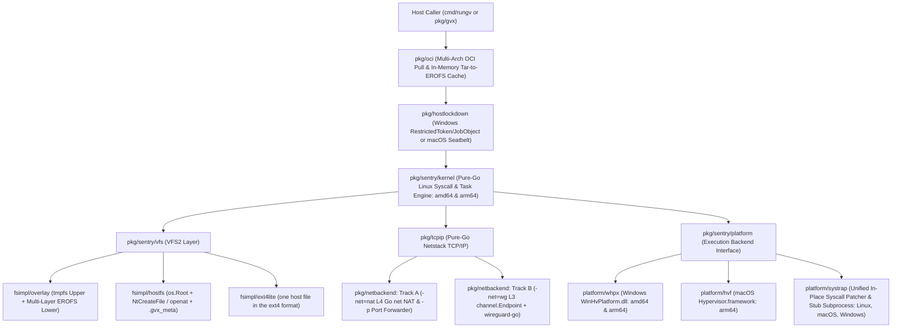
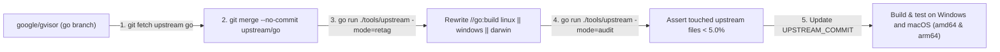
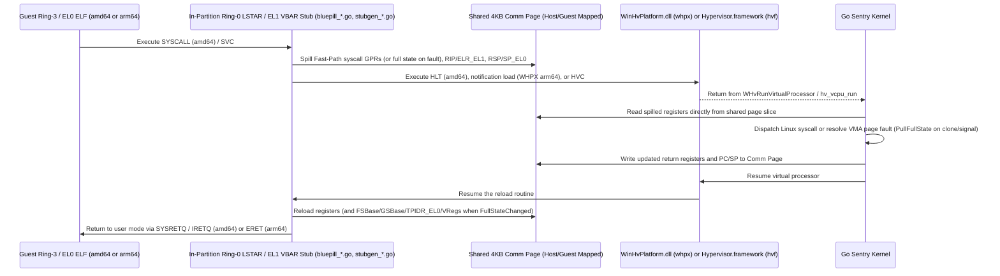
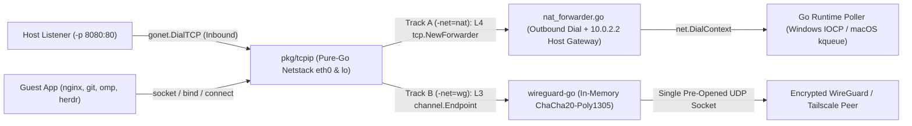
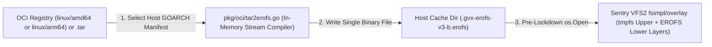
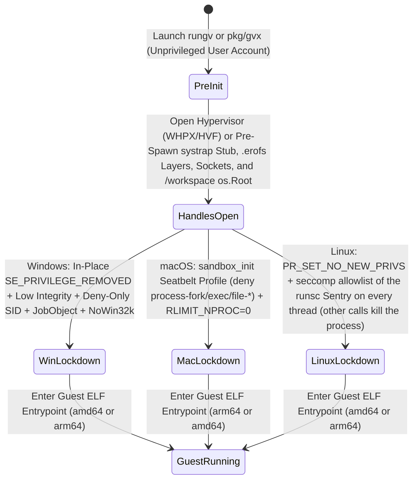

# `gvx` Architecture and Implementation Plan

`gvx` is an upstream-trackable fork of `google/gvisor` that ports the Sentry kernel to Windows (`windows/amd64`, `windows/arm64`) and macOS (`darwin/arm64`) as Priority-0 targets. Without booting a virtual machine, `gvx` runs Linux ELF64 binaries and OCI images inside an unprivileged sandbox via `cmd/rungv` or `pkg/gvx`. The runtime intercepts Linux system calls in Go and translates them into native Windows NT, macOS XNU, Go `net`, and user-mode hypervisor or `systrap` calls.

---

## 1. Executive Summary and Architectural Scope

This section defines the Priority-0 target matrix, execution backends, networking modes, OCI image pipeline, and upstream isolation rules for `gvx`. Every subsystem implementation must satisfy these baseline contracts before merging.

| Design Objective | Engineering Contract | Verification Boundary |
| :--- | :--- | :--- |
| **Priority-0 Dual-OS & Dual-Arch** | Targets `windows/amd64`, `windows/arm64`, and `darwin/arm64` from one codebase. | Compiles and runs native `linux/amd64` and `linux/arm64` ELF64 workloads on Windows and macOS. |
| **Zero Runtime Elevation** | Runs under a standard user account and locks down the host process before guest entry. | Requires no UAC prompts, no `sudo`/`root`, no kernel drivers/kexts, and no background daemons. |
| **Hardware 4KB Paging (`whpx` & `hvf`)** | Uses `WinHvPlatform.dll` (Windows) and `Hypervisor.framework` (macOS) with 4KB EPT and Stage-1/Stage-2 tables. | Bypasses the Windows 64KB `VirtualAlloc` limit and the Apple Silicon 16KB host page limit. |
| **Unified `systrap` Fallback (`systrap`)** | Exposes `pkg/sentry/platform/systrap` on Linux (upstream). Windows (`winsystrap`) runs stub processes from a small locked image with `winSysmsg` fast-path islands and debug-object stops. macOS has no `systrap` engine. | Executes ELF64 binaries and JIT runtimes (V8) when hardware virtualization is disabled. The guest architecture must equal the host architecture. |
| **Dual-Track Netstack (`pkg/netbackend`)** | Connects `pkg/tcpip` to an L4 Go `net` NAT and port forwarder (`-net=nat -p`) or an L3 `wireguard-go` tunnel (`-net=wg`). | Supports inbound/outbound port forwarding (`-p`) and `host.docker.internal`, or cryptographic L3 isolation. |
| **Direct OCI Image Execution (`pkg/oci`)** | Streams OCI `.tar.gz`/`.tar.zst` layers in memory into cached `<sha256>.erofs` images mounted via `fsimpl/overlay`. | Runs unmodified multi-arch Docker/OCI images without extracting Linux files onto NTFS or APFS. |
| **Clean Upstream Boundary** | Isolates host logic behind `_windows.go` and `_darwin.go` files and platform interfaces. | Requires a charged upstream diff below 5.0% under Section 2.2 audit rules and Go 1.27+ builds without Bazel. |



### 1.1 Compatibility Matrix and Cross-Architecture Execution (Descriptive Module)

`gvx` pairs hardware virtualization (`whpx` and `hvf`) as the default Tier-1 engine with the `systrap` backend as the user-mode fallback. Linux uses the upstream gVisor platforms.

The `systrap` fallback runs on Windows `amd64` and `arm64` with 4KB guest pages. The Windows engine starts its stubs from a generated 1 KB image, so it needs no C toolchain. The project removed the macOS engine (`darwinsystrap`) because it could not run executables with 4KB-aligned segments and non-PIE executables. Section 3.3 gives the reason. macOS runs on `hvf`. The project also dropped the Rosetta 2 engine and the whole `darwin/amd64` target. A syscall-number Seatbelt filter on a translated process panicked the host kernel. A stub without that filter would let a guest issue host system calls. The guest architecture must equal the host architecture on every backend.

| Host Target | Primary Engine (`whpx` / `hvf`) | Fallback Engine (`systrap`) | Host Page & Allocation Granularity | Platform Requirements & Status |
| :--- | :--- | :--- | :--- | :--- |
| **`windows/amd64`** (Intel / AMD) | `platform/whpx` (`WinHvPlatform.dll` 4KB EPT) | `platform/systrap` (`winsystrap`: `winSysmsg` fast path and debug-object stops, `jmp rel32` or `CC 90` patch). | 4KB Page / 64KB `VirtualAlloc` Reserve | Windows 10 (2004+) and Windows 11 with the Windows Hypervisor Platform feature. Runs `linux/amd64` images. |
| **`windows/arm64`** (Snapdragon X) | `platform/whpx` (`Arm64Support` 4KB Stage-2) | `platform/systrap` (`winsystrap`: `winSysmsg` fast path and debug-object stops, `B` or `brk` patch). Runs on hosts without WHP. | 4KB Page / 64KB `VirtualAlloc` Reserve | Windows 11 24H2 (Build `26100.3915+`) required for ARM64 WHPX. Runs `linux/arm64` images. |
| **`darwin/arm64`** (Apple Silicon M1-M5) | `platform/hvf` (`Hypervisor.framework` Stage-1 4KB + Stage-2 16KB) | None. The `darwinsystrap` engine was removed. `platform/systrap` builds a stub that returns `ErrUnavailable`. | 16KB Host Page / 16KB Map Granularity | Entitlement `com.apple.security.hypervisor` for `hvf`. Runs `linux/arm64` images. |
| **`darwin/amd64`** (Intel Mac) | None. | None. | None. | Not supported. The project dropped this target, because no Intel Mac ran the engine. |
| **`linux/amd64`** | Upstream platforms (`kvm`, `systrap`). | Upstream `systrap`. | 4KB Page | CI builds and tests the packages that `gvx` owns. |
| **`linux/arm64`** | Upstream platforms (`kvm`, `systrap`). | Upstream `systrap`. | 4KB Page (host dependent) | CI builds and tests the packages that `gvx` owns. |

---

## 2. Repository Layout and Upstream Synchronization Architecture

`gvx` tracks the pre-generated `go` branch of `https://github.com/google/gvisor.git` (`upstream/go`). Upstream publishes `go_stateify` and `go_marshal` output for both `amd64` and `arm64` directly to `upstream/go`, so `gvx` compiles with `go build` without Bazel.

```text
gvx/ (Fork of google/gvisor@go)
 ├── AGENTS.md                              # [NEW] Mandatory agent instructions and ASD-STE100 gates
 ├── README.md                              # [NEW] Project overview, quickstart, and build guide
 ├── UPSTREAM_COMMIT                        # [NEW] Pinned commit SHA from google/gvisor (go branch)
 ├── entitlements.plist                     # [NEW] com.apple.security.hypervisor entitlement for hvf
 ├── .github/workflows/                     # [NEW] ci.yml (every push) and e2e-images.yml (weekly registry gates)
 ├── docs/
 │   └── architecture.md                    # [NEW] Authoritative architecture and milestone plan
 ├── scripts/                               # [NEW] codesign-exec.sh (signs test binaries) and sync-upstream.sh
 ├── tools/
 │   ├── shiminterop/                       # [NEW] Isolated SDK smoke tests
 │   └── upstream/                          # [NEW] Upstream sync, diff audit, import boundaries, and build-tag rewriter
 │       ├── main.go
 │       ├── patches.go
 │       ├── buildtag_allowlist.txt
 │       ├── boundaries.go
 │       ├── compare.go
 │       ├── sync.go
 │       └── diff_audit.go
 ├── cmd/
 │   ├── containerd-shim-gvx-v2/             # [NEW] Optional containerd control command
 │   │   └── main.go
 │   └── rungv/                             # [NEW] Standalone CLI runner (run, pull, stub)
 │       └── main.go
 ├── internal/                              # [NEW] gvxshim control adapter and test fixtures
 │   └── xsys/unix/                         # [NEW] Embedded copy of golang.org/x/sys/unix with Darwin and Windows changes (docs/x-sys-unix.md)
 ├── pkg/
 │   ├── gvx/                               # [NEW] Embeddable Go library API for host tools
 │   │   ├── sandbox.go
 │   │   ├── config.go
 │   │   ├── image.go
 │   │   ├── kernel_runner.go
 │   │   ├── stdio_device.go
 │   │   └── platform_systrap_{native,other}.go
 │   ├── oci/                               # [NEW] Multi-arch OCI puller and Tar-to-EROFS compiler
 │   │   ├── pull.go
 │   │   ├── tar2erofs.go
 │   │   ├── erofs_layout.go
 │   │   └── cache.go
 │   ├── netbackend/                        # [NEW] Dual-track Netstack egress & port forwarder
 │   │   ├── nat_forwarder.go
 │   │   ├── port_forwarder.go
 │   │   ├── dns_relay.go
 │   │   ├── wireguard_endpoint.go
 │   │   ├── wireguard_tun.go
 │   │   └── wireguard_bind.go
 │   ├── hostarch/
 │   │   └── hostarch_darwin_arm64_4k.go    # [NEW] 4KB guest page constants for darwin/arm64
 │   ├── sync/
 │   │   ├── futex_linux_xplat.go           # [NEW] Linux SYS_FUTEX implementation
 │   │   ├── futex_windows.go               # [NEW] WaitOnAddress / WakeByAddressSingle bindings
 │   │   └── futex_darwin.go                # [NEW] XNU __ulock_wait / __ulock_wake bindings
 │   ├── memutil/
 │   │   ├── memfd_linux_unsafe.go          # Unmodified upstream memfd_create / mmap wrappers
 │   │   ├── memutil_windows.go             # [NEW] CreateFileMappingW + MapViewOfFile3 wrappers
 │   │   └── memutil_darwin.go              # [NEW] mmap(MAP_ANON) + mach_vm_remap wrappers
 │   ├── fd/
 │   │   ├── fd_windows.go                  # [NEW] Unified HostHandle wrapping Win32 HANDLE
 │   │   └── fd_darwin.go                   # [NEW] Unified HostHandle wrapping Darwin FD
 │   ├── hostlockdown/
 │   │   ├── lockdown_windows.go            # [NEW] RestrictedToken, Low Integrity, JobObject, Win32k block
 │   │   ├── lockdown_darwin.go             # [NEW] Seatbelt sandbox_init SBPL profile & RLIMIT_NPROC=0
 │   │   └── lockdown_other.go              # [NEW] Returns ErrUnsupported on other hosts
 │   └── sentry/
 │       ├── hostcpu/
 │       │   ├── hostcpu_windows.go         # [NEW] GetCurrentProcessorNumber binding
 │       │   └── hostcpu_darwin.go          # [NEW] Darwin CPU number binding
 │       ├── time/
 │       │   ├── calibrated_clock_windows.go # [NEW] QueryPerformanceCounter clock calibration
 │       │   └── calibrated_clock_darwin.go  # [NEW] mach_continuous_time clock calibration
 │       ├── pgalloc/
 │       │   ├── memory_file_windows.go     # [NEW] DiscardVirtualMemory / MEM_RESET page reclaim
 │       │   └── memory_file_darwin.go      # [NEW] madvise(MADV_FREE) page reclaim
 │       ├── platform/
 │       │   ├── whpx/                      # [NEW] Windows Hypervisor Platform backend (amd64 & arm64)
 │       │   │   ├── whpx.go
 │       │   │   ├── address_space.go
 │       │   │   ├── vcpu_amd64.go
 │       │   │   ├── vcpu_arm64.go
 │       │   │   ├── vector.go              # Guest XSAVE features, XCR0, and the compacted layout
 │       │   │   ├── stubgen_x86.go         # Go generator for the in-partition amd64 stub
 │       │   │   └── stubgen_a64.go         # Go generator for the in-partition arm64 stub
 │       │   ├── hvf/                       # [NEW] macOS Hypervisor.framework backend (arm64)
 │       │   │   ├── hvf.go
 │       │   │   ├── address_space.go
 │       │   │   ├── vcpu_darwin_arm64.go
 │       │   │   └── bluepill_arm64.go      # Go generator for the in-guest EL1 stub
 │       │   ├── hvcommon/                  # [NEW] Encoders, descriptors, and EL1 values that whpx and hvf share
 │       │   │   ├── a64.go                 # AArch64 encoders and EL1 constants
 │       │   │   └── x86.go                 # x86-64 selectors, GDT, TSS, IDT gate, and GS opcode emitters
 │       │   └── systrap/                   # Unified systrap backend (Linux upstream + Windows siblings)
│       │       ├── systrap.go             # Unmodified upstream Linux systrap implementation
│       │       ├── systrap_xplat.go       # [NEW] Shared types: ProbeInfo, ErrUnavailable
│       │       ├── platform_darwin.go     # [NEW] macOS stub: New returns ErrUnavailable, because macOS runs on hvf
│       │       ├── patcher_amd64_xplat.go # [NEW] Page scan and patcher for amd64 (x86asm sweeps, island slots)
│       │       ├── patcher_arm64_xplat.go # [NEW] Lazy page-trap patcher for arm64 (B island slots)
│       │       ├── stubcode_*_xplat.go    # [NEW] Generated spill routines and trampolines
│       │       ├── stubimage_xplat.go     # [NEW] The 1 KB executable that every Windows stub runs
│       │       ├── platform_windows.go    # [NEW] Windows platform, stub host client, debug object
│       │       ├── stubhost_windows.go    # [NEW] Stub host process, confined token, one job for each stub
│       │       ├── stubimage_windows.go   # [NEW] Writes the image once and holds it open with read-only sharing
│       │       ├── address_space_windows.go # [NEW] 4KB placeholder window, lazy patching, private code pages
│       │       ├── context_windows.go     # [NEW] Context.Switch over debug-object stops
│       │       ├── fastpath_windows.go    # [NEW] winSysmsg fast path and spin windows
│       └── fsimpl/
 │           ├── hostfs/                    # [NEW] Secure os.Root + .gvx_meta host mount (Windows, macOS, and Linux)
 │           │   ├── hostfs.go
 │           │   ├── inode_windows.go
 │           │   ├── inode_darwin.go
 │           │   └── posix_rename_windows.go
 │           └── ext4lite/                  # [NEW] Volume file system: one host file in the ext4 format
 │               ├── ondisk.go              # Geometry and codecs
 │               ├── alloc.go               # Block and inode allocator
 │               ├── flush.go               # Snapshot of the dirty state and the write of a flush
 │               ├── gate.go                # Operation gate that makes the snapshot a cut between operations
 │               ├── jbd2.go                # JBD2 journal codecs
 │               ├── journal.go             # Journal commit, replay, and creation
 │               ├── orphan.go              # Orphan list of unlinked open files
 │               ├── fsck.go                # fsckLite for volumes without a journal
 │               ├── compact.go             # Unmount compaction
 │               └── storage_*.go           # Storage tiers A, B, and C
 └── e2e/                                   # [NEW] Unified OS-agnostic end-to-end test suite
     ├── sandbox_e2e_test.go
     └── gate_*_test.go                     # Milestone gates M2, M3, and M4
```

### 2.1 Layered Subsystem Map and Import Directionality

Each package owns one architectural boundary. Enforce top-down import directionality to keep Windows and macOS host APIs out of the pure-Go Sentry kernel.

| Package | Single Responsibility | Allowed Internal Imports | Forbidden Imports |
| :--- | :--- | :--- | :--- |
| `cmd/containerd-shim-gvx-v2` | Dispatches the optional shim command. | `internal/gvxshim` | `pkg/*`, `runsc/*`, `shim/*` |
| `internal/gvxshim` | Owns bootstrap, local RPC controls, process lifetime, and safe cleanup. | None; public containerd types, ttRPC, protobuf, and host APIs are external dependencies. | `pkg/*`, `runsc/*`, `shim/*`, `cmd/*` |
| `tools/shiminterop` | Exercises real ShimManager `2.1.5` against the compiled shim in an isolated module. | None | Root runtime, command, and internal packages |
| `cmd/rungv` | Parses the Docker-style commands of [`cli.md`](cli.md) (`run`, `pull`, `images`, `inspect`, `tag`, `rmi`, `save`, `load`, `login`, `logout`, `stub`) and starts a sandbox instance. | `pkg/gvx` | `pkg/sentry/*`, `WinHvPlatform.dll` |
| `pkg/gvx` | Coordinates `pkg/oci`, `pkg/netbackend`, `pkg/hostlockdown`, and Sentry boot. | `pkg/oci`, `pkg/netbackend`, `pkg/hostlockdown`, `pkg/sentry/*`, `pkg/fd`, `pkg/tcpip` | `cmd/*`, `internal/gvxshim` |
| `pkg/oci` | Resolves `amd64`/`arm64` OCI manifests and compiles `.tar` layers into `.erofs` files. | `pkg/abi/linux` | `pkg/sentry/kernel`, `pkg/hostlockdown` |
| `pkg/netbackend` | Bridges `pkg/tcpip` to L4 Go `net` forwarders (`nat`) or L3 `wireguard-go` (`wg`). | `pkg/tcpip` | `pkg/sentry/kernel`, `WinHvPlatform.dll` |
| `pkg/hostlockdown` | Locks down the host process via Windows Tokens/JobObjects or macOS Seatbelt. | `golang.org/x/sys/windows`, `golang.org/x/sys/unix` | `pkg/sentry/*`, `pkg/tcpip` |
| `pkg/sentry/kernel` | Dispatches the OS-agnostic Linux task, signal, and syscall table (`amd64` & `arm64`). | `pkg/abi/linux`, `pkg/sentry/platform`, `pkg/sentry/vfs`, `pkg/sync` | `golang.org/x/sys/windows`, `pkg/hostlockdown` |
| `pkg/sentry/platform/whpx` | Executes guest Ring-3/EL0 code on Windows via `WinHvPlatform.dll` and 4KB EPT/Stage-2. | `pkg/sentry/platform`, `pkg/memutil`, `pkg/abi/linux`, `golang.org/x/sys/windows` | `pkg/sentry/kernel`, `pkg/sentry/vfs` |
| `pkg/sentry/platform/hvf` | Executes guest EL0/Ring-3 code on macOS via `Hypervisor.framework` and 4KB Stage-1/Stage-2. | `pkg/sentry/platform`, `pkg/memutil`, `pkg/abi/linux`, `golang.org/x/sys/unix` | `pkg/sentry/kernel`, `pkg/sentry/vfs` |
| `pkg/sentry/platform/systrap` | Executes guest code via in-place syscall patching, `sysmsg` shared memory, and isolated stub subprocesses across Linux, macOS, and Windows. | `pkg/sentry/platform`, `pkg/memutil`, `pkg/abi/linux`, `golang.org/x/arch/*` | `pkg/sentry/kernel`, `pkg/sentry/platform/whpx`, `pkg/sentry/platform/hvf` |
| `pkg/sentry/fsimpl/hostfs` | Mounts host `/workspace` via `os.Root`, `NtCreateFile`/`openat`, and `.gvx_meta`. | `pkg/sentry/vfs`, `pkg/abi/linux`, `pkg/fd`, `golang.org/x/sys/*` | `pkg/sentry/platform/*` |
| `pkg/sentry/fsimpl/ext4lite` | Stores one named volume in one pre-opened host file in the ext4 format. | `pkg/sentry/vfs`, `pkg/sentry/blockdev`, `pkg/abi/linux`, `pkg/fd`, `golang.org/x/sys/*` | `pkg/sentry/platform/*`, `cmd/*` |
| `pkg/sync`, `pkg/memutil`, `pkg/fd` | Provide host futexes, shared memory views, and host handles on Windows and macOS. | `golang.org/x/sys/windows`, `golang.org/x/sys/unix` | `pkg/sentry/*` |

`tools/upstream` enforces this table with `boundaries.go`. Sentry foundation packages such as `pkg/context`, `pkg/hostarch`, `pkg/usermem`, and `pkg/sentry/memmap` appear in every platform and VFS interface, so those packages import them. Each other import needs a reason-annotated exception in `boundaries.go`.

### 2.2 Three-Tier Upstream Isolation Model (Descriptive Module)

To prevent merge conflicts during continuous upstream pulls, `gvx` partitions all repository files into three strict isolation tiers.

| Isolation Tier | File Paths | Upstream Conflict Rate | Maintenance Mechanism |
| :--- | :--- | ---: | :--- |
| **Tier 1: Additive Directories** | `cmd/rungv/`, `cmd/containerd-shim-gvx-v2/`, `pkg/gvx/`, `pkg/oci/`, `pkg/netbackend/`, `pkg/hostlockdown/`, `pkg/sentry/platform/whpx/`, `pkg/sentry/platform/hvf/`, `pkg/sentry/platform/hvcommon/`, `pkg/sentry/fsimpl/chunkcache/`, `pkg/sentry/fsimpl/hostfs/`, `pkg/sentry/fsimpl/ext4lite/`, `e2e/`, `internal/`, `scripts/`, `.github/`, `tools/upstream/`, `tools/shiminterop/`, `tools/licenses/`, `docs/` | `0.0%` | Owned exclusively by `gvx`; `upstream/go` never touches these paths. |
| **Tier 2: Sibling `_windows`, `_darwin`, & `_xplat` Files** | `pkg/sync/*_{windows,darwin,xplat}*`, `pkg/memutil/*_{windows,darwin,xplat}*`, `pkg/fd/*_{windows,darwin,xplat}*`, `pkg/{erofs,fdnotifier,syserr}/*_{windows,darwin,xplat}*`, `pkg/hostarch/*_darwin*`, `pkg/sentry/{kernel,mm}/*_xplat*`, `pkg/sentry/{pgalloc,time,hostcpu}/*_{windows,darwin}.go`, `pkg/sentry/platform/*_{windows,darwin,xplat}*`, `pkg/sentry/platform/systrap/*_{windows,darwin,xplat}*` | `0.0%` | Placed alongside unmodified `*_linux.go` files; Go selects the target file by `GOOS` and `GOARCH`. |
| **Tier 3: Build-Tag & Seam Patches** | Pure-Go files listed in `tools/upstream/buildtag_allowlist.txt` and `io_uring` `-ENOSYS` stubs | `< 5.0%` | Re-applied automatically by `tools/upstream` (`//go:build linux \|\| windows \|\| darwin`) after every `git merge upstream/go`. |

The audit charges a file against the 5.0% ceiling only when its content differs from upstream. A file that `gvx` adds inside an upstream directory is free when its name carries the token `windows`, `darwin`, or `xplat`. The audit then counts it as a Tier 2 sibling. It reports build-tag fences on Linux-only trees (`runsc`, `shim`, `pkg/sentry/fsimpl/gofer`) as a third number. A strict count that includes the fences is larger than the charged share, and the audit prints both.



### 2.3 Upstream Diff and Synchronization Procedure (Procedural Module)

Run this procedure to audit the current upstream diff or merge new commits from `google/gvisor`.

> [!WARNING]
> Do not hand-edit `*_linux.go` files or scatter ad-hoc changes across pure-Go Sentry files. Unrecorded edits in Tier 3 files cause merge conflicts during upstream synchronization and violate the 5.0% diff ceiling. Register every build-tag change in `tools/upstream/buildtag_allowlist.txt`.

1. Register the upstream gVisor repository as the `upstream` Git remote.
2. Fetch the latest `go` branch from `upstream`.
3. Inspect the modified upstream file count and verify the `< 5.0%` budget against `UPSTREAM_COMMIT`.
4. Merge `upstream/go` without committing.
5. Run `tools/upstream` in `retag` mode to apply `//go:build linux || windows || darwin` to allowlisted files.
6. Run `tools/upstream` in `audit` mode to assert zero unauthorized edits in `*_linux.go` files.
7. Record the merged `upstream/go` SHA in `UPSTREAM_COMMIT` and verify all three non-Linux Priority-0 targets and both Linux targets.

```bash
git remote add upstream https://github.com/google/gvisor.git 2>/dev/null || true
git fetch upstream go

# Merge new upstream commits and re-apply build tags
git merge --no-commit upstream/go
go run ./tools/upstream -mode=retag
go run ./tools/upstream -mode=audit -max-ratio=0.05   # add -offline to reuse the cached upstream archive
git rev-parse upstream/go > UPSTREAM_COMMIT

# Verify the three non-Linux Priority-0 host targets and both Linux targets compile cleanly
GOOS=windows GOARCH=amd64 go build ./...
GOOS=windows GOARCH=arm64 go build ./...
GOOS=darwin  GOARCH=arm64 go build ./...
GOOS=linux   GOARCH=amd64 go build ./...
GOOS=linux   GOARCH=arm64 go build ./...
```

---

## 3. Subsystem Porting Specifications

This section specifies the Windows and macOS APIs, `amd64` and `arm64` transitions, 4KB memory mapping decouplers, `systrap` in-place binary patchers, register preservation rules, network backends, OCI loaders, and security invariants.

### 3.1 Host OS Primitives and Build-Tag Decoupling (Descriptive Module)

Approximately 65% of gVisor (`pkg/sentry/kernel`, `pkg/sentry/arch`, `pkg/ring0`, `pkg/sentry/vfs`, `pkg/sentry/fsimpl/tmpfs`, `pkg/sentry/fsimpl/erofs`, `pkg/sentry/fsimpl/overlay`, and `pkg/tcpip`) contains OS-agnostic Go code supporting both `amd64` and `arm64`. `tools/upstream` expands the build tags on these pure-Go files to `//go:build linux || windows || darwin`, while `_windows.go` and `_darwin.go` files implement the host primitives.

| gVisor Package | Current Linux Dependency | Windows Implementation (`_windows.go`) | macOS Implementation (`_darwin.go`) |
| :--- | :--- | :--- | :--- |
| **`pkg/sync`** | `SYS_FUTEX` (`FUTEX_WAIT`, `FUTEX_WAKE`) | `WaitOnAddress`, `WakeByAddressSingle`, `WakeByAddressAll` (`api-ms-win-core-synch-l1-2-0.dll`). | `__ulock_wait` and `__ulock_wake` (`UL_COMPARE_AND_WAIT` in `libSystem.B.dylib`). |
| **`pkg/memutil` & `pgalloc`** | `memfd_create`, `SYS_MMAP`, `MADV_DONTNEED`, `FALLOC_FL_PUNCH_HOLE` | `CreateFileMappingW(INVALID_HANDLE_VALUE, ...)`, `MapViewOfFile3` (`kernelbase.dll`, with `MapViewOfFile` fallback), and `DiscardVirtualMemory` (`MEM_RESET`). | `mmap(MAP_ANON)`, `mach_vm_remap` (multi-view shared aliasing), and `madvise(MADV_FREE)`. |
| **`pkg/sentry/time` & `hostcpu`** | `clock_gettime(CLOCK_MONOTONIC)`, `getcpu` VDSO | `QueryPerformanceCounter` / `QueryPerformanceFrequency` and `GetCurrentProcessorNumber`. | `mach_continuous_time` / `clock_gettime_nsec_np` and `pthread_cpu_number_np`. |
| **`pkg/fd`** | Raw `int` FDs, `dup3`, `SCM_RIGHTS` | `HostHandle` wrapping `syscall.Handle` with explicit `Close()` ownership. | `HostHandle` wrapping Darwin file descriptors with `fcntl(F_DUPFD_CLOEXEC)`. |
| **`pkg/fdnotifier`** | `epoll` in edge-triggered mode (`fdnotifier.go`, Linux only). | One table of observed descriptors in `fdnotifier_portable.go`, with no goroutine and no event. `NonBlockingPoll` reports every requested event as ready. | The same table in `fdnotifier_portable.go`. `NonBlockingPoll` calls `poll` once without blocking. |
| **`pkg/tcpip`** | `af_packet` / `tun` host links | Pure-Go Netstack routed via `pkg/netbackend` (`-net=nat` or `-net=wg`). | Pure-Go Netstack routed via `pkg/netbackend` (`-net=nat` or `-net=wg`). |
| **`pkg/abi/linux` & `sentry/arch`** | Pure Go (`amd64` & `arm64`) | Retain 100% unchanged; supports Linux `x86_64` and `aarch64` ABIs natively. | Retain 100% unchanged; supports Linux `aarch64` and `x86_64` ABIs natively. |
| **`pkg/sentry/syscalls`** | `io_uring` host passthrough | Return `-ENOSYS` on `io_uring_setup` and `io_uring_enter` to select Sentry `epoll`. | Return `-ENOSYS` on `io_uring_setup` and `io_uring_enter` to select Sentry `epoll`. |

### 3.2 Primary Hardware Hypervisor Engines: `platform/whpx` (Windows) and `platform/hvf` (macOS)

`platform/whpx` (Windows `WinHvPlatform.dll` on `amd64` and `arm64`) and `platform/hvf` (macOS `Hypervisor.framework` on `arm64`) share one architectural design. Both backends decouple Linux 4KB `mmap(MAP_FIXED)` mappings from the Windows 64KB allocation granularity and the Apple Silicon 16KB host page granularity. Both also use an in-partition Ring-0 (`amd64`) or EL1 (`arm64`) shared communication page to avoid per-syscall register API calls.

| Hypervisor Operation | Windows (`platform/whpx` on `amd64` & `arm64`) | macOS (`platform/hvf` on `arm64`) |
| :--- | :--- | :--- |
| **Privilege / OS Requirement** | Standard user token; `windows/arm64` verifies Windows 11 24H2 (`Build >= 26100.3915`) and `WHvCapabilityCodeFeatures.Arm64Support`. | Standard user token with ad-hoc `com.apple.security.hypervisor` signature (`codesign -s -`). |
| **Partition Creation** | `WHvCreatePartition` + `WHvSetupPartition` | `hv_vm_create(NULL)` |
| **4KB Page Granularity Mapping** | Registers each 64MiB arena of `pgalloc.MemoryFile` with the partition once through `WHvMapGpaRange`. `MapFile` and `Unmap` then change only the guest page tables, which hold 4KB or 2MiB entries. | Maps each 1GiB chunk of a `pgalloc.MemoryFile` into Stage-2 IPA once with `HV_MEMORY_READ \| WRITE \| EXEC` via `hv_vm_map`. `MapFile` and `Unmap` then change only Stage-1 (`TTBR0_EL1` with `TCR_EL1.TG0 = 0b00` 4KB granule), which enforces `R/W/X` at 4KB. |
| **vCPU Execution Call** | `WHvRunVirtualProcessor(partition, vpIndex, ...)` | `hv_vcpu_run(vcpu)` on a dedicated worker thread per vCPU. The worker calls `runtime.LockOSThread()`, because a vCPU belongs to the thread that created it. |
| **Async Signal Preemption** | `WHvCancelRunVirtualProcessor(partition, vpIndex, 0)` | `hv_vcpus_exit(&vcpu, 1)` |
| **`amd64` Syscall Trap (`stubgen_x86.go`)** | Ring-3 `SYSCALL` enters Ring-0 `MSR_LSTAR`, spills syscall GPRs to `CommPage`, executes `HLT`. | Not applicable (`darwin/amd64` dropped). |
| **`arm64` Syscall Trap (`bluepill_arm64.go`, `stubgen_a64.go`)** | EL0 `SVC #0` enters EL1 vectors and spills registers to `CommPage`. An EL1 load from unbacked GPA zero returns to the host. | EL0 `SVC #0` enters EL1 `VBAR_EL1`, spills `X0..X8, SP_EL0, ELR_EL1, PSTATE` to `CommPage`, executes `HVC #0`. |
| **`amd64` Vector State** | Sets `ProcessorXsaveFeatures` before `WHvSetupPartition`. XCR0 enables x87, SSE, AVX, and AVX-512 when the hypervisor and the Sentry image hold them. `WHvGetVirtualProcessorState` moves the compacted XSAVE state on the cold path. | Not applicable (`darwin/amd64` dropped). |
| **Read-only File Mappings** | Maps read-only host views directly into the partition. | `hv_vm_map` rejects the read-only descriptor of an EROFS image. `hvf` copies those pages into immutable slab pages, and pgalloc memory files map directly. |
| **`membarrier` Global and Private Expedited** | `GlobalMemoryBarrier` cancels each virtual processor that runs guest code and waits until its `Switch` call returns. A processor outside the guest needs no cancel. `FlushProcessWriteBuffers` orders the Sentry threads, which access guest memory for system calls in progress. | `GlobalMemoryBarrier` cancels each vCPU that runs guest code and waits for one exit of `hv_vcpu_run`. A cancel that finds no guest to stop resumes the guest, so the guest task keeps running. macOS has no call that forces a barrier on every thread of a process, so the barrier orders guest code only. It does not order a Sentry thread that accesses guest memory for a system call in progress. |
| **Unknown Exit Reason** | Not applicable. | `HV_EXIT_REASON_UNKNOWN` carries no information. The worker resumes the vCPU as it does after a cancellation, and `Switch` fails after 4096 consecutive unknown exits. |



#### Two-Stage 4KB Paging on Apple Silicon (`platform/hvf`) and 64KB-to-4KB Slicing on Windows (`platform/whpx`) (Descriptive Module)

Linux ELF64 binaries map `.text` (`R-X`) and `.data` (`RW-`) segments at 4KB (`0x1000`) file offsets and virtual address boundaries. On Windows, `VirtualAlloc(MEM_RESERVE)` and `MapViewOfFile3` require 64KB (`0x10000`) alignment. `platform/whpx` resolves this with 4KB entries in its own guest page tables. It registers each 64MiB arena of `pgalloc.MemoryFile` with `WHvMapGpaRange` once. Each arena has a read-only layer and a writable layer, and memory-file chunks always use the writable layer. The guest page tables give each 4KB page its permissions.

On Apple Silicon macOS (`darwin/arm64`), the host XNU kernel and `hv_vm_map()` operate on 16KB (`0x4000`) pages. `platform/hvf` resolves this using the two-stage ARM64 MMU (`GVA` to Stage-1 `TTBR0_EL1` 4KB, then `IPA` to Stage-2 `hv_vm_map` 16KB, then `HPA`). Stage-2 maps each 1GiB chunk of the memory file into IPA space once, with permissive `HV_MEMORY_READ | HV_MEMORY_WRITE | HV_MEMORY_EXEC` rights. Inside the vCPU, the `bluepill` stub configures `TCR_EL1.TG0 = 0b00` (4KB granule) and populates 4KB Stage-1 page table entries in `TTBR0_EL1` with exact `R-X` or `RW-` (`UXN=1`) permissions. Because the ARM64 MMU enforces the intersection of Stage-1 and Stage-2 permissions, the hardware traps permission violations at exact 4KB boundaries.

Both hardware backends register guest memory with the hypervisor once, and never on a page fault. `MapFile` and `Unmap` change only the guest page tables. A 4 MiB fault therefore makes one call into the page-table code and no call into the hypervisor. `Platform.MapUnit` returns 2 MiB on both backends. `SupportsAddressSpaceIO` returns false, so the Sentry reads and writes guest memory through its own mapping of the memory file. A write that the Sentry makes to a page that the guest already runs as code does not flush the guest instruction cache on `arm64`. A mapping with execute permission flushes it, so the ELF loader, `mprotect`, and copy-on-write stay correct.

`pkg/sentry/platform/hvcommon` holds the code that the architecture fixes and that the two backends share. This code is the AArch64 instruction encoders, the EL1 system-register values, the x86-64 selectors and descriptors, the TSS template, the IDT gate encoding, and the GS-relative opcode emitters. Each backend keeps its own `CommPage` layout and its own stub generator. Hyper-V and Hypervisor.framework exchange different state at a stop.

ARM64 WHPX configures GICv3 before partition setup and assigns a separate redistributor to every vCPU.
It clears startup suspension because Sentry schedules guest threads without a Linux kernel.
The EL1 notification page maps to unbacked GPA zero, outside the RAM allocator.
An access from EL0 to this page raises a permission fault.
The memory exit leaves PC at the load, so every stop costs one PC write before the next run.
WHP consumes `HVC #0` without an exit, so the stub has no instruction that exits past itself.

#### CPU Feature Exposure (Descriptive Module)

A guest must never see a CPU feature that it cannot use. The Sentry derives `/proc/cpuinfo`, `AT_HWCAP`, signal frames, and sigreturn checks from one `cpuid.FeatureSet`.

| Backend | Guest CPUID or ID Registers | Sentry Feature Set |
| :--- | :--- | :--- |
| **`whpx` (`amd64`)** | One selection in `vector.go` sets the `ProcessorXsaveFeatures` property and XCR0. MPX, AMX, XFD, XCR1, and AVX10 stay hidden. Hyper-V rejects a partition without `XsaveComp` or `XsaveSupervisor`, so both stay. | `Platform.GuestFeatureSet` removes the hidden features and reports the guest XCR0 in CPUID leaf `0xD`. |
| **`whpx` (`arm64`)** | `hvcommon.DefaultIDRegisters`. | `AT_HWCAP` holds only the host features that those registers also report. |
| **`hvf`** | Host ID registers with the PAC, SVE, MTE, SME, and MPAM fields hidden. | `AT_HWCAP` comes from the `hw.optional` sysctl keys. |
| **`systrap` (Windows)** | Host CPUID and host XCR0. The stub saves x87, SSE, AVX, and AVX-512 state. | Host feature set. |

On `amd64`, `New` reads the XSAVE state of one probe vCPU and checks its compacted layout against host CPUID leaf `0xD`. A mismatch makes `New` fail, and `PlatformAuto` then selects `systrap`.

### 3.3 Unified User-Mode Fallback Engine: `pkg/sentry/platform/systrap` (`winsystrap`) (M5)

`pkg/sentry/platform/systrap` registers the `"systrap"` backend. Linux uses the upstream implementation. Windows (`winsystrap`) uses the engine of `gvx` on `amd64` and `arm64`. macOS has no `systrap` engine. The engine executes guest ELF64 code and in-guest JIT code (V8) directly on the host CPU at native speed without basic-block translation or instruction emulation.

[`systrap-windows.md`](systrap-windows.md) records the measured Windows behavior and the `winsystrap` design. The table below follows that document.

The macOS engine `darwinsystrap` was removed because of compatibility problems. It forced 16KB guest pages, so executables with 4KB-aligned segments failed. macOS also reserves a 4GB `PAGEZERO` in every `arm64` task, so non-PIE executables that link below 4GB failed. `hvf` runs both kinds natively.

#### Stub Thread Wake-Up on Linux (Descriptive Module)

The Linux engine wakes a stub thread through a seccomp listener. The Sentry reads the notification of the thread and answers it. The kernel allows one listener in the filter chain of a task. A sandbox that runs inside another sandbox can have a listener in its chain already.

The engine installs the listener of each new stub thread and reads the error from the kernel. On `EBUSY`, it writes one warning for the process and stops the attempt for every later stub. Those stub threads use the futex loop. The futex loop is slower. Any other error stops the start of the stub.

#### `membarrier` on `systrap` (Descriptive Module)

The guest threads of `winsystrap` run in stub processes, so `FlushProcessWriteBuffers` in the Sentry cannot order them. `GlobalMemoryBarrier` suspends each stub thread that can run guest code, reads its context, and resumes it. The context call returns after the thread left user mode. A thread that the engine parked, or that waits in the spill routine for the Sentry, runs no guest code and needs no stop. The call holds the per-thread lock of the engine, so it never changes a suspend count that another operation owns. It suspends all running threads first, reads their contexts, and then resumes them, so the threads leave user mode in parallel. `FlushProcessWriteBuffers` in the Sentry orders the Sentry threads. [`systrap-windows.md`](systrap-windows.md) section 9 gives the reasoning and the limits.

#### Multi-Process Hardware Page-Table (`CR3` / `TTBR0_EL1`) Isolation and `sysmsg` IPC (Descriptive Module)

Running untrusted guest instructions inside the Sentry process without SFI masking would expose the Go runtime heap to arbitrary pointer writes. To preserve hardware MMU isolation (`CR3` on `amd64`, `TTBR0_EL1` on `arm64`) without a hypervisor, `platform/systrap` runs the guest in a stub process. The stub exists before `hostlockdown.Apply()` executes, or a process that exists then creates it.

The upstream package `usertrap` and the message types of `sysmsg` build on every host for `amd64`. The retag rules of `tools/upstream` widen eight files, and the other files of both packages stay Linux-only. No engine of `gvx` uses `usertrap.State`. Its trampolines write the thread state of the Linux stub into the `sysmsg` page, and it reads guest memory through `kernel.Task`. The Windows engine patches `syscall` sites with its own rewriter in `patcher_amd64_xplat.go`, which writes slots that follow the layout of `winSysmsg`.

On Windows, the `whpx` backend writes the root register of the address space on the host. The register is `CR3` on `amd64` and `TTBR0_EL1` on `arm64`. The write happens before a virtual processor runs with a recorded address space that differs from the current one. The reload stub in the guest loads the same value. A kick before the run, a cancel inside the reload stub, and `AddressSpace.Release` invalidate the recorded state of the virtual processor. The first fetch of the reload stub then never walks page tables that `Release` freed.

On Windows, a stub host starts before the lockdown. The host is a copy of the Sentry executable that runs only a request loop. It creates one stub process for each address space. The stub runs a generated 1 KB image that the host holds open with read-only sharing, so no process can change it. The stub is suspended, and its entry point never runs. It lives in a one-process job under a Low-integrity token with all privileges removed (`SE_PRIVILEGE_REMOVED`). By default, a patched syscall jumps through an island slot into the spill routine. The routine exchanges registers through a shared `winSysmsg` page and spins or waits on an event pair. Each side spins for a fixed time before it waits: 64 µs in the stub and 8 µs in the Sentry. The Sentry also attaches every stub to one debug object, which receives page faults, signals, and fallback `CC 90` or `brk` stops.

| `systrap` Subsystem | Windows (`winsystrap`: `amd64` & `arm64`), implemented |
| :--- | :--- |
| **Page Granularity** | Reserves the guest window as one placeholder with `VirtualAlloc2(MEM_RESERVE_PLACEHOLDER)` and maps memory-file pages as 4KB views with `MapViewOfFile3(MEM_REPLACE_PLACEHOLDER)`. The 64KB limit does not apply to such views. The guest sees 4KB pages. |
| **Guest Address Range** | A low window runs from `0x10000` to `0x7ffe0000`, a middle window from `0x7fff0000` to 66GiB, and a high window from `0x40000000000` (4TB) to `0x7edffdff0000`. Between 96GiB and 994GiB lie 29 HotSpot windows of 2GiB. The Sentry reserves all of them before the loader runs, and the memory manager treats the gaps as holes. The top `0x2010000` bytes of the high window hold the engine pages and the per-thread `winSysmsg` areas. A Linux `ET_EXEC` image at `0x10000` or `0x400000` loads in the low window. The compressed class space of HotSpot on `arm64` lives in the middle window or in a HotSpot window. |
| **Lazy Execute Page-Trap** | Maps original frames without execute permission. On an execute fault, the Sentry receives the exception through the debug object, patches a private copy of the page, and maps the copy as `PAGE_EXECUTE_READ`. A write to a writable and executable page maps the original frame again and reclaims its island slots. A platform-wide index maps each frame of the memory file to its patched copies and to its writable views. While a copy exists, the other writable views of the frame stay read-only, and a write through one of them drops the copies and restores the write permission. On `amd64`, the copy of a writable page that no ELF or PE image backs stays unpatched, because a JIT compiler reads the data beside its code from the copy that runs. The scan covers the executable sections of the backing ELF file. A store into the executing page, or into the executing frame through a second view, completes with a single step: the engine maps the copy as read, write, and execute for one instruction, writes the changed bytes to the original frame, and drops the copies. A write of the Sentry into a frame, such as the copy-out of `read` or the `write` of a mapped file, reaches the platform through an observer on the memory file, and the platform drops the copies of that frame. |
| **`amd64` Syscall Patching** | Decodes the page in 16 linear sweeps and patches a site when more than half of the sweeps with the fewest skipped bytes agree. With the fast path on, replaces `syscall` and the next three bytes with `jmp rel32` to a trampoline island slot when relocation rules hold. Otherwise it replaces the instructions in front of `syscall` with `jmp rel32` and keeps `CC 90` at `syscall`, or it keeps `CC 90` alone. Also patches `RDFSBASE`, `RDGSBASE`, and 32-bit/64-bit `%gs:` `MOV` instructions to island slots. |
| **`arm64` Trampoline Island & I-Cache Flush** | Reserves a 4KB island within `±120 MB` of the patched page. With the fast path on, replaces `svc #0` with `B <island_slot>` and `mrs xN, tpidr_el0` with a 16-byte slot branch; replaces `mrs xN, ctr_el0` and `msr tpidr_el0, xN` with `brk` traps, and replaces `ic ivau, xN` and the `dc` cache-clean instructions with `nop`. The `CTR_EL0` value of a guest sets `DIC` and `IDC`, because the engine flushes the instruction cache when it maps a copy. The `svc` slot stores the guest `x18` below the stack pointer before it uses the register, and a fault of that store sends the call through the debug path. Reclaims island slots via a bitmap on unmap or restore. |
| **Register Virtualization** | `amd64`: Windows resets the FS base at every context switch and reserves `%gs` for the host TEB. The engine loads the FS base through a trampoline at each start, serves patched `RDFSBASE`, `RDGSBASE`, and `%gs:` `MOV` sites through island slots, and repairs any faulting unpatched `%fs` or `%gs` access through `winTEBScratchA`. `arm64`: Windows keeps `x18` and `TPIDR_EL0` across stops. A routine in the engine page writes `TPIDR_EL0`. The `svc` slot keeps the live guest `x18` in the `winSysmsg` and restores it on return. |
| **Unpatched Syscall Safety Net** | Not installed. The kernel calls `ProcessInstrumentationCallback` only after it ran the NT service, so the hook cannot stop a missed site. On `arm64`, a scan of every aligned word in guest pages removes every `svc` before it can run. |
| **Cross-Arch Container Execution** | Running `GOARCH=amd64` `rungv` (`-platform=systrap`) on `windows/arm64` would invoke Windows 11 24H2 Prism. Not implemented. |

The diagram shows the Windows engine.

```mermaid
sequenceDiagram
    participant Guest as Guest Thread (Stub Process)
    participant Island as Trampoline Island & Spill Routine
    participant WinSysmsg as Shared winSysmsg Page & Events
    participant Debug as Debug Object
    participant Sentry as Go Sentry Kernel Process

    Note over Guest,Sentry: First Execution of a Code Page (Lazy Page-Trap)
    Guest->>Debug: Execute access violation on a non-executable view
    Debug->>Sentry: Exception event
    Sentry->>Guest: Patch a private copy, map it as PAGE_EXECUTE_READ, and continue the thread

    Note over Guest,Sentry: Fast-Path Syscall (Default)
    Guest->>Island: B <slot> (arm64) or jmp rel32 <slot> (amd64)
    Island->>WinSysmsg: Spill GPRs, flags, and vector state; set Trapped
    Island->>Sentry: Spin or signal guest event and wait
    Sentry->>WinSysmsg: Read arguments, dispatch Linux syscall, write return state
    Sentry->>Island: Set RunHot or RunCold and signal host event
    Island->>Guest: Reload registers and return through slot tail
```

### 3.4 Register Preservation and Two-Tier Synchronization Contract (Linux ELF & Wine / WoW64 / ARM64EC) (Descriptive Module)

A Linux `syscall` (`amd64`) or `svc #0` (`arm64`) is a kernel trap, not a C function call. Guest compilers, `glibc`/`musl`, and Wine assume that every general-purpose register (except the return register and hardware-clobbered `RCX`/`R11` on `amd64` `syscall`) and every 128-bit/256-bit SIMD/FP vector register (`XMM`/`YMM`, `V0..V31`) remain 100% intact across system calls and page faults. Because the host Go runtime overwrites SIMD registers (`XMM`/`YMM` and `V0..V31`) during `copy`, `memmove`, and string operations, entering Go without isolating guest vector and TLS state causes silent memory corruption.

#### Mandatory Preserved Register Sets for `amd64` and `arm64` (Reference Module)

Every execution backend (`whpx`, `hvf`, and `systrap`) must preserve these architectural registers across transitions to support standard Linux ELF64 workloads, Ubuntu 24.04+ PAC binaries, and Wine (`wine64`, WoW64, and `arm64ec`).

| Architecture & Category | Register Set | Linux ELF & Wine / WoW64 / ARM64EC Preservation Rule |
| :--- | :--- | :--- |
| **`amd64` Syscall & Callee GPRs** | `RAX`, `RDI`, `RSI`, `RDX`, `R10`, `R8`, `R9`, `RBX`, `RBP`, `R12..R15`, `RIP`, `RSP`, `RFLAGS` | Sync syscall arguments/return on every syscall; preserve `RBX`, `RBP`, and `R12..R15` without modification across all transitions. |
| **`amd64` Trap-Clobbered GPRs** | `RCX`, `R11` | Hardware `syscall` clobbers `RCX` (`RIP`) and `R11` (`RFLAGS`), but page faults (`#PF`), asynchronous signals, and Wine `int 0x80` traps must preserve the original `RCX` and `R11` values. |
| **`amd64` Dual TLS & Segments** | `FSBase`, `GSBase` (`KernelGsBase`), `CS`, `SS`, `DS`, `ES`, `FS`, `GS` | `wine64` uses `FSBase` for Linux TLS and `GSBase` for the 64-bit Windows TEB; WoW64 switches between `CS=0x23` (32-bit compatibility mode) and `CS=0x33` (64-bit mode). Preserve both TLS bases and all segment selectors. |
| **`amd64` Vector, FP Control & Debug** | `XMM0..15`, `YMM0..15`, `x87 ST0..7`, `MXCSR`, `FCW`, `FSW`, `DR0..DR7` | Protect guest SIMD/x87 state and rounding/denormal control words (`MXCSR`, `FCW`) from the Go runtime; expose `DR0..DR7` for `ptrace` and Wine `GetThreadContext` / `SetThreadContext`. |
| **`arm64` General & Syscall GPRs** | `X0..X8`, `X9..X17`, `X19..X30 (LR)`, `SP (SP_EL0)`, `PC`, `PSTATE (NZCV)` | Although AAPCS64 treats `X9..X17` as caller-saved in C calls, `svc #0` and page faults must preserve all of `X1..X30` (`OrigR0` saved separately for syscall restart). |
| **`arm64` Platform Register `X18`** | `X18` | macOS and Windows ARM64 reserve `X18` on the host, while Windows ARM64 / Wine `arm64ec` stores the guest TEB pointer in `X18`. Isolate guest `X18` from host `X18` on every transition. |
| **`arm64` Dual TLS & PAC Keys** | `TPIDR_EL0`, `TPIDRRO_EL0`, `APIAKeyLo/Hi_EL1` (`HWCAP_PACA`) | Preserve both `TPIDR_EL0` (Linux TLS) and `TPIDRRO_EL0` (Wine/auxiliary thread ID). Mask `HWCAP_PACA`/`HWCAP_PACG` in `AT_HWCAP` or preserve PAC key registers so Ubuntu 24.04+ `paciasp`/`autiasp` instructions never fault with `SIGILL`. |
| **`arm64` Full 128-bit NEON/FP & Debug** | `V0..V31` (full 128-bit `Q0..Q31`), `FPCR`, `FPSR`, `DBGBVR/BCR0..15`, `DBGWVR/WCR` | Preserve all 32 128-bit vector registers (`512B`) plus `FPCR`/`FPSR` across syscalls and signals, and map hardware debug registers for `ptrace` and Wine thread contexts. |

#### Two-Tier Lazy Synchronization in `whpx` and `hvf` vs. Full Trampoline Save in `systrap` (Procedural Module)

Follow these synchronization rules in `platform/whpx`, `platform/hvf`, and `platform/systrap`:

> [!CAUTION]
> Always call `runtime.LockOSThread()` at the start of `Context.Switch()` before invoking `hv_vcpu_run`, `WHvRunVirtualProcessor`, or entering a `systrap` trampoline. Calling `hv_vcpu_run` from a migrated OS thread returns `HV_ERROR` immediately, and entering Go with guest `FSBase`, `GSBase`, `X18`, or `MXCSR` crashes the Go runtime.

1. In `platform/whpx` and `platform/hvf` Fast-Path transitions (standard system calls), read and write only the syscall argument/return GPRs, `PC`, `SP`, and `PSTATE`/`RFLAGS` in `CommPage` while leaving `XSAVE`/`V0..V31`, `FSBase`/`GSBase`, and `DR0..DR7` inside the hardware vCPU.
2. In `platform/whpx` and `platform/hvf` Medium/Cold-Path transitions (`PullFullState` and `FullStateChanged` on `clone`, signal delivery, page faults, `arch_prctl`, and `ptrace` / Wine context queries), synchronize all GPRs (`RCX`, `R11`, `X18`), dual TLS bases, segment selectors, full 512-byte `V0..V31` / `XSAVE` state (`ac.FloatingPointData()`), `FPCR`/`FPSR`/`MXCSR`/`FCW`, and debug registers.
3. In `platform/systrap` trampolines, spill all GPRs (`RAX..R15` including `RCX` and `R11` on `amd64`; `X0..X30` including `X18` on `arm64`), flags, dual TLS pointers, and vector state (`XSAVEOPT` on `amd64` or `STP Q0..Q31` on `arm64`) into the `Sysmsg` context before restoring host `FSBase`/`GSBase`/`X18`/`MXCSR` and waking the Sentry thread.

One implementation deviates from this contract for a stated reason. `hvf` loads and stores the general and FP registers from `arch.Context64` on every `Switch`, because `Hypervisor.framework` ties a vCPU to its host thread. `hvf` does not synchronize `TPIDRRO_EL0`, the PAC keys, or the debug registers.

On `amd64`, `whpx` keeps `YMM0..15` and the AVX-512 state inside the vCPU on the fast path. The cold path reads and writes the compacted XSAVE state of the vCPU. The converters in `fp.go` translate it to and from the standard XSAVE image of `ac.FloatingPointData()`. A write keeps the supervisor components and `XCOMP_BV` that the hypervisor returned.

### 3.5 Dual-Track Netstack Backend and Port Forwarding: `pkg/netbackend`

Guest applications (`nginx`, `postgres`, `git`, `curl`, `omp`, `herdr`) invoke `socket()`, `connect()`, `bind()`, and `epoll_wait()` against gVisor's pure-Go `pkg/tcpip` (Netstack). Netstack implements the virtual Linux network interface (`eth0`), loopback (`lo`), TCP 3-way handshakes, sliding windows, and packet retransmission in memory. `pkg/netbackend` is 100% OS-agnostic Go code and runs identically on Windows and macOS.

| Egress Attribute | Track A: Go `net` NAT & Port Forwarder (`-net=nat`, Default) | Track B: In-Memory WireGuard (`-net=wg`) |
| :--- | :--- | :--- |
| **Interception Layer** | L4 Transport Layer (`tcp.NewForwarder`, `udp.NewForwarder`, `gonet.DialTCP`) | L3 Network Layer (`channel.Endpoint` to `wireguard-go`) |
| **Packet / Stream Path** | Dials outbound via host `net.DialContext` and forwards inbound `-p host:guest` listeners via `gonet.DialTCP`. | Encrypts raw IP packets in memory and transmits via one pre-bound host UDP socket. |
| **Admin / Driver Needed** | None (Standard unprivileged host sockets on Windows IOCP and macOS `kqueue`) | None (Pure in-memory link; no `WinTun.dll` or `/dev/tun`) |
| **Local / LAN Access** | Permitted by default (maps `10.0.2.2` / `host.docker.internal` to host `127.0.0.1`; optional `-isolate-lan` flag). | Enforced cryptographically; packets exit only through the WireGuard tunnel. |
| **Primary Workload** | Unmodified OCI containers (`-p 8080:80`), local dev tools (`git`, `omp`), and L4/L7 API key proxies. | Enterprise LAN isolation, multi-sandbox mesh, and remote `herdr` cluster links. |



#### Track A: L4 Go `net` Forwarder and Bidirectional Port Forwarding (`nat_forwarder.go`, `port_forwarder.go`) (Descriptive Module)

In `-net=nat` mode, the guest `eth0` is one end of an in-memory `pipe` link. The other end belongs to a second Netstack instance that stands for the host network. That host stack accepts packets to any address (promiscuous mode) and sends packets from any address (spoofing). `nat_forwarder.go` registers `tcp.NewForwarder` and `udp.NewForwarder` handlers on the host stack. The guest stack thus routes as a Linux host does, so a guest bridge, a network namespace, and iptables NAT work in the guest. When a guest process connects to an external address or local LAN host, Netstack completes the virtual TCP handshake and invokes the forwarder callback. Outbound connections to `10.0.2.2` (`host.docker.internal`) route to the host loopback (`127.0.0.1`). Guest `127.0.0.1` traffic remains isolated on the container's internal `lo` interface. Callers can pass the optional `-isolate-lan` flag when they wish to block RFC1918 and host loopback ranges.

The guest `eth0` starts with the MTU 1500, as on a Linux node or in a Docker container. The tunable `net.nat.mtu` sets the first MTU. The loopback device keeps 65,536. Software in the guest derives the MTU of its tunnels from `eth0`: `flannel` uses 1450 for `vxlan` and 1420 for WireGuard.

The guest changes the MTU of `eth0`, of a veth link, and of a bridge with `RTM_SETLINK` (`ip link set dev eth0 mtu N`) or with `ioctl(SIOCSIFMTU)`, which the busybox `ip` and `ifconfig` use. `eth0` accepts 68 to 65535. In the `wg` network mode it accepts 68 to 65503, or 68 to 1984 on Windows, because `wireguard-go` limits a packet there to 2016 bytes. A veth link and a bridge accept 68 to 65535. A value outside the range fails with `EINVAL`, as on Linux.

Each end of a veth pair has its own MTU. The host end of the `eth0` link takes the new MTU, so the TCP streams use the new segment size. A link with an MTU below 1280 loses its IPv6 addresses and routes, and it accepts no IPv6 address until the MTU returns to 1280, as `addrconf_notify` does in Linux. A request to change `lo` succeeds and keeps 65,536.

macOS limits a datagram to the send buffer of a UDP socket, which starts at `net.inet.udp.maxdgram`, or 9216 bytes. A guest with a larger MTU builds larger tunnel datagrams. The NAT relay and the published UDP ports therefore raise the send buffer of their host UDP sockets to 128 KiB on macOS. Linux and Windows need no change.

The NAT relay keeps at most 512 UDP sessions by default. The tunable `net.nat.udp_sessions` sets the limit. A new session beyond the limit ends the session with the oldest datagram. Each running direction of a session holds one pooled read buffer of 64 KiB, so a full table holds at most 64 MiB.

The values of this track that Linux has no knob for are tunables: the MTU of `eth0`, the UDP session limit and idle time, the dial time, the SYN backlog, the DNS time limits, and the limits of published ports. [`cli.md`](cli.md), section 3.3, lists them with their defaults and ranges. The registry in `pkg/gvx/tuning` holds them, and `gvx.Config.Tuning` passes them to `netbackend` through `NATConfig.Tuning`, `WireGuardConfig.Tuning`, and `NewPortForwarder`. No package keeps a global setting: each sandbox holds its own `Values`.

For inbound port forwarding (`-p hostPort:guestPort`), `port_forwarder.go` binds host `net.Listener` and `net.PacketConn` sockets before `hostlockdown.Apply()` executes. When a host client connects to a published port (`127.0.0.1:8080`), `port_forwarder.go` calls `gonet.DialTCP` into Netstack (`10.0.2.15:80`) and relays both streams. Go's `internal/poll` runtime multiplexes host sockets over Windows IOCP and macOS `kqueue` without custom C socket loops. Optional L4/L7 stream interceptors attach at the outbound forwarder boundary to inject host-held LLM API keys without exposing secrets inside the guest environment.

A DNS relay (`dns_relay.go`) answers guest queries to `10.0.2.3` through the host resolvers in both `-net=nat` and `-net=wg` modes. The relay reads the resolver addresses before `hostlockdown.Apply()` executes, because the macOS profile denies `getaddrinfo` and reads of `/etc/resolv.conf` afterwards. The relay has no fixed public resolver address.

#### Track B: L3 In-Memory WireGuard Tunnel (`wireguard_endpoint.go`) (Descriptive Module)

In `-net=wg` mode, `wireguard_endpoint.go` attaches a Netstack `channel.Endpoint` (MTU 1420) directly to `golang.zx2c4.com/wireguard/device` in Go memory. `wireguard_tun.go` adapts the endpoint to a `tun.Device`, and `wireguard_bind.go` adapts the pre-bound socket to a `conn.Bind`. Before `hostlockdown.Apply()` locks down the process, `wireguard_endpoint.go` opens one host UDP socket (`net.ListenPacket("udp", ":0")`) and passes it to the WireGuard bind interface. Outbound guest IP packets enter `wireguard-go` in memory for ChaCha20-Poly1305 encryption. Encrypted packets exit exclusively through that pre-bound UDP socket to the configured WireGuard or Tailscale peer. Guest DNS queries to `10.0.2.3:53` resolve through the virtual DNS relay (`dns_relay.go`).

### 3.6 Unmodified Multi-Arch OCI Image Runner: `pkg/oci`

Extracting Linux container layers (`.tar.gz`) directly onto Windows NTFS or case-insensitive macOS APFS breaks case-sensitive filenames (`xt_CONNMARK.h` vs. `xt_connmark.h`), fails on reserved Windows names (`CON`, `AUX`, `NUL`, `:`), discards POSIX `uid/gid` ownership, and requires elevated privileges for device nodes or symbolic links. `pkg/oci` runs unmodified OCI and Docker images on both Windows and macOS by compiling layer tarballs in memory into cached EROFS images.



#### Tar-to-EROFS Layer Compilation and Overlay Mount (Procedural Module)

Execute these steps in `pkg/oci` before calling `hostlockdown.Apply()`:

1. Resolve the OCI Image Index and select the manifest matching `linux/amd64` or `linux/arm64` for the target guest architecture. Verify the manifest digest and every layer digest.
2. Parse `Entrypoint`, `Cmd`, `Env`, `WorkingDir`, and `User` from the OCI image configuration JSON.
3. Stream each `.tar.gz` or `.tar.zst` layer in memory through `tar2erofs.go` without extracting files onto NTFS or APFS. Decode zstd with `github.com/klauspost/compress/zstd` under bounded window and output limits.
4. Convert OverlayFS whiteout markers (`.wh.<name>` and `.wh..wh..opq`) into native EROFS whiteout nodes and the `trusted.overlay.opaque` attribute on opaque directories.
5. Write each compiled layer to the non-TCC cache directory (`%LOCALAPPDATA%\gvx\cache\layers\` on Windows; `~/Library/Caches/gvx/layers/` on macOS). Name the file `<sha256>.gvx-erofs-v3-b<block>.erofs`. The block size equals `hostarch.PageSize`, which is 4096. A `.sum` record next to the file proves its integrity.
6. Open read-only `os.File` handles for all cached `.erofs` layers before calling `hostlockdown.Apply()`.
7. Mount the `.erofs` handles as ordered read-only lower layers under Sentry's `fsimpl/overlay` with `fsimpl/tmpfs` as the writable upper layer.

An image reference follows the Docker grammar. `oci.ParseReference` splits it into a registry, a repository, a tag, and a digest. The credentials come from `credHelpers`, `credsStore`, or `auths` of the Docker configuration file. The layer cache doubles as the image store: one record for each image and one record for each name. `images`, `tag`, `rmi`, `inspect`, `save`, and `load` work on those records. [`cli.md`](cli.md) states the rules.

The sandbox applies the image settings with Docker rules. The `Entrypoint` and `Cmd` of the image compose the command. The caller environment merges over the `Env` of the image. The `User` resolves against the guest `/etc/passwd` and `/etc/group`. The `ExposedPorts` feed `-P`. The sandbox sets the mode of the guest root to 0755, because the tmpfs upper layer has the mode 01777.

### 3.7 Secure Host File System Driver: `pkg/sentry/fsimpl/hostfs`

`fsimpl/hostfs` replaces `pkg/sentry/fsimpl/gofer` (`lisafs`) to mount the host `/workspace` directory on Windows and macOS without spawning an external file-server process. It also runs on Linux, where it uses `os.Root` and `openat` in the same way. A run can mount many host directories. The mount at `/workspace` is one of them, and the `-v` bind mounts and the named volumes are the others. Each directory has its own `os.Root` handle and its own `.gvx_meta` writer. A host directory nested inside another mounted host directory keeps its own table. When a non-aligned layout lets the guest reach one file through both mounts, the two views can show different metadata for that file. An aligned layout has no overlap, because the inner mount covers the outer copy. A bind mount can also name one host file. See "Single-File Mount" below.

#### Handle-Scoped Traversal and POSIX Adaptation (Descriptive Module)

`hostfs` anchors the workspace mount using `os.OpenRoot(hostWorkspacePath)` before sandbox lockdown. On Windows (`inode_windows.go`), every file open invokes `NtCreateFile` with `OBJECT_ATTRIBUTES.RootDirectory` pinned to the `os.Root` handle and enforces `FILE_OPEN_REPARSE_POINT`. On macOS (`inode_darwin.go`), `os.OpenRoot` uses `openat(dirfd, ..., O_NOFOLLOW | O_SYMLINK)` so the XNU kernel never traverses symbolic links or firmlinks pointing outside `/workspace`.

On Windows, `hostfs` sets `FILE_SHARE_READ | FILE_SHARE_WRITE | FILE_SHARE_DELETE` on every open. It implements `rename(2)` on open files via `NtSetInformationFile(FileRenameInformationEx)` with `FILE_RENAME_POSIX_SEMANTICS`, and `unlink(2)` via `FileDispositionInfoEx`. NTFS refuses to rename a directory that has an open descendant, so `hostfs` closes and reopens the descendant handles around the rename. On macOS, `hostfs` uses native `renameat` and `unlinkat` scoped to directory file descriptors. On both platforms, an in-memory xattr table stores virtual POSIX mode bits (`0755`), `uid/gid`, and intra-workspace symlinks. It persists this table to `.gvx_meta` as an append-only journal. See "Extended Operations and Durability" below.

`hostfs` opens a child through a pinned handle of its parent directory, with `NtCreateFile` and `RootDirectory` on Windows and `openat` on Unix. A lookup of one name then makes one host call, and a path of depth `D` no longer walks from the root at each level. A `Workspace` owns the pinned handles, caps them at 256, and closes idle handles after 5 seconds. It closes the handles in a subtree before a directory rename or a directory removal. Windows refuses to rename or remove a directory with an open handle.

Every lookup, mutation, and listing of an entry uses the pinned handle of the directory that holds it. The host backend takes the handle and one name for `create`, `mkdir`, `unlink`, `rmdir`, `rename`, `link`, `utimensat`, and the listing, and it refuses a name with a separator. These calls make one host call for the name at any depth. A handle follows its directory when a host process moves it, so each pinned handle gets one `lstat` of its name in the parent directory after the cache lifetime. A handle whose name now holds another object retires with its subtree, and the next call opens the new directory. A host swap of a directory therefore reaches every call after 1 second at the latest. A descriptor that the guest opened below the directory before the swap keeps the old directory, as `openat` on an open directory does on POSIX.

A listing reads the type and the inode number of each entry from the directory record: `d_type` and `d_ino` of `getdents` on Unix, and `FILE_ID_BOTH_DIR_INFO` on Windows. An entry of unknown type costs one `lstat`. A listing drops the cached missing names and the cached entries that now name another host object or kind. It keeps the cached metadata of every other entry until the cache lifetime ends.

A write changes only the size and the times of the host file, and the host picks the new times. The inode keeps its cached identity, mode, and owner valid and marks the times stale. An `fstat` of an open file reads size and times from its handle and makes no path lookup. A `stat` of the path reads the host again.

A host volume that sets `LocksOpenDirMove` gets a registry of the open regular-file handles (`winHandleRegistry`). Every read, write, and mapped-page write-back reaches the host file through a `hostHandle` lock. A directory rename holds `Workspace.mu`, flushes the mapped pages, and takes the lock of each handle below the directory in path order. It closes the files, renames the directory, and reopens each file at the new path with the original access mode. It verifies the host identity of each reopened file.

When the rename fails, the registry reopens the files at the old path. A file that does not reopen, such as a file that a host process deleted, returns `EIO` from later calls. A host process that holds a descendant open still blocks the rename, and the guest sees `EACCES`.

A lookup result stays valid for 1 second without a host call. A positive result and a missing name follow that rule. A guest mutation of the entry, of a hard link to it, or of its parent drops the result at once. A change by a host process shows up after 1 second at the latest. The Windows host reports the case of a name through `finalPathLeaf`, so `hostfs` skips the second case check there.

A guest `mmap` of a workspace file reads the file in 64KiB chunks. The hardware backends map a guest page by host pointer, so `hostfs` keeps each chunk on the Go heap on macOS. The Linux and Windows `systrap` engines run guest code in stub processes and map a guest page by the descriptor or section of the kernel memory file. On Linux and Windows, `pkg/gvx` therefore passes the kernel memory file to `Workspace.SetChunkMemory` and `ext4lite.Volume.SetChunkMemory`, and both drivers allocate mapped chunks there. `hostfs` invalidates the mappings of a truncated file before it drops its reference to a chunk.

The mapped pages of a file read through one host handle. The last `munmap` of a file releases that handle. A second thread can configure a new mapping of the same file before the first thread unmaps. `ConfigureMMap` therefore reserves its handle, and `AddMapping` attaches the reserved handle again when the unmap released the first one. Without the reservation, a page fault of the new mapping ends in `SIGBUS`, which `git gc` hit in `pack-objects`.

A `pread` writes back only the dirty chunks that overlap its byte range. It reads from the host file straight into the destination blocks of the caller, with one allocation for each call. A file with no guest mapping skips the write-back without a lock.

#### Name Translation and Host Clutter (Descriptive Module)

`OpenWorkspace` probes the volume of the workspace root before the lockdown and records the result in `WorkspaceCaps`. The probe creates temporary files in the root and removes them. A Linux volume needs no translation, so `NameCodec` is the identity there and allocates nothing.

On Windows and on a volume that folds case, `NameCodec` keeps ordinary names unchanged. It stores a name that the host cannot hold under the prefix `~gvx~`, and it writes each escaped byte as `%XX`. A case variant of an existing name gets an escaped form, so any number of case variants coexist. The `.gvx_meta` keys stay guest paths, and the host boundary is the only place that translates a name.

On APFS, a lookup that misses the exact name falls back to the NFC form of the name. A listing shows an NFD name as NFC, unless `.gvx_meta` records the NFD name that the guest created.

`hostfs` hides `.DS_Store`, `._*` AppleDouble files, `Thumbs.db`, and its own `~gvx~tmp.*` and `~gvx~swap.*` files from the guest. The `rmdir` call removes verified clutter files from a directory that has no other entry. `OpenWorkspace` deletes the internal files that a killed process left behind. A background collector removes the `.gvx_meta` records whose host object is gone. See "Metadata Records and File Identity" below.

#### Single-File Mount (Descriptive Module)

`OpenWorkspace` accepts the path of a regular file. It resolves links in the path, pins the parent directory with `os.OpenRoot`, and remembers the stored name of the file. The root of the mounted filesystem is that file. The guest sees no other name of the parent directory. The lockdown grants the one file only: a Seatbelt `literal` rule on macOS. On Windows it puts a Low-integrity label and an ACL entry on the file. It also adds one non-inherited `FILE_TRAVERSE` entry for the logon SID to the parent directory. The restricted token lacks `SeChangeNotifyPrivilege`, so a relative open through the pinned parent needs that right. The entry gives no listing and no creation, and no sibling gains access, because each sibling keeps its own ACL.

The mode writes no `.gvx_meta`, because the parent directory belongs to the user. The mode, the owner, and the extended attributes that the guest sets stay in memory and reset at the next start. A change of the times reaches the host file. The guest mount point is an empty regular file. A `unlink` or a `rename` of the mount point returns `EBUSY`, because the mount point lies in the outer filesystem. A `link` to the file returns `EXDEV`.

On Windows, the mode does not call `GetFinalPathNameByHandle` for the bound file. That call reads the parent directory, which needs a list right that the mode does not grant. `OpenWorkspace` finds the stored name of the file before the lockdown instead. The volume numbers come from `NtQueryVolumeInformationFile` on the pinned parent handle, which needs no path. Only a failure of that call falls back to a path query.

A host editor can replace the file with an atomic rename. Each fresh open resolves the stored name again and reaches the new file. A file description that is open keeps its handle and so keeps the old file. The host watcher polls the one file by name in this mode.

#### Host Event Bridge (Descriptive Module)

The host watcher turns a change that a host process makes into a guest `inotify` event. A host watch exists only for an object that a guest `inotify` instance watches. The first guest watch on a dentry attaches the host watch, and `OnZeroWatches` detaches it. The host sets the cap of watched objects for one workspace. See "Cap of Watched Objects" below.

Each platform uses a primitive that works after the lockdown. On Linux, a revalidator scans the watched directories and files every 200 ms with `fstatat` and `getdents64` through the pinned handles. It runs only while a watch exists, and it adds no system call to the seccomp allowlist. On macOS, `kqueue` with `EVFILT_VNODE` watches descriptors that `openat` opened below the pinned directories. It needs no `FSEvents` Mach service. On Windows, overlapped `ReadDirectoryChangesW` watches handles that `NtCreateFile` opened with `FILE_LIST_DIRECTORY`.

A backend only says when to look. The scan compares the state of the object with the state of the last scan. It pairs a vanished name with a new name of the same inode as `IN_MOVED_FROM` and `IN_MOVED_TO`, and it reports the rest as `IN_CREATE`, `IN_DELETE`, `IN_MODIFY`, and `IN_ATTRIB`. It hides host clutter names and decodes host names with `NameCodec.ToGuest`.

A guest mutation must not echo. A mutation of names removes the name from the next scan. A mutation of content or times records the host state that it produced, under a generation counter, and a scan that finds the same state sends nothing. A change that the guest did not make drops the clean chunks of the page cache and the cached metadata before the event leaves. A guest that reacts to the event therefore reads the new bytes through `read` and `mmap`. Chunks that a writable mapping dirtied stay.

The cap is visible to the guest. Before `inotify_add_watch(2)` adds a watch, the syscall layer calls `AdmitInotifyWatch` on a dentry that implements it. The seam is in `pkg/sentry/syscalls/linux/sys_inotify.go`. The hostfs dentry attaches the host watch and returns `ENOSPC` when the workspace already watches as many other objects as the cap allows. Linux returns the same error above `fs.inotify.max_user_watches`. An object that has a host watch always passes, so a mask update or a second `inotify` instance never fails. A host error other than `ENOSPC` leaves the guest watch without host events, and the watcher logs it once.

#### Cap of Watched Objects (Descriptive Module)

The cap protects the host resources of a watch. `OpenWorkspace` sets it before the lockdown. The Linux filter does not allow `getrlimit` afterwards.

| Host | Cost of one watched object | Cap |
| :--- | :--- | :--- |
| Linux | One pinned descriptor for a directory. | The soft `RLIMIT_NOFILE` minus 1,024 descriptors, between 2,048 and 65,536. A limit of 1,048,576 gives 65,536. |
| macOS | One pinned descriptor for a directory, and up to 4,096 `kqueue` registrations for the whole workspace. | The soft `RLIMIT_NOFILE` minus 1,024 and minus 4,096 descriptors, between 2,048 and 65,536. The stock limit of 10,240 gives 5,120. |
| Windows | One directory handle and one 4 KiB buffer. | 32,768 objects. The buffers take at most 128 MiB. |

A cap above the descriptor limit makes every later open of the sandbox fail with `EMFILE`. A higher `ulimit -n` therefore raises the cap on Linux and macOS. Earlier releases used a fixed cap of 8,192 objects and the buffer of Windows held 64 KiB.

The scans of the poll backend of Linux, and of the fallback timer of macOS for objects without a `kqueue` registration, take tens of microseconds for each directory. A pass over 65,536 directories would keep one core busy all the time. A pass that takes time `d` therefore waits for `3d` before the next pass, and never for less than 200 ms. The scans take at most a quarter of one core. A host change in a very large watch set shows up after seconds and not after 200 ms.

#### Metadata Records and File Identity (Descriptive Module)

`.gvx_meta` holds one record for each file and directory that the guest created. A record keys on the identity of the host file and not on its path. A host process that renames a file or a directory keeps the record. A new file that takes an old path gets no record.

| Host | Identity of a file | Guard against reuse |
| :--- | :--- | :--- |
| Windows | Volume serial number and the 128-bit file id of `FILE_ID_INFO` | NTFS and ReFS never reuse the pair while the volume lives. |
| Linux | Device, inode number, and the `statx` birth time | The birth time, because ext4 reuses an inode number at the next create. |
| macOS | Device and inode number of an APFS volume | APFS takes inode numbers from a counter that only grows, so no file reuses one. The birth time stays out of the key, because APFS lowers it when a process sets an earlier modification time. |

The device of the workspace root is stored as zero, so a volume that gets another device number after a reboot keeps its records. A virtual symbolic link has no host object. Its record keys on the identity of the parent directory and on the link name. The table indexes the links of each directory, so a listing reads the entries of that directory only.

The names of a hard-linked file share one record. A `chmod`, `chown`, or `setxattr` through one name changes the record once, and every name shows the change. The record dies with the last name. A rename keeps the record and updates its path hint. A rename of a directory therefore writes one record, whatever the number of entries below it. A listing, a rename, and a change through a hard link make the same host calls. They scan no table at any table size, except that a rename of a directory scans the table when it holds path records, which path-key volumes and entries without an identity have.

Each record carries a hint: the guest path where the guest last saw the file, and the identity of the directory with the entry name. The hint never selects a record for a file that has one. A host editor saves a file by writing a temporary file and renaming it over the old file. The new file has no record. When a record names the directory and the name of the new file, and the host no longer holds the recorded file, the new file adopts the record without the set-user-ID and set-group-ID bits. The match uses the identity of the directory, so a rename of an ancestor does not break it. Windows asks the host with `OpenFileById`. Linux and macOS look for the inode number in the listing of the directory. They cache the inode set of a directory for one second, so a host editor that saves many files of one directory costs one listing. A recorded file that still exists keeps its record, and the new file starts with the defaults of a host file. On Linux and macOS, a host process that deletes a file and creates another one under the same name, or that moves a file into another directory and then creates a new file in its place, gives the record to the new file.

On APFS, a `utimensat` to a time before the creation of a file lowers the birth time of the file, as `tar`, `cp -p`, and `git` cause. The key holds no birth time, so the record and the links of a directory keep their key. An earlier build keyed macOS records on the birth time. The loader reads the birth time of a stored macOS key as zero, so those records apply again.

`OpenWorkspace` probes the volume before the lockdown. The probe needs a real birth time on Linux, a nonzero inode number on macOS, or `FILE_ID_INFO` on Windows. On macOS the volume must also be APFS, because HFS+ can reuse an inode number after its 32-bit counter wraps. On Linux the volume must not be FAT, exFAT, NTFS, NFS, SMB, FUSE, or 9p, and 64 rounds of create and unlink must give 64 different keys, which catches a coarse birth-time clock together with inode reuse. The rounds run once at each open of a writable workspace, and they cost 256 system calls (open, `statx`, close, and unlink for each round). They use a file with the internal name `~gvx~tmp.probe.*`, which the guest never sees, and the sweep at the next open removes the file of a killed process. The identity must stay the same across a write. `WorkspaceCaps.StableIDs` reports the result. A volume that fails the probe keeps its records by guest path, as earlier releases did, and so does the single-file mode.

An entry of a file system that the guest mounts inside the workspace can report no usable identity. Its records key on the guest path, and the records of the other entries stay keyed on the identity, so one table holds both kinds. A create, a `chmod`, a `chown`, a `setxattr`, a `utimensat`, and a guest symbolic link work there as everywhere else. The names of a hard-linked file without an identity have one record each, and a change through one name scans the table to copy the change to the others. A directory rename and a `RENAME_EXCHANGE` scan the table to move the path records below the directories, and they scan only when the table holds a path record. A table with path keys has the same cost. A record then follows a path and not a file. A path record whose path is absent at the open stays, because the file system of the entry can be unmounted for now. On macOS, an entry whose device differs from the device of the workspace root has no identity unless `fstatfs` reports APFS for that device.

A background collector removes the records whose file is gone. It starts 30 s after the open, and a table with an older file form waits for the first flush. Windows asks the host with `OpenFileById` for each record. Linux and macOS walk the tree through the pinned handles. The walk lists each directory once, and it stats only an entry whose inode number a record names. A path record is alive when the walk meets its path, and a volume that asks by identity walks too while the table holds a path record. A step handles 64 directories or 256 records every 100 ms, and a pass waits 10 minutes before the next one. A record dies when two complete passes in a row miss it and a lookup by the hint path confirms the loss. When that lookup finds a new file of the same kind, the record moves to it as in a guest lookup. A pass that misses records is followed at once by a confirming pass, and a record that the confirming pass finds stays. A directory that the host denies access to is skipped. Any other host error ends a pass without a verdict and drops the misses of the first pass. A host process that moves a file during one walk therefore cannot make the collector delete its record. A record of a file that the host deleted dies after about two walks, so a session shorter than 30 s plus two walks collects nothing, and the next session collects it.

The table may use 128 MiB of estimated memory, which fits about 300,000 plain records. A mutation that needs a new record above that cap fails with `ENOSPC`. A hard link needs no new record on a volume with identities.

#### Extended Operations and Durability (Descriptive Module)

A guest symbolic link lives only in `.gvx_meta`. The host never receives a link, so any target is valid except the empty string and a string with a NUL byte. The Sentry resolves the target in the guest namespace. `RENAME_EXCHANGE` uses `renameat2` on Linux and `renameatx_np` on macOS. Windows swaps two names with three renames through a `~gvx~swap` file, under `Workspace.mu`. `RENAME_WHITEOUT` moves the source and creates a character device `0:0` at the old name.

`fallocate` supports mode 0, `FALLOC_FL_KEEP_SIZE`, and `FALLOC_FL_PUNCH_HOLE` with `FALLOC_FL_KEEP_SIZE`. A volume or a range that the host call cannot serve takes a zero-fill emulation. The system call forwards a mode other than 0 only to a file description that implements `ServesFallocateModes`. The seam is in `pkg/sentry/syscalls/linux/sys_file.go`. Other file systems keep the answer `ENOTSUP` for such a mode.

On Windows, a punch marks the file sparse and calls `FSCTL_SET_ZERO_DATA`. NTFS then frees the whole clusters of the range, and the allocation size of the host file drops. The file stays sparse. The bytes of a partial cluster at an edge read as zeros and stay allocated. A volume without sparse files, such as FAT or exFAT, takes the zero-fill emulation. A file whose `$ATTRIBUTE_LIST` is full takes it too. Many holes in one file fragment that list, and NTFS stops at about 256 KiB of it with `ERROR_FILE_SYSTEM_LIMITATION` (see `docs/gvxip/gvxip-002-ext4lite-volume-engine.md`, section 2). Such a file keeps its holes, and its later punches write zeros. The `st_blocks` of the guest still shows the logical size on Windows.

A linkable `O_TMPFILE` file keeps a hidden `~gvx~tmp` host file until the last reference ends. The host seccomp rule refuses `linkat` with `AT_EMPTY_PATH`. An `O_TMPFILE|O_EXCL` file uses native `O_TMPFILE` on Linux. A file with no name reports a link count of zero. A running program makes every write open, `truncate`, and writable shared mapping fail with `ETXTBSY`. `statfs` reports the host volume.

Metadata mutations reach `.gvx_meta` after 250 ms. `fsync`, `fdatasync`, `sync`, and writes with `O_SYNC` or `O_DSYNC` skip that delay. They flush the mapped pages, the host file, the directory entry, and the table. A table without changes costs no host call.

`.gvx_meta` is an append-only journal of table changes. The file starts with the header `GVXMETA` and the version byte 4. Each flush appends one frame: a 4-byte length, a 4-byte CRC-32C of the payload, and the payload. The payload holds one operation for each changed record: `put` with a binary record body, or `delete`. The key of an operation is the identity of a file, or the identity of a directory with a link name, or a guest path for an entry without an identity. One frame for each flush keeps the flush atomic, so a crash keeps the whole flush or none of it. The loader ignores a frame that is incomplete or fails its checksum, and it ignores the bytes after that frame. The next flush then rewrites the file.

A flush appends one frame and flushes the file. It rewrites the file, which this document calls a compaction, in four cases:

- No journal exists yet.
- The journal has a torn tail.
- The journal holds more than twice the live records plus 1,024 operations.
- The file passes 64 MiB.

A compaction copies the record pointers under the table lock. It encodes the snapshot and writes it to `.gvx_meta.tmp` after it releases the lock. It flushes the file, renames it over `.gvx_meta`, and flushes the workspace directory. A failed flush keeps its records pending, and the next flush retries them. A flush never checks a record against the host.

Earlier releases keyed the records on guest paths: version 3 as a journal with JSON bodies, and older releases as one JSON document. The loader reads both forms and converts them at open time. The conversion reads the host once for each recorded path. It drops a record whose path holds no file or directory, and it merges the records of hard links into one. The first flush with a change writes version 4, and a session without changes leaves the older file as it is. An earlier release fails to open a workspace that has version 4, with an error for the unsupported version. `hostfs.ReadMeta` reads every form for tools. It names each identity-keyed record by the path where it finds the file in the host tree, and it leaves out the record of a file that no longer exists.

#### Special Files and Extended Attributes (Descriptive Module)

`hostfs` keeps sockets, FIFOs, and device nodes in Sentry memory. A `mknod` call creates an empty placeholder file on the host and a `.gvx_meta` record with the file type. A socket keeps its bound endpoint on the inode, and a FIFO keeps its pipe on the inode. The dentry cache never drops a socket inode, because a new inode would lose the endpoint.

A reopened workspace shows each node with the same type and no in-memory state. A connect to an old socket file fails with `ECONNREFUSED`. A host file that has content is a regular file, even when an old record names a special type. A device node opens through the device registry of the VFS. A whiteout is a character device node with the device number 0:0.

On Linux, the `user.*` attributes of regular files and directories live on the host file. `hostfs` reaches them with `fgetxattr`, `fsetxattr`, `flistxattr`, and `fremovexattr` on a pinned descriptor. Every other attribute lives in `.gvx_meta`. That covers all `trusted.*` and `security.*` attributes, every attribute on macOS and Windows, and each attribute that the host refuses with `EPERM` or `EOPNOTSUPP`. A Linux host never receives `security.capability`, because its kernel would honor the attribute on the real file.

A `hostfs` or `ext4lite` directory can serve as the upper layer of a guest overlay mount, and as a lower layer. The overlay reads the POSIX ACLs of each layer on mount and on every lookup, so both drivers report no ACL instead of an error. A whiteout is a device node 0:0, and the opaque flag is the `trusted.overlay.opaque` attribute. `ext4lite` stores both in its image. `hostfs` stores both in `.gvx_meta`, so a whiteout on a host directory is an empty host file. The overlay keeps the `Mappable` of a layer file after the first `mmap`, and it calls `AddMapping` for later maps without `ConfigureMMap`. The `hostfs` file data therefore opens a new handle in `AddMapping` when the last unmap dropped the old one.

The meta store holds at most 4 KiB of names and values for one inode, and it fails with `ENOSPC` above that size. A single value above 64 KiB fails with `E2BIG`. The names of a hard-linked file share one set of attributes. The memory cap of the `.gvx_meta` table applies to the attributes too, as "Metadata Records and File Identity" describes.

### 3.8 Volume File System: `pkg/sentry/fsimpl/ext4lite`

`fsimpl/ext4lite` stores a named volume in one host file. The sandbox opens that file before the host lockdown. After the lockdown, the volume needs no host path and no new host handle. A sandbox that has only ext4lite volumes therefore reports `UnboundFileOpenBlocked`, also on Linux.

#### Image Layout (Descriptive Module)

The image uses the ext4 on-disk format with 4KiB blocks. A block group has 4096 blocks and 4096 inodes of 256 bytes, so one group takes 16MiB. Group `g` covers the blocks `4096*g` to `4096*g+4095`. The first data block is 0, and the superblock sits at byte 1024 of block 0. The groups 0, 1, and every power of 3, 5, or 7 hold a copy of the superblock.

The volume uses `meta_bg`. Each meta-group of 64 block groups keeps its descriptor block in its first group, with copies in its second and last groups. A group starts with its superblock copy, if it has one, and then its descriptor block, if it has one. Growth adds meta-groups at the end, so a volume grows to 64TiB without moving any block. In group 0, the descriptor block is block 1, the block bitmap is block 2, the inode bitmap is block 3, and the inode table is blocks 4 to 259. Groups past the 32-bit inode limit hold data blocks only.

The volume enables `ext_attr`, `filetype`, `meta_bg`, `extents`, `64bit`, `inline_data`, `sparse_super`, `large_file`, `extra_isize`, and `has_journal`. It has no directory index and no checksums. `e2fsck -fn` accepts a clean image, and the Linux kernel can mount it.

The journal is inode 8. It takes 1024 blocks of group 0 and never grows. A volume of an older release gets a journal at the first writable mount, when group 0 has a free run of 1024 blocks. Without such a run, the volume runs without a journal and never grows the host file for one.

#### Storage Forms (Descriptive Module)

An inode keeps its data in one of three forms. An inline file keeps up to 60 bytes in `i_block` and up to 68 more bytes in the `system.data` attribute behind the extra inode fields. The limit is therefore 128 bytes. A symlink with a target shorter than 60 bytes is a fast symlink, which ext4 stores in `i_block` with no flag.

A file of more data uses an extent tree. A tree of depth 0 keeps up to 4 extents in `i_block`. A tree of depth 1 keeps up to 4 index entries in `i_block`. Each index entry names a leaf block of up to 340 extents. A tree of depth 2 puts one index block of up to 340 entries between the root and the leaves, so a file has at most 462,400 extents. A leaf can hold fewer extents than 340. The engine reads every valid shape and writes the canonical shape when the extent list changes. A directory always uses extents and has no hash tree. A lookup reads the whole directory once and answers from a map.

An extent with a length above 32768 is uninitialized. It reads as zeros, and a write initializes only the blocks that it covers.

Every attribute other than `system.data` lives in one xattr block for each inode, or in the space behind the extra inode fields. The block holds at most 4KiB. A larger set fails with `ENOSPC`. Several inodes of a Linux image can name one xattr block. The engine keeps the count of each shared block, copies a block before it changes it, and frees the block with its last name.

#### Growth, Shrink, and Storage Tiers (Descriptive Module)

The volume grows by one 16MiB group when no free block or inode remains. Three storage tiers allocate the host space for a new group without a sparse hole. Tier A calls `fallocate` on Linux and `fcntl(F_PREALLOCATE)` on macOS. Tier B sets `FileAllocationInfo` on Windows and never sets `FSCTL_SET_SPARSE`. Tier C calls `ftruncate` and grows the file as the allocator needs blocks. The probe at open selects the first tier that works, and a failed call moves the volume down one tier.

A clean unmount returns unused space to the host. It moves the blocks of the trailing groups into free holes of lower groups. A move that does not fit, for example because the file would need more extents than a tree holds, leaves the inode where it is. The unmount then removes the empty trailing groups, commits the new size, empties the journal, and truncates the host file. The move changes blocks only. An inode keeps its number, so a group that holds an inode stays.

#### Block Statistics (Descriptive Module)

A mounted volume is a disk of the sandbox. The kernel gives it the lowest free name from `vda`, `vdb`, and so on, and the device number `254:16*N`, where N is the index of the name. A guest with an image has the root image as `vda` (254:0), so its first volume is `vdb` (254:16). A guest without an image has no root disk, and its first volume is `vda`. The disk ends when the mount ends, and a later mount can reuse its name.

The wrapper `countedFile` sees every host call of the engine on the image file. One `ReadAt` or `WriteAt` call is one request. One `Sync` call is one flush. A `Truncate` call that shrinks the file is one discard of the removed tail. A call that grows the file moves no data and counts nothing. The counters have the 17 fields of Linux 5.5 and later. The sector count rounds a request up to whole sectors of 512 bytes. The times use the monotonic clock: the time of a request is the time between the start and the end of the host call. The I/O time grows while at least one request is in flight, and the weighted time adds the number of requests in flight to each interval. The merged counts stay 0, because the Sentry has no request queue that merges neighbors.

The files of the volume report the number of the disk as `st_dev`, and `/proc/<pid>/mountinfo` and `/proc/<pid>/mounts` show `/dev/vdb` as the mount source. `/proc/diskstats`, `/proc/partitions`, `/sys/block/<disk>/dev`, `/sys/class/block/<disk>/dev`, and `/sys/dev/block/<major>:<minor>/dev` give the same number. The size in `/proc/partitions` and `/sys/block/<disk>/size` is the size of the volume at the mount: the space of the file system plus the room to grow that the host volume offers then. The size does not change until the mount ends.

The root disk counts the file data that the EROFS driver takes from a layer image. The image sits behind the page cache of the host, so a page of 4 KiB counts once, in full, at its first read or at the first guest mapping that needs it, as a cache fill does on Linux. A second read, or a second `exec` of the same file, counts nothing. A hole counts nothing. The metadata of an image comes through the memory mapping of the image, and the counters do not include it. The writes of the guest to its root file system go to a `tmpfs` upper layer, which is memory, so the sectors written of the root disk stay 0. The directories of the root overlay report the number of the root disk, and the regular files report anonymous numbers, as the overlay did before.

The counters take no lock. Each counter is an atomic word, and the I/O time and the weighted time follow `update_io_ticks` of Linux with a millisecond stamp that one compare-and-swap moves forward. All CPUs of a guest can read one disk at once without waiting for each other.

The syscall counters of `/proc/<pid>/io` are separate. They count the bytes and calls of each task, including sockets and pipes, as on Linux.

#### Crash Safety (Descriptive Module)

The journal makes a flush atomic. A flush has two steps. The snapshot copies the dirty inodes, directory blocks, extent blocks, xattr blocks, bitmaps, descriptors, and superblock into block images. The operation gate closes during the copy, so the images show a state between two guest operations. The write step then writes the images to the journal as one transaction and flushes the host file. After that flush, a crash replays the transaction at the next mount. The volume shows the state before the flush or the state after it, never a mix. The flush then writes the images to their home blocks without a second flush of the host file. The next flush of the host file makes them durable.

The journal records metadata only, in the JBD2 format of the Linux kernel. Every journal field is big endian. A transaction holds revoke blocks, descriptor blocks with the images that they list, and a commit block. The commit block carries a CRC-32 of the transaction, so one flush of the host file makes a commit durable, and a torn commit fails the checksum and ends the log. A transaction that frees a metadata block of the current log writes a revoke record for it. The record stops a replay from writing the old metadata over new file data.

The journal follows the ordered mode of ext4. File data goes straight to its blocks. A transaction that makes new blocks reachable first flushes the data that the guest wrote, so a new file never shows the stale data of a deleted file after a power loss. A transaction that only reuses blocks, such as an overwrite of a preallocated file, needs one flush of the host file. A transaction that allocates needs two.

The log runs in a straight line from block 1 of the journal. When the log is full, the journal flushes the home blocks and starts the log again with a higher sequence number. The old blocks stay in the file as stale data. Their sequence numbers do not match, so no replay reads them. A transaction that is larger than the journal runs as several transactions. The first sets the error flag of the superblock and the last clears it, so a crash in between makes the next mount run `fsckLite`. The throttle of the guest operations keeps this case rare.

`fsync`, `fdatasync`, `sync`, and a write on an `O_SYNC` or `O_DSYNC` descriptor run a flush. A background flush runs every 5 seconds, so a guest that never syncs loses at most the last 5 seconds. A guest operation waits for a flush when 96 nodes wait for one.

The allocator never reuses a block or an inode that the disk still records as used. A freed block waits until the transaction that frees it is durable. A block that never reached the disk returns to the pool at once. A guest operation that finds no free block while freed blocks wait for a flush runs the flush with the gate open and tries again once.

A writable mount of a volume with a journal sets the recovery flag in the superblock and starts the log before the first guest write. A mount that finds a log with committed transactions replays them before it reads any other metadata. The replay writes only blocks inside the final size of the volume and inside the host file, so a damaged log cannot grow the file. It then flushes the host file and empties the log. A clean unmount flushes the home blocks, empties the log, and clears the recovery flag.

A guest can unlink a file and keep it open. The inode then has no link. The volume keeps these inodes in the orphan list of ext4: `s_last_orphan` names the first inode, and the field `i_dtime` of each inode names the next one. A mount frees every inode of the list.

An `open` with `O_TMPFILE` creates an inode with no link and no directory entry. The orphan list already serves such an inode, so the last close frees it and a crash cannot leak it. `O_TMPFILE` without `O_EXCL` marks the inode linkable. A `linkat` with `AT_EMPTY_PATH`, or through `/proc/self/fd`, gives a linkable inode its first name. The transaction of the link removes the inode from the orphan list and clears its deletion time. A file with no link that `O_TMPFILE|O_EXCL` made, or that an `unlink` left, refuses `linkat` with `ENOENT`. The name that a link creates gets a new dentry. The dentry of the open descriptor stays out of the tree and reports `(deleted)`.

`fallocate` serves a reservation (mode 0 and `FALLOC_FL_KEEP_SIZE`), `FALLOC_FL_PUNCH_HOLE` with `FALLOC_FL_KEEP_SIZE`, `FALLOC_FL_ZERO_RANGE` with or without `FALLOC_FL_KEEP_SIZE`, `FALLOC_FL_COLLAPSE_RANGE`, and `FALLOC_FL_INSERT_RANGE`. The checks and the error codes follow `vfs_fallocate` and `ext4_fallocate`. A mode with two operations, `FALLOC_FL_UNSHARE_RANGE`, and `FALLOC_FL_NO_HIDE_STALE` fail with `EOPNOTSUPP`.

A zero range turns the whole blocks of the range into uninitialized extents, and a hole of the range gets new uninitialized blocks. The bytes of a partial block at an edge are cleared in place. A collapse and an insert need block-aligned arguments, or they fail with `EINVAL`. A collapse fails with `EINVAL` when its range reaches the end of the file. An insert fails with `EINVAL` at or past the end of the file, and with `EFBIG` when the new size exceeds the largest file. Each of these three calls changes only the extent list and the size of the inode, so one transaction of the journal holds it. A crash leaves the state before the call or the state after it. A reservation (mode 0 and `FALLOC_FL_KEEP_SIZE`) maps uninitialized blocks, which read as zeros and which `e2fsck` accepts behind the end of the file. A collapse and an insert change the mapped pages under the locks of the page cache: it writes back, changes the file, and reloads the chunk that spans the offset. Pages below the offset keep their mapping, and the mappings from the offset on load the new bytes at their next access. A call that grows a file past `RLIMIT_FSIZE` fails with `EFBIG` and sends `SIGXFSZ`.

A read and a write accept the flags `RWF_HIPRI`, `RWF_DSYNC`, `RWF_SYNC`, `RWF_NOWAIT`, `RWF_APPEND`, and `RWF_NOAPPEND`. `RWF_APPEND` writes at the end of the file for one call. `RWF_NOAPPEND` writes at the offset for one call, also on a description with `O_APPEND`. The two flags together fail with `EINVAL`, and any other flag fails with `EOPNOTSUPP`. `RWF_NOWAIT` never returns `EAGAIN`, because no page cache lies between a call and the engine.

#### Volumes Without a Journal (Descriptive Module)

A volume of an older release has no journal. The first writable mount adds one when group 0 has a free run of 1024 blocks. A volume without that room stays without a journal. It writes the blocks of a flush in an order that `fsckLite` can repair. The order depends on the size change. A volume that grows writes the new group, then the superblock, then the inodes. A volume that shrinks writes the inodes, then the superblock, then the descriptors. Otherwise the superblock goes last. A writable mount clears the valid bit in block 0 and syncs it before the first guest write.

A mount that finds the valid bit clear, or the error flag set, runs `fsckLite`. It walks the tree from the root inode and rebuilds the bitmaps and the link counts from what it reaches. A directory entry can name an inode whose link count is zero on the disk, for example after the link of an `O_TMPFILE` file. The walk gives that inode the rebuilt count. `fsckLite` frees every inode that no directory names, and it frees the blocks of those inodes. It creates no `lost+found` directory. A damaged object below the root does not fail the mount. The walk drops the directory entry that names it, replaces a directory block that does not parse with an empty block, keeps the first name of a directory that two entries name, and keeps the first owner of a block that two inodes claim. A root inode that is not a directory fails with `EUCLEAN`. Without a journal, a rename across directories is not atomic, and a power loss can leave stale data in a new file.

#### Live Migration Block Tracking (Descriptive Module)

A pre-copy migration sends the image in two passes. `Volume.AllocatedBlocks` returns the allocated 4KiB blocks as `(Block, Count)` runs in ascending order. The runs include the metadata blocks of every group, and they skip every free block. `Volume.EnableMigrationTracking` starts a record with one bit for each block of a group.

The host file of a volume is a `trackedFile`, so every write marks its blocks. The wrapper covers the data writes, the zeroing of edge blocks, the relocations of a compaction, and every metadata write of a flush, including the writes to the journal. The journal blocks are allocated blocks, so the first pass sends them. The replica then holds a log that its first mount replays. The mark follows the write, so a drain never loses a block that a concurrent write changes.

`Volume.DrainDirtyBlocks` writes the mapped pages of a mounted file system, flushes the volume, and returns the marked runs. It clears the record. Call `EnableMigrationTracking` before `AllocatedBlocks`. Run the last drain while the guest is stopped.

#### Untrusted Image Checks (Descriptive Module)

A volume file is untrusted input. `isValidDataBlock` rejects every block that overlaps the superblock, the descriptors, a bitmap, or an inode table. The mount, the extent parser, and the directory parser apply it to every block number. The directory parser checks that each `rec_len` is at least 8, is a multiple of 4, and ends inside the block. The inode parser compares every size with the extents that cover it before it allocates memory: a directory has at most 2^20 blocks, a symlink at most 4095 bytes, and a file at most 2^32-1 blocks. A failed check returns `EUCLEAN` and never writes to the image. The journal is untrusted too. The scan stops at the first block whose sequence number or checksum does not match, and the replay skips a block outside the volume.

#### Sandbox Integration (Procedural Module)

> [!IMPORTANT]
> Open the volume file before `hostlockdown.Apply()`. The lockdown refuses every new host open.

1. Write `-v name:/guest/path`. The sandbox opens or creates `<cacheDir>/volumes/<name>.ext4`.
2. Wait for the exclusive lock of the file. A second sandbox on the same volume fails with `ErrVolumeInUse`.
3. Mount the volume through `ext4lite`. Add `driver=hostfs` to `--mount` to use a host directory instead.
4. Keep a volume directory of an older release on `hostfs`. The sandbox does this only when the directory exists and the `.ext4` file does not.

### 3.9 Host Self-Lockdown and Security Model: `pkg/hostlockdown`

`gvx` enforces a three-ring defense-in-depth security model against untrusted guest code.

| Security Ring | Boundary Owner | Enforced Invariant |
| :--- | :--- | :--- |
| **Ring 1: Execution Boundary** | `platform/whpx`, `platform/hvf`, `platform/systrap` | Isolates guest execution inside hardware 4KB EPT/Stage-1 tables or an untrusted `systrap` stub process (`CR3`/`TTBR0_EL1`) with zero direct host syscall access. |
| **Ring 2: Application Kernel** | `pkg/sentry/kernel`, `fsimpl/hostfs`, `fsimpl/ext4lite`, `pkg/netbackend` | Services ~250 Linux syscalls in memory-safe Go. Scopes all `/workspace` opens to the `os.Root` handle. Keeps each volume inside one pre-opened host file. |
| **Ring 3: Host OS Containment** | `pkg/hostlockdown` (Windows NT, macOS XNU, and Linux seccomp) | Locks down the host process before guest entry so even a hypothetical Sentry compromise cannot spawn child processes or read/write unbound host files. The host directories of the mounts are the only bound files. |



#### Windows Lockdown Sequence (`lockdown_windows.go`) (Procedural Module)

Execute these steps in `lockdown_windows.go` before starting virtual processor or `systrap` execution:

> [!IMPORTANT]
> Open the WHPX partition handle (or pre-spawn the `systrap` stub subprocess and `sysmsg` mapping), cached `.erofs` layer handles, `-p` host listeners, the `-net=wg` UDP socket, and `/workspace` `os.Root` before calling `hostlockdown.Apply()`. Once `hostlockdown.Apply()` locks down the process token and sets `JOB_OBJECT_LIMIT_ACTIVE_PROCESS = 1`, the Windows kernel rejects new host file opens and child processes.

1. Apply an inheritable Low-Integrity ACE (`S-1-16-4096`) to bound `/workspace` paths and a non-inherited `FILE_TRAVERSE` entry to single-file mount parents.
2. Restrict the default DACL on the live primary process token (`restrictPrimaryTokenDACL`) to deny unbound host file creation.
3. Open the live primary process token (`OpenProcessToken`) and call `AdjustTokenPrivileges` with `SE_PRIVILEGE_REMOVED` to delete privileges in-place.
4. Create a `DISABLE_MAX_PRIVILEGE` restricted impersonation token at `Low` integrity (`S-1-16-4096`) with `SE_GROUP_USE_FOR_DENY_ONLY` and bind it to runtime threads via `SetThreadToken`.
5. Install the Winsock outbound hook when `-net=none` or `-net=wg` blocks direct host socket connections and listeners.
6. Create an anonymous Job Object with `CreateJobObjectW` and assign the current process via `AssignProcessToJobObject`.
7. Set `JOB_OBJECT_LIMIT_ACTIVE_PROCESS = 1`, `JOB_OBJECT_LIMIT_DIE_ON_UNHANDLED_EXCEPTION`, and `JOB_OBJECT_UILIMIT_HANDLES | JOB_OBJECT_UILIMIT_READCLIPBOARD | JOB_OBJECT_UILIMIT_WRITECLIPBOARD` on the Job Object.
8. Call `SetProcessMitigationPolicy(ProcessSystemCallDisablePolicy, ...)` with `DisallowWin32kSystemCalls = 1` to block `win32kfull.sys` system calls.

#### macOS Lockdown Sequence (`lockdown_darwin.go`) (Procedural Module)

Execute these steps in `lockdown_darwin.go` after opening the `Hypervisor.framework` VM, cached `.erofs` layer descriptors, network sockets, and `/workspace` `os.Root` descriptor:

1. Call `setrlimit(RLIMIT_NPROC, &rlimit{Cur: 0, Max: 0})` to block `fork()` at the XNU kernel boundary.
2. Call `sandbox_init_with_parameters` with the Seatbelt `deny default` profile to block `process-fork`, `process-exec*`, and new host file opens.
3. Probe that each denial holds. `Apply` returns an error when a probe succeeds.

`rungv` and `pkg/gvx` enable the lockdown by default. The option `-lockdown=false` opts out and prints a warning.

#### Linux Lockdown Sequence (`lockdown_linux.go` and `syscallfilter_linux.go`) (Procedural Module)

Execute these steps after the `systrap` platform, the cached `.erofs` layer descriptors, the network sockets, and the `/workspace` directory exist. The lockdown reuses the seccomp allowlist of the gVisor Sentry in `runsc/boot/filter`. `pkg/hostlockdown` must not import the Sentry. Therefore `pkg/gvx` builds the program and passes it in `Options.InstallSyscallFilter`.

1. Build the rules with `config.Rules`. Pass the `SeccompInfo` of the `systrap` platform. Enable the host network rules for `-net=nat`. Enable the host filesystem rules when a workspace, a bind mount, or a hostfs volume exists.
2. Merge the embedder rules of `gvx`. They allow `fcntl` with close-on-exec, `renameat`, and `sched_getaffinity`. An `ext4lite` volume adds `flock` with `LOCK_UN`. NAT adds sockets with protocol 0. WireGuard adds `sendto` and `recvfrom`.
3. Add a last rule set that returns `EPERM` for `execve`, `execveat`, `clone`, `openat`, and `socket`. It applies only when no allow rule matched. Every other call outside the allowlist kills the process.
4. Install the program on every thread with `seccomp(SECCOMP_FILTER_FLAG_TSYNC)`. The call sets `PR_SET_NO_NEW_PRIVS` first.
5. Probe the result. `execve` and `clone` must fail with `EPERM`. An `openat` relative to the working directory must fail with `EPERM`. A TCP `socket` must fail unless the options allow outbound traffic.

#### Linux Lockdown Limits (Descriptive Module)

Seccomp reads no path. A workspace or a hostfs mount needs `openat` relative to a directory descriptor, and that call can open an absolute path. gVisor closes this gap with a mount namespace and `chroot`. A library cannot create them without privilege, because the Go runtime runs many threads. `Status.UnboundFileOpenBlocked` is therefore false on Linux when a bind mount, a workspace, or a hostfs volume exists. It is true when the guest has only `ext4lite` volumes and tmpfs mounts. The filter then has no rule for `openat`.

Seccomp cannot read a socket address. The filter cannot pin the WireGuard peer port the way the Seatbelt profile does. The `EPERM` rule set keeps the process alive where `runsc` kills it. Code in the embedding process then sees an error from `os/exec`, `os.Open`, or `net.Dial`. The Go runtime also opens cgroup files once a second to adjust `GOMAXPROCS`, and it accepts a failure.

The upstream `systrap` platform hangs while it starts in a cgo build. `New` returns `ErrPlatformUnavailable` there, and race builds use cgo. Build with `CGO_ENABLED=0`. A missing rule kills the process. Run `scripts/seccomp-audit.sh` to list the calls that the allowlist lacks. It builds with the tag `gvx_seccomp_log`, which logs those calls and allows them.

### 3.10 Optional Containerd Control Adapter (Descriptive Module)

The command `containerd-shim-gvx-v2` implements runtime identity `io.containerd.gvx.v2`. Its `internal/gvxshim` adapter adds the G3 control boundary beside M2, without changing the M1 through M5 runtime.
The daemon never calls `gvx.New`, starts a guest, or applies guest lockdown. The standalone SDK does not depend on it.

The launcher validates identity, serializes startup, starts a detached child, and probes the real Task endpoint. It emits JSON bootstrap version `3` only after readiness and keeps successful stderr empty.
The child remains provisional until an authorized external control RPC attaches. Private readiness probes do not attach it.
The default five-second timeout bounds startup, provisional handoff, shutdown drain, and executable cleanup. Attached serving has no lifetime timeout.

| RPC | Result | State effect |
| :--- | :--- | :--- |
| Task v3 `Connect` | Actual shim PID, task PID `0`, version `gvx-control-v1` | Attaches an external caller |
| Task v3 `Shutdown` | Empty success after registering the response obligation | Requests daemon shutdown |
| Sandbox `CreateSandbox` | Wire `Unimplemented` after namespace and ID validation | Attaches but creates no sandbox |
| Sandbox `ShutdownSandbox` | Empty success after registering the response obligation | Requests daemon shutdown |
| Other Task or Sandbox methods | Wire `Unimplemented` | No workload state |

Supported methods require matching namespace metadata and instance ID. The adapter registers no Task v2 service.
Executable `delete` emits the upstream Task v2 `DeleteResponse` encoding independently of the Task v3 RPC version. Nonempty runtime options and arbitrary socket overrides remain unsupported.

Identity combines the effective owner, normalized local containerd address, namespace, ID, and canonical bundle. A fixed-order JSON array and full SHA-256 digest derive endpoint names.
Linux and Darwin use `/tmp/gvx-shim-<euid>/<digest>/task` and `stop`, private directories, private sockets, and kernel peer credentials.
Windows uses local `\\.\pipe\gvx-shim-<digest>-task` and `-stop` pipes. Protected DACLs grant the current user and LocalSystem access; the transport rejects remote clients.
These controls do not isolate hostile callers that share the owner's credentials.

The bundle's `.gvx-shim` directory contains generation state, diagnostics, a command lock, and a lifetime lease. Each command pins directory identities and rejects unsafe links or replacement entries.
Delete captures one generation before waiting for the command lock. Its independent stop channel remains usable when the Task pathname disappears.
Delete waits for release of the same lease before removing admitted transient entries. It never signals a PID from metadata.
Delete preserves containerd-owned files, the bundle, and stable lock files. Containerd removes its own bundle after executable cleanup.
Conflicting resources or unresponsive serving loops cause an error and preserve evidence.

Shutdown closes listeners before draining accepted connections. The response barrier counts complete empty-success frames accepted by the underlying transport.
The drain deadline bounds blocked writes and closes retained connections directly. Transport acceptance does not prove that the peer consumed a response.

The root module retains containerd SDK `2.1.5`, API `1.10.0`, and ttRPC `1.2.7`. Bootstrap version `3` selects Task v3; the runtime-name suffix remains `v2`.
The isolated `tools/shiminterop` module compiles real SDK lifecycle code with compatible telemetry dependencies. Root telemetry dependencies remain unchanged.
The installed containerd `2.2.4` smoke verifies native creation rejection and cleanup only. It does not demonstrate a successfully created sandbox.
Containerd `2.3` binary bootstrap, CRI, guest workloads, and successful native sandbox creation remain outside this adapter.

### 3.11 Guest Kernel Interfaces for the Docker Engine (Descriptive Module)

`dockerd`, `containerd`, and `runc` read and write kernel files that upstream gVisor does not provide. The `kubelet` and `k3s` need more files (GVXIP-005, phase P1): the rows from `/dev/kmsg` to `/proc/diskstats` belong to that phase. Phase P3 adds the last four rows, which link a node to other nodes. Each addition lives in an `_xplat.go` file next to the upstream file that calls it. The table lists the additions and their owners.

| Interface | Owner | Behavior |
| :--- | :--- | :--- |
| `/proc/sys/net/ipv4/conf/<link>/route_localnet` and `/proc/sys/net/ipv6/conf/<link>/accept_ra` | `fsimpl/proc/tasks_sys_xplat.go`, `tcpip/network/ipv4/martian_xplat.go` | `conf` has one directory for each link of the root network stack. A lookup or an open of `conf` adds the directories of new links and removes those of deleted links. A directory stays valid only for the same link index, so a recreated link starts with fresh values. `route_localnet` of a link is a flag of that IPv4 endpoint. The endpoint accepts martian loopback packets when that flag or `conf/all` is set. |
| `/proc/sys/net/bridge/bridge-nf-call-iptables` and `bridge-nf-call-ip6tables` | `fsimpl/proc/tasks_sys_xplat.go`, `socket/netstack/bridge_netfilter_xplat.go`, `tcpip/stack/bridge_netfilter_xplat.go`, a seam in `tcpip/stack/bridge.go` | Each network namespace has its own values, which start at 1, and the other `bridge-nf-*` files store theirs. At 1, a bridged IP frame passes the iptables hooks PREROUTING, FORWARD, and POSTROUTING, named by the bridge. A DNAT rule can move the destination to another host of the bridge, and the neighbor cache gives its Ethernet address. A destination at the bridge or behind another route gets the original frame in the IP layer, which reuses the connection of the bridge. Conntrack undoes the NAT of each reply. The bridge skips the hooks for group frames, for frames to the bridge or to a port, and while no table has a rule. |
| `bind` of a TCP client port, then `connect` | `tcpip/transport/tcp/bindaddr_xplat.go`, a seam in `tcpip/transport/tcp/endpoint.go` | A client that binds a port on the wildcard address and connects gets a local address from the route. The endpoint releases the port under the wildcard address and the networks of the bind. This holds for a dual-stack endpoint that connects to a mapped address. The port is free again after the connection closes. A later `bind` to it succeeds. |
| `-m statistic` | `socket/netfilter/statistic_matcher_xplat.go` | The match has the modes `random` and `nth`, with inversion. The probability is a 31-bit fraction. Each rule has its own `nth` counter. `iptables-save` prints the rule back unchanged. |
| `-m recent` | `socket/netfilter/recent_matcher_xplat.go`, a seam in `socket/netfilter/netfilter.go` | The match has `--set`, `--rcheck`, `--update`, and `--remove`, with `--seconds`, `--hitcount`, `--reap`, `--rttl`, `--mask`, `--rsource`, `--rdest`, and inversion. Rules of one network stack that name one list share it, with the mask of the first rule. A table replacement releases the lists of the old rules, and a list goes away with its last rule. A list has at most `ip_list_tot` addresses, 100 by default. Each address keeps 32 time stamps, or the largest hit count rounded up to a power of two. `ip_pkt_list_tot` raises that count as `recent_mt_check` does. `/proc/net/xt_recent` does not exist. |
| IP sets | `pkg/ipset` (Tier 1) | A registry holds the named sets of one network namespace, found through its network stack. The types are `hash:ip`, `hash:net`, `hash:ip,port`, `hash:net,port`, `hash:ip,port,ip`, `hash:ip,port,net`, `hash:net,net`, `bitmap:port`, and `list:set`, with the revision ranges of Linux 7.0. The options are `family`, `timeout`, `counters`, `comment`, `skbinfo`, `forceadd`, `maxelem` (default 65536), `hashsize`, `bucketsize`, `netmask`, `bitmask`, and `nomatch`. A net set tests the longest prefix first, so a `nomatch` element of a longer prefix wins. A set keeps its elements in the order of their insertion, and a listing in progress keeps its place when elements go away. The table of sets starts with `max_sets` slots and grows by 64, as in Linux. A set that a rule, a `list:set` set, or a listing refers to cannot be destroyed, renamed, or swapped. |
| `NETLINK_NETFILTER` with the subsystem `IPSET` | `socket/netlink/netfilter/ipset_xplat.go`, `socket/netlink/dump_xplat.go`, a seam in `socket/netlink/socket.go` | The subsystem serves the protocol versions 6 and 7 with the commands `PROTOCOL`, `CREATE`, `DESTROY`, `FLUSH`, `RENAME`, `SWAP`, `LIST`, `SAVE`, `ADD`, `DEL`, `TEST`, `HEADER`, `TYPE`, `GET_BYNAME`, and `GET_BYINDEX`. An error message carries the request, as in Linux, because the `ipset` library decodes it. A failure in a batch carries the line number of the failed element. A listing is a resumable dump: each message has the header of the set and its first elements, or the next elements. |
| `-m set`, `-j SET`, `SO_IP_SET` | `socket/netfilter/set_matcher_xplat.go`, `set_target_xplat.go`, `ipset_sockopt_xplat.go`, `ipset_packet_xplat.go`, seams in `socket/netfilter/netfilter.go` and `socket/netstack/netstack.go` | The match has the revisions 1 to 4 and the target the revisions 1 to 3, for IPv4 and IPv6. A rule takes a reference to each set that it names when the table is installed, and it fails with `ENOENT` for an unknown index. A table replacement gives the references back. `getsockopt(SOL_IP, SO_IP_SET)` answers `iptables` with the index of a set. |
| `/sys/module/ip_set/parameters/max_sets` | `fsimpl/sys/ipset_xplat.go` | The file has the mode 0600 and the default 256. A network namespace that starts after a write takes the value as the size of its table of sets. |
| `-m icmp`, `-m icmp6`, `-m limit`, `-m physdev`, `-j NFLOG` | `socket/netfilter/icmp_matcher_xplat.go`, `limit_matcher_xplat.go`, `physdev_matcher_xplat.go`, `nflog_target_xplat.go`, a seam in `tcpip/stack/packet_buffer.go` | The matches `icmp` and `icmp6` select by type and code. The match `limit` is a token bucket for each rule on the monotonic clock of the stack. The match `physdev` reads three fields that the bridge code sets on the private copy of a bridged frame: the frame is bridged, the port that received it, and the port that sends it. The target `NFLOG` accepts the rule and has no effect, because no group has a listener. |
| `NETLINK_NETFILTER` with the subsystem `CTNETLINK` | `socket/netlink/netfilter/ctnetlink_xplat.go`, `socket/netlink/dump_xplat.go`, `tcpip/stack/conntrack_xplat.go`, a seam in `socket/netlink/netfilter/protocol.go`, a seam in `socket/netlink/socket.go`, a seam in `tcpip/stack/conntrack.go` | The socket opens without nftables. `conntrack` and `kube-proxy` list the connection table, read one entry by tuple, and delete entries by tuple or by filter. A delete by full tuple uses the hash lookup. A deleted flow runs the NAT rules again at its next packet, and so does a SYN on a closed TCP flow. A dump has no size limit: the socket sends one datagram at a time and builds the next one when the reader consumes it. A message of another subsystem fails with `EINVAL`, and a batch of an absent subsystem fails with `EOPNOTSUPP`. |
| RTM_SETLINK with `IFLA_PROTINFO` and `IFLA_BRPORT_MODE` | `socket/netstack/bridgeport_xplat.go` | The stack accepts the hairpin mode for a bridge port and refuses it for any other link. A frame of the IP layer of the bridge goes to the port of its destination address. That port can be the port of the original sender, so the hairpin mode needs no state. |
| Bridge forwarding and the veth receive filter | `tcpip/stack/bridge_forward_xplat.go`, `socket/netstack/hostfilter_xplat.go`, a seam in `tcpip/stack/bridge.go` | The bridge follows `br_input.c`. It learns a source address again when the address moves to another port. A frame for the bridge address stays on the bridge, and a known unicast address has one egress port. A group address or an unknown unicast address goes to every port. A veth end that is not a bridge port drops a unicast frame for another address before the IP layer, as `ip_rcv` does for `PACKET_OTHERHOST`; packet sockets still see the frame. Without both rules, a namespace with IP forwarding forwards the frames of its neighbors, and the copies loop. |
| RTM_GETLINK with `IFLA_STATS64` | `socket/netlink/route/link_stats_xplat.go` | The attribute carries the counters of `/proc/net/dev`. `docker stats` drops the whole answer for a container when a link has no counters. |
| `/proc/net/ip_tables_names` and `ip6_tables_names` | `fsimpl/proc/task_net_xplat.go` | The files list the four tables that the stack always has. `iptables-legacy-save` reads them. |
| `memory.stat` of a cgroup | `fsimpl/cgroup2fs/memory_xplat.go` | The fields follow from the memory kinds that `usage.MemoryAccounting` counts for the memory cgroup IDs of the subtree. |
| `memory.stat` of the root cgroup | `fsimpl/cgroup2fs/memory_xplat.go`, seam in `memory.go` | The file reports all memory of the sandbox, as the root of Linux does. The cAdvisor of the kubelet reads it for the memory of the node. The root has no `memory.current` and no `memory.max`, as in Linux. |
| `cpu.stat` usage of removed cgroups | `fsimpl/cgroup2fs/cpu_xplat.go` | A removed cgroup adds its CPU time to the nearest cpu controller above it. The usage of a parent never falls when a child is removed. |
| `memory.max` enforcement and `memory.events` counters | `fsimpl/cgroup2fs/memory_xplat.go` | See the next paragraphs. |
| `cpu.max` enforcement and `cpu.stat` throttle counters | `fsimpl/cgroup2fs/cpu_xplat.go`, `kernel/cpu_bandwidth_xplat.go`, `kernel/cpu_meter_xplat.go`, `kernel/task_cpu_bandwidth_xplat.go` | The tasks of a subtree use at most the quota in each period on all CPUs. A child obeys every ancestor. See the last paragraphs. |
| `/dev/kmsg` (character device 1:11, mode 0644) | `devices/memdev/kmsg_xplat.go`, `kernel/kmsg_xplat.go`, `pkg/gvx/kernel_runner.go` | Each open file reads the kernel log ring from its own position. One read returns one record: `prio,seq,usec,-;text`. A read returns at most 2,048 bytes. A small buffer returns `EINVAL`, and the descriptor skips the record. A dropped record returns `EPIPE` once. An open fails with `EPERM` while `kernel.printk_devkmsg` is `off`. The end returns `EAGAIN` or waits. `poll` reports `POLLIN`, and `POLLERR` with `POLLPRI` after a drop. `lseek` with offset 0 moves to the first record (`SEEK_SET`), after the last cleared record (`SEEK_DATA`), or after the last record (`SEEK_END`). A non-zero offset returns `ESPIPE`, and other values of `whence` return `EINVAL`. A write of at most 1,024 bytes adds one record for each line. It obeys `kernel.printk_devkmsg` and a limit of 10 writes in 5 seconds for each open file. The close of a file records the writes that the limit dropped. A read needs `CAP_SYSLOG` when `kernel.dmesg_restrict` is 1. |
| `syslog(2)`, `/proc/sys/kernel/{printk,printk_devkmsg,dmesg_restrict}` | `syscalls/linux/sys_syslog.go`, `kernel/kmsg_xplat.go`, `fsimpl/proc/tasks_sys_kmsg_xplat.go` | The commands `READ`, `READ_ALL`, `READ_CLEAR`, `CLEAR`, `CONSOLE_*`, `SIZE_UNREAD`, and `SIZE_BUFFER` use the ring of `/dev/kmsg`. The text form is `<prio>[ sec.usec] text`. |
| `vm/overcommit_memory`, `vm/panic_on_oom`, `kernel/panic`, `kernel/panic_on_oops`, `kernel/keys/root_maxkeys`, `kernel/keys/root_maxbytes` | `fsimpl/proc/tasks_sys_node_xplat.go` | Each file stores the last written integer for the kernel and returns it. The range of Linux applies. It is 0 to 2 for `overcommit_memory` and `panic_on_oom`, and 1 to 2,147,483,647 for the two key limits. The other two take any 32-bit integer. A value outside the range returns `EINVAL`. The values change no behavior of the Sentry. |
| `kernel/shm_rmid_forced` | `tasks_sys_node_xplat.go`, `kernel/ipc_namespace_xplat.go` | The value (0 or 1) belongs to the IPC namespace of the reader. The shm registry does not read it. |
| `net/ipv4/ip_unprivileged_port_start` | `tasks_sys_node_xplat.go`, `socket/netstack/sysctl_store_xplat.go`, `socket/netstack/bindport_xplat.go`, `pkg/gvx/kernel_runner.go` | Each network namespace has its own value, from 0 to 65,535. The root namespace of the sandbox is the container namespace, so it starts at 0, as in a Docker container. A namespace that the guest creates starts at 1024, as on Linux. A `bind` of a TCP or UDP socket of IPv4 or IPv6 to a lower port returns `EACCES`. The caller needs `CAP_NET_BIND_SERVICE` in the user namespace of the network namespace of the socket. |
| `net/ipv4/ip_local_port_range`, `tcp_fin_timeout`, `tcp_syncookies`, `tcp_keepalive_time`, `tcp_keepalive_intvl`, `tcp_keepalive_probes` | `tasks_sys_node_xplat.go`, `socket/netstack/sysctl_xplat.go`, `tcpip/transport/tcp/keepalive_xplat.go` | Each network namespace has its own value. The port range sets the ephemeral range of the stack, and `tcp_fin_timeout` sets the FIN-WAIT-2 time. The keepalive values set what new TCP sockets start with, and a socket option still overrides them. The files take the range of Linux, including 0 for the times. The stack gets each time as at least one second and the probe count from 1 to 127. The value 2 of `tcp_syncookies` sends a cookie for every SYN. The values 0 and 1 send cookies only when the accept queue is full, so 0 does not turn cookies off. |
| `net/ipv4/ping_group_range`, `ip_local_reserved_ports` | `tasks_sys_node_xplat.go` | The files store their values for the network namespace. The group IDs go up to 4,294,967,294. A range with the end below the start reads as `1 0`. The reserved ports read as sorted ranges. Neither the ping sockets nor the port allocator read the values. |
| `net/ipv4/ip_forward`, `net/ipv4/conf/all/forwarding`, `net/ipv4/conf/default/forwarding`, and the IPv6 `forwarding` files | `tasks_sys_node_xplat.go`, `tasks_sys.go`, `socket/netstack/sysctl_store_xplat.go`, `tcpip/stack/forwarding_xplat.go` | For each IP family, `ip_forward` and `conf/all/forwarding` are one switch. A write to it also sets `conf/default/forwarding` and every link that exists. A write to `conf/default/forwarding` changes only the links that the guest creates later. A new network namespace gets the IPv4 switches of the root namespace. Its IPv6 switches start at 0. |
| `net/netfilter/nf_conntrack_*_timeout*`, `nf_conntrack_tcp_timeout_*`, `nf_conntrack_tcp_max_retrans`, `nf_conntrack_max`, `nf_conntrack_count`, `nf_conntrack_buckets`, `/proc/sys/net/nf_conntrack_max`, `/sys/module/nf_conntrack/parameters/hashsize` | `tasks_sys_conntrack_xplat.go`, `socket/netstack/conntrack_sysctl_xplat.go`, `tcpip/stack/conntrack_limits_xplat.go`, `tcpip/stack/conntrack_proto_xplat.go`, `fsimpl/sys/netclass_xplat.go`, seams in `tcpip/stack/conntrack.go` and `tcpip/stack/iptables.go` | The timeout files set the connection tracker of the network namespace of the reader: `nf_conntrack_tcp_timeout_{syn_sent,syn_recv,established,fin_wait,close_wait,last_ack,time_wait,close,max_retrans,unacknowledged}`, `nf_conntrack_udp_timeout`, `nf_conntrack_udp_timeout_stream`, `nf_conntrack_icmp_timeout`, `nf_conntrack_icmpv6_timeout`, and `nf_conntrack_generic_timeout`. They start at the Linux defaults and take 0 to 8589934 seconds. A connection keeps the timeout of its last packet, so a write changes a connection at its next packet. Each TCP connection follows the state table of Linux, and `ctnetlink` reports the TCP state and the time that is left. An ACK that repeats `nf_conntrack_tcp_max_retrans` times, or data that nobody acknowledged, shortens the timeout, as in Linux. A UDP flow with a reply for two seconds uses the stream timeout and becomes assured. The stack does not track other protocols, so the generic timeout is stored only. `nf_conntrack_max` is one value for the kernel, as in Linux. Every network namespace shows it, only the root network namespace writes it, and a write in another namespace fails with `EACCES`. The default is 262144, the value 0 means no limit, and a negative integer is a very large limit. `/proc/sys/net/nf_conntrack_max` is the same file, and every namespace has it. A packet that needs a new connection can find the table full: the table holds `nf_conntrack_max` connections. The stack then reads up to eight buckets. It removes the connections of the first bucket that has a connection that timed out or is not assured. Linux does this in `early_drop`. If the stack finds none, it drops the packet and logs `nf_conntrack: table full, dropping packet` once for each minute. A new TCP connection starts at a SYN or an ACK, as with `nf_conntrack_tcp_loose` at 1. A RST ends a connection that the tracker picked up from an ACK when its sequence number is not below the last acknowledgment of the other end. A packet that a hook drops frees the connection that it created, so dropped packets do not fill the table. The first reply of a connection still counts as a packet without a reply, as in Linux. `nf_conntrack_count` counts the connections of the namespace, including timed-out ones that the reaper did not remove. `nf_conntrack_buckets` is read-only and shows the fixed bucket count 16384, and `hashsize` starts at that value and stores its writes. A connection takes about 500 bytes, so the default limit allows about 128 MiB of table. The tracker of `nftables` keeps the Linux defaults and has no limit. |
| `net/ipv4/neigh/default/gc_thresh1` to `gc_thresh3`, and the IPv6 files | `tasks_sys_neigh_xplat.go`, `tasks_sys.go`, `socket/netstack/neighbor_xplat.go`, `tcpip/stack/neighbor_gc_xplat.go`, a seam in `tcpip/stack/neighbor_cache.go`, a seam in `tcpip/stack/nic.go` | Each network namespace has its own thresholds for the ARP table and the ND table. They start at 128, 512, and 1024. A write takes 0 to 2,147,483,647, and the three values are not compared. See the paragraphs after this table. |
| `/sys/module/xt_recent/parameters/ip_list_tot`, `ip_pkt_list_tot` | `fsimpl/sys/xtrecent_xplat.go`, `socket/netfilter/recent_module_xplat.go`, `pkg/gvx/kernel_runner.go` | The files have mode 0400 and the values 100 and 0, as in Linux. The kernel owns the values, and every network namespace shares them. A write by root works while no recent list exists. See the paragraphs after this table. |
| `net/ipv4/conf/{all,default,<link>}/rp_filter` | `fsimpl/proc/rpfilter_xplat.go`, `tasks_sys_node_xplat.go`, `tasks_sys_xplat.go`, `socket/netstack/rpfilter_xplat.go`, `pkg/gvx/kernel_runner.go` | Each file holds an integer that starts at 0. The values of `all` and `default` belong to the network stack of the reader, and a new namespace copies them from the root stack. A link follows the default until a write to its file. `EffectiveRPFilter(nic)` returns the larger of the `all` value and the value of the link, as `IN_DEV_RPFILTER` does. The IPv4 input path checks reverse paths with these values. The files of a link exist for the links of the root namespace. |
| `MemTotal`, `sysinfo(2)`, and the online CPUs | `pkg/gvx/hostmem.go`, `pkg/gvx/kernel_runner.go`, `kernel/total_memory_xplat.go` | `MemTotal` and `totalram` equal the memory limit of the sandbox when the limit is below the host RAM. The value belongs to the kernel of the sandbox. Sandboxes of one process with different limits each see their own total. The CPU count follows the CPU quota, rounded up to whole CPUs. This holds for `sched_getaffinity`, `/sys/devices/system/cpu/online`, and `/proc/cpuinfo`. Without a limit nothing changes. |
| `/sys/fs/bpf`, file system type `bpf` | `fsimpl/sys/bpffs_xplat.go`, `pkg/gvx/kernel_runner.go` | The directory exists in every sysfs mount as the mountpoint of bpffs. The type `bpf` is a user mount, listed in `/proc/filesystems`, with the magic `0xcafe4a11` and the root mode 01777. The file system holds directories only. A regular file, a symlink, or a node returns `EPERM`. |
| `ioctl(SIOCETHTOOL)` | `socket/netstack/ethtool_xplat.go`, seams in `socket/netstack/netstack.go` and `stack.go` | Each link has the feature bits (`hw_features`, `wanted_features`, `features`) of its Linux driver. `ETHTOOL_GFEATURES`, `ETHTOOL_SFEATURES`, the feature names, and the legacy offload commands follow `net/ethtool/ioctl.c`. A change runs the rules of `netdev_fix_features()`. A fixed feature, a missing link, and a missing capability give the Linux errors. The state moves with a link to another namespace and ends when the link ends. The datapath ignores the features. |
| Policy routing | `tcpip/stack/fib_xplat.go`, `tcpip/route_xplat.go`, `socket/netlink/route/rule_xplat.go`, `socket/netstack/route_xplat.go`, seams in `tcpip/stack/stack.go` and `tcpip/tcpip.go` | The stack keeps the routes of all tables in one list that is sorted by prefix length and metric, and the rules of each IP family. A lookup walks the rules by priority and the routes of the table of each matching rule, as Linux does. The route types blackhole, unreachable, prohibit, and throw end the walk of a table or the lookup. `FindRouteFlow` takes the mark and the input NIC. Netlink adds `RTM_*RULE`, `RTA_TABLE`, `RTA_PRIORITY`, `RTA_PREFSRC`, and `RTAX_MTU`. |
| Reverse path check and proxy ARP | `tcpip/stack/fib_xplat.go`, `tcpip/stack/rpfilter_xplat.go`, `tcpip/stack/proxyarp_xplat.go`, seams in `network/ipv4/ipv4.go` and `network/arp/arp.go` | `ReversePathValid` looks up the route to the source of a packet. The IPv4 input path and the `rpfilter` match use it. The netstack gives the stack the policies for `rp_filter` and `proxy_arp`. |
| `CONNMARK`, `connmark`, goto, `rpfilter` | `socket/netfilter/*_xplat.go`, `tcpip/stack/conntrack_xplat.go` | A connection holds a mark. The target and the match follow `xt_connmark`, and `-g chain` enters a chain without a return address. |
| `/sys/class/net/<link>` | `fsimpl/sys/netclass_xplat.go` | The directory lists the links of the network namespace of the reader. Each link has `address`, `mtu`, `operstate`, `ifindex`, and `statistics/{rx,tx}_{bytes,packets,errors,dropped}`. The counters are those of `/proc/net/dev`, and the errors and dropped counters stay 0. |
| `/proc/diskstats`, `/proc/partitions`, `/sys/block`, `/sys/class/block`, `/sys/dev/block` | `fsimpl/proc/diskstats_xplat.go`, `fsimpl/sys/blockclass_xplat.go`, `pkg/sentry/blockdev` (Tier 1 additive), `fsimpl/ext4lite/blockstats.go`, `fsimpl/erofs/blockstats_xplat.go`, `fsimpl/overlay/dirdev_xplat.go`, `vfs/mount_source_xplat.go` | Each disk is a host file that the Sentry reads and writes: the EROFS layers of the root image (`vda`, read-only) and the image of each `ext4lite` volume (the next free name, such as `vdb`). The counters follow the 17 fields of Linux. They count the host calls of the engine, in sectors of 512 bytes, with times from the monotonic clock. Sockets, pipes, terminals, and `tmpfs` files change no counter. See section 3.8, "Block Statistics". |
| `NETLINK_GENERIC` and the controller family `nlctrl` | `socket/netlink/genetlink` (Tier 1) | `socket(AF_NETLINK, SOCK_RAW, NETLINK_GENERIC)` works. `CTRL_CMD_GETFAMILY` returns the family ID, name, version, header size, maximum attribute, and commands, by name, by ID, or as a dump. An unknown family ID returns `ENOENT`, and an unknown command returns `EOPNOTSUPP`. A command with the admin flag returns `EPERM` without `CAP_NET_ADMIN` in the user namespace of the network namespace. |
| `wireguard` link and the family `wireguard` | `socket/netlink/genetlink/wireguard` (Tier 1), `socket/netstack/linkkind_xplat.go`, `socket/netstack/linkstate_xplat.go` | `RTM_NEWLINK` with the kind `wireguard` creates a link with the MTU 1420 and no link-layer header. `WG_CMD_SET_DEVICE` and `WG_CMD_GET_DEVICE` follow `include/uapi/linux/wireguard.h`. A sandbox has no limit on the count of links, and a device has at most 1,048,576 peers, as in Linux. The link starts down and follows `IFF_UP`. See the paragraphs after this table. |
| `vxlan` link | `pkg/tcpip/link/vxlan` (Tier 1), `socket/netstack/vxlan_xplat.go`, `socket/netstack/linkkind_xplat.go` | `RTM_NEWLINK` with the kind `vxlan` creates an Ethernet link with the MTU 1450, or the MTU of the underlay link minus 50. `RTM_GETLINK` reports the kind and `IFLA_INFO_DATA`. See the paragraphs after this table. |
| Neighbor and FDB netlink | `socket/netlink/route/neigh_xplat.go`, one call in `route/protocol.go` | `RTM_NEWNEIGH`, `RTM_DELNEIGH`, and `RTM_GETNEIGH` map permanent IPv4 and IPv6 entries to the static neighbors of the stack. The family `AF_BRIDGE` reads and writes the FDB of a `vxlan` link. |

Generic netlink dispatches on the type of the netlink message, which is the family ID. The controller has the fixed ID 0x10. `genetlink.RegisterFamily` gives the other families the IDs from 0x11, in the order of registration. A family lists its commands. Each command answers a plain request, a dump, or both, and it can require `CAP_NET_ADMIN`.

A dump runs as a `genetlink.Dumper`. The socket asks it for one chunk each time that the reader consumes a datagram. A dump of any size then needs the room of one chunk in the receive queue. The first chunk has at most 3,776 bytes, so a reader with a 4,096-byte buffer, such as `libmnl`, never truncates it. A later chunk can fill the largest buffer that the reader offered, up to 32,448 bytes. The family fills the chunk through `Chunk.Message`, and `NLMSG_DONE` follows the last chunk. The dump of `nlctrl` and the dump of `wireguard` use this interface. No dump has a size limit and no dump fails with `ENOBUFS`.

The registry of link kinds in `socket/netstack/linkkind_xplat.go` does the same for `RTM_NEWLINK`. A package registers a kind from an init function. The one seam in `stack.go` calls the registry for each kind that the stack does not create itself.

The `wireguard` link runs a `wireguard-go` device. Its TUN side is a `channel.Endpoint`, and that endpoint is the link endpoint of the stack. Its UDP side is one IPv4 and one IPv6 UDP endpoint of the network stack where the guest created the link. The encrypted packets leave through the routes of that stack, for example through `eth0` and the NAT of `-net=nat`. The replies arrive through a published UDP port or through the NAT.

The link has an administrative state, as the Linux driver has. `LinkKind.AdminState` makes a link start down, and `netstack.LinkStateListener` gives the endpoint two calls. `ip link set wg0 up` calls `LinkUp`, which opens the two UDP endpoints on the stored listen port, starts the peers, and sends the keepalives. A port that is busy fails the request with `EADDRINUSE` and leaves the link down. `ip link set wg0 down` calls `LinkDown`, which closes the endpoints and stops the peers. The configuration stays. The stored port also stays. Port 0 selects a free port at the first up, and a later up binds that port again, as `wg_open` does. A change of the listen port on a link that is down only stores the port. On a link that is up, it binds the new endpoints before it closes the old ones. A busy port then leaves the device as it was. The link reports `IFF_POINTOPOINT` and `IFF_NOARP`, and `IFF_UP` and `IFF_LOWER_UP` while it is up. Its `IFLA_OPERSTATE` is `IF_OPER_UNKNOWN` while it is up, as on Linux. The stack calls both methods without a stack lock, because the device waits for goroutines that use the stack. A request applies its flags after the other changes. A new route through a link that is down fails with `ENETDOWN`. `/sys/class/net/NAME/operstate` follows the same rule as `IFLA_OPERSTATE`.

The UDP endpoints belong to the stack that created the link, also after `ip link set wg0 netns X`. A move to another namespace brings the link down, as `dev_change_net_namespace` does, and the link stays down in the new namespace. The end of the creating stack closes the endpoints of the links that moved away, as `wg_netns_exit_rtnl` does. The device keeps its configuration, and a later up fails with `ENONET`. The mark of the link (`fwmark`) goes to the socket option `SO_MARK` of both UDP endpoints. Every encrypted packet then carries the mark in the stack, and the match `mark` of iptables sees it in the OUTPUT chain.

A link and a peer have no fixed limit, except the 1,048,576 peers of one device that `MAX_PEERS_PER_DEVICE` sets in Linux. The Sentry process holds the memory of the devices. Each device and each peer therefore charges an estimate of its memory to `usage.MemoryAccounting` as kernel memory. A device charges 64 KiB and 48 KiB for each CPU. A peer charges 32 KiB. The memory guard of the sandbox counts the charge, and a guest that creates too many links reaches its memory limit. A link or a peer that does not fit in the memory of the host fails with `ENOMEM`.

The `vxlan` link is an Ethernet device that implements RFC 7348. `ip link add vxlan1 type vxlan` registers the kind with the same registry as `wireguard`. The link endpoint wraps each frame in a VXLAN header, which has the I flag and the VNI, and in a UDP datagram. It sends the datagram through the routes of the network stack where the guest created the link. The outer packets leave through `eth0` and its NAT, or through `wg0`. An outer route that leaves through any `vxlan` link drops the packet, so two links cannot route through each other.

The link receives the datagrams on a UDP endpoint of that stack, bound to the wildcard address and the destination port. It checks each header with the rules of `vxlan_rcv` and gives the inner frame to the link with the VNI of the datagram. Links with the same address family and port share the endpoint, as in Linux. A second link with the same VNI, family, and port fails with `EEXIST`, whatever the local address. The last link that leaves closes the endpoint and waits for its read goroutine. A `vxlan` link has no administrative state, so the link binds its port at creation and not at "up".

The outer source port comes from a hash of the flow, so each flow keeps its port. The hash covers the Ethernet addresses, the IP addresses, the protocol, and the ports. It stays inside the source port range of the link, which is 32768 to 60999 by default. The UDP checksum of an IPv4 outer packet is off unless `udpcsum` is set, as in Linux. An IPv6 outer packet carries a checksum unless `udp6zerocsumtx` is set. The MTU is the MTU of the underlay link minus 50 (70 for IPv6), or 1450, and it stays between 68 and 65,485.

The following attributes are stored and reported but not enforced: `ttl inherit`, `df inherit` (it acts as `df unset`), `label`, `udp6zerocsumrx`, `remcsumtx`, `remcsumrx`, `remcsum_nopartial`, `proxy`, `l2miss`, `l3miss`, and `rsc`. The link does not send to a multicast group. A request that changes an existing link with `IFLA_INFO_DATA`, as `ip link set vxlan1 type vxlan`, fails with `EOPNOTSUPP`. The same holds for a `wireguard` link.

The forwarding table follows `vxlan_fdb_update` of Linux. An entry maps an Ethernet address to a list of remotes. Each remote has an address, a port, a VNI, and an optional interface index. A frame goes to every remote of its entry, or to the all-zeros entry when it has none. The all-zeros entry comes from `group`, or from `bridge fdb append 00:00:00:00:00:00 dst X`. With `nolearning`, only the entries that a request added exist.

With learning on, the link adds a reachable entry for the source address of each received frame and moves it when the source changes. A frame that would move a static entry is dropped. An unused learned entry ends after the ageing time, which is 300 s by default. A lookup scans the table only when an entry can be due, and a learn sweeps the table first.

A table has no limit by default, as in Linux. The attribute `IFLA_VXLAN_LIMIT` (`maxaddr` of `ip link`) sets the largest count of entries, static and learned together, and the value 0 means no limit. `RTM_GETLINK` reports it, and `ip -d link show` prints `maxaddr N` for a value above 0. A new entry beyond the limit fails with `ENOSPC`, as `vxlan_fdb_create` does, and learning then adds nothing. The all-zeros entry of `group` counts as an entry. A request that changes an existing link with `IFLA_VXLAN_LIMIT` fails with `EOPNOTSUPP`, as `vxlan_changelink` does. An entry has no limit on its remotes.

Nothing else caps the table, so its memory grows with the guest. A heap measurement with 200,000 entries gave about 190 bytes for an entry with one remote. Each further remote takes the 40 bytes of one `Remote` value, and the list can grow to twice that. A guest that adds 1,000,000 entries holds about 190 MB. Set `maxaddr` on a link that an untrusted process controls, or limit the memory of the sandbox with `-m`.

The neighbor messages dispatch from one call in `ProcessMessage`. For IPv4 and IPv6, a permanent or noarp entry becomes a static neighbor of the link. A dump lists the neighbor cache with the `NUD_*` state of each entry. The link must resolve addresses, so the loopback and `wg0` answer `EOPNOTSUPP`. A static entry has no limit, as in Linux, where a `NUD_PERMANENT` entry stays off the list that the thresholds bound. A dump of a neighbor table or an FDB runs in chunks, as the conntrack dump does. A table of 70,000 entries lists without `EMSGSIZE`.

The dynamic entries follow `neigh_alloc` and `neigh_forced_gc` of Linux. One table of the network namespace holds the dynamic entries of all its links for one IP family. A new dynamic entry starts a forced collection in two cases. The table holds `gc_thresh3` entries, or it holds `gc_thresh2` entries and no collection ran in the last five seconds. The collection removes failed entries, entries for a multicast address, and stale entries that did not change for five seconds. It stops after it removed the entries above `gc_thresh2`, or after one millisecond. An entry that runs address resolution, or that is reachable, delay, or probe, stays, as an entry with a timer holds a reference in Linux. A table that frees nothing at `gc_thresh3` refuses the new entry and drops the packet. Linux logs `neighbor table overflow!` and answers with `ENOBUFS`.

Three points differ from Linux. First, the table belongs to the network namespace, where Linux has one table for the kernel and shows its thresholds in every namespace. A pod namespace therefore cannot starve another namespace of entries. Second, the collection visits the links in registration order, and each link from its least recently used entry. Linux walks one list in creation order. Third, `gc_thresh1` is stored and read, and nothing else reads it, because gvx has no periodic collection. The per-link directories of `neigh` do not exist.

For `AF_BRIDGE`, the link must be a `vxlan` link and the state must hold `NUD_PERMANENT` or `NUD_REACHABLE`. `NLM_F_APPEND` extends the all-zeros and multicast entries, and `NLM_F_REPLACE` changes the remote of a unicast entry. A delete with a remote removes that remote, and a delete without one removes the entry. A dump accepts `struct ndmsg` and `struct ifinfomsg` and honors the interface index and `IFLA_MASTER`. It sends one message for each remote. `RTM_NEWROUTE` accepts the `onlink` flag, and the route dump does not report it.

The parameters of `xt_recent` live in one `RecentModule` for each kernel. The sysfs files and the lists of every network namespace of the kernel use it. Linux reads `ip_list_tot` and `ip_pkt_list_tot` when it loads the module, so the files have mode 0400, and a write to a loaded module fails. gvx has no module load. A write by root works while no recent list exists in any network namespace, and it acts as a load with new options. A write while a list exists fails with `EINVAL`, as the write to a loaded module does. A list goes away with its last rule, so the files take a write again after the rules are gone. The value of `ip_list_tot` is the largest count of addresses in one list. A new address in a full list removes the oldest address. The value 0 fails with `EINVAL`, as `recent_mt_init` refuses it. `ip_pkt_list_tot` gives each address that many time stamps, rounded up to a power of two, for a rule with a smaller hit count. It fails with `EINVAL` from 65,536. A text that does not fit 32 bits fails with `ERANGE`, and other bad text fails with `EINVAL`. The memory of a list grows with `ip_list_tot` and with the stamp count, because each address keeps its own array of time stamps. A very large `ip_list_tot` lets a flood of source addresses fill the memory of the sandbox. `ip_list_hash_size`, `ip_list_perms`, `ip_list_uid`, and `ip_list_gid` do not exist, because the lists have no files in `/proc/net/xt_recent`.

`WG_CMD_SET_DEVICE` checks every attribute against the policy of `drivers/net/wireguard/generated/netlink.c` in the strict mode, as Linux does. An unknown attribute, an unknown flag bit, a missing `NLA_F_NESTED` flag, and an integer of the wrong size fail with `EINVAL`. A key, an endpoint, or an address of the wrong size fails with `ERANGE`. The request then runs in the order of Linux: the mark, the port, the removal of every peer, the private key, and the peers. It runs one peer after the other, and an error keeps the changes before it, as in Linux. The translation to `wireguard-go` is one configuration text for each peer. A request that sets the port or the mark needs `CAP_NET_ADMIN` in the user namespace of the namespace that created the link. A peer with the public key of the device is ignored without an error. An endpoint with a length that does not fit its family is ignored too, as in `set_peer`.

`WG_CMD_GET_DEVICE` is a dump of one device. The dump reads the configuration of the device one time, when it starts, and sends one message for each chunk. The first message holds the port, the mark, the interface, and the keys. Each message holds as many peers as fit. A peer whose allowed IP addresses do not fit in one message continues in the next message with its public key only. The peers come in the order of their creation, and the attributes of a peer come in the order of `get_peer`. Both commands need `CAP_NET_ADMIN`, and the answer holds the keys, as on Linux. A request with both `WGDEVICE_A_IFINDEX` and `WGDEVICE_A_IFNAME`, or with neither, fails with `EBADR`. A peer protocol version other than 1 fails with `EPFNOSUPPORT`.

Closing the link endpoint closes the device and both UDP endpoints before the call returns. The endpoint closes when the guest deletes the link and when the network namespace ends.

The Sentry counts a page for a memory cgroup only after a scan of the memory file. One goroutine per cgroup tree checks every cgroup with a finite `memory.max`. It starts at the first write of a finite limit, and it ends when no cgroup has a limit or the guest has no task. It stays off under the Windows `systrap` engine, which cannot count the pages of its stub processes. The goroutine runs one scan for all limited cgroups, then compares the anonymous memory plus the tmpfs data of each subtree with its limit. Page cache, mapped file pages, and freed pages are not unreclaimable and do not count. It waits 5 ms while a cgroup uses half of its limit, and 25 ms otherwise. The tunables `memory.cgroup.poll_interval` and `memory.cgroup.idle_poll_interval` set the two waits. In both cases it waits at least 4 times the duration of the last check. A kill without a candidate, because every process is immune, still counts in `oom` and `max`.

When a subtree passes its limit, the goroutine kills the process with the highest score with SIGKILL. The score is the resident set plus `oom_score_adj` per mille of the limit. The init process and processes with `oom_score_adj` of -1000 are immune. When a cgroup with `memory.oom.group` lies between the victim and the limited cgroup, it kills every other process of the highest such cgroup. The goroutine checks a child before its parent, and a process dies once in one pass. It kills again only after a check saw the usage at or below the limit, or after two more checks above it.

Each OOM event adds to `oom` and `max` in `memory.events` of the cgroup that passed its limit and of its ancestors. Each kill adds to `oom_kill` in the cgroup of the victim and its ancestors, as in Linux. Each change wakes the readers of the file. `containerd` reads that file through `inotify` and reports the kill, so `docker inspect` shows `OOMKilled: true`.

The enforcer also writes the report of the OOM killer of Linux to the kernel log, in the order of `mm/oom_kill.c`. The first line, at level 4, names the process that invoked the killer: `<comm> invoked oom-killer: gfp_mask=0xcc0(GFP_KERNEL), order=0, oom_score_adj=<adj>`. The second line, at level 6, starts with `oom-kill:constraint=CONSTRAINT_MEMCG`. It names the cgroup that passed its limit, the cgroup of the victim, the victim, its pid, and its uid. The third line, at level 3, starts with `Memory cgroup out of memory: Killed process`. The OOM parser of `cAdvisor` in the `kubelet` matches these three lines. The Sentry has no process that triggered the charge, so the first line names the victim. It prints the name of the cgroup of the victim after `cpuset=`, as Linux does with cgroup v2. It reports the whole resident set as `anon-rss`, because it does not count file and shared pages for each process. Each other victim of a `memory.oom.group` kill has a third line without the first two.

The kernel log is a ring of records in `kernel/kmsg_xplat.go`. Each kernel has one. Its size comes from the tunable `kernel.log_buf_len`, rounded up to a power of two. Each record uses its text, 8 bytes of header, and a rounding to 8 bytes. The ring also keeps at most one record for each 32 bytes of its size. The writers are `/dev/kmsg`, the memory enforcer, the target `LOG` of iptables in the root network namespace, and the boot messages of `rungv`. A `LOG` rule in another network namespace writes nothing to the ring, as Linux does without `nf_log_all_netns`. The `runsc` loader writes no boot messages, so its ring starts empty. The readers are `/dev/kmsg` and `syslog(2)`. The time of a record is the monotonic time since the start of the guest.

On macOS, the block count of the memory file can trail the commit of a page by seconds. The scan of a single memory cgroup therefore always runs, as `pgalloc.MemoryFile.UpdateUsage` does for hosts other than Linux.

A meter reads the wall clock when a task goroutine blocks and when it resumes. It gives the time that the task ran in application and Sentry code. The CPU clock ticker charges that time, since the last charge, to the budget of the cgroup. It also charges the budget of each ancestor with a limit.

A budget below zero by more than one tick throttles its subtree. The ticker then interrupts the tasks that run guest code. The run loop blocks each task at its next return to guest code. A task in a system call keeps running, so system time counts toward the quota, as in Linux.

A timer ends the throttle at the end of the period. A write to `cpu.max` starts a new period with a full quota and wakes the tasks. A task that moves to another cgroup reads the new budget at once. Time over the quota is a debt that the next period repays.

The periods of a budget follow a fixed grid from the last write to `cpu.max`. A stall of the Sentry can delay a charge by many periods. The budget spreads the running time of each task evenly over the time since the last charge of that task. Each period takes its part, and the quota refills between the periods, as if the charges had come on time. A task below its quota in each period makes no debt. A task above it pays the debt in the next periods.

A period that ends in debt of more than 10 ms counts in `nr_throttled`, as it does for charges on time. `throttled_usec` grows by the time that a task at an even rate would have stayed stopped. The ticker gives the charges of one tick to a budget together, so that the runs of many tasks count for the same periods. A charge covers at most 1024 periods.

A sandbox without a finite `cpu.max` pays one atomic load for each return to guest code. `cpu.stat` reports the measured time as `usage_usec`. The split between `user_usec` and `system_usec` still comes from the tick clocks.

---

## 4. Milestone Roadmap and Verification Criteria

Implementation proceeds across five sequential milestones (`M1` through `M5`) targeting both Windows (`amd64`, `arm64`) and macOS (`arm64`) as Priority-0 platforms. Linux (`amd64`, `arm64`) is an official platform that CI verifies on every push.

| Phase | Milestone | Key Deliverables | Verification Gate |
| :--- | :--- | :--- | :--- |
| **M1** | **Host Primitives & Pure-Go Sentry Compile** | `pkg/sync` (`WaitOnAddress` & `__ulock_wait`), `pkg/memutil` (`MapViewOfFile3` & `mach_vm_remap`), `pkg/fd`, `pgalloc`, `time`, `hostcpu`, `tools/upstream`, and Sentry build-tag expansion (`linux \|\| windows \|\| darwin`). | `go build ./pkg/sentry/kernel/...` and primitive unit tests pass on `windows/{amd64,arm64}` and `darwin/arm64`. |
| **M2** | **WHPX & HVF Engines & Static ELF Execution** | `pkg/sentry/platform/whpx` (Windows `amd64`/`arm64`), `pkg/sentry/platform/hvf` (macOS `arm64`), shared-page stubs generated in Go (`bluepill_*.go`, `stubgen_*.go`), `cmd/rungv`, and `pkg/gvx`. | Boot static `busybox` (`PID 1`) via `platform/whpx` on Windows and `platform/hvf` on macOS and execute commands at a `busybox ash` prompt. |
| **M3** | **Dynamic Linking, Dual-Track Netstack & OCI Runner** | `clone`, `futex`, signals, TLS (`ARCH_SET_FS` & `TPIDR_EL0`), VDSO, `pkg/netbackend` (`-net=nat -p` & `-net=wg`), and `pkg/oci` (multi-arch Tar-to-EROFS + `fsimpl/overlay`). | Run unmodified `alpine:3.20`, `nginx:alpine`, `python:3.12-alpine`, and `node:22-alpine` OCI images (`amd64` & `arm64`) on Windows and macOS. |
| **M4** | **`hostfs` VFS2 Driver & Self-Lockdown** | `pkg/sentry/fsimpl/hostfs` (`os.OpenRoot`, `NtCreateFile`/`openat`, `.gvx_meta`) and `pkg/hostlockdown` (Windows RestrictedToken/JobObject & macOS Seatbelt `sandbox_init`). | Pass POSIX rename/unlink torture tests (`git rebase`, `bun install`) on `/workspace`; verify subprocess creation fails on both Windows and macOS. |
| **M5** | **`systrap` Fallback Engine (`winsystrap`)** | `pkg/sentry/platform/systrap`: the Windows files (the stub host, the small stub image, the debug object, the placeholder window, the fast path, and the `x86asm` and `brk` patchers). The macOS engine `darwinsystrap` shipped first and was removed later, because of its compatibility problems (section 3.3). Rosetta 2 / Prism support stays out of scope. | Execute static and dynamic ELF64 workloads via `-platform=systrap` on Windows `amd64` and `arm64`. |

### 4.1 Host-Native-First Execution Order and Unified E2E Suite (Descriptive Module)

Within each milestone (`M1` through `M5`), engineers implement and verify `darwin/arm64` code paths (`*_darwin.go`, `*_arm64.s`, `platform/hvf`) first on the Apple Silicon development host. Running `go test -race -exec "$PWD/scripts/codesign-exec.sh" ./...` natively on `darwin/arm64` validates the Sentry integration, VFS semantics, and OCI/Netstack pipelines immediately. Once `darwin/arm64` passes all tests, engineers implement the sibling `windows/{amd64,arm64}` bindings (`*_windows.go`, `platform/whpx`, and the Windows `platform/systrap` engine) and verify cross-compilation across all five targets.

`gvx` enforces the Barbell Testing Model across two test layers:

| Test Layer | Package Scope | Build Constraints | Behavioral Contract Verified |
| :--- | :--- | :--- | :--- |
| **Bottom of Barbell: Host Primitive Unit Tests** | `pkg/sync`, `pkg/memutil`, `pkg/fd`, `pkg/hostlockdown`, `platform/{whpx,hvf,systrap}` | OS-specific (`*_darwin_test.go`, `*_windows_test.go`) | Verifies low-level OS syscalls (`__ulock_wait`, `WaitOnAddress`, `mach_vm_remap`, `MapViewOfFile3`, Seatbelt, JobObjects, in-place syscall patching, and 4KB Trampoline Islands) in isolation. |
| **Top of Barbell: Unified Black-Box E2E Suite** | `e2e/` (`sandbox_e2e_test.go`) | 100% OS-agnostic (`//go:build darwin \|\| windows \|\| linux`) | Invokes `pkg/gvx` and `cmd/rungv` with identical assertions across Windows, macOS, and Linux (`amd64` & `arm64`) and all backends (`hvf`, `whpx`, `systrap`). `-platform=auto` selects `systrap` on Linux. |

### 4.2 Continuous Integration and Verification Status (Procedural Module)

GitHub Actions runs the verification that the local host cannot run. The workflows live in `.github/workflows/`. Keep CI usage small: a new push cancels the older run, documentation-only changes skip it, and tests that pull images run once a week.

| Workflow and Job | Runner | What It Verifies |
| :--- | :--- | :--- |
| `ci.yml` (`build, vet, and audit`) | `ubuntu-24.04` | Formatting of the packages that `gvx` owns, a build of every package for five targets, `go vet` of the packages that `gvx` wrote, and the upstream audit. |
| `ci.yml` (`test linux/amd64`, `test linux/arm64`) | `ubuntu-24.04`, `ubuntu-24.04-arm` | `go test -race` of the owned packages. Without cgo: `pkg/hostlockdown`, `pkg/gvx`, and the whole `e2e` suite with the seccomp lockdown on. Guest runs on the upstream `systrap` platform with and without the lockdown. |
| `ci.yml` (`test darwin/arm64`) | `macos-15` | The owned packages and `pkg/sentry/platform/systrap` through `scripts/codesign-exec.sh`. The runner has no hypervisor, so `GVX_ALLOW_NO_HYPERVISOR=1` skips the tests that run a guest. |
| `ci.yml` (`test windows/amd64`) | `windows-latest` | The owned packages, the `systrap` engine, the host lockdown tests, a report of the hypervisor state, and a guest boot on `whpx`. |
| `ci.yml` (`test windows/arm64`) | `windows-11-arm` | The containerd shim control plane, the `systrap` engine, and the `systrap` end-to-end and host lockdown suites. |
| `e2e-images.yml` (`test linux/*`, `test windows/*`) | `ubuntu-24.04`, `ubuntu-24.04-arm`, `windows-latest`, `windows-11-arm` | The registry gates, once a week. The Linux and Windows jobs run the same registry scope with host lockdown enabled: every gate on `systrap`, plus `whpx` on `windows-latest`. Only `TestE2EK3sMultiNodeMixedKernels` and `TestE2EK3sConformance*` run on Linux alone. |
| `pjdfstest.yml` (`select pjdfstest drivers`, `build pjdfstest bundle linux/*`, `test pjdfstest <fs> <target>`) | `ubuntu-24.04`, `ubuntu-24.04-arm`, `windows-latest`, `windows-11-arm` | The POSIX conformance suite `pjdfstest` inside `systrap` guests. A change below `pkg/sentry/fsimpl/ext4lite` runs it on `ext4lite` volumes. A change below `pkg/sentry/fsimpl/hostfs` runs it on `hostfs` volumes. A change of the harness runs both. |
| `diagnose.yml` (`test (<runner>)`) | A chosen runner | A chosen test selection or script, started by hand. |
| `release.yml` (`build <target>`, `publish`) | `ubuntu-24.04`, `macos-15` | The five archives of a `v*` tag, the signature of the macOS binary, the SLSA build provenance attestation, and the GitHub release. A pull request that changes the workflow runs every step except the publication. |

The `pjdfstest` harness lives in `scripts/pjdfstest`. The command `internal/pjdfsreport` compares the guest output with `scripts/pjdfstest/known-failures.txt`. That file lists only failures that a host file system cannot avoid, by driver, host OS, and test number. A failure that the file does not list fails the job. A listed failure that does not occur also fails the job, so the list cannot go stale. CI has no macOS guest, so run the suite on a Mac with `hvf` by hand. Set `PJDFS_PLATFORM=auto`, then run `build-bundle.sh`, `run.sh`, and `go run ./internal/pjdfsreport -os darwin`.

A hosted runner is a virtual machine. The macOS runner cannot create a nested VM, so it skips the `hvf` tests when `GVX_ALLOW_NO_HYPERVISOR=1`. The tests that pull images skip when `GVX_E2E_OFFLINE=1`. Windows `amd64` runners expose the Windows Hypervisor Platform, so CI runs the real `whpx` tests there.

The gate `TestE2EGateETExec` decides whether a backend runs an executable that links at a fixed address. It runs four programs: a static Go program, a static C program, `herdr api schema`, and the `herdr` server with one request. Each program must print the same output on every backend. `hvf`, `whpx`, and the Windows `systrap` engine run these images natively. The removed macOS engine could not hold them, because every `arm64` task on macOS has a 4GB `PAGEZERO`. The Go and `herdr` rows need `go` and a download of the `herdr` release file. The C row and the server row pull `alpine:3.20`.

| Platform | Verified By |
| :--- | :--- |
| `darwin/arm64` `hvf` | The Apple Silicon development host. A hosted runner has no hypervisor. |
| `darwin/arm64` `systrap` | Not applicable. The engine was removed. `platform_darwin.go` returns `ErrUnavailable`, and CI builds and vets it. |
| `windows/amd64` and `windows/arm64` | CI builds and tests both. `whpx` runs on `windows/amd64` where the runner exposes the Windows Hypervisor Platform, and `systrap` runs on both `windows/amd64` and `windows/arm64`. |
| `darwin/amd64` | Not supported. The project dropped this target. |
| `linux/amd64` and `linux/arm64` | CI builds, vets, and tests both. |

### 4.3 Containerd Shim Verification (Reference Module)

Integration verification covers `f3b7ef4` after the merge of upstream `90a2f3f7`. It does not establish compatibility for every incoming feature or change guest-runtime verification above.

The focused native runs selected `internal/gvxshim`, `cmd/containerd-shim-gvx-v2`, `tools/upstream`, `pkg/sentry/platform/hvcommon`, and `pkg/fdnotifier`. The command package has no tests; Linux `pkg/fdnotifier` also has none. The Windows runs also passed the `TestGvxFallocate` cases in `internal/xsys/unix`. The macOS run used `scripts/codesign-exec.sh`.

| Boundary | Executed result | Evidence limit |
| :--- | :--- | :--- |
| Linux command | JSON v3/ttRPC bootstrap, independent and repeated delete, child exit, and owned state and socket cleanup passed | No guest workload |
| Real SDK `2.1.5` | ShimManager shutdown and disconnect smoke passed | Library lifecycle, not an external daemon |
| External containerd `2.2.4` (`193637f7`) on Linux `amd64` | Native creation returned the intended unsupported error; cleanup passed | No successful native sandbox |
| Five production targets | Whole-root builds passed for `linux/amd64`, `linux/arm64`, `darwin/arm64`, `windows/amd64`, and `windows/arm64` ([run](https://github.com/gfire-sigs/gvx/actions/runs/41290717221)) | Cross-compilation does not prove native behavior |
| Native Linux `amd64` | Race tests and focused vet passed; the SDK and external containerd smoke tests passed in the same run ([run](https://github.com/gfire-sigs/gvx/actions/runs/41290732381)) | Focused diagnose run, not the full CI workflow |
| Native Linux `arm64` | Focused race tests passed ([run](https://github.com/gfire-sigs/gvx/actions/runs/41290736565)) | Focused diagnose run; opt-in external containerd test skipped |
| Native Darwin `arm64` | Focused race tests passed ([run](https://github.com/gfire-sigs/gvx/actions/runs/41290740802)) | Focused diagnose run, not the full CI workflow |
| Native Windows `amd64` | Focused packages and fallocate cases passed ([run](https://github.com/gfire-sigs/gvx/actions/runs/41290744995)) | Focused diagnose run, not the full CI workflow |
| Native Windows `arm64` | Focused packages and fallocate cases passed ([run](https://github.com/gfire-sigs/gvx/actions/runs/41290749213)) | Focused diagnose run, not the full CI workflow |
| Upstream isolation | The audit charged 18/2507 files (0.72%), below the 1.0% ceiling | Charged share excludes Linux fences |

Workload creation and native sandbox creation remain unsupported; these results make no CRI or guest-execution claim.
The [README smoke procedure](../README.md#23-containerd-control-shim-procedural-module) reproduces the SDK and external-daemon boundaries without registry or rootfs dependencies.

