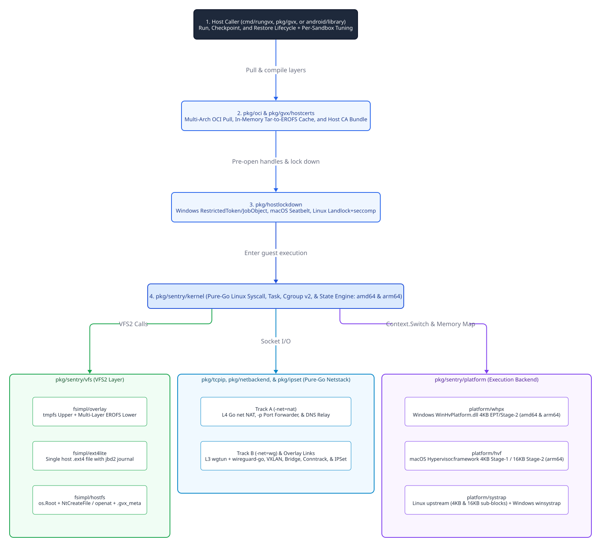
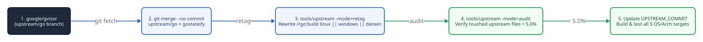
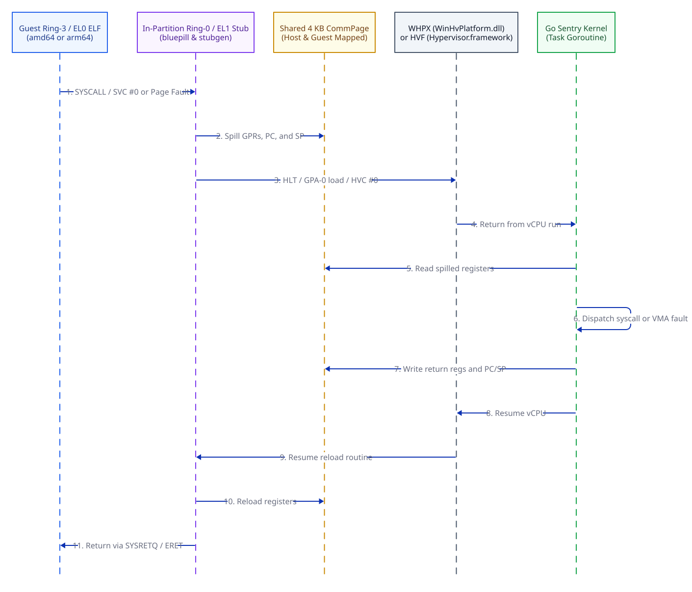
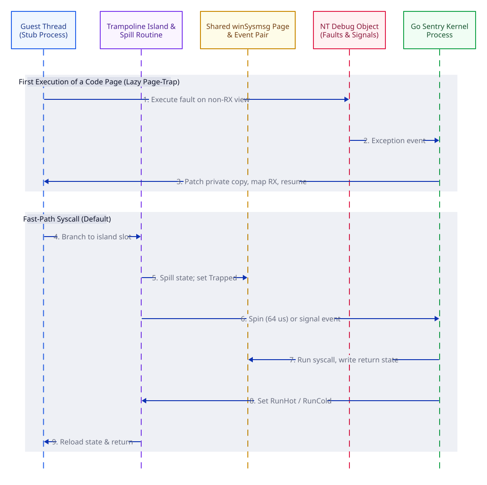
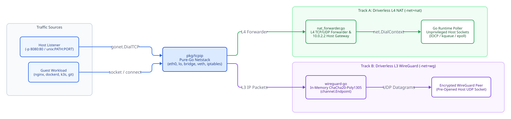
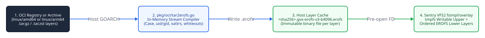
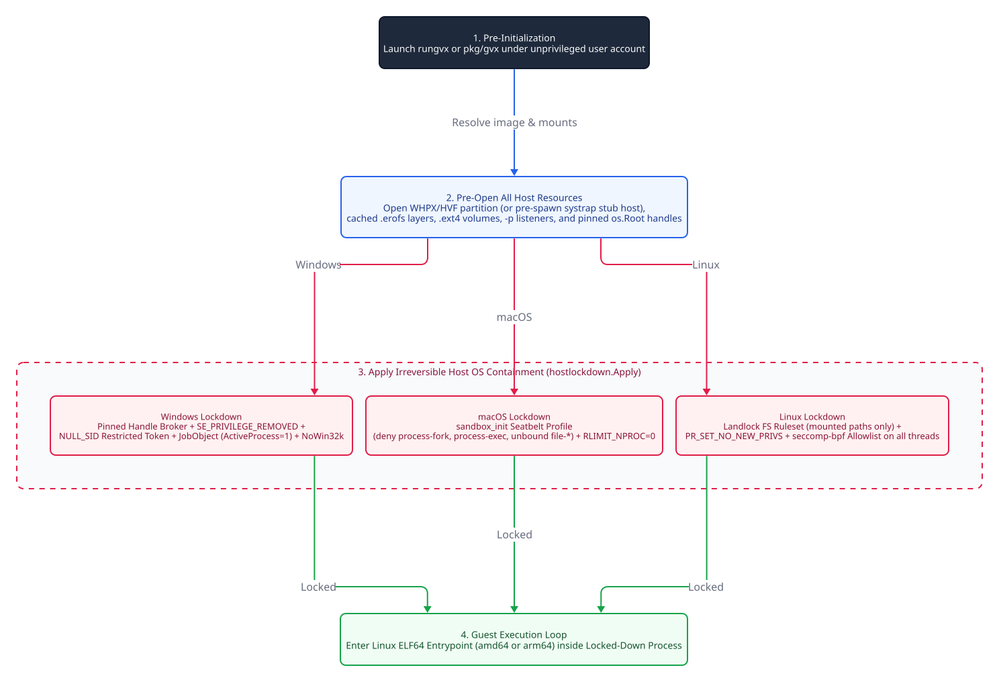
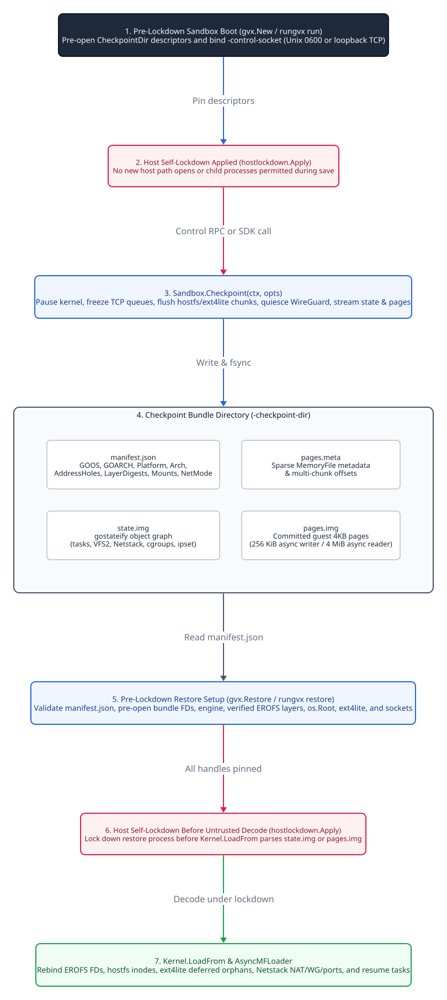

# System Architecture of `gvx`

`gvx` is an upstream-tracking port of Google's `gvisor` user-space Linux kernel (`Sentry` and `Netstack`) to Windows (`windows/amd64`, `windows/arm64`) and macOS (`darwin/arm64`), alongside official Linux (`linux/amd64`, `linux/arm64`, 4 KiB and 16 KiB host pages) and Android (`android/arm64`) support. Without booting a Linux virtual machine, `gvx` executes unmodified Linux ELF64 binaries and OCI container images inside a single unprivileged process via `cmd/rungvx` or the embeddable `pkg/gvx` Go SDK.

---

## 1. Executive Summary and System Scope

This section states the architectural contracts, supported host matrix, and deliverable boundaries that govern the system.

| Architectural Property | Design Contract | Verification Boundary |
| :--- | :--- | :--- |
| **Multi-OS, Multi-Arch Hosts** | Supports `windows/amd64`, `windows/arm64`, `darwin/arm64`, `linux/amd64`, `linux/arm64`, and `android/arm64`. | Builds and executes matching-architecture `linux/amd64` and `linux/arm64` ELF64 workloads across desktop, server, and mobile hosts. |
| **Zero Runtime Elevation** | Executes under a standard user account and confines its host process prior to guest entry. | Requires no `sudo`, no UAC prompts, no kernel drivers or kexts, and no background daemon. |
| **Hardware 4 KiB Paging (`whpx`, `hvf`)** | Runs guest code via `WinHvPlatform.dll` (Windows) and `Hypervisor.framework` (macOS) with 4 KiB guest page tables. | Bypasses Windows 64 KiB `VirtualAlloc` alignment and Apple Silicon 16 KiB host pages. |
| **Stub-Process Execution (`systrap`)** | Runs upstream `seccomp`-trapped `systrap` on Linux and Android (4 KiB and 16 KiB pages), and opt-in binary-rewriting `winsystrap` on Windows. | Executes ELF64 binaries and JIT runtimes (V8, HotSpot) when hardware virtualization is absent. |
| **Driverless Networking (`pkg/netbackend`)** | Connects guest Netstack to unprivileged L4 Go `net` NAT (`-net=nat`, `-p`, `--auto-publish`, host NAT policy, bandwidth limits) or an L3 `wireguard-go` tunnel (`-net=wg`). | Supports Docker Engine (`docker:dind`), single-node and multi-node Kubernetes (`k3s`, Flannel, Calico VXLAN), and LAN isolation. |
| **Direct OCI Compilation (`pkg/oci`)** | Streams `.tar.gz`/`.tar.zst` layers directly into cached read-only EROFS files mounted beneath `tmpfs` or `ext4lite`. | Runs unmodified Linux images without unpacking Linux filenames onto NTFS or APFS. |
| **Lockdown-Safe Checkpoint/Restore** | Pre-opens bundle descriptors and optional `gvx-ctrl/2` listeners prior to `hostlockdown.Apply()`, and validates untrusted bundles before allocation. | Saves and resumes guest tasks, sparse memory, `hostfs`, `ext4lite`, and network namespaces without weakening containment. |
| **Upstream Isolation** | Separates host logic into Tier 1 additive packages and Tier 2 `_windows`/`_darwin`/`_xplat` siblings. | Enforces a `< 4.5%` CI audit gate inside a `< 5.0%` ceiling; builds with Go 1.27.4+ without Bazel. |



### 1.1 Supported Host Targets

Hardware virtualization (`whpx` and `hvf`) is the default backend on Windows and macOS. On Windows, `--backend=auto` fails closed when `whpx` is unavailable unless `-allow-unconfined-systrap` opts into `systrap`; untrusted Windows workloads require `whpx`. Linux and Android select `systrap` by default. Every backend requires the guest CPU architecture to match the host CPU architecture.

`darwinsystrap` was removed because macOS forces 16 KiB user mappings and reserves a 4 GiB `PAGEZERO` that prevented 4 KiB-aligned segments and non-PIE executables from loading. `darwin/amd64` (Intel Mac) and Rosetta 2 execution were likewise dropped.

| Host Target | Primary Backend | Fallback Backend | Host Page Granularity | Platform Requirements |
| :--- | :--- | :--- | :--- | :--- |
| `windows/amd64` | `whpx` (`WinHvPlatform.dll`, 4 KiB EPT) | `systrap` (`winsystrap`, opt-in; trusted workloads only) | 4 KiB page / 64 KiB reserve | Windows 10 (2004+) or Windows 11 with WHP enabled. |
| `windows/arm64` | `whpx` (`Arm64Support`, 4 KiB Stage-2) | `systrap` (`winsystrap`, opt-in; trusted workloads only) | 4 KiB page / 64 KiB reserve | Windows 11 24H2 (`Build 26100.3915+`) for `whpx`. |
| `darwin/arm64` | `hvf` (`Hypervisor.framework`, Stage-1 4 KiB / Stage-2 16 KiB) | None (`platform_darwin.go` returns `ErrUnavailable`) | 16 KiB page | Apple Silicon with `com.apple.security.hypervisor` entitlement. |
| `darwin/amd64` | None | None | None | Unsupported. |
| `linux/amd64` | Upstream `systrap` | None | 4 KiB page | Official target; full CI `e2e/` and conformance suites. |
| `linux/arm64` | Upstream `systrap` (4 KiB direct or 16 KiB `subblock_xplat.go`) | None | 4 KiB or 16 KiB page | Official target; 4 KiB native and 16 KiB QEMU CI. |
| `android/arm64` | None (`untrusted_app` lacks `/dev/kvm`) | Upstream `systrap` (`MFD_EXEC`, `idleStubLimit = 2`, 16 KiB sub-blocks) | 4 KiB or 16 KiB page | Packaged as `librungvx.so` in `gvx-android.aar` (`minSdkVersion 31`). |

### 1.2 Deliverables and Feature Map

The repository builds four deliverables backed by eight major component subsystems:

| Deliverable or Subsystem | Owning Packages | Component Specification |
| :--- | :--- | :--- |
| Standalone CLI (`rungvx`) | `cmd/rungvx` | [`cli.md`](cli.md) |
| Embeddable Go SDK & Control Protocol | `pkg/gvx`, `pkg/gvx/control`, `pkg/gvx/tuning` | Section 3.13; [`control-protocol.md`](control-protocol.md) |
| Optional Containerd Control Shim | `cmd/containerd-shim-gvx-v2`, `internal/gvxshim` | Section 3.10 |
| Android Library (`gvx-android.aar`) | `android/`, `tools/androidprobe` | [`components/android.md`](components/android.md) |
| Hardware Hypervisor Backends | `pkg/sentry/platform/{whpx,hvf,hvcommon}` | [`components/hypervisors.md`](components/hypervisors.md) |
| Windows and Linux `systrap` | `pkg/sentry/platform/systrap` | Section 3.3; [`systrap-windows.md`](systrap-windows.md) |
| Single-File Ext4 Volumes | `pkg/sentry/fsimpl/ext4lite`, `pkg/sentry/blockdev` | [`components/ext4lite.md`](components/ext4lite.md) |
| Pinned Host Filesystem & Proxy VFS | `pkg/sentry/fsimpl/{hostfs,rpcfs,chunkcache,fsutilx}` | [`components/hostfs.md`](components/hostfs.md) |
| Driverless Networking & Overlays | `pkg/netbackend`, `pkg/ipset`, `pkg/tcpip/link/{vxlan,wgtun}`, `genetlink` | [`components/netbackend.md`](components/netbackend.md) |
| OCI Image Compiler & Host CAs | `pkg/oci`, `pkg/gvx/hostcerts` | [`components/oci.md`](components/oci.md) |
| Pre-Execution Host Self-Lockdown | `pkg/hostlockdown` | [`components/hostlockdown.md`](components/hostlockdown.md) |

---

## 2. Repository Layout and Upstream Synchronization

`gvx` tracks the pre-generated `go` branch of `https://github.com/google/gvisor.git` (`upstream/go`), where upstream publishes `go_stateify` and `go_marshal` output for `amd64` and `arm64`. Consequently, `gvx` compiles with standard `go build` without Bazel, while `tools/gostateify` regenerates `*_state_autogen.go` for `gvx`-owned and Tier 2 packages.

```text
gvx/ (Tracks google/gvisor@go)
 ├── AGENTS.md, CONTRIBUTING.md, CODE_OF_CONDUCT.md, README.md, SECURITY.md, CHANGELOG.md
 ├── UPSTREAM_COMMIT                        # Pinned google/gvisor go-branch commit SHA
 ├── entitlements.plist                     # com.apple.security.hypervisor entitlement for macOS
 ├── android/                               # Android AAR library (dev.gfire.gvx.Gvx) and sample service
 ├── cmd/
 │   ├── rungvx/                             # Standalone foreground CLI
 │   └── containerd-shim-gvx-v2/            # Optional containerd v3 control shim
 ├── docs/
 │   ├── architecture.md, cli.md, compatibility.md, control-protocol.md, glossary.md, troubleshooting.md
 │   ├── systrap-windows.md, moonshots.md
 │   ├── components/                        # Standalone specifications per major subsystem
 │   ├── recipes/                           # Docker Engine and Kubernetes user recipes
 │   └── assets/                            # D2 diagram sources and compiled SVGs
 ├── internal/                              # gvxshim, acceptprog probes, weakmap, embedded xsys/unix
 ├── pkg/
 │   ├── gvx/                               # Embeddable SDK, control/ (gvx-ctrl/2), hostcerts/, tuning/
 │   ├── oci/                               # Multi-arch OCI client, cache, Tar-to-EROFS compiler
 │   ├── netbackend/                        # NAT forwarder, DNS relay, bandwidth/policy, WireGuard
 │   ├── ipset/, tcpip/link/{vxlan,wgtun}/  # Guest IP sets, VXLAN, and shared WireGuard TUN endpoint
 │   ├── hostlockdown/                      # Windows, macOS, Linux, and Android host self-confinement
 │   ├── sync/, memutil/, fd/, fdnotifier/  # Cross-platform host OS primitives (Tier 2 siblings)
 │   └── sentry/
 │       ├── blockdev/                      # Lock-free 17-field disk statistics
 │       ├── socket/netlink/genetlink/      # Generic Netlink router and in-guest WireGuard family
 │       ├── platform/{whpx,hvf,hvcommon,systrap}/
 │       └── fsimpl/{chunkcache,fsutilx,hostfs,ext4lite,rpcfs}/
 ├── e2e/                                   # OS-agnostic black-box end-to-end suite (180 TestE2E* tests)
 ├── scripts/                               # Build, signing, sync, lint, repro, pjdfstest, android, linux16k
 └── tools/                                 # upstream, gostateify, gvisorlint, licenses, androidprobe, shiminterop
```

### 2.1 Layered Subsystem Map and Import Directionality

Strict top-down import directionality keeps host OS bindings out of the pure-Go Sentry kernel. `tools/upstream` (`boundaries.go`, `VerifyBoundaries`) enforces this table on every CI run. Foundational Sentry types (`pkg/context`, `pkg/hostarch`, `pkg/usermem`, `pkg/sentry/memmap`) are permitted across platform and VFS interfaces; any other cross-boundary import requires a documented exception in `boundaries.go`.

| Package | Single Responsibility | Permitted Internal Imports | Forbidden Imports |
| :--- | :--- | :--- | :--- |
| `cmd/containerd-shim-gvx-v2` | Entrypoint for the optional containerd shim. | `internal/gvxshim` | `pkg/*`, `runsc/*`, `shim/*` |
| `internal/gvxshim` | Shim bootstrap, ttRPC serving, leases, and teardown. | Containerd types, ttRPC, protobuf, OS APIs | `pkg/*`, `runsc/*`, `shim/*`, `cmd/*` |
| `tools/shiminterop` | Isolated containerd `2.1.5` SDK interoperability tests. | None | Root runtime, `cmd/*`, `internal/*` |
| `tools/gostateify` | Reflection-free `pkg/state` generator and drift checker. | `golang.org/x/tools/*` | Production `pkg/*`, `cmd/*`, `internal/*` |
| `cmd/rungvx` | CLI subcommands documented in [`cli.md`](cli.md). | `pkg/gvx`, `pkg/gvx/{control,tuning}`, `pkg/oci`, `pkg/netbackend` | `pkg/sentry/*`, `WinHvPlatform.dll` |
| `pkg/gvx` | Orchestrates OCI, mounts, networking, lockdown, Sentry boot, control server, and C/R. | `pkg/gvx/{control,hostcerts,tuning}`, `pkg/oci`, `pkg/netbackend`, `pkg/hostlockdown`, `pkg/sentry/*`, `pkg/fd`, `pkg/tcpip`, `pkg/seccomp`, `runsc/boot/filter/config` | `cmd/*`, `internal/gvxshim` |
| `pkg/gvx/control` | `gvx-ctrl/2` wire framing, auth, and capability policy. | `internal/xsys/unix`, `golang.org/x/sys/windows`, `zstd` | `pkg/sentry/*`, `cmd/*`, `pkg/hostlockdown` |
| `pkg/oci` | Multi-arch OCI registry client, cache, and Tar-to-EROFS compiler. | `pkg/abi/linux`, `pkg/erofs`, `pkg/gvx/tuning` | `pkg/sentry/kernel`, `pkg/hostlockdown` |
| `pkg/netbackend` | Bridges Netstack to NAT forwarders or `wireguard-go`. | `pkg/tcpip`, `pkg/tcpip/link/wgtun`, `pkg/hostlockdown`, `pkg/gvx/tuning` | `pkg/sentry/kernel`, `WinHvPlatform.dll` |
| `pkg/hostlockdown` | Host self-lockdown across Windows, macOS, Linux, and Android. | `golang.org/x/sys/windows`, `internal/xsys/unix` | `pkg/sentry/*`, `pkg/tcpip` |
| `pkg/sentry/kernel` | OS-agnostic Linux tasks, signals, and syscalls (`amd64`, `arm64`). | `pkg/abi/linux`, `pkg/sentry/platform`, `pkg/sentry/vfs`, `pkg/sync`, `internal/weakmap` | `golang.org/x/sys/windows`, `pkg/hostlockdown` |
| `pkg/sentry/platform/hvcommon` | Shared Stage-2 GPA mapper, `CommHeader`, Stage-1 pool, arch encoders. | `pkg/hostarch`, `pkg/sentry/memmap` | `pkg/sentry/kernel`, `pkg/sentry/vfs` |
| `pkg/sentry/platform/whpx` | Windows Hypervisor Platform backend (`amd64`, `arm64`). | `pkg/sentry/platform`, `hvcommon`, `pkg/memutil`, `pkg/abi/linux`, `windows` | `pkg/sentry/kernel`, `pkg/sentry/vfs` |
| `pkg/sentry/platform/hvf` | macOS `Hypervisor.framework` backend (`arm64`). | `pkg/sentry/platform`, `hvcommon`, `pkg/memutil`, `pkg/abi/linux`, `internal/xsys/unix` | `pkg/sentry/kernel`, `pkg/sentry/vfs` |
| `pkg/sentry/platform/systrap` | Linux (4 KiB/16 KiB) and Windows stub-process execution engine. | `pkg/sentry/platform`, `hvcommon`, `pkg/memutil`, `pkg/abi/linux`, `golang.org/x/arch/*` | `pkg/sentry/kernel`, `whpx`, `hvf` |
| `pkg/sentry/fsimpl/hostfs` | Pinned host directory/file VFS2 driver and `.gvx_meta` journal. | `pkg/sentry/vfs`, `chunkcache`, `fsutilx`, `pkg/abi/linux`, `pkg/fd`, `pkg/hostlockdown`, `internal/xsys/unix` | `pkg/sentry/platform/*` |
| `pkg/sentry/fsimpl/ext4lite` | Single-file JBD2-journaled ext4 volume driver. | `pkg/sentry/vfs`, `pkg/sentry/blockdev`, `chunkcache`, `fsutilx`, `pkg/abi/linux`, `pkg/fd`, `internal/xsys/unix` | `pkg/sentry/platform/*`, `cmd/*` |
| `pkg/sentry/fsimpl/rpcfs` | Client-served proxy VFS2 driver for `rungvx mount serve`. | `pkg/sentry/vfs`, `pkg/abi/linux`, `pkg/errors/linuxerr`, `pkg/usermem` | `pkg/gvx/*`, `pkg/sentry/platform/*`, `pkg/hostlockdown` |
| `pkg/sync`, `pkg/memutil`, `pkg/fd` | Host futexes, shared memory views, and handle wrappers. | `golang.org/x/sys/windows`, `internal/xsys/unix` | `pkg/sentry/*` |

### 2.2 Three-Tier Upstream Isolation Model

Repository files fall into three isolation tiers so upstream synchronization remains mechanical:

| Isolation Tier | File Paths | Upstream Overlap | Maintenance Rule |
| :--- | :--- | ---: | :--- |
| **Tier 1: Additive Packages** | `cmd/rungvx/`, `cmd/containerd-shim-gvx-v2/`, `pkg/gvx/`, `pkg/oci/`, `pkg/netbackend/`, `pkg/ipset/`, `pkg/tcpip/link/{vxlan,wgtun}/`, `pkg/hostlockdown/`, `pkg/sentry/socket/netlink/genetlink/`, `pkg/sentry/platform/{whpx,hvf,hvcommon}/`, `pkg/sentry/blockdev/`, `pkg/sentry/fsimpl/{chunkcache,fsutilx,hostfs,ext4lite,rpcfs}/`, `e2e/`, `internal/`, `scripts/`, `.github/`, `tools/{upstream,shiminterop,licenses,gvisorlint,androidprobe,gostateify}/`, `android/`, `docs/` | `0.0%` | Owned wholly by `gvx`; protected by `tools/upstream/file_mask.txt`. |
| **Tier 2: Sibling Files** | `*_windows*`, `*_darwin*`, and `*_xplat*` files placed inside upstream packages | `0.0%` | Selected by Go build constraints alongside unmodified `*_linux.go` files; zero diff budget charged. |
| **Tier 3: Build-Tag and Seam Patches** | Allowlisted pure-Go upstream files (`tools/upstream/buildtag_allowlist.txt`) | `< 5.0%` (`< 4.5%` CI gate) | Automatically re-applied by `tools/upstream -mode=retag`; Linux-only build fences on `runsc`/`shim`/`gofer` are tracked separately. |



### 2.3 Upstream Diff and Synchronization Procedure

Run `scripts/sync-upstream.sh` or the sequence below to merge new commits from `google/gvisor`.

> [!WARNING]
> Do not hand-edit `*_linux.go` or unrecorded Tier 3 files. Unregistered edits cause merge conflicts on upstream sync and fail the CI audit gate. Register every Tier 3 rule in `tools/upstream/buildtag_allowlist.txt`.

1. Ensure the `upstream` remote points to `https://github.com/google/gvisor.git` and fetch `upstream go`.
2. Merge `upstream/go` with `--no-commit` (or invoke `tools/upstream -mode=gitsync`).
3. Regenerate state files with `./scripts/gostateify.sh`.
4. Re-apply Tier 3 tags with `go run ./tools/upstream -mode=retag`.
5. Verify zero drift and audit compliance with `./scripts/gostateify.sh -check` and `tools/upstream -mode=audit`.
6. Update `UPSTREAM_COMMIT` and `tools/upstream/sync_manifest.json`, then compile all five production targets.

```bash
git remote add upstream https://github.com/google/gvisor.git 2>/dev/null || true
git fetch upstream go
git merge --no-commit upstream/go
./scripts/gostateify.sh
go run ./tools/upstream -mode=retag
./scripts/gostateify.sh -check
go run ./tools/upstream -mode=audit -max-ratio=0.045
git rev-parse upstream/go > UPSTREAM_COMMIT
for t in windows/amd64 windows/arm64 darwin/arm64 linux/amd64 linux/arm64; do
  GOOS=${t%/*} GOARCH=${t#*/} go build ./...
done
```

---

## 3. Subsystems and Cross-Cutting Contracts

Each major subsystem has a dedicated specification under [`components/`](components/hypervisors.md) or [`systrap-windows.md`](systrap-windows.md). This section states the shared architectural contracts that span subsystems.

### 3.1 Host OS Primitives and Build-Tag Decoupling

Roughly 65% of upstream gVisor (`pkg/sentry/kernel`, `arch`, `ring0`, `vfs`, `fsimpl/{tmpfs,erofs,overlay}`, and `pkg/tcpip`) is OS-agnostic Go code. `tools/upstream` widens build tags on allowlisted files to `//go:build linux || windows || darwin`, while Tier 2 siblings bind host primitives:

| Package | Linux Primitive | Windows Sibling (`_windows.go`) | macOS Sibling (`_darwin.go`) |
| :--- | :--- | :--- | :--- |
| `pkg/sync` | `SYS_FUTEX` | 64-shard table over `WaitOnAddress` / `WakeByAddress*` | `__ulock_wait` / `__ulock_wake` via `syscall6` trampolines |
| `pkg/memutil` & `pgalloc` | `memfd_create`, `mmap`, `MADV_DONTNEED`, `FALLOC_FL_PUNCH_HOLE`, `mincore` | `VirtualAlloc` (`MEM_RESERVE`/`MEM_COMMIT`/`MEM_DECOMMIT`) for `whpx`; `CreateFileMappingW` (`SEC_RESERVE`), `MEM_RESET`, `DiscardVirtualMemory`, `K32QueryWorkingSetEx` for `systrap` | `mmap(MAP_ANON)`, `mach_vm_remap`, 16 KiB `F_PUNCHHOLE` / sub-page zeroing, 4 KiB `darwinMincore` |
| `pkg/sentry/time` & `hostcpu` | `CLOCK_MONOTONIC`, `getcpu` | `QueryPerformanceCounter`, `GetCurrentProcessorNumberEx` | `mach_continuous_time`, `pthread_cpu_number_np` |
| `pkg/fd` | Raw FD, `dup3`, `SCM_RIGHTS` | `HostHandle` wrapping `syscall.Handle` | `HostHandle` wrapping FD (`F_DUPFD_CLOEXEC`) |
| `pkg/fdnotifier` | Edge-triggered `epoll` | Passive table (`fdnotifier_portable_xplat.go`) | Passive table with non-blocking `SYS_POLL` |
| `internal/xsys/unix` | Linux syscalls and structs | Translates `SYS_MMAP`/`PREAD64`/etc. to Win32 | Bridges 48-byte `darwinMsghdr`, `Stat_t`, `Dirent`, `Fallocate` without cgo |
| `pkg/sentry/syscalls` | Host `io_uring` passthrough | Returns `-ENOSYS` on `io_uring_*` (selects Sentry `epoll`) | Returns `-ENOSYS` on `io_uring_*` (selects Sentry `epoll`) |

On 16 KiB hosts (macOS, Android 16, Debian `arm64-16k`), `pgalloc` aligns allocations >= 16 KiB to 16 KiB boundaries, punches holes only across whole reclaimed 16 KiB host pages, zeroes reclaimed 4 KiB sub-pages in place, and expands host `mincore(2)` bytes four-to-one (`mincoreExpandHostPages`). Every `MemoryFile` carries its own per-sandbox `usage.Memory` ledger (`MemoryFileOpts.Accounting`) and notifies registered platform write observers (`ObserveHostWrites`, `NoteHostWrite`).

### 3.2 Hardware Hypervisor Backends: `whpx` and `hvf`

`platform/whpx` (Windows `amd64`/`arm64`) and `platform/hvf` (macOS `arm64`) share `platform/hvcommon` (`RegionTable`, `PageTablePool`, 304-byte `CommHeader`, and architecture encoders). Both map `pgalloc.MemoryFile` chunks into Stage-2 once and handle subsequent guest faults strictly in 4 KiB guest page tables without hypervisor calls. Consult [`components/hypervisors.md`](components/hypervisors.md) for paging invariants, CPU feature masking, `membarrier`, measurements, and file maps.



### 3.3 Stub-Process Execution Engine: `platform/systrap`

`platform/systrap` runs guest instructions natively inside isolated stub processes across Linux (4 KiB and 16 KiB host pages), Android, and opt-in Windows (`winsystrap`). Consult [`systrap-windows.md`](systrap-windows.md) for the complete Windows design, measurements, binary patchers, fast path, island reclamation, and security limits.



#### 4 KiB Guest Pages on 16 KiB Linux and Android Hosts (`subblock_xplat.go`)

When the host kernel enforces 16 KiB mappings, `subblock_xplat.go` partitions guest memory into 16 KiB host blocks while keeping guest pages at 4 KiB (`hostpage_xplat.go` aligns internal engine regions to host pages):

| 16 KiB Host Block State | Stub Mapping Strategy |
| :--- | :--- |
| Four contiguous 4 KiB pages in one file, 16 KiB aligned, uniform write permission | Direct host file mapping. |
| Heterogeneous four-page block | Non-writable composite page in platform memory file; guest stores fault and execute in `substore_xplat_arm64.go`. |
| Private writable pages beside unmapped or `PROT_NONE` pages | Single memory-file block with spare pages released via `platform.HostBlockOwner` upon conflicting `mmap`/`mprotect`. |
| Partially unpopulated block | Populated on switch; missing pages read as zero, with stores or `SIGILL` converted to `SEGV_MAPERR`. |

Sentry write notifications keep composite copies fresh selectively, and updated executable composite pages flush via `pwrite(2)` and remap to clean stub instruction caches. Set `GVX_SYSTRAP_SUBBLOCKS=1` to exercise this layer on 4 KiB Linux hosts.

#### Linux Stub Wake-Up, Idle Pool, and `membarrier`

- **Seccomp listener fallback**: Linux permits one `seccomp` user-notify listener per task filter chain. If `EBUSY` occurs (for example, inside nested sandboxes), `systrap` logs one warning and switches subsequent stubs to the futex wake loop.
- **Process-wide idle stub pool (`globalPool`)**: Retains idle stubs up to a compile-time bound (`2` on Android; `GOMAXPROCS` clamped to `4..32` on other Linux builds). Excess stubs terminate in strict order: kill, stop request goroutine, `wait4`, close listener, and release memory ranges (context queue, thread contexts, syscall message area, and `sysmsg` stacks).
- **Windows `systrap` `membarrier`**: `GlobalMemoryBarrier` suspends all guest-running stub threads under per-thread locks, invokes `GetThreadContext` (forcing kernel thread switches in parallel), resumes them, and invokes `FlushProcessWriteBuffers` for Sentry threads.

### 3.4 Register Preservation and Two-Tier Synchronization

Linux `syscall` and `svc #0` traps preserve all general-purpose registers (except return register and hardware-clobbered `RCX`/`R11` on `amd64` `syscall`) and all SIMD/FP state. Because Go overwrites SIMD registers (`XMM`/`YMM`, `V0..V31`), backends isolate guest state across transitions:

| Architecture and Class | Registers | Preservation Requirement |
| :--- | :--- | :--- |
| `amd64` GPRs | `RAX`, `RDI`, `RSI`, `RDX`, `R10`, `R8`, `R9`, `RBX`, `RBP`, `R12..R15`, `RIP`, `RSP`, `RFLAGS` | Sync syscall args/return; preserve callee-saved registers across all transitions. |
| `amd64` trap-clobbered | `RCX`, `R11` | Preserve intact across `#PF`, async signals, and `int 0x80` (Wine/WoW64). |
| `amd64` TLS and segments | `FSBase`, `GSBase`, `CS`, `SS`, `DS`, `ES`, `FS`, `GS` | Preserve Linux TLS (`FSBase`), 64-bit TEB (`GSBase`), and WoW64 `CS=0x23`/`0x33`. |
| `amd64` vector and debug | `XMM/YMM0..15`, AVX-512, `x87`, `MXCSR`, `FCW`, `FSW`, `DR0..DR7` | Shield from Go runtime; expose `DR0..DR7` for `ptrace` and thread contexts. |
| `arm64` GPRs and `X18` | `X0..X30`, `SP_EL0`, `PC`, `PSTATE`, `OrigR0` | Preserve all `X1..X30` across `svc #0` and faults; isolate guest `X18` from host TEB/platform register. |
| `arm64` TLS, vector, debug | `TPIDR_EL0`, `TPIDRRO_EL0`, `V0..V31`, `FPCR`, `FPSR`, debug regs | Preserve 512-byte NEON state; mask `HWCAP_PACA`/`PACG` when PAC keys are unvirtualized. |

> [!CAUTION]
> Always execute hypervisor run loops and `systrap` trampolines on OS-locked threads (`runtime.LockOSThread`). Entering Go with guest `FSBase`, `GSBase`, `X18`, or `MXCSR` corrupts the Go runtime.

`whpx` transfers only syscall GPRs on fast paths and full XSAVE/segment/debug state on cold paths (`PullFullState`/`FullStateChanged`). `hvf` loads/stores GPR and FP registers from `arch.Context64` on every `Switch` (omitting `TPIDRRO_EL0`, PAC keys, and debug registers). `systrap` trampolines spill all GPRs, TLS pointers, and vector state into `sysmsg` before waking Sentry.

### 3.5 Dual-Track Networking Backend: `pkg/netbackend`

`pkg/netbackend` links pure-Go Netstack to Track A (`-net=nat`: L2 pipe to peer stack, Go `net` dialers, `-p`, `--auto-publish`, DNS relay, bandwidth buckets, immutable host NAT policy) or Track B (`-net=wg`: in-memory `wireguard-go` over `wgtun.Endpoint`). Consult [`components/netbackend.md`](components/netbackend.md) for session limits, MTU rules, Linux TCP dial-error synthesis, and implementation files.



### 3.6 OCI Image Compilation and Host CA Injection

`pkg/oci` resolves multi-arch OCI manifests, verifies digests, compiles `.tar.gz`/`.tar.zst` streams directly into cached 4 KiB EROFS images with OverlayFS whiteouts, and mounts them under `tmpfs` or persistent `ext4lite` (`-rootfs-volume`). `pkg/gvx/hostcerts` optionally collects host root CAs prior to lockdown and merges them into guest upper-layer PEM bundles. Consult [`components/oci.md`](components/oci.md) for complete details.



### 3.7 Host Filesystem Driver: `pkg/sentry/fsimpl/hostfs`

`hostfs` mounts host directories and single regular files via pinned `os.Root` handles (`NtCreateFile` / `openat` / `openat2`), uses `chunkcache` for 64 KiB `mmap` chunks, translates host-incompatible names with `NameCodec`, bridges host changes to guest `inotify` under a process-wide descriptor budget, and persists POSIX metadata in a CRC-32C-framed identity-keyed `.gvx_meta` v4 journal coordinated across sandboxes via `.gvx_meta.lock`. Consult [`components/hostfs.md`](components/hostfs.md) for full invariants and limits.

### 3.8 Volume Filesystem Driver: `pkg/sentry/fsimpl/ext4lite`

`ext4lite` backs named volumes, copy-on-write overlay branches, and `-rootfs-volume` mounts inside single pre-opened `.ext4` image files featuring 16 MiB `meta_bg` block groups (up to 64 TiB), extent trees, ordered JBD2 journaling, online hole punching, clean-unmount tail compaction, shared/exclusive locks (`LOCK_SH`/`LOCK_EX`), untrusted-image checks, and 17-field lock-free block statistics (`pkg/sentry/blockdev`). Consult [`components/ext4lite.md`](components/ext4lite.md) for full layout and recovery rules.

### 3.9 Host Self-Lockdown and Security Model

`pkg/hostlockdown` seals the host process before guest entry across three concentric rings: Ring 1 (hardware page tables or Linux `seccomp` stubs), Ring 2 (memory-safe Go Sentry, `os.Root`, single-file volumes), and Ring 3 (Windows Untrusted primary token + Restricted thread tokens + Job Object + Win32k block + pre-lockdown file/socket brokers; macOS `RLIMIT_NPROC=0` + Seatbelt `deny default`; Linux Landlock ABI v1-v5 + `seccomp-bpf`). Consult [`components/hostlockdown.md`](components/hostlockdown.md) for OS-specific sequences and limits.



### 3.10 Optional Containerd Control Adapter

`cmd/containerd-shim-gvx-v2` (`internal/gvxshim`) implements runtime identity `io.containerd.gvx.v2` for the G3 control boundary without modifying the standalone runtime or invoking `gvx.New`. It launches a detached provisional child, emits JSON bootstrap version `3` upon readiness (empty stderr), and bounds startup, provisional handoff, shutdown drain, and cleanup with a 5-second timeout.

| RPC | Response | State Transition |
| :--- | :--- | :--- |
| Task v3 `Connect` | Shim PID, task PID `0`, version `gvx-control-v1` | Attaches external caller. |
| Task v3 `Shutdown` / Sandbox `ShutdownSandbox` | Empty success after response barrier | Initiates graceful drain (retaining peer sockets up to `peerCloseGrace = 1 s` for ttRPC `1.2.7` EOF safety). |
| Sandbox `CreateSandbox` | Wire `Unimplemented` after namespace/ID validation | Attaches caller; creates no sandbox. |
| Other Task/Sandbox RPCs | Wire `Unimplemented` | None. |

Endpoint names derive from SHA-256 over owner, normalized local containerd address, namespace, ID, and canonical bundle (`/tmp/gvx-shim-<euid>/<digest>/{task,stop}` on Unix with peer credentials; local `\\.\pipe\gvx-shim-<digest>-{task,stop}` with owner/SYSTEM DACLs on Windows). Bundle metadata under `.gvx-shim` coordinates command locks and lifetime leases; executable `delete` emits Task v2 `DeleteResponse`, never signals stored PIDs, and preserves containerd-owned files. Root dependencies remain containerd SDK `2.1.5`, API `1.10.0`, and ttRPC `1.2.7`, verified separately in `tools/shiminterop`. Guest workload execution and CRI remain outside this adapter.

### 3.11 Guest Kernel Interfaces for Docker Engine and Kubernetes

`dockerd`, `containerd`, `runc`, `kubelet`, `flannel`, and Calico depend on Linux kernel interfaces omitted by upstream gVisor. Each addition resides in Tier 1 packages or Tier 2 `*_xplat.go` siblings:

| Kernel Interface | Owning Package(s) | Core Contract |
| :--- | :--- | :--- |
| `/proc/sys/net/ipv4/conf/<link>/route_localnet`, `ipv6/conf/<link>/accept_ra`, `rp_filter` | `fsimpl/proc/*_xplat.go`, `tcpip/network/ipv4/martian_xplat.go`, `socket/netstack/rpfilter_xplat.go` | Per-link dynamic `/proc/sys` directories keyed by link index; per-endpoint `route_localnet` martian allowance and `EffectiveRPFilter`. |
| `bridge-nf-call-iptables` / `ip6tables`, bridge forwarding, veth receive filter, hairpin | `socket/netstack/{bridge_netfilter,bridgeport,hostfilter}_xplat.go`, `tcpip/stack/bridge_{netfilter,forward}_xplat.go` | Per-netns default `1`; routes bridged frames through `PREROUTING`/`FORWARD`/`POSTROUTING`, drops `PACKET_OTHERHOST` on non-bridge veth, supports hairpin. |
| Netfilter matches/targets (`statistic`, `recent`, `set`/`SET`, `icmp`/`icmp6`, `limit`, `physdev`, `CONNMARK`, `goto`, `rpfilter`, `NFLOG`, `LOG`) | `socket/netfilter/*_xplat.go`, `pkg/ipset`, `socket/netlink/netfilter/ipset_xplat.go` | Legacy `iptables` tables (`filter`, `nat`, `mangle`, `raw`); full `ipset` types and `NETLINK_NETFILTER` v6/v7 chunked dumps; `/sys/module/{ip_set,xt_recent}/parameters/*`. |
| `CTNETLINK` & `nf_conntrack_*` sysctls | `socket/netlink/netfilter/ctnetlink_xplat.go`, `tcpip/stack/conntrack*_xplat.go` | Resumable conntrack dumps and deletes; per-netns TCP/UDP/ICMP timeouts; kernel-wide `nf_conntrack_max` (default `262,144`) with 8-bucket early drop. |
| Policy routing, proxy ARP, `SIOCETHTOOL`, `IFLA_STATS64`, `/sys/class/net/<link>` | `tcpip/stack/{fib,rpfilter,proxyarp}_xplat.go`, `socket/netlink/route/*_xplat.go`, `socket/netstack/ethtool_xplat.go` | Priority-ordered rule walk across tables, `blackhole`/`unreachable`/`prohibit`/`throw` routes, ethtool feature bits, and link byte/packet counters. |
| `NETLINK_GENERIC`, in-guest `wireguard`, `vxlan`, neighbor/FDB netlink | `genetlink` (Tier 1), `tcpip/link/vxlan` (Tier 1), `socket/netlink/route/neigh_xplat.go`, `tcpip/stack/neighbor_gc_xplat.go` | Chunked `genetlink.Dumper` (no `ENOBUFS`); `wireguard` link (`IFF_UP` lifecycle, `fwmark`, memory charge); RFC 7348 `vxlan` (FDB learning, `maxaddr`); per-netns `gc_thresh1..3`. |
| `cgroup2` `memory.max`, `memory.stat`, `cpu.max`, `cpu.stat` | `fsimpl/cgroup2fs/{memory,cpu}_xplat.go`, `kernel/*cpu_bandwidth*_xplat.go` | Polling OOM enforcer (5 ms / 25 ms, `memory.oom.group`, Linux `oom_kill.c` `/dev/kmsg` format); per-cgroup CFS quota enforcement across guest and Sentry time (up to 1,024-period late-charge smoothing). |
| `/dev/kmsg`, `syslog(2)`, node sysctls, `MemTotal`, online CPUs | `devices/memdev/kmsg_xplat.go`, `kernel/{kmsg,total_memory}_xplat.go`, `fsimpl/proc/tasks_sys*_xplat.go` | Per-kernel power-of-two log ring (`kernel.log_buf_len`); per-netns `ip_unprivileged_port_start`, port range, keepalive, forwarding; per-sandbox reported RAM and CPU count. |
| Block statistics & `/sys/fs/bpf` | `pkg/sentry/blockdev`, `fsimpl/{proc/diskstats,sys/blockclass,sys/bpffs}_xplat.go` | 17-field atomic counters for EROFS (`vda`) and `ext4lite` (`vdb+`); directory-only stub `bpf` mountpoint (`0xcafe4a11`). |

### 3.12 State Shared Across Sandboxes in One Process

Because `pkg/gvx`, `e2e/`, and shims execute multiple sandboxes inside one host process, guest-visible limits, counters, and state must belong strictly to one kernel, memory file, or network stack. To attach per-sandbox extensions to upstream structs without Tier 3 struct conflicts, `internal/weakmap.Map` maintains a 16-shard `weak.Pointer` side table evicted via `runtime.AddCleanup` (`kernelExtState` and `stackExtState`, serialized via `saveExt`/`loadExt`).

| Intentional Process-Wide State | Owner | Justification |
| :--- | :--- | :--- |
| Host RAM bounds (`usage.Minimum/MaximumTotalMemoryBytes`, `tmpfs.totalHostMem`) | `usage`, `tmpfs`, `pkg/gvx` | Physical host RAM is invariant across sandboxes; per-sandbox limits override via `kernel.SetReportedMemory`. |
| Global `usage.MemoryAccounting` / `DirtyMemoryAccounting` | `usage` | `gvx` charges per-sandbox `MemoryFile.Accounting`; globals cover unused `gofer` paths only. |
| `systrap` `sealedHoles`, dispatcher, thread budgets, `globalPool`, `sharedSystrap` | `platform/systrap`, `pkg/gvx` | Describes host address layout and host stub pool with compile-time cap (`2` Android; `4..32` Linux). |
| `hvf` shared VM (`vmGlobal`) | `platform/hvf` | `Hypervisor.framework` permits one VM per host process; platforms reference-count it with separate page tables. |
| `hostfs` watch budget (`processWatches`) | `fsimpl/hostfs` | Host FD limits are process-wide; all workspaces draw from one shared cap. |
| Capability probes, `memutil` arena index, `lastPIDNSID`, `hostlockdown` state, extension lockdown grants (`extLockdownRecvMsgFD`), `tuning` registry, `log.SetLevel` | Respective packages | Host kernel facts, monotonic counters, one-way lockdown (`gvx.New` returns `ErrLockdownActive` if a subsequent sandbox requires helper spawns or ungranted `RecvMsgFDs`), immutable tables, or `CapDebug`-gated upstream log level. |
| Unused `runsc`-only globals (`seccheck.Global`, `nftables`, `gofer.globalDentryCache`, `time.tscOffset`, etc.) | Upstream Sentry | Never set by `gvx`. |

| Per-Sandbox Owned State | Owning Key |
| :--- | :--- |
| Memory usage accounting, `/proc/meminfo`, `memory.current`/`memory.stat`, OOM enforcer, WireGuard memory charge | `pgalloc.MemoryFile.Accounting` |
| Engine fault cause, reported total memory, `/dev/kmsg` ring (`kernelExtState`), node sysctls, `shm_rmid_forced`, cgroup registry | `kernel.Kernel` or namespace |
| Policy-routing FIB, `rp_filter`, proxy ARP, bridge netfilter switches, `xt_recent`, `ipset`, `vxlan`, WireGuard links, C/R topology (`stackExtState`), disk registry | Network stack or VFS |

> [!IMPORTANT]
> Never add a package variable for guest-visible state. Any change to accounting, limits, or IDs requires a concurrent two-sandbox test (modeled on `TestE2EMemoryAccountingIsPerSandbox`).

### 3.13 Pre-Lockdown Checkpoint and Restore

`Sandbox.Checkpoint` (`pkg/gvx/checkpoint.go`) and `gvx.Restore` (`pkg/gvx/restore.go`) save and resume sandboxes on identical host OS, CPU architecture, and backend without relaxing `hostlockdown`.



| Bundle File | Producer / Consumer | Wire Format and Bounds |
| :--- | :--- | :--- |
| `manifest.json` | `pkg/gvx` (`CheckpointManifest` v1..v3) | JSON recording version (`1` default, `2` NAT policy, `3` capped `ext4lite` + `nat_policy_required`), targets, `layer_digests`, `mounts`, `net_mode`, `eth0`, `memory_limit_bytes`, `created_at` (1 MiB max, regular file only). |
| `state.img` | `pkg/state/statefile`, `pkg/sentry/state` | 8-byte `"gVisorSF"` magic, big-endian `uint64` metadata length, 1 MiB chunked `compressio` stream holding `cpuid.FeatureSet` and `kernel.Kernel`. |
| `pages.meta` | `pkg/sentry/pgalloc` | Little-endian `uint64` length + `MemoryFileMetadataProto` + private `MemoryFile` metadata keyed by `checkpoint.ResourceID` (rejected above 256 MiB or 131,072 chunks). |
| `pages.img` | `pkg/sentry/pgalloc`, `stateio` | Concatenated 4 KiB non-zero ranges scanned with `SEEK_DATA`/`SEEK_HOLE` and loaded via `AsyncMFLoader` (size bounded by `2 * memoryLimit + 1 GiB`; unordered/overlapping ranges rejected). |

During save, the runtime stops the watchdog, pauses guest tasks, quiesces NAT relays, port forwarders, and WireGuard workers, captures `stackExtState` topology, stages unlinked `hostfs` files (`.gvx_tmp_*`), and commits an `ext4lite` JBD2 transaction. Any failure after pause resumes the guest (except post-NIC-teardown `LeaveRunning: false`, which terminates via `SIGKILL`, exit `137`). During restore, `gvx.Restore` verifies exact manifest equality, pre-opens all backing files and sockets before `hostlockdown.Apply()`, then rebinds EROFS descriptors, `hostfs`, `ext4lite`, overlays, stdio, and Netstack inside lockdown.

### 3.14 Android Host Runtime and Packaging

`scripts/android/build-sdk.sh` compiles `cmd/rungvx` (`GOOS=android`, `CGO_ENABLED=1`) into `jni/arm64-v8a/librungvx.so` inside `gvx-android.aar` (`minSdkVersion 31`) so Android PackageManager extracts it under the executable `apk_data_file` label. `dev.gfire.gvx.Gvx` launches it with app-private `HOME`/`TMPDIR` and active `--host-dns` resolvers, while `android/sample` wraps execution in an Android 14+ `specialUse` foreground service. Consult [`components/android.md`](components/android.md) for `MFD_EXEC`, 16 KiB sub-blocks, and the 32-process ceiling.

---

## 4. Implementation History, Verification, and Tooling

`gvx` was built across five milestones (`M1` Host Primitives, `M2` WHPX/HVF Static ELF, `M3` Dynamic Linking/Netstack/OCI, `M4` `hostfs`/Lockdown, `M5` `winsystrap`), all complete and continuously verified.

### 4.1 Test Architecture and Native-First Verification

Verification spans three tiers:

| Layer | Scope | Purpose |
| :--- | :--- | :--- |
| Host primitive & contract unit tests | `pkg/sync`, `memutil`, `fd`, `hostlockdown`, `platform/*`, `fsimpl/*`, `oci`, `ipset` | Verifies OS syscalls, binary patchers, crash recovery, and layout invariants. |
| Zero-dependency guest probes | `internal/acceptprog` (`acceptprog`, `lockdownprobe`, `checkpointprobe`, `cpumaxprobe`, `nodeprobe`, `microbench`) | Cross-compiled static `GOOS=linux` probes exercising syscalls, signals, cgroups, and C/R offline. |
| Black-box E2E & POSIX suites | `e2e/` (180 `TestE2E*` functions), `scripts/pjdfstest` | Identical cross-OS assertions across Windows, macOS, Linux (4 KiB/16 KiB), and Android, plus POSIX filesystem conformance. |

### 4.2 Continuous Integration Matrix

| Workflow / Job | Runner | Verified Scope |
| :--- | :--- | :--- |
| `ci.yml` (`build, vet, and audit`) | `ubuntu-24.04` | `gofmt`, 5-target + `android/arm64` builds, `go vet`, `gostateify -check`, `tools/licenses -check`, `gvisorlint`, `tools/upstream -max-ratio=0.045`, consumer module check. |
| `ci.yml` (`test linux/*`, `repro`, `dind-build`) | `ubuntu-24.04`, `ubuntu-24.04-arm` | `-race` owned tests, `GVX_SYSTRAP_SUBBLOCKS=1`, offline `e2e/`, SHA-256 self-hosted reproducible build, local-registry `docker:dind` build. |
| `ci.yml` (`test darwin/arm64`, `windows/*`) | `macos-26`, `windows-latest`, `windows-11-arm` | Signed owned tests (`codesign-exec.sh`), real `whpx` + `winsystrap` on `windows/amd64`, `winsystrap` + shim on `windows/arm64`. |
| `android.yml`, `linux16k.yml` | `ubuntu-24.04` (KVM), `ubuntu-24.04-arm` (QEMU) | Android 16 emulator smoke + APK launch; Debian trixie `arm64-16k` QEMU suite. |
| `pjdfstest.yml`, `e2e-images.yml` | Linux & Windows runners | POSIX `pjdfstest` against `known-failures.txt`; weekly real-registry Docker and K3s gates. |
| `benchmark.yml`, `release.yml` | Multi-OS runners | Longitudinal `TestE2EMicroBench` (`bench-results` branch); 7-archive SLSA-attested releases. |

Hosted macOS runners cannot run nested VMs (`GVX_ALLOW_NO_HYPERVISOR=1`), so physical Apple Silicon hosts verify `hvf` and macOS `pjdfstest`.

### 4.3 Containerd Shim Verification

Integration evidence covers commit `f3b7ef4` (post-upstream `90a2f3f7`) across focused native runs (`internal/gvxshim`, `cmd/containerd-shim-gvx-v2`, `tools/upstream`, `hvcommon`, `fdnotifier`) and does not claim guest execution or CRI support:

| Boundary | Observed Result | Scope Limit |
| :--- | :--- | :--- |
| Linux command & real SDK `2.1.5` | JSON v3/ttRPC bootstrap, repeated `delete`, lease cleanup, and `ShimManager` disconnect passed. | Control-plane lifecycle only; no guest workload. |
| External containerd `2.2.4` (`193637f7`, Linux `amd64`) | Native creation returned expected `Unimplemented`; teardown cleaned owned state. | No created sandbox. |
| Five targets (build + focused native race/tests) | Passed across `linux/{amd64,arm64}`, `darwin/arm64`, `windows/{amd64,arm64}` (CI diagnose runs `41290717221` through `41290749213`). | Focused diagnose runs; reproduce via `tools/shiminterop` with `GVX_SHIM_BINARY` and `GVX_CONTAINERD_BINARY`. |

### 4.4 Embedded `internal/xsys/unix` Package

`gvx` embeds a tailored copy of `golang.org/x/sys/unix` inside `internal/xsys/unix` so pure-Go Sentry packages compile on Windows and macOS without a `go.mod` `replace` directive (verified by `scripts/check-consumer.sh`). When upgrading `golang.org/x/sys`, preserve every `gvx_*` file and the Darwin `Stat_t`, `Dirent`, `darwinMsghdr`, and `SYS_POLL`/`SYS_PPOLL` adaptations.

### 4.5 The gVisor Static Analyzers (`tools/gvisorlint`)

`scripts/gvisorlint.sh` executes `checklocks`, `checkconst`, and `checklinkname` via `go vet` across all five targets. Correct real lock-order or field-guard bugs in code first; apply `// +checklocksforce:` or `// +checklocksignore:` solely with a documented justification when SSA cannot prove a valid lock path. `tools/gvisorlint/baseline.txt` records accepted upstream findings only.

### 4.6 Native State Code Generator (`tools/gostateify`)

`tools/gostateify` generates reflection-free `pkg/state` methods from `// +stateify savable` annotations without Bazel for packages listed in `tools/gostateify/packages.txt` (`tier2` entries emit `*_xplat_state_autogen.go` siblings so upstream autogen files remain pristine). Run `./scripts/gostateify.sh` after editing savable structs and verify with `./scripts/gostateify.sh -check`.

### 4.7 Third-Party License Collector (`tools/licenses`)

`tools/licenses` walks the transitive Go module graph across shipped targets, generates `pkg/rungvx/licenses/THIRD_PARTY_LICENSES.txt`, and verifies both that file and the license table in `README.md` (`go run ./tools/licenses -check`).

### 4.8 Reproducible Builds

`scripts/repro-build.sh` compiles deterministic binaries (`-trimpath`, stripped build IDs, scrubbed environment, pinned `CGO_ENABLED=0` and `GOAMD64`/`GOARM64` levels). `scripts/verify-repro-gvx.sh` builds `rungvx` both on the host and inside a `golang` container running on `gvx`, asserting identical SHA-256 hashes.
