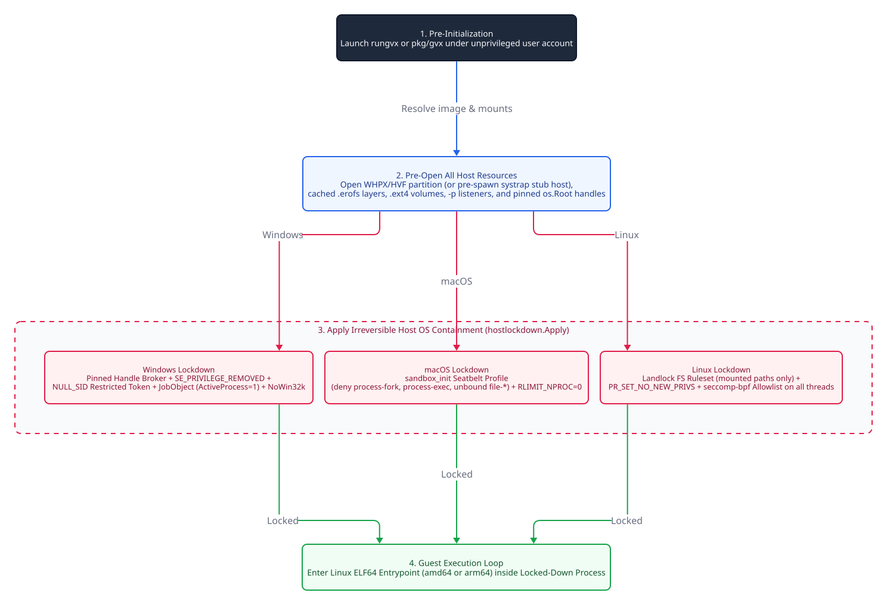

# Pre-Execution Host Self-Lockdown: `pkg/hostlockdown`

This specification describes `pkg/hostlockdown`, the third defense boundary of `gvx`. Before guest instructions execute, `hostlockdown.Apply()` seals the host process using OS-native confinement primitives.

---

## 1. Purpose and Scope

Running a sandbox inside one ordinary host process avoids VM setup, yet leaves host privileges reachable if Sentry is compromised. Without host containment, a Sentry flaw could spawn child processes, open arbitrary host paths, or open unauthorized sockets.

`pkg/hostlockdown` strips OS privileges and seals forks, unbound file opens, and unauthorized sockets before guest code enters execution. Every platform translates sandbox mounts and listeners into native rules: Windows Untrusted/Restricted tokens and Job Objects, macOS Seatbelt, or Linux Landlock and `seccomp-bpf`.

The ring summary and state diagram below define pre-lockdown ordering, OS sequences, and containment boundaries.

| Ring | Owning Packages | Enforced Invariant |
| :--- | :--- | :--- |
| **Ring 1: Execution Boundary** | `platform/whpx`, `platform/hvf`, `platform/systrap` | Confines guest machine code in 4 KiB hardware page tables or Linux `seccomp` stubs. |
| **Ring 2: Application Kernel** | `pkg/sentry/kernel`, `hostfs`, `ext4lite`, `pkg/netbackend` | Serves Linux syscalls in Go, pins workspaces to `os.Root`, and confines volumes to open files. |
| **Ring 3: Host OS Containment** | `pkg/hostlockdown` | Blocks child creation, unbound file opens, and unauthorized sockets inside the host OS kernel. |

---

## 2. Design and Pre-Lockdown Ordering

> [!CAUTION]
> Open every host resource before calling `hostlockdown.Apply()`, including hypervisor partitions, `.erofs`/`.ext4` handles, `os.Root` mounts, DNS config, `-p` listeners, and control sockets. After `Apply()` returns, the host OS kernel rejects child process spawns and unbound file opens.

### 2.1 Windows (`lockdown_windows.go`, `broker_windows.go`, `netbroker_windows.go`)

Because `CreateProcessAsUser` cannot swap a running process primary token, Windows places `RestrictedSids` on thread impersonation tokens. To defend against `SetThreadToken(nil, 0)` dropping thread restrictions, `lockdown_windows.go` lowers the primary token itself to Untrusted integrity (`S-1-16-0`):

1. Update `TokenDefaultDacl` on the primary token so unnamed kernel objects admit `NULL_SID`.
2. Pin mounted directory and single-file handles without modifying NTFS ACLs or labels.
3. Strip all privileges from the primary token (`SE_PRIVILEGE_REMOVED`).
4. Start locked `winMountBroker` and thread-sweeper OS threads before lowering the primary token.
5. Start the locked Low-integrity `winNetBroker` worker pool when `-net=nat` or `--auto-publish` is active.
6. Verify containment using an Untrusted restricted token containing `NULL_SID`.
7. Assign the process to a Job Object with `JOB_OBJECT_LIMIT_ACTIVE_PROCESS = 1` and `JOB_OBJECT_UILIMIT_ALL`.
8. Call `SetProcessMitigationPolicy` (`DisallowWin32kSystemCalls = 1`) to block `win32kfull.sys`.
9. Lower the primary token to Untrusted integrity after binding pre-warmed Go threads.
10. Start the background sweeper so new Go OS threads inherit the restricted token.

### 2.2 macOS (`lockdown_darwin.go`)

1. Pin `GOMAXPROCS` so Seatbelt denials on CPU `sysctl` queries cannot shrink Go parallelism.
2. Call `setrlimit(RLIMIT_NPROC, {0, 0})` to reject `fork()` at the XNU kernel boundary.
3. Apply a `deny default` Seatbelt SBPL profile blocking forks, execs, unbound `file-*`, and unauthorized binds.
4. Execute denial self-probes for forks, unbound files, and unbound sockets; fail startup if any succeeds.

The Seatbelt profile permits only explicit mount paths, resolved targets, and `localhost:*` when `--auto-publish` or `--dynamic-ports` is active.

### 2.3 Linux and Android (`landlock_linux.go`, `lockdown_linux.go`, `pkg/gvx/syscallfilter_linux.go`)

Because `pkg/hostlockdown` forbids importing Sentry packages, `pkg/gvx` builds the `seccomp-bpf` allowlist (`runsc/boot/filter/config`) and passes `Options.InstallSyscallFilter`:

1. Apply a Landlock ruleset scoped to `Options.Mounts` (ABI v1 through v5) across all threads.
2. Build `config.Rules` for `systrap`, network mode, mounts, extension `RecvMsgFDs`, and loopback binds (`--auto-publish`/`--dynamic-ports`).
3. Append `EPERM` rules for `execve`, `execveat`, `clone`, `openat`, and `socket` so embedders receive Go errors instead of `SIGSYS`.
4. Install the seccomp filter across all threads (`SECCOMP_FILTER_FLAG_TSYNC`) and run containment probes.

In cgo builds, threads unregister `rseq` across `fork` (`rseq_xplat.go`) so child stubs avoid unmap faults. On Android, `pkg/hostlockdown` detects Zygote's seccomp filter (`PR_GET_SECCOMP == 2`), skips Landlock syscalls trapped with `SIGSYS`, and relies on per-UID SELinux domains.

---

## 3. Component Limits

Consult [`../compatibility.md`](../compatibility.md) for host-wide limits; the invariants below apply specifically to `pkg/hostlockdown`:

- **Windows primary-token revert**: Compromised host code could call `SetThreadToken(nil, 0)` to drop thread restricted SIDs. The Untrusted primary token still blocks raw sockets, `NO_READ_UP` reads, and Low/Medium writes.
- **Linux seccomp socket addresses**: `seccomp-bpf` cannot inspect `sockaddr` pointers, so Linux cannot pin a WireGuard peer UDP endpoint like macOS Seatbelt.
- **One-way process-wide lockdown**: `hostlockdown.Apply()` is process-global; a subsequent sandbox needing helper spawns or ungranted `RecvMsgFDs` fails with `ErrLockdownActive`.
- **Opt-out flag**: `-lockdown=false` disables confinement for debugging and emits a stderr warning.

---

## 4. Implementation Map

This table maps the host-lockdown source files and test suites.

| Files | Role |
| :--- | :--- |
| `pkg/hostlockdown/lockdown.go`, `mountpaths.go`, `dial*.go`, `bind_other.go` | Shared `Options`, `Status`, mount path normalization, broker dispatch wrappers. |
| `pkg/hostlockdown/lockdown_windows.go`, `token_windows.go`, `job_windows.go`, `broker_windows.go`, `netbroker_windows.go`, `workspace_windows.go`, `probe_windows.go` | Windows tokens, Job Object, Win32k block, file and socket brokers, probes. |
| `pkg/hostlockdown/lockdown_darwin.go`, `lockdown_darwin_*.s`, `extension_darwin.go`, `probe_darwin.go` | macOS Seatbelt generator, `sandbox_init` trampolines, file-extension tokens, probes. |
| `pkg/hostlockdown/lockdown_linux.go`, `landlock*_linux.go`, `pkg/gvx/syscallfilter_linux.go` | Linux Landlock ABI v1-v5 rulesets, `seccomp-bpf` allowlist, `scripts/seccomp-audit.sh`. |
| Tests | `pkg/hostlockdown/*_test.go`, `e2e/gate_m4_test.go`, `e2e/sandbox_e2e_test.go`, `e2e/checkpoint_e2e_test.go`. |
