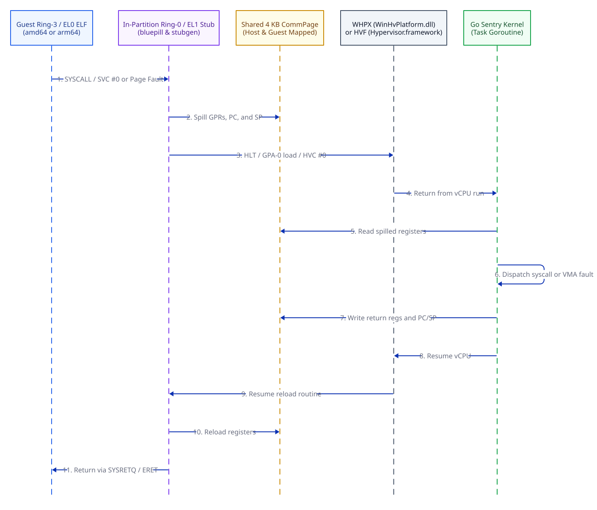

# Hardware Hypervisor Backends: `whpx`, `hvf`, and `hvcommon`

This specification describes `platform/whpx` on Windows (`amd64` and `arm64`), `platform/hvf` on macOS (`arm64`), and their shared foundation `platform/hvcommon`. Both backends execute unmodified Linux ELF64 instructions at Ring-3 or EL0 inside an unprivileged hardware virtualization partition.

---

## 1. Purpose and Scope

Linux ELF64 binaries map segments at 4 KiB (`0x1000`) boundaries, while Windows `VirtualAlloc` reserves 64 KiB and Apple Silicon enforces 16 KiB pages. Without hardware translation, those host memory rules break standard Linux executables and dynamically linked programs.

`whpx` and `hvf` run guest code inside hardware two-stage page tables using 4 KiB guest mappings over the host's native pages. Both backends isolate guest virtual memory from the Go heap without kernel drivers or root privileges.

The table below compares the host APIs, privilege models, paging structures, and VM lifetimes across both backends.

| Property | `platform/whpx` (Windows) | `platform/hvf` (macOS) |
| :--- | :--- | :--- |
| **Host targets** | `windows/amd64` (Win 10 2004+ / Win 11); `windows/arm64` (Win 11 24H2 `26100.3915+`) | `darwin/arm64` (Apple Silicon) |
| **Host API** | `WinHvPlatform.dll` (`WHvCreatePartition`, `WHvRunVirtualProcessor`) | `Hypervisor.framework` (`hv_vm_create`, `hv_vcpu_run`) |
| **Privilege requirement** | Standard user; WHP feature enabled | Standard user; `com.apple.security.hypervisor` signature |
| **Guest paging** | 4 KiB guest page tables over Stage-2 GPA (`WHvMapGpaRange`) | 4 KiB Stage-1 (`TTBR0_EL1`) over 16 KiB Stage-2 (`hv_vm_map`) |
| **Shared VM model** | One partition per platform instance | Process-wide shared VM (`vmGlobal`, reference-counted) |

---

## 2. Design and Invariants

Both backends avoid per-syscall host register calls by installing minimal Ring-0 (`amd64`) or EL1 (`arm64`) stubs. Each stub spills syscall registers into a shared 304-byte `CommHeader` page before exiting to the Sentry.

### 2.1 Two-Stage 4 KiB Paging and Zero-Hypercall Faults

Both `whpx` and `hvf` register backing chunks of `pgalloc.MemoryFile` with the hypervisor once rather than on every guest page fault:

- **Windows Stage-2 GPA (`whpx`)**: Maps each `MemoryFile` chunk into a 36-to-40-bit GPA window once via `WHvMapGpaRange`. Transient non-memory files track read-only and writable regions separately and unmap via `WHvUnmapGpaRange`. `MemoryManager.PinRange` (`mm/pinned_xplat.go`) keeps backing frames pinned while mappings exist.
- **macOS Stage-1/Stage-2 (`hvf`)**: Maps each 1 GiB `MemoryFile` chunk into Stage-2 IPA once with `HV_MEMORY_READ | HV_MEMORY_WRITE | HV_MEMORY_EXEC`. `MapFile` and `Unmap` update only 4 KiB Stage-1 `TTBR0_EL1` entries; the MMU intersects Stage-1 and Stage-2 permissions. Because `hv_vm_map` rejects EROFS descriptors, `hvf` copies read-only blocks into 64 KiB `MAP_ANON` buffers (`CopyReadOnly`). A 4 MiB VM slab allocates Stage-1 tables, EL1 vectors, and communication pages.

`Platform.MapUnit` returns 2 MiB on both backends, and `SupportsAddressSpaceIO` returns false so Sentry accesses guest memory directly. On `arm64`, mapping executable pages flushes the guest instruction cache for ELF loading, `mprotect`, and copy-on-write. During teardown, `Sandbox.Close` closes the platform before releasing `pgalloc.MemoryFile` chunks.

### 2.2 Syscall Traps, Thread Affinity, and Register State

- **`whpx` (`amd64`)**: Ring-3 `SYSCALL` enters `MSR_LSTAR`, spills syscall GPRs to `CommPage`, and halts (`HLT`). The host writes `CR3` only when the recorded address space changes; kicks and releases invalidate it. Fast paths leave `YMM0..15` and AVX-512 inside the vCPU; cold paths convert XSAVE via `fp.go`.
- **`whpx` (`arm64`)**: Configures GICv3 with one redistributor per vCPU and clears startup suspension. EL0 `SVC #0` spills registers to `CommPage` and reads unbacked GPA zero because WHP consumes `HVC #0`. Each stop advances PC past that load before resuming.
- **`hvf` (`arm64`)**: Dedicated `vcpuWorker` threads (`runtime.LockOSThread`) own each `hv_vcpu_t` because XNU binds vCPUs to creating threads. EL0 `SVC #0` enters `VBAR_EL1`, spills `X0..X8`, `SP_EL0`, `ELR_EL1`, and `PSTATE`, and executes `HVC #0`. On `HV_EXIT_REASON_UNKNOWN`, workers retry up to 4,096 times; `hvf` syncs GPR and FP state on every `Switch`.

### 2.3 CPU Feature Exposure and `membarrier`

Guests observe only CPU features they can execute. One `cpuid.FeatureSet` drives `/proc/cpuinfo`, `AT_HWCAP`, signal frames, and `sigreturn`:

| Backend | Guest CPUID or ID Registers | Sentry Feature Set |
| :--- | :--- | :--- |
| **`whpx` (`amd64`)** | `vector.go` hides MPX, AMX, XFD, XCR1, and AVX10 while keeping `XsaveComp` and `XsaveSupervisor`. `New` probes leaf `0xD` layout on startup. | `Platform.GuestFeatureSet` strips hidden features and reports guest XCR0 in leaf `0xD`. |
| **`whpx` (`arm64`)** | `hvcommon.DefaultIDRegisters`. | `AT_HWCAP` retains only host features reported in those ID registers. |
| **`hvf` (`arm64`)** | Host ID registers with PAC, SVE, MTE, SME, and MPAM masked. | `AT_HWCAP` derived from `hw.optional` sysctl keys. |

For `membarrier(2)`, `whpx` cancels virtual processors with `WHvCancelRunVirtualProcessor`, awaits `Switch` returns, and calls `FlushProcessWriteBuffers`. `hvf` cancels vCPUs with `hv_vcpus_exit` and waits for `hv_vcpu_run` exits.

---

## 3. Verified Measurements

The `TestE2EMicroBench` medians below come from [`bench-results`](https://github.com/gfire-sigs/gvx/tree/bench-results) (`darwin/arm64` host at `ce792c97`; nested `windows/amd64` runner at `d77169d3`). Reproduce locally with `GVX_E2E_BENCH=1 go test -count=1 -v -run TestE2EMicroBench ./e2e/`.

| Backend and Host | `host_new` | `getpid` | `open_close` | `pipe_pingpong` | `futex_pingpong` | `fork_wait` | `fork_exec_true` |
| :--- | ---: | ---: | ---: | ---: | ---: | ---: | ---: |
| `hvf` (`darwin/arm64`, physical) | 11.39 ms | 1.3 us | 5.2 us | 15.1 us | 25.9 us | 0.94 ms | 0.23 ms |
| `whpx` (`windows/amd64`, nested CI VM) | 12.24 ms | 12.4 us | 29.0 us | 74.4 us | 69.6 us | 0.99 ms | 1.12 ms |

---

## 4. Component Limits

Consult [`../compatibility.md`](../compatibility.md) for host-wide limits; the invariants below apply directly to `whpx` and `hvf`:

- **No nested virtualization on macOS VMs**: `hvf` requires a physical Apple Silicon Mac because hosted runners omit nested EL2/virtualization.
- **`hvf` omitted registers**: `hvf` does not virtualize `TPIDRRO_EL0`, ARM64 PAC key registers, or hardware debug registers (`DBGBVR`/`DBGWVR`).
- **Sentry writes to active `arm64` code pages**: A Sentry write into an executable page does not flush guest icache until executable mappings change.

---

## 5. Implementation Map

This table maps the hypervisor package files and test suites.

| Package and Files | Role |
| :--- | :--- |
| `pkg/sentry/platform/hvcommon/` (`a64.go`, `x86.go`, `pagetables.go`, `regions.go`) | Shared Stage-2 `RegionTable`, Stage-1 `PageTablePool`, 304-byte `CommHeader`, encoders, `DefaultIDRegisters`, TSS/IDT. |
| `pkg/sentry/platform/whpx/` (`whpx.go`, `backend_windows.go`, `gpa.go`, `vcpu_*.go`, `stubgen_*.go`, `vector.go`, `fp.go`) | WHP partition lifecycle, GPA mapper, x86-64/ARM64 vCPU loops, stub generators, XSAVE conversion. |
| `pkg/sentry/platform/hvf/` (`hvf.go`, `vm_darwin.go`, `worker_darwin.go`, `stage1*.go`, `bluepill_arm64.go`, `vcpu_darwin_arm64.go`, `entitlement_darwin.go`) | Shared VM lifecycle, thread-locked vCPU workers, 4 KiB Stage-1 tables, EL1 stub, entitlement check. |
| Tests | `pkg/sentry/platform/whpx/*_test.go`, `pkg/sentry/platform/hvf/*_test.go`, `pkg/sentry/platform/hvcommon/*_test.go`, `e2e/gate_m2_test.go`. |
