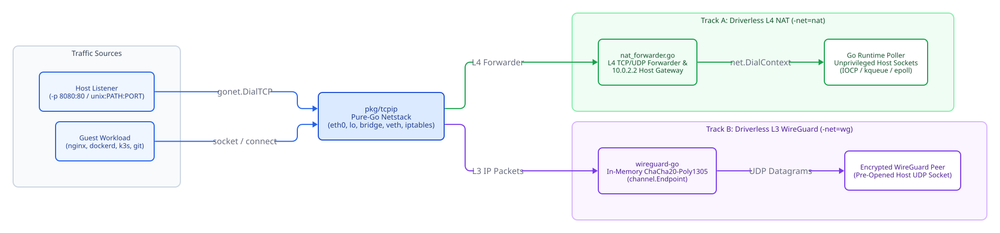

# Driverless Networking Backend: `netbackend` and Guest Overlays

This specification describes `pkg/netbackend` together with the guest overlay packages `pkg/tcpip/link/vxlan`, `pkg/tcpip/link/wgtun`, `pkg/ipset`, and `pkg/sentry/socket/netlink/genetlink`. Together they provide unprivileged networking, port forwarding, DNS relay, bandwidth shaping, host firewalling, and Kubernetes-grade guest networking across Windows, macOS, Linux, and Android.

---

## 1. Purpose and Scope

Guest processes invoke standard Linux socket calls against gVisor's pure-Go `pkg/tcpip` (Netstack), which implements `lo`, `eth0`, TCP state machines, bridges, `veth`, and legacy `iptables` entirely in memory. `pkg/netbackend` connects Netstack to the host network through two driverless tracks requiring zero administrator privileges or host TUN drivers:

| Attribute | Track A: NAT and Port Forwarder (`-net=nat`, default) | Track B: In-Memory WireGuard (`-net=wg`) |
| :--- | :--- | :--- |
| **Attachment layer** | L2 in-memory `pipe` link to a peer host-side Netstack (`tcp.NewForwarder`, `udp.NewForwarder`, `gonet`) | L3 `wgtun.Endpoint` directly attached to `wireguard-go` in memory |
| **Host transport** | Unprivileged host Go `net` sockets (Windows IOCP, macOS `kqueue`, Linux `epoll`) | One pre-bound unprivileged host UDP socket (`:0`) |
| **Host/LAN reachability** | Permitted by default (`10.0.2.2` / `host.docker.internal` maps to host `127.0.0.1`; optional `-isolate-lan`) | Cryptographically isolated; all egress exits via WireGuard |
| **Inbound exposure** | Static `-p` (TCP, UDP, ranges up to 1,024, `unix:`), dynamic `--auto-publish`, `rungv port add`, and `port-forward` | Tunnel peers only |

---

## 2. Design and Invariants

### 2.1 Track A: L2-Bridged NAT Relay, MTU, and Error Translation

In `-net=nat` mode, guest `eth0` connects via an in-memory `pipe` link to a second promiscuous, spoofing Netstack representing the host network. Because the guest stack routes unmodified Ethernet frames, guest bridges, network namespaces, and guest `iptables` NAT operate identically to Linux.

- **MTU rules**: Guest `eth0` defaults to `1500` (overridable via `net.nat.mtu`; `lo` stays `65,536`). Guests modify MTUs via `RTM_SETLINK` or `ioctl(SIOCSIFMTU)` (`68` to `65,535` in NAT; `68` to `65,503` in WireGuard on Unix; `68` to `1,984` in WireGuard on Windows due to `wireguard-go`'s 2,016-byte packet bound). Dropping a link MTU below `1280` strips IPv6 addresses and routes until restored. On macOS, host UDP send buffers are raised to 128 KiB so `net.inet.udp.maxdgram` (`9,216` bytes) does not reject large tunnel datagrams.
- **Session ceilings**: Defaults cap concurrent NAT flows at `4,096` TCP connections (excess reset), `512` UDP sessions (`net.nat.udp_sessions`, oldest evicted; 64 KiB pooled read buffers per direction), and `256` DNS flows.
- **Linux-faithful TCP dial errors**: The peer stack completes the guest TCP handshake only after the host dial succeeds (`net.nat.dial_timeout`). Host `ECONNREFUSED` sends RST; host `EHOSTUNREACH`/`ENETUNREACH` emits an ICMPv4 unreachable from `10.0.2.2` quoting the full SYN TCP header so guest `conntrack` propagates the exact errno behind container NAT; dial timeout drops silently so SYN retransmission retries until Linux's ~127 s timeout.

### 2.2 Port Forwarder, `--auto-publish`, and DNS Relay

- **Inbound forwarding (`port_forwarder.go`, `dynamic_forwarder.go`)**: Static `-p` TCP, UDP, range, and `unix:PATH:GUEST` listeners bind prior to `hostlockdown.Apply()`. Incoming host connections dial `10.0.2.15:GUEST` via `gonet`, falling back to `127.0.0.1:GUEST` on `lo` if the guest bound loopback only. Under `--auto-publish`, a poller (`net.forward.dynamic_poll_interval`, default `200 ms`) reconciles guest TCP listeners and `iptables` `DNAT` rules onto host `127.0.0.1` (up to `net.forward.max_dynamic_ports`, default `64`) without displacing static `-p` rules.
- **DNS relay (`dns_relay.go`)**: Answers guest UDP and TCP queries to `10.0.2.3:53` in both `-net=nat` and `-net=wg` modes. Before lockdown, it collects host nameservers, `search` domains, and safe `options` (falling back to `/run/systemd/resolve/resolv.conf` if `/etc/resolv.conf` lists only `127.0.0.53`, or using explicit `--host-dns` servers). It randomizes upstream transaction IDs with `crypto/rand`, bounds concurrency to 64 slots, retries truncated UDP over TCP, answers internal names (`localhost`, `host.docker.internal`, `gateway.docker.internal`, `gvx`) authoritatively, and returns empty `NOERROR` for external `AAAA` queries when `eth0` lacks an IPv6 route.

### 2.3 Bandwidth Shaping and Host NAT Policy

Each sandbox owns one transmit and one receive token bucket (`--net-tx-bps`, `--net-rx-bps`; 256 KiB burst per direction) shared across the NAT relay, published ports, DNS relay, private peer, and control tunnels. Stream relays throttle; full packet queues drop. Bucket state is host-owned and omitted from checkpoints.

An immutable host NAT firewall policy (`--nat-policy-file`, `.json`/`.yaml`/`.yml`, up to 64 KiB and 1,024 ordered rules per direction) evaluates IPv4 and IPv6 egress and ingress outside the guest. Live replacement over `gvx-ctrl/2` (`net.policy_set`) terminates active relays denied by the new policy. Protected checkpoints require supplying a policy file on restore. `-isolate-lan` always takes precedence over policy `allow` rules, and the sandbox blocks NAT dials to its own TCP control listener.

### 2.4 Track B: WireGuard (`-net=wg`) and In-Guest Overlay Primitives

In `-net=wg` mode, `wireguard_endpoint.go` attaches `pkg/tcpip/link/wgtun.Endpoint` (default MTU `1420`, 16-packet batching, `Suspend`/`Resume` hooks) directly to `wireguard-go` over a single pre-bound host UDP socket.

Inside the guest kernel, `gvx` also implements the full overlay stack needed by `dockerd`, `flannel`, and Calico:

- **In-guest `wireguard` links (`pkg/sentry/socket/netlink/genetlink/wireguard`)**: `RTM_NEWLINK` kind `wireguard` over `NETLINK_GENERIC` (`WG_CMD_GET_DEVICE`/`WG_CMD_SET_DEVICE`), sharing `wgtun.Endpoint`, charging kernel memory per device and peer (`64 KiB + 48 KiB/CPU` per link, `32 KiB` per peer) to per-sandbox memory accounting, and supporting namespace migration and `fwmark`.
- **In-guest `vxlan` links (`pkg/tcpip/link/vxlan`)**: RFC 7348 Ethernet encapsulation with flow-hashed outer source ports, FDB learning and 300 s ageing, `IFLA_VXLAN_LIMIT` (`maxaddr`), and `AF_BRIDGE` netlink FDB control.
- **IP sets (`pkg/ipset`)**: `hash:ip`, `hash:net`, `hash:ip,port`, `hash:net,port`, `hash:ip,port,ip`, `hash:ip,port,net`, `hash:net,net`, `bitmap:port`, and `list:set` over `NETLINK_NETFILTER` (`IPSET`) plus `-m set`/`-j SET`.

---

## 3. Known Limits

- **No IPv6 ICMP unreachable synthesis**: Unreachable IPv6 NAT dials time out rather than emitting ICMPv6 errors.
- **Windows WireGuard MTU cap**: `eth0` in `-net=wg` mode caps at `1984` bytes on Windows.
- **Policy and `StreamInterceptor` interaction**: Go SDK bandwidth limits and NAT policies cannot combine with a custom `Config.StreamInterceptor`.
- **Unbounded default VXLAN FDB**: Without `maxaddr`, 200,000 FDB entries consume roughly 38 MB (~190 bytes/entry); set `maxaddr` or `-m` for untrusted guests.
- **Guest WireGuard source selection and link-local IPv6**: Replies use the route-selected source address rather than the peer's target address, and IPv6 endpoints drop `sin6_scope_id`.

---

## 4. Implementation Map

| Package and Files | Role |
| :--- | :--- |
| `pkg/netbackend/` (`nat_forwarder.go`, `udp_sessions.go`, `tcp_dial_answer*.go`, `udp_sendbuf*.go`, `stack_options.go`) | Track A NAT relay, UDP table, Linux dial-error synthesis, macOS send-buffer raise. |
| `pkg/netbackend/` (`port_forwarder.go`, `dynamic_forwarder.go`, `dynamic_control.go`, `dns_relay.go`, `dns_servers_*.go`) | Static `-p`, `--auto-publish`, runtime `port add/rm`, DNS relay and resolver discovery. |
| `pkg/netbackend/` (`bandwidth.go`, `nat_bandwidth_packets.go`, `nat_policy.go`, `nat_policy_packets.go`) | Per-sandbox token buckets and immutable host NAT firewall policy. |
| `pkg/netbackend/` (`wireguard_endpoint.go`, `wireguard_bind.go`, `wireguard_tun.go`) & `pkg/tcpip/link/wgtun/` | Track B `-net=wg` tunnel and shared `wireguard-go` link endpoint. |
| `pkg/tcpip/link/vxlan/`, `pkg/ipset/`, `pkg/sentry/socket/netlink/genetlink/` | Guest VXLAN device, IP sets, Generic Netlink router, and in-guest WireGuard family. |
| Tests | `pkg/netbackend/*_test.go`, `pkg/ipset/*_test.go`, `e2e/nat_*`, `e2e/wireguard_*`, `e2e/vxlan_*`, `e2e/ipset_*`. |
