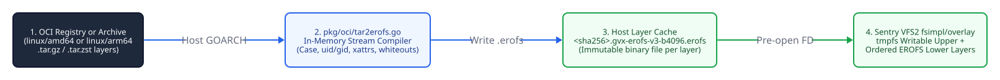

# OCI Image Compiler, Registry Client, and Host CA Injector: `pkg/oci` and `pkg/gvx/hostcerts`

This specification describes `pkg/oci` and `pkg/gvx/hostcerts`. `pkg/oci` resolves, pulls, pushes, saves, loads, caches, and compiles multi-architecture OCI and Docker images directly into EROFS filesystem images in memory. `pkg/gvx/hostcerts` collects host root CA certificates prior to lockdown for optional injection into the guest root filesystem.

---

## 1. Purpose and Scope

Extracting Linux container `.tar` layers onto Windows NTFS or case-insensitive macOS APFS corrupts case-sensitive filenames (`Makefile` vs. `makefile`), rejects Windows reserved names (`CON`, `AUX`, `NUL`, `:`), discards POSIX `uid`/`gid` bits, and requires elevated privileges for device nodes or symlinks. `pkg/oci` eliminates host extraction entirely: compressed layer streams compile directly into read-only 4 KiB-block EROFS files cached on disk and opened as read-only handles before `hostlockdown.Apply()`.

---

## 2. Design and Invariants

### 2.1 Reference Grammar, Registry Transport, and Credentials

`oci.ParseReference` implements the Docker image reference grammar, splitting registry host, repository (`library/` prefix for single-component Docker Hub names), tag (default `latest`), and `@sha256:` digest while rejecting uppercase repository names. Registries default to HTTPS except `localhost`, `127.0.0.0/8`, and `[::1]`, which use HTTP.

Credentials load from `$DOCKER_CONFIG/config.json` (or `~/.docker/config.json`) in the standard lookup order: `credHelpers`, `credsStore`, then `auths`. External `docker-credential-NAME` helpers run with a 30-second timeout and 1 MiB output cap. `rungvx login` validates credentials against the target registry before persisting them. `LayerCache.SetDNSServers` routes registry lookups through `--host-dns` servers without modifying the process-wide Go resolver.

### 2.2 In-Memory Tar-to-EROFS Compilation

For every resolved manifest matching the requested architecture (`linux/amd64` or `linux/arm64`), `pkg/oci` performs the pipeline below prior to host lockdown:

1. Verify the manifest SHA-256 digest and every compressed layer blob SHA-256 digest against registry descriptors (rejecting legacy Docker manifest schema 1).
2. Parse `Entrypoint`, `Cmd`, `Env`, `WorkingDir`, `User`, and `ExposedPorts` from the image config JSON.
3. Stream `.tar`, `.tar.gz`, or `.tar.zst` layers through `tar2erofs.go` without unpacking files onto the host OS.
4. Deduplicate 4 KiB blocks and sparse holes with `InodeDataLayoutChunkBased`, and inline short symlinks and directory tails with `InodeDataLayoutFlatInline`.
5. Translate OCI OverlayFS whiteouts (`.wh.<name>` and `.wh..wh..opq`) into `0:0` character device nodes and `trusted.overlay.opaque` extended attributes.
6. Write compiled `<sha256>.gvx-erofs-v3-b4096.erofs` images and `.sum` integrity sidecars into the platform layer cache (`%LOCALAPPDATA%\gvx\cache\layers`, `~/Library/Caches/gvx/layers`, or `~/.cache/gvx/layers`).
7. Enforce all `oci.*` tunables from `pkg/gvx/tuning` (`oci.max_json_bytes`, `oci.max_blob_bytes`, `oci.max_layer_bytes`, `oci.max_image_bytes`, `oci.max_entry_bytes`, `oci.max_entries`, `oci.max_archive_entries`, `oci.max_zstd_window_bytes`, `oci.registry_idle_timeout`).

At mount time, `pkg/gvx` opens read-only `HostHandle` descriptors for all lower `.erofs` layers before lockdown and mounts them under `fsimpl/overlay` beneath either an ephemeral `tmpfs` upper layer or a persistent `ext4lite` volume (`-rootfs-volume`).

### 2.3 Cache Operations, Blob Retention, Push, Save, and Load

- **Pull policies**: `missing` (default), `always` (falling back to cache with a warning on unreachable registry or HTTP 401/403/404 for locally loaded images), and `never` (strictly offline).
- **Blob retention (`-keep-blobs` / `GVX_KEEP_BLOBS=1`)**: Retains original compressed layer blobs under `blobs/sha256/<hex>` so `rungvx save` and `rungvx push` operate offline without re-fetching from the origin registry.
- **OCI Distribution v1.1 push (`push.go`)**: Probes existing blobs with `HEAD`, attempts same-registry cross-repository mounts, and uploads exact manifest bytes.
- **Archives (`save.go`, `load.go`)**: Read and write dual OCI layout and `docker save` tar archives.

### 2.4 Host Root CA Injection (`pkg/gvx/hostcerts`)

When `--host-ca-certs` (`Config.HostCACerts`) is enabled, `hostcerts` gathers trusted X.509 roots prior to `hostlockdown.Apply()`: `ROOT` system store on Windows, Keychain trust stores (`System.keychain`, `SystemRootCertificates.keychain`, `login.keychain-db`, honoring explicit user/admin/system denials) on macOS, and `/etc/ssl/certs` or `/etc/pki/tls/certs` on Linux, plus optional `SSL_CERT_FILE` and `SSL_CERT_DIR`. At rootfs setup, missing roots append to existing distribution CA bundles in the writable upper layer and write anchor files under `/usr/local/share/ca-certificates` or `/etc/pki/ca-trust/source/anchors` without mutating cached EROFS layers or mount points.

---

## 3. Known Limits

- **Docker manifest schema 1**: Rejected with an error (matching Docker 28+).
- **Offline `save` / `push` without `-keep-blobs`**: Requires network access to the origin registry if original compressed blobs were not retained when pulling or loading.
- **Ignored image directives**: `VOLUME`, `HEALTHCHECK`, `STOPSIGNAL`, and image labels are ignored by `rungvx run`.
- **Nested container CA roots**: `--host-ca-certs` injects roots into the direct guest rootfs only; nested containers started by `dockerd` require mounting `/etc/ssl/certs/ca-certificates.crt` explicitly.

---

## 4. Implementation Map

| Files | Role |
| :--- | :--- |
| `pkg/oci/reference.go`, `registry.go`, `credentials.go`, `resolver.go`, `pull.go`, `push.go` | Reference parser, OCI Distribution v1.1 HTTP client, Docker credential helpers, pull/push flows. |
| `pkg/oci/tar2erofs.go`, `erofs_layout.go`, `compress.go`, `limits.go` | Streaming Tar-to-EROFS compiler, 4 KiB block deduplication, whiteout conversion, decompression limits. |
| `pkg/oci/cache.go`, `store.go`, `blobs.go`, `archive.go`, `save.go`, `load.go`, `prune.go` | Layer cache index, blob store, OCI/Docker tar save and load, garbage collection. |
| `pkg/gvx/hostcerts/` & `pkg/gvx/hostcacerts.go` | Cross-platform host trust-store reader and guest upper-layer PEM injector. |
| Tests | `pkg/oci/*_test.go`, `pkg/gvx/hostcerts/*_test.go`, `e2e/gate_m3_test.go`, `e2e/hostcacerts_e2e_test.go`. |
