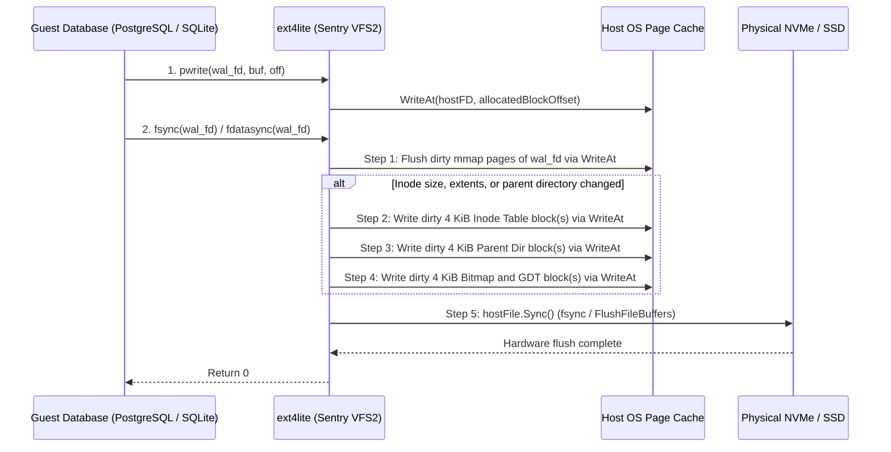

# GVXIP-002: `ext4lite` Single-File Volume and Overlay Engine

This specification defines `ext4lite` (`pkg/sentry/fsimpl/ext4lite`), a Tier 1 read-write VFS2 filesystem stored inside a single pre-opened host file. `ext4lite` backs named volumes (`MountVolume` in `pkg/gvx/mounts.go`) and optional persistent container rootfs overlay upper layers. It operates on one host file descriptor opened before `hostlockdown.Apply()`. This design eliminates Windows Defender (`WdFilter.sys`) per-file scans and avoids host path-walk system calls at run time. It also enforces strict `fsync` durability for databases and produces images compatible with Linux `ext4` tools.

| Field | Value |
| :--- | :--- |
| **Document ID** | `GVXIP-002` |
| **Title** | `ext4lite` Single-File Volume and Overlay Engine |
| **Status** | Implemented |
| **Isolation Tier** | Tier 1 (`pkg/sentry/fsimpl/ext4lite`, `pkg/gvx`) |
| **Target Platforms** | `darwin/arm64`, `windows/amd64`, `windows/arm64`, `linux/amd64`, `linux/arm64` |
| **Companion Spec** | [`gvxip-001-better-posix-hostfs.md`](gvxip-001-better-posix-hostfs.md) |

---

## 1. Motivation and Storage Engine Partitioning

Directory bind mounts (`hostfs`) expose individual files on the host filesystem so host IDEs and guest processes can edit the same workspace tree. However, package installation (`npm install`, `cargo build`, `pip install`) and database workloads create tens of thousands of small files. Creating those files directly on Windows (`NTFS`) or macOS (`APFS`) incurs high host kernel overhead.

- **Windows Minifilter and Antivirus Interception (`FltMgr.sys` and `WdFilter.sys`)**: Every `NtCreateFile` and `NtClose` call traverses the Windows Filter Manager stack. Microsoft Defender (`WdFilter.sys` and `MsMpEng.exe`) intercepts `IRP_MJ_CREATE` and `IRP_MJ_CLEANUP` packets synchronously to scan newly written `.js`, `.o`, `.so`, and ELF files. These scans hold temporary handles open. They cause transient `STATUS_SHARING_VIOLATION` and `STATUS_ACCESS_DENIED` errors when guest build tools immediately rename or unlink temporary files.
- **Component-by-Component Path Walk Cost**: To prevent symlink escapes, `walkParent` in `pkg/sentry/fsimpl/hostfs` opens each intermediate directory component with `NtCreateFile` or `openat(..., O_NOFOLLOW)`. Opening 10,000 files at a depth of five directories executes over 50,000 host system calls.
- **NTFS Sparse-File Allocation Stalls**: [`docs/systrap-windows.md`](../systrap-windows.md) Section 3.8 measured `git add` across 200 small files on Windows. The operation took 8 to 19 seconds on a sparse NTFS file versus 0.8 to 1.3 seconds on a dense NTFS file. NTFS blocks on cluster allocation during the first write to each sparse hole.

`gvx` already solves this problem for read-only container image layers by compiling `.tar` layers into single-file `<sha256>.erofs` images mounted by `pkg/sentry/fsimpl/erofs`. `ext4lite` provides the read-write counterpart to `erofs`.

| Storage Engine | Mount Role in `pkg/gvx` | Backing Host Resource | Host `openat` / `NtCreateFile` Calls at Run Time | Windows Defender (`WdFilter.sys`) Per-File Scans |
| :--- | :--- | :--- | ---: | ---: |
| `pkg/sentry/fsimpl/erofs` | Read-only OCI image lower layers | Single `<sha256>.erofs` file per layer | `0` | `0` |
| `pkg/sentry/fsimpl/ext4lite` | Named volumes (`-v name:/path`) and persistent overlay `upperdir` | Single `<name>.ext4` file per volume | `0` | `0` |
| `pkg/sentry/fsimpl/hostfs` v2 | Live host workspace (`-workspace`, `-v /host:/guest`) | Pinned `*os.Root` host directory | `O(depth)` per uncached open | `1` per host file close |

### 1.1 Filesystem Format Evaluation

`ext4lite` requires a compact pure-Go implementation (under 1,500 lines) with zero B+Tree rebalancing during `fsync`. The format must also store small files inline and shrink without sparse holes.

| Format Candidate | On-Disk Allocation and Directory Structures | Estimated Pure-Go Subset Size | Small-File Inline Storage | Non-Sparse Dynamic Shrink Support | Verdict |
| :--- | :--- | ---: | :--- | :--- | :--- |
| **Linux `ext4` (`ext4lite` profile)** | Flat block and inode bitmaps, static inode array per group, linear `ext4_dir_entry_2` records, 4-entry inline `ext4_extent` | `~1,400` lines | Up to `128 bytes` inside each `256-byte` inode (`INLINE_DATA`) | Supported via `16 MiB` dynamic block-group append and tail `ftruncate` | **Selected** |
| **Linux `XFS`** | Dual free-space B+Trees (`bnobt`, `cntbt`), inode B+Trees (`inobt`, `finobt`), directory B+Trees | `~6,500` lines | Shortform directories only | Unsupported (`XFS` AGs cannot shrink online) | Rejected |
| **Linux `Btrfs`** | Six coupled Copy-on-Write B-Trees (Root, Extent, Chunk, Device, FS, CSUM) | `~8,000` lines | Inline B-Tree leaf items | Supported via chunk tree relocation, high CoW amplification | Rejected |
| **OpenZFS** | DMU, SPA, ZAP hash tables, indirect DNodes, 128-bit block pointers | `~20,000` lines | DNode bonus buffer | Unsupported on single-vdev files; absent from mainline Linux kernel | Rejected |

---

## 2. Non-Sparse Contingency and Dynamic 16 MiB Block Groups

Pre-creating a 64 GiB sparse volume file via `ftruncate(fd, 64<<30)` fails across multiple host filesystems and backup workflows:

- **Windows NTFS `$ATTRIBUTE_LIST` Exhaustion (Win32 Error 665)**: Random 4 KiB writes and hole-punching calls (`FSCTL_SET_ZERO_DATA`) across a sparse NTFS file fragment the MFT `$ATTRIBUTE_LIST` attribute. Once that attribute list reaches 256 KiB, NTFS fails all subsequent writes with `ERROR_FILE_SYSTEM_LIMITATION` (error 665) even when disk space remains free.
- **Zero-Fill Stalls on Non-Sparse Volumes**: External `exFAT`, `FAT32`, `HFS+`, and some SMB or NFS volumes lack sparse file support. Calling `ftruncate(fd, 64<<30)` on these volumes forces the host kernel to write 64 GiB of physical zeros synchronously.
- **Backup and Archive Expansion**: Copy utilities, archive tools, and cloud-sync agents often inspect `st_size` without querying sparse extent maps. Those tools expand a 64 GiB sparse file into 64 GiB of physical zeros.
- **Static Inode Table Offset Jumps in Default `ext4`**: A default `ext4` filesystem uses 128 MiB block groups (`32,768` blocks) with 8,192 inodes per group. Creating 50,000 1-byte files forces allocation in Block Group 6 at offset `768 MiB`, creating a 700 MiB sparse hole.

### 2.1 Self-Contained 16 MiB Micro-Groups and Dense Growth

`ext4lite` eliminates sparse holes through **First-Fit dense block allocation** and **16 MiB self-contained block groups (`s_blocks_per_group = 4096`, `s_inodes_per_group = 4096`)**. The engine appends and truncates these 16 MiB groups dynamically at the end of the host file.

```text
+-----------------------------------------------------------------------+
| Fixed Volume Header (Blocks 0..64, 260 KiB total)                     |
| - Block 0 (4 KiB):      1024B zero pad + ext4_super_block (1024B)     |
| - Blocks 1..64 (256 KiB): Pre-reserved Group Descriptor Table (GDT)   |
|                           (4,096 x 64-byte descriptors = 64 GiB max)  |
+-----------------------------------------------------------------------+
| Block Group 0 (Blocks 65..4160, 16 MiB = 4,096 x 4 KiB blocks)        |
| - Block +0 (4 KiB):     Block Allocation Bitmap (4,096 bits = 512B)   |
| - Block +1 (4 KiB):     Inode Allocation Bitmap (4,096 bits = 512B)   |
| - Blocks +2..+257:      Inode Table (4,096 x 256B = 1 MiB)            |
| - Blocks +258..+4095:   Data and Directory Blocks (3,838 blocks)      |
+-----------------------------------------------------------------------+
| Block Group 1..N (16 MiB each, appended on demand at physical EOF)    |
+-----------------------------------------------------------------------+
```

| Layout Parameter | Constant / Formula | Value | Architectural Purpose |
| :--- | :--- | ---: | :--- |
| **Block Size** | `1024 << s_log_block_size` | `4,096 B` | Matches 4 KiB guest and host page size |
| **Blocks per Group** | `s_blocks_per_group` | `4,096` (`16 MiB`) | Legal `ext4` multiple of 8 (`mkfs.ext4 -b 4096 -g 4096`); bounds physical growth step |
| **Inodes per Group** | `s_inodes_per_group` | `4,096` | Provides `1` inode per `4 KiB` of group space; prevents inode exhaustion on small-file trees |
| **Inode Size** | `s_inode_size` | `256 B` | Holds `60 B` `i_block` plus `96 B` inline `xattr` area (`68 B` max `system.data` payload) |
| **Reserved GDT Blocks** | `Blocks 1..64` | `64 blocks` (`256 KiB`) | Pre-allocates descriptor slots for `4,096` groups (`64 GiB`) so appending a group never moves data blocks |

### 2.2 Platform Storage Contingency Matrix

When opening or creating the backing `.ext4` file before `hostlockdown.Apply()`, `ext4lite` probes the host descriptor and selects one of three storage tiers. None of the tiers sets `FSCTL_SET_SPARSE` on Windows.

| Contingency Tier | Host Environment | Group Append Mechanism (`+16 MiB`) | Space Reclamation Mechanism (`-16 MiB`) | `StatFS` Free Space Formula |
| :--- | :--- | :--- | :--- | :--- |
| **Tier A: Native Prealloc** | Linux (`ext4`, `xfs`, `btrfs`), macOS (`APFS`) | `unix.Fallocate(fd, 0, off, 16<<20)` or `fcntl(F_PREALLOCATE)` plus `ftruncate` | First-fit block reuse; tail compaction on `Close()` followed by `unix.Ftruncate` | `min(64 GiB - usedBytes, hostAvailBytes)` |
| **Tier B: Windows Dense** | Windows (`NTFS`, `ReFS`) | Non-sparse file extended via `SetFileInformationByHandle(FileAllocationInfo)` in `16 MiB` chunks | First-fit block reuse; tail compaction on `Close()` followed by `SetEndOfFile` | `min(64 GiB - usedBytes, hostAvailBytes)` |
| **Tier C: Universal Fallback** | `exFAT`, `FAT32`, `HFS+`, SMB, NFS (when prealloc returns `EOPNOTSUPP` or `EINVAL`) | Extend via `ftruncate` in `4 MiB` steps up to `highWaterBlock * 4096` | First-fit block reuse; tail `ftruncate` when trailing groups empty | `min(64 GiB - usedBytes, hostAvailBytes)` |

---

## 3. On-Disk Format Specification

Every unmounted or synced `ext4lite` image is a valid little-endian Linux `ext4` filesystem (`s_magic == 0xEF53`). The image passes `e2fsck -f` and mounts via `mount -o loop -t ext4` on Linux.

| Feature Set Field | Offset in `ext4_super_block` | Bitmask Value | Enabled Flags and Rationale |
| :--- | ---: | ---: | :--- |
| `s_feature_compat` | `0x5C` | `0x00000008` | `COMPAT_EXT_ATTR` (`0x08`) only; `COMPAT_HAS_JOURNAL` (`0x04`) and `COMPAT_DIR_INDEX` (`0x20`) cleared |
| `s_feature_incompat` | `0x60` | `0x000080C2` | `INCOMPAT_FILETYPE` (`0x02`), `INCOMPAT_EXTENTS` (`0x40`), `INCOMPAT_64BIT` (`0x80`), `INCOMPAT_INLINE_DATA` (`0x8000`) |
| `s_feature_ro_compat` | `0x64` | `0x00000042` | `RO_COMPAT_LARGE_FILE` (`0x02`), `RO_COMPAT_EXTRA_ISIZE` (`0x40`) |

### 3.1 Inode, Inline Data, and Extent Layout

Each `256-byte` `ext4_inode` stores file metadata, inline small-file content up to `128 bytes`, fast symlinks up to `59 bytes`, or an `ext4_extent` tree header inside `i_block[60]`.

```text
0x00..0x27 (40B):  i_mode, i_uid, i_size_lo, i_atime, i_ctime, i_mtime, i_dtime, i_gid, i_links_count
0x28..0x63 (60B):  i_block[60]: Inline data bytes [0..59] OR ext4_extent_header (12B) + 4 x ext4_extent (48B)
0x64..0x7F (28B):  i_generation, i_file_acl_lo, i_size_high, i_osd2 (high 16 bits of uid, gid, links)
0x80..0x9F (32B):  i_extra_isize (32), nanosecond timestamps (ctime_extra, mtime_extra, atime_extra, crtime)
0xA0..0xFF (96B):  Inline xattr area (4B magic 0xEA020000 + "system.data" entry + inline tail [60..127])
```

| File Size or Type | `i_flags` Bit | Storage Location | Allocated 4 KiB Data Blocks |
| :--- | :--- | :--- | ---: |
| Regular file `0..60 B` or fast symlink `< 60 B` | `EXT4_INLINE_DATA_FL` (`0x10000000`, regular files) | `i_block[0..59]` inside the `256 B` inode | `0` |
| Regular file `61..128 B` | `EXT4_INLINE_DATA_FL` (`0x10000000`) | `i_block[0..59]` plus `system.data` inline xattr (`0xA0..0xFF`) | `0` |
| Regular file or directory `<= 4` extents (up to `512 MiB` contiguous) | `EXT4_EXTENTS_FL` (`0x00080000`) | Root `ext4_extent_header` (`eh_depth == 0`) + up to 4 `ext4_extent` structs in `i_block` | `ceil(size / 4096)` |
| Regular file `> 4` extents | `EXT4_EXTENTS_FL` (`0x00080000`) | Root `ext4_extent_header` (`eh_depth == 1`) + up to 4 `ext4_extent_idx` pointers to 4 KiB leaf extent blocks (up to `340` extents per leaf) | `ceil(size / 4096) + leafBlocks` |

### 3.2 Untrusted Image Validation Invariants

Because a backing `.ext4` file resides on the host disk and can be modified offline, `ext4lite` validates every on-disk structure before dereferencing block offsets. Any violation returns `linuxerr.EUCLEAN` (`EIO` on mount) and aborts the operation without panicking the Sentry process.

| Validation Boundary | Enforced Invariant | Prevented Attack Class |
| :--- | :--- | :--- |
| **Extent Physical Block Range** (`isValidDataBlock`) | Every physical block `b` in an `ext4_extent` must satisfy `65 <= b < s_blocks_count` and `(b - 65) % 4096 >= 258`. | Prevents a crafted file extent from pointing at the Superblock (`Block 0`), GDT (`Blocks 1..64`), bitmaps, or inode tables (metadata overwrite via data write). |
| **Directory Entry Stepping** (`ext4_dir_entry_2.rec_len`) | Every directory record must satisfy `rec_len >= 8`, `rec_len % 4 == 0`, and `offset + int(rec_len) <= 4096`. | Prevents infinite CPU loops (`rec_len == 0`) and out-of-bounds slice reads during `getdents64` and `lookup`. |
| **Reachability Graph Walk** (`fsckLite`) | `fsckLite` tracks a `visitedInodes` bitmap and a `claimedBlocks` bitmap across the walk from root inode `#2`. | Rejects cyclic directory links (preventing stack overflow) and cross-linked extents where two inodes claim the same physical data block. |
| **In-Memory Cache Eviction & Xattr Cap** | Per-inode `xattr` payloads are capped at `4 KiB`, and unreferenced `dentry` nodes are evicted when `vfs.Dentry` refcounts hit zero. | Prevents a guest from exhausting Sentry Go heap memory via unbounded metadata creation. |

---

## 4. In-Memory Architecture and Strict Sync Protocol

`ext4lite` separates in-memory metadata mutation during normal system calls from synchronous disk durability during `fsync`, `fdatasync`, `sync`, and `O_DSYNC` or `O_SYNC` writes:

- **In-Memory Runtime State**: At mount time, `ext4lite` loads bitmaps into memory (`alloc.go`) and populates `dentry` maps lazily on lookup. VFS calls (`CreateAt`, `MkdirAt`, `SymlinkAt`, `UnlinkAt`, `RenameAt`, `SetStatAt`, `SetXattrAt`) mutate Go structs in memory. They mark the affected inode, directory, and bitmaps dirty in `dirtyTracker` and return immediately. Short-lived compiler temporaries that close after `unlink` without calling `fsync` return their blocks to the in-memory bitmap without touching disk metadata.
- **Strict Durability on Sync**: Guest databases (PostgreSQL, MySQL, SQLite, etcd) call `fsync`, `fdatasync`, or write with `O_DSYNC` or `O_SYNC` on commit. `ext4lite` executes an ordered write-through flush to the host descriptor and calls `hostFile.Sync()` (`fsync` on Unix; `FlushFileBuffers` on Windows) before returning.



### 4.1 Ordered Strict Sync Procedure

Execute this procedure in `regularFD.Sync`, `directoryFD.Sync`, and `O_DSYNC` or `O_SYNC` write paths.

> [!CAUTION]
> Always write dirty data blocks before writing dirty inode table blocks, and always write dirty inode table blocks before writing dirty directory blocks. Reversing this order can expose a directory entry that points to an uninitialized inode or stale data blocks if host power fails mid-flush.

1. Flush all dirty mapped 1 MiB chunks in `inode.data` to their 4 KiB block offsets in `hostFile` via `WriteAt`.
2. Return `hostFile.Sync()` immediately if `opts.DataOnly` (`fdatasync`) is set and the inode size and extents are clean.
3. Acquire `fs.metaFlushMu.Lock()`.
4. Serialize the dirty `256-byte` `ext4_inode` into its 4 KiB inode-table block and write that block to `hostFile`.
5. Serialize and write the parent directory's 4 KiB `ext4_dir_entry_2` blocks if a create or rename dirtied the parent.
6. Write any dirtied 4 KiB block-bitmap, inode-bitmap, Group Descriptor Table, or Superblock blocks to `hostFile`.
7. Clear the dirty bits for the flushed blocks in `dirtyTracker` and release `fs.metaFlushMu.Unlock()`.
8. Call `hostFile.Sync()` and return any host I/O error translated via `translateHostError`.

### 4.2 Unmount Tail Compaction and Mount-Time Self-Healing

`ext4lite` runs without a JBD2 block journal (`^has_journal`). It tracks mount state via `s_state` in `ext4_super_block` (`EXT4_VALID_FS = 0x0001`). After an abnormal host termination (`SIGKILL` or power loss), a mount-time reachability scan (`fsckLite`) reconstructs the bitmaps in memory.

Unlike `mkfs.ext4`, `ext4lite` does not create a `/lost+found` directory in the volume root. Database initializers (`PostgreSQL` `initdb`, `MySQL` `mysqld --initialize`) and `git clone` reject non-empty mount points when `/lost+found` is present. An allocated inode that is unreachable from root inode `#2` during `fsckLite` comes from an unlinked open file or an interrupted pre-`fsync` write. `fsckLite` reclaims those unreachable inodes and their data blocks directly into the free bitmaps instead of linking them into `/lost+found`.

> [!IMPORTANT]
> Clear `EXT4_VALID_FS` (`s_state = 0`) and flush Block 0 before servicing the first guest write on a writable mount. Leaving `EXT4_VALID_FS` set while the volume is mounted skips bitmap reconstruction after a host crash.

1. Read `ext4_super_block` from Block 0 at mount time and verify `s_magic == 0xEF53`.
2. Run `fsckLite` if `s_state & EXT4_VALID_FS == 0` to walk reachable directories from inode `#2` and rebuild bitmaps.
3. Set `s_state = 0` in Block 0 and write Block 0 to `hostFile` on writable mounts.
4. Relocate allocated data blocks from trailing sparse-used groups into lower free holes during `filesystem.Release`.
5. Decrement `s_blocks_count` and `s_inodes_count` for trailing empty 16 MiB groups and call `hostFile.Truncate`.
6. Flush all dirty metadata blocks, set `s_state = EXT4_VALID_FS`, write Block 0, and call `hostFile.Sync()`.

---

## 5. Sandbox Mount Integration and Lockdown Invariants

`pkg/gvx/mounts.go` integrates `ext4lite` without breaking existing CLI flags (`-workspace`, `-v`, `--mount`, `--tmpfs`). Before `hostlockdown.Apply()` executes, `openMounts` in `pkg/gvx/mounts.go` opens the single `<volume>.ext4` file descriptor for each `MountVolume` entry and passes the `fd.HostHandle` to `ext4lite`.

| Mount Configuration | CLI Syntax | `MountKind` in `pkg/gvx` | VFS2 Engine | Runtime Host Syscalls Needed After `hostlockdown.Apply()` |
| :--- | :--- | :--- | :--- | :--- |
| **Workspace Bind Mount** | `-workspace /host/dir` | `MountBind` | `hostfs` v2 | `openat`, `unlinkat`, `renameat2`, `fstatat` relative to pinned `os.Root` |
| **Explicit Bind Mount** | `-v /host/dir:/guest/dir` | `MountBind` | `hostfs` v2 | `openat`, `unlinkat`, `renameat2`, `fstatat` relative to pinned `os.Root` |
| **Named Volume (Default)** | `-v pgdata:/var/lib/postgresql/data` | `MountVolume` | `ext4lite` | `pread64`, `pwrite64`, `fsync`, `ftruncate`, `fallocate` on 1 pre-opened FD (`UnboundFileOpenBlocked = true`) |
| **Named Volume (Host Dir Opt-In)** | `--mount type=volume,src=myvol,dst=/data,driver=hostfs` | `MountVolume` | `hostfs` v2 | Same as `MountBind` |
| **Memory Mount** | `--tmpfs /run:size=64m` | `MountTmpfs` | `tmpfs` | None (pure memory) |
