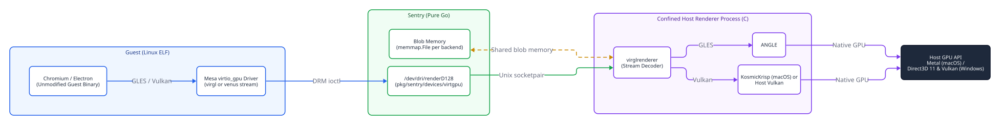

# Research Proposal: GPU Acceleration for Browser and GUI Guests

This document outlines a future research architecture for providing Linux browser and GUI guests access to the host GPU on macOS and Windows. The design comprises three layers: unmodified Mesa drivers inside the guest, a virtual DRM render node inside the Sentry, and a confined host renderer process. **The repository implements no part of this design today.**

| Field | Value |
| :--- | :--- |
| **Status** | Proposed (Phase 0 not started) |
| **Target Isolation Tier** | Tier 1 for `pkg/sentry/devices/virtgpu`, the host renderer binary, and its IPC package (registered in `tier1Prefixes` and `file_mask.txt`); Tier 3 `seam` in `pkg/sentry/fsimpl/sys/sys.go`. |
| **Target Hosts** | `darwin/arm64`, `windows/amd64`, `windows/arm64` (`linux/amd64` and `linux/arm64` optional). |
| **Companion Specifications** | [`architecture.md`](architecture.md), [`systrap-windows.md`](systrap-windows.md) |

Execution proceeds strictly in phases; each phase begins only after the preceding phase satisfies its exit criterion.

| Phase | Scope | Status |
| :--- | :--- | :--- |
| Phase 0 | Software-rendering baseline gates for Chromium, Playwright, and Electron | Not started |
| Phase 1 | Prototype over `virglrenderer`'s `vtest` socket protocol (no Sentry changes) | Not started |
| Phase 2 | Virtual DRM render node in the Sentry plus confined headless host renderer | Not started |
| Phase 3 | Display presentation to the host desktop | Not started |

---

## 1. Scope and Objectives

Target workloads are Chromium-based browsers, browser automation frameworks (Playwright and Puppeteer), and Electron applications. Because Chromium deprecates automatic WebGL fallback to CPU SwiftShader (requiring `--enable-unsafe-swiftshader` when no GPU exists), hardware acceleration becomes essential for WebGL and GPU-composited workloads.

| Objective | Requirement |
| :--- | :--- |
| G1 | Headless Chromium renders WebGL and compositing on the host GPU on macOS and Windows. |
| G2 | The `rungv` binary remains pure Go (`CGO_ENABLED=0`) without linking host C graphics libraries. |
| G3 | GPU access is strictly opt-in; default sandboxes retain their existing security posture. |
| G4 | Guests run unmodified distribution packages (Mesa, Chromium, Electron). |
| G5 | A subsequent phase presents guest windows on the host desktop if user demand warrants it. |

Out of scope: GPU machine-learning compute (CUDA, ROCm, Metal compute), hardware video codecs, native macOS/Windows guest apps, and full Linux desktop session managers.

---

## 2. Background and Current Browser State

Linux guest browsers are ELF64 binaries served by the Sentry; they cannot `dlopen` host Mach-O `Metal.framework` or PE `d3d11.dll`. Standard virtualization architectures serialize guest graphics calls into a command stream decoded by a host renderer (`virtio-gpu` paired with `virglrenderer`).

### 2.1 Current Evidence in `gvx`

The repository contains no end-to-end test for Chromium, Playwright, Puppeteer, or Electron. Their behavior under software rendering on each backend is therefore unknown and must be measured before evaluating GPU speedups.

| Aspect | Current Repository State |
| :--- | :--- |
| Browser or Electron `e2e/` gate | None. |
| `/dev/shm` | Mounted as `tmpfs` with no fixed size limit (inherits Linux's 50% of host RAM default). |
| Registered guest devices | `memdev`, `/dev/kmsg`, `ttydev`, `/dev/fuse`, and `tundev` (`nvproxy`, `rdmaproxy`, `tpuproxy` exist in upstream code but are unregistered). |
| DRM device (`/dev/dri/*`) | None. |
| `fork` + `exec` cost on Windows `systrap` | 6.4 ms (`amd64`) and 22 ms (`arm64`) on hosted runners ([`systrap-windows.md`](systrap-windows.md#39-cross-backend-micro-benchmarks-and-spin-windows)). |

Because Chromium forks separate renderer and GPU utility processes, Windows `systrap` process-creation latency will likely affect tab startup time (inference; to be measured in Phase 0).

---

## 3. Prior Art

Four existing systems illustrate relevant command-stream translation and confinement designs:

| Project | Host | Guest Driver | Host Renderer | Implication for `gvx` |
| :--- | :--- | :--- | :--- | :--- |
| UTM | macOS | Mesa `virgl` (GL), `venus` (Vulkan) | `virglrenderer` + ANGLE/Metal or MoltenVK | Demonstrates `virgl` over ANGLE/Metal; UTM disabled GPU acceleration by default in v4.1.6 due to guest Mesa bugs and notes Linux desktops fail over `venus`. |
| `libkrun` / `krunkit` | macOS | Mesa `venus` | `virglrenderer` (`venus`) + MoltenVK | Demonstrates Linux Vulkan containers on Apple GPUs (used by Podman Machine). |
| `crosvm` | Linux | Mesa `virgl`, `venus`, cross-domain | Confined `virglrenderer` process | Demonstrates renderer confinement and Wayland forwarding (`sommelier`). |
| WSLg | Windows | Mesa `d3d12` | DirectX 12 via `/dev/dxg` (`dxgkrnl`) | Requires `D3DKMT` calls through `win32k`, which conflict with `gvx`'s Sentry lockdown (inference). |

No production Windows product is known to ship `virglrenderer` over ANGLE on Direct3D 11; Phase 1 must verify that stack experimentally before Phase 2 commits to it.

---

## 4. Constraints Imposed by `gvx`

| Constraint | Source | Architectural Consequence |
| :--- | :--- | :--- |
| No post-lockdown child processes | `hostlockdown.Apply` | Renderer process must launch prior to lockdown, analogous to the `systrap` stub host. |
| No `win32k` syscalls inside Sentry | `AGENTS.md` Section 3.2 | Direct3D calls must stay confined to the separate renderer process. |
| Pure-Go `rungv` (`CGO_ENABLED=0`) | `.github/workflows/release.yml` | C graphics libraries (`virglrenderer`, ANGLE) reside in a separate renderer binary communicating over IPC. |
| `hostfs` sockets live in Sentry memory | [`components/hostfs.md`](components/hostfs.md) | Guests cannot connect to host Unix sockets through bind mounts; display protocols need a dedicated socket bridge or TCP. |
| Distinct guest memory models per backend | `hvf`, `whpx`, `systrap` | Zero-copy renderer blob buffers require per-backend `memmap.File` imports. |
| No physical GPU on hosted CI runners | GitHub Actions | Windows CI can test functionally on WARP; macOS hardware testing and performance checks require physical hosts. |
| Upstream diff ceiling (< 5.0%; 4.2% CI) | `tools/upstream` | New packages must register in `tier1Prefixes`; `sysfs` `/sys/class/drm` requires one Tier 3 seam. |

---

## 5. Proposed Architecture

The Sentry implements a Linux `virtio_gpu` DRM render node (`/dev/dri/renderD128`) and forwards serialized command streams over shared-memory IPC to a separate confined renderer process, which alone invokes host graphics APIs.

### 5.1 Subsystem Boundaries

| Component | Location | Responsibility |
| :--- | :--- | :--- |
| Guest driver | Unmodified image (`libgl1-mesa-dri`, `mesa-vulkan-drivers`) | Encodes OpenGL ES or Vulkan calls into `virgl` or `venus` streams. |
| Virtual render node | `pkg/sentry/devices/virtgpu` (proposed) | Registers DRM major `226` (minor >= `128`), serves 28 DRM and `virtio-gpu` ioctls, owns GEM handles, dma-buf PRIME FDs, and `sync_file` fences. |
| Device enumeration | Sentry `sysfs` and `devtmpfs` | Populates `/sys/class/drm` and `/sys/dev/char/226:*` required by `libdrm`. |
| Blob memory adapter | Per-backend `memmap.File` (proposed) | Imports renderer shared sections into `hvf`, `whpx`, or `systrap` guest address spaces. |
| Host renderer | Separate C/cgo binary (proposed) | Runs `virglrenderer` with ANGLE/Metal, ANGLE/D3D11, MoltenVK, or host Vulkan inside OS confinement. |
| IPC transport | Dedicated Tier 1 package (proposed) | Shared-memory command ring and event pair carrying commands, fences, and resource metadata. |

### 5.2 Guest DRM Surface

An earlier draft estimated ~10 ioctls; actual Mesa requirements encompass 28 ioctls plus two new file types (`dma-buf` and `sync_file`) and `sysfs` entries:

| Group | Requests | Purpose |
| :--- | :--- | :--- |
| DRM core (2) | `DRM_IOCTL_VERSION`, `DRM_IOCTL_GET_CAP` | Reports driver `virtio_gpu` (`SET_CLIENT_CAP` and `GET_UNIQUE` return `EACCES` on render nodes). |
| GEM / PRIME (3) | `GEM_CLOSE`, `PRIME_HANDLE_TO_FD`, `PRIME_FD_TO_HANDLE` | Buffer lifetimes and cross-process dma-buf sharing. |
| Sync objects (12) | `DRM_IOCTL_SYNCOBJ_*` and `EXECBUFFER` fences | GPU-CPU and cross-process synchronization. |
| `virtio-gpu` (11) | `VIRTGPU_{GETPARAM,GET_CAPS,CONTEXT_INIT,RESOURCE_CREATE,RESOURCE_CREATE_BLOB,RESOURCE_INFO,MAP,EXECBUFFER,TRANSFER_TO_HOST,TRANSFER_FROM_HOST,WAIT}` | Context creation, resource transfers, and command submission. |
| File operations | `mmap`, `poll`, `read` | Mapped GEM buffers and completion events. |

### 5.3 Command Streams, Memory Mapping, and Display Paths

- **`virgl` (OpenGL ES) vs. `venus` (Vulkan)**: Phase 2 begins with `virgl` using explicit `TRANSFER_TO_HOST`/`TRANSFER_FROM_HOST` copies. `venus` eliminates host ANGLE translation but requires `VIRTGPU_PARAM_RESOURCE_BLOB` and host-visible memory export across `hvf` (`hv_vm_map` 16 KiB aligned), `whpx` (`WHvMapGpaRange`), and Windows `systrap` (`sectionCache` imported handles).
- **Renderer confinement**: Launched per sandbox before `hostlockdown.Apply()`, with no handle granting write access to Sentry memory. Windows applies a Low-integrity restricted token, one-process job, and file denial while allowing `dxgi.dll`/`d3d11.dll`; macOS applies Seatbelt denying forks, writes, and network while permitting Metal `iokit-open`; optional Linux uses `seccomp` and namespaces.
- **Display options (Phase 3)**: X11 over TCP copies every frame (~2 GB/s at 4K 60 Hz; MIT-SHM does not cross hosts); VNC encodes and decodes every frame; RDP/VAIL (WSLg) lacks a `gvx` shared-memory client path; a Wayland cross-domain bridge enables zero-copy blob presentation at the cost of per-OS host compositors.

---

## 6. Security Analysis

Adding a C renderer that parses guest command streams and calls host GPU drivers enlarges the sandbox attack surface.

| Threat | Evidence | Mitigation |
| :--- | :--- | :--- |
| Memory corruption in `virglrenderer` | [CVE-2019-18389](https://access.redhat.com/security/cve/cve-2019-18389) (heap overflow), [CVE-2022-0135](https://access.redhat.com/security/cve/cve-2022-0135) (out-of-bounds write). | Isolate renderer per sandbox under OS confinement; pin and update versions. |
| Host GPU driver defects | Drivers execute in the host kernel or privileged graphics services. | Keep GPU acceleration strictly opt-in and document the trade-off. |
| Resource exhaustion | Malicious guests can allocate excessive VRAM or stall fences. | Cap resource memory and submission size in Sentry; time out stalled contexts. |
| Cross-sandbox leakage | Shared GPU processes risk context leaks. | Strictly one renderer process per sandbox. |

---

## 7. Corrections to an Earlier Draft

| Earlier Claim | Corrected Finding | Basis |
| :--- | :--- | :--- |
| ~10 Sentry ioctls suffice | 28 ioctls plus dma-buf, `sync_file`, and `sysfs` enumeration are needed. | Section 5.2 |
| Chromium enables GPU automatically | GPU blocklists may disable `virgl` without `--ignore-gpu-blocklist`. | Inference; tested in Phase 1 |
| Tens-of-times speedup across automation | Applies to WebGL; rasterization, PDFs, and screenshots remain partly CPU-bound. | Measured in Phase 0 |
| Guest sockets reach host X11/Wayland directly | `hostfs` sockets stay in Sentry memory; host display requires TCP or a bridge. | Section 4 |
| Zero-copy 4K60 over X11 | X11 over TCP copies every frame; zero copy needs blobs plus a compositor bridge. | Section 5.3 |
| `/dev/shm` capped at 64 MB | `gvx` mounts `/dev/shm` with Linux's 50% host RAM default. | `pkg/gvx/kernel_runner.go` |
| Licenses fit Apache-2.0 | `virglrenderer` (MIT), ANGLE (BSD-3-Clause), and MoltenVK (Apache-2.0) are compatible. | Upstream licenses |

---

## 8. Risks and Phased Exit Criteria

| Risk | Mitigation | Tested In |
| :--- | :--- | :--- |
| Software-rendered browsers fail on a backend | Fix core Sentry or backend defects first. | Phase 0 |
| Speedup over SwiftShader is below threshold | Halt after Phase 0 or Phase 1. | Phases 0 and 1 |
| `virglrenderer` + ANGLE/D3D11 unstable on Windows | Evaluate `venus` on host Vulkan or retain CPU rendering on Windows. | Phases 1 and 2 |
| Multi-layer translation rendering bugs | Gate on a WebGL conformance subset. | Phases 1 and 2 |
| C build and archive overhead | Build and distribute renderer as a separate optional archive. | Phase 2 |

### 8.1 Phase 0: Baseline Software Gates

1. Add `e2e/` gates for headless Chromium, Playwright (screenshot and PDF), and Electron across `hvf`, `whpx`, Windows `systrap`, and Linux `systrap`.
2. Measure browser startup, tab spawn cost, and SwiftShader CPU share (`--enable-unsafe-swiftshader`).
3. Define the minimum SwiftShader time share and speedup threshold justifying Phase 1.

### 8.2 Phase 1: `vtest` Socket Prototype

> [!CAUTION]
> Execute the `vtest` prototype only on a local development machine with trusted test pages. The prototype server parses guest graphics streams in unconfined C code.

1. Build `virglrenderer` + ANGLE on macOS and port `vtest` to Windows.
2. Relay guest `vtest` Unix traffic over NAT TCP to the host prototype.
3. Run a WebGL conformance subset and Phase 0 workloads on `virgl` (deferring `venus` to Phase 2).
4. Proceed to Phase 2 only if conformance passes and rendering speedup clears the Phase 0 threshold.

### 8.3 Phase 2: Virtual Render Node and Confined Renderer

1. Implement `pkg/sentry/devices/virtgpu`, `sysfs` DRM entries, IPC ring, and the separate renderer binary.
2. Launch and confine the renderer prior to `hostlockdown.Apply()`, with negative confinement tests.
3. Enforce resource caps and fence timeouts; add blob resources before testing `venus` (MoltenVK and host Vulkan).
4. Ship the renderer as a separate archive; gate Windows CI on WARP and verify macOS manually on physical hardware.

### 8.4 Phase 3: Desktop Display Output

1. Publish a quantitative comparison of display options and target 1080p/4K frame rates.
2. Implement the selected bridge or compositor and verify an Electron window on macOS and Windows.

---

## 9. Open Questions and External Sources

| Open Question | Resolved In |
| :--- | :--- |
| Does Chromium run multi-process sandboxing in `gvx`, or require `--no-sandbox`? | Phase 0 |
| What fraction of target automation time is spent in SwiftShader? | Phase 0 |
| Does `virglrenderer` + ANGLE/D3D11 pass the WebGL conformance subset? | Phase 1 |
| Does `venus` run reliably on Windows `amd64` and `arm64` vendor Vulkan drivers? | Phase 2 |
| Which Windows confinement policy retains Direct3D 11 functionality? | Phase 2 |
| Do users require headed desktop windows beyond headless rendering? | Before Phase 3 |

External references: [Linux `virtgpu_drm.h`](https://github.com/torvalds/linux/blob/master/include/uapi/drm/virtgpu_drm.h), [`virglrenderer`](https://gitlab.freedesktop.org/virgl/virglrenderer), [ANGLE](https://chromium.googlesource.com/angle/angle), [UTM Graphics](https://github.com/utmapp/UTM/blob/main/Documentation/Graphics.md), [UTM v4.1.6](https://github.com/utmapp/UTM/releases/tag/v4.1.6), [`krunkit`](https://github.com/containers/krunkit), [WSLg](https://github.com/microsoft/wslg), [CVE-2019-18389](https://access.redhat.com/security/cve/cve-2019-18389), [CVE-2022-0135](https://access.redhat.com/security/cve/cve-2022-0135), and [Chromium SwiftShader](https://chromium.googlesource.com/chromium/src/+/main/docs/gpu/swiftshader.md).
