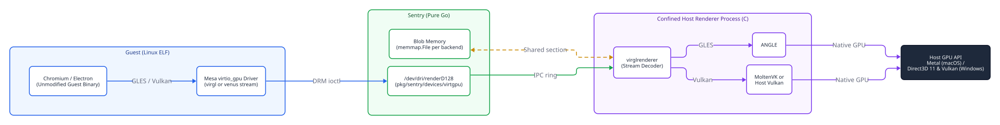

# Moonshot: GPU Acceleration for Browser and GUI Guests

This document outlines a future moonshot architecture for giving Linux browser and GUI guests access to the host GPU on macOS and Windows. The design has three layers: the Mesa driver in the guest, a virtual DRM device in the Sentry, and a renderer process on the host. The document assesses an earlier draft, states the constraints of `gvx`, and defines the security model and a phased plan with exit criteria. The repository implements no part of this design today.

| Field | Value |
| :--- | :--- |
| **Title** | GPU Acceleration for Browser and GUI Guests |
| **Status** | Moonshot (Proposed, Phase 0 not started) |
| **Isolation Tier** | Tier 1 after registration of `pkg/sentry/devices/virtgpu`, the renderer command, and its IPC package. Register each path in `tier1Prefixes` (`tools/upstream/diff_audit.go`) and in `tools/upstream/file_mask.txt`. Add each path to the Tier 1 tables of `AGENTS.md` and `docs/architecture.md`. Tier 3: a `seam` entry for `pkg/sentry/fsimpl/sys/sys.go`. |
| **Target Platforms** | `darwin/arm64`, `windows/amd64`, `windows/arm64`. `linux/amd64` and `linux/arm64` are optional. |
| **Companion Docs** | [`systrap-windows.md`](systrap-windows.md), [`architecture.md`](architecture.md) |

The phases below have a fixed order. A phase starts only when the phase before it meets its exit criterion.

| Phase | Content | State |
| :--- | :--- | :--- |
| Phase 0 | Baseline gates for Chromium, Playwright, and Electron with software rendering | Not started |
| Phase 1 | Prototype over the `vtest` socket protocol, with no Sentry change | Not started |
| Phase 2 | Virtual render node in the Sentry and a confined renderer process (headless) | Not started |
| Phase 3 | Display output to the host desktop | Not started |

---

## 1. Scope and Goals (Descriptive Module)

The primary workloads are Chromium-based browsers, browser automation (Playwright and Puppeteer), and Electron applications. These programs use the GPU for WebGL, for compositing, and for rasterization when a usable GPU exists. Chromium deprecates the automatic WebGL fallback to SwiftShader, a CPU implementation of Vulkan and OpenGL ES. Without a GPU, WebGL context creation then fails unless the command line sets `--enable-unsafe-swiftshader`.

| Goal | Description |
| :--- | :--- |
| G1 | A headless Chromium guest renders WebGL and compositing on the host GPU on macOS and Windows. |
| G2 | The `rungv` binary stays pure Go (`CGO_ENABLED=0`) and keeps its size. |
| G3 | The GPU path is opt-in. A sandbox without the option keeps the current security model. |
| G4 | The guest uses unmodified distribution packages (Mesa, Chromium, Electron). |
| G5 | A later phase shows a guest window on the host desktop. |

These items are out of scope:

- GPU compute for machine learning (CUDA, ROCm, or Metal compute from the guest).
- Video decode and encode acceleration.
- Native Windows or macOS applications inside the guest.
- A display server for full Linux desktop sessions.

---

## 2. Background (Descriptive Module)

A browser in a `gvx` guest is a Linux ELF program, and the Sentry serves its system calls. The host GPU APIs are native libraries of the host: `Metal.framework` (Mach-O) on macOS and `d3d11.dll` (PE) on Windows. A Linux process cannot load them with `dlopen`, and the Sentry cannot hand them to the guest.

The standard solution serializes the guest graphics calls into a command stream. A driver in the guest encodes the stream, and a renderer on the host decodes it and calls the host API. Linux virtual machines use this model through the `virtio-gpu` device and the `virglrenderer` library.

### 2.1 State of Browser Support in `gvx`

The repository has no end-to-end test for Chromium, Playwright, Puppeteer, or Electron. The behavior of these programs on each backend is therefore unknown. A GPU path cannot show a gain before software rendering works.

| Item | State in the current tree |
| :--- | :--- |
| Browser or Electron gate in `e2e/` | None |
| `/dev/shm` | A `tmpfs` mount without a size option (`pkg/gvx/kernel_runner.go`), so the `tmpfs` default of 50% of host RAM applies |
| Guest devices | `pkg/gvx` registers `memdev`, `ttydev`, `/dev/fuse`, and `tundev` (when the stack supports TUN). `pkg/sentry/devices` also holds `nvproxy`, `rdmaproxy`, and `tpuproxy`, which `pkg/gvx` does not register. |
| DRM device (`/dev/dri/*`) | None |
| Cost of `fork` and `exec` on Windows `systrap` | 6.4 ms on `amd64` and 22 ms on `arm64` (hosted runners; `systrap-windows.md`, section 3.9) |

Chromium starts a process for each renderer and for the GPU service. The `fork` and `exec` cost of Windows `systrap` therefore affects the start time of each tab [inference]. Phase 0 measures this cost.

---

## 3. Prior Art (Reference Module)

Four projects run a Linux guest with GPU access on a host that is not Linux, or isolate the renderer on Linux. This table lists the stack of each project and the result that matters for `gvx`.

| Project | Host | Guest driver | Host renderer | Result for `gvx` |
| :--- | :--- | :--- | :--- | :--- |
| UTM | macOS | Mesa `virgl` (OpenGL), Mesa `venus` (Vulkan) | `virglrenderer` with ANGLE on Metal, or MoltenVK | Proves `virgl` over ANGLE on Metal. UTM turned GPU acceleration off by default in v4.1.6 because of guest Mesa defects. The UTM manual states that a Linux desktop does not render through `venus`. |
| libkrun and `krunkit` | macOS | Mesa `venus` | `virglrenderer` (`venus`) with MoltenVK | Proves Vulkan from Linux containers on Apple GPUs. Podman machine uses it. |
| `crosvm` (ChromeOS) | Linux | Mesa `virgl`, `venus`, and the cross-domain context | `virglrenderer` in a separate, confined GPU process | Proves the confinement model and the Wayland bridge (`sommelier`). |
| WSLg | Windows | Mesa `d3d12` driver | DirectX 12 through the `dxgkrnl` paravirtual device (`/dev/dxg`) | Proves a Windows path for a guest kernel that has the `dxgkrnl` driver. A Sentry emulation of `/dev/dxg` would call host `D3DKMT` functions, which use win32k system calls and conflict with the `gvx` lockdown [inference]. |

No project runs `virglrenderer` with ANGLE on Direct3D 11 as a supported Windows product. The authors did not find one. Phase 1 must measure this path before Phase 2 depends on it.

---

## 4. Constraints of `gvx` (Descriptive Module)

The design must satisfy the rules of [`AGENTS.md`](../AGENTS.md) and of the backends. These constraints change the design of the earlier draft. Each row names the rule and its effect on this proposal.

| Constraint | Source | Effect on the design |
| :--- | :--- | :--- |
| No new host process after the lockdown | `hostlockdown.Apply` (Job object with one process on Windows, Seatbelt `deny process-fork` on macOS) | The renderer is a separate process that starts before the lockdown, like the `systrap` stub host. |
| No win32k call after the lockdown | `AGENTS.md`, section 3.2 | Direct3D runs in the renderer process, never in the Sentry. |
| Pure Go build | `release.yml` sets `CGO_ENABLED=0`, so the binary needs no C library on the host | `virglrenderer` and ANGLE live in the renderer binary. The Sentry talks to it through IPC. |
| Sockets of `hostfs` live in Sentry memory | `docs/architecture.md`, "Special Files and Extended Attributes"; `pkg/sentry/fsimpl/hostfs/host.go` (`hostKindOther`) | A guest cannot connect to a host Unix socket through a bind mount. A display bridge needs a new socket bridge or TCP. |
| Guest memory differs on each backend | `hvf` (`hv_vm_map`, 16 KiB blocks), `whpx` (`WHvMapGpaRange`), Windows `systrap` (section views), Linux `systrap` (memory file) | A shared buffer of the renderer needs a new `memmap.File` for each backend. |
| Hosted CI runners have no GPU | GitHub-hosted runners | CI runs function tests on WARP for Windows only. The hosted macOS runner cannot run `hvf` (`docs/architecture.md`, section 4.2), so macOS tests run by hand on an Apple Silicon host. CI cannot detect a performance regression. |
| Upstream diff budget below 2.0% | `tools/upstream -mode=audit` | Add each new package to `tier1Prefixes` first. Otherwise the audit charges each added file against the ceiling. The `sysfs` change needs a `seam` line in `buildtag_allowlist.txt`. |

---

## 5. Target Architecture (Descriptive Module)

The architecture keeps the guest unmodified and moves every host API call into one confined process. The Sentry implements the Linux DRM interface of a `virtio-gpu` render node and forwards command streams to the renderer. The renderer runs `virglrenderer` and passes the decoded calls to ANGLE or to a Vulkan driver.

### 5.1 Components

Each component has one owner and one boundary. The renderer is the only component that calls a host graphics API.

| Component | Location | Responsibility |
| :--- | :--- | :--- |
| Guest driver | Guest image (`libgl1-mesa-dri`, `mesa-vulkan-drivers`) | Encodes OpenGL or Vulkan calls into `virgl` or `venus` command streams. |
| Virtual render node | `pkg/sentry/devices/virtgpu` (new) | Registers DRM character devices, serves the DRM and `virtio-gpu` ioctls, and owns GEM handles of each guest file. |
| DRM file types | `pkg/sentry/devices/virtgpu` (new) | Implements dma-buf file descriptions for PRIME export and import, and `sync_file` descriptions for fences. |
| Device enumeration | Sentry `sysfs` and `devtmpfs` | Exposes the nodes under `/sys/class/drm` and `/sys/dev/char/226:*`, which `libdrm` reads. `NewFilesystem` in `pkg/sentry/fsimpl/sys/sys.go` creates `dev/char` empty and has no extension point. |
| Blob memory | Per-backend `memmap.File` (new) | Maps renderer buffers into guest address space without a copy, where the backend allows it. |
| Renderer | New command, built with cgo or as a C program | Runs `virglrenderer` with ANGLE or Vulkan, owns the GPU context, and serves one sandbox. |
| IPC | New package | Carries commands, fences, and resource events in a shared-memory ring with an event pair. |

### 5.2 Guest Interface

The Linux kernel driver `virtio_gpu` defines the interface that Mesa expects. The Sentry must serve the DRM core ioctls and the `virtio-gpu` ioctls of [`virtgpu_drm.h`](https://github.com/torvalds/linux/blob/master/include/uapi/drm/virtgpu_drm.h). The DRM major number is 226, and render nodes use minor numbers from 128.

| Group | Requests | Purpose |
| :--- | :--- | :--- |
| DRM core | `DRM_IOCTL_VERSION`, `DRM_IOCTL_GET_CAP` | Driver name (`virtio_gpu`) and capabilities. Mesa selects its driver by this name. A render node returns `EACCES` for `DRM_IOCTL_SET_CLIENT_CAP` and `DRM_IOCTL_GET_UNIQUE`. |
| GEM and PRIME | `DRM_IOCTL_GEM_CLOSE`, `DRM_IOCTL_PRIME_HANDLE_TO_FD`, `DRM_IOCTL_PRIME_FD_TO_HANDLE` | Buffer handles and their export to other processes as dma-buf descriptors. |
| Synchronization | `DRM_IOCTL_SYNCOBJ_*` and the `sync_file` descriptors of `EXECBUFFER` | Fences between submissions and between processes. |
| `virtio-gpu` | `DRM_IOCTL_VIRTGPU_` plus `GETPARAM`, `GET_CAPS`, `CONTEXT_INIT`, `RESOURCE_CREATE`, `RESOURCE_CREATE_BLOB`, `RESOURCE_INFO`, `MAP`, `EXECBUFFER`, `TRANSFER_TO_HOST`, `TRANSFER_FROM_HOST`, `WAIT` | Contexts, resources, command submission, and data transfer. |
| File operations | `mmap` of a GEM object, `poll`, `read` of DRM events | Mapped buffers and completion events. |

The earlier draft estimated about 10 ioctls. The table lists 28 ioctls (2 core, 3 GEM and PRIME, 12 `SYNCOBJ`, 11 `virtio-gpu`). The full surface also adds two new file types and `sysfs` enumeration.

### 5.3 Command Stream Choice

The renderer can serve two command streams. Each stream has a different translation depth and different prior art. Phase 1 measures `virgl`; Phase 2 measures `venus`.

| Property | `virgl` (OpenGL) | `venus` (Vulkan) |
| :--- | :--- | :--- |
| Guest API | OpenGL and OpenGL ES | Vulkan |
| Path of a Chromium WebGL call | Chromium ANGLE (GL back end), Mesa `virgl`, `virglrenderer`, host ANGLE, Metal or Direct3D 11 | Chromium ANGLE (Vulkan back end), Mesa `venus`, `virglrenderer`, MoltenVK or the host Vulkan driver |
| Layers on the path | Chromium ANGLE, Mesa `virgl`, host ANGLE | Chromium ANGLE and MoltenVK (macOS only) |
| macOS prior art | UTM | UTM, `krunkit` |
| Windows prior art | None found | None found |
| Known limit | Host ANGLE on Direct3D 11 offers OpenGL ES 3.0 and parts of 3.1 [inference] | `venus` needs host memory export that `virglrenderer` implements for Linux; the macOS port carries patches [inference] |

### 5.4 Memory Model

A `virtio-gpu` resource has guest backing pages, host backing memory, or both. Without blob support, Mesa copies data with `TRANSFER_TO_HOST` and `TRANSFER_FROM_HOST`. Blob resources let the guest map renderer memory directly.

| Backend | Mapping of a renderer buffer into the guest | Expected work |
| :--- | :--- | :--- |
| `hvf` | `hv_vm_map` of a host pointer, aligned to 16 KiB | Import a shared memory object of the renderer and expose it as a `memmap.File`. |
| `whpx` | `WHvMapGpaRange` of a host pointer | Import a section handle of the renderer. |
| Windows `systrap` | Map a view of a section into the stub | Extend `sectionCache` (`section_windows.go`) to accept an imported section handle. `get` accepts only file handles today. |
| Linux `systrap` | Map the descriptor of a memory file | Import a descriptor from the renderer (optional platform). |

Phase 2 starts with `virgl` and transfers only. Mesa `venus` requires `VIRTGPU_PARAM_RESOURCE_BLOB` and `VIRTGPU_PARAM_HOST_VISIBLE`, so blob mapping must land before `venus` support.

### 5.5 Renderer Process

The Sentry starts one renderer for each sandbox before `hostlockdown.Apply`. The renderer receives its IPC endpoints and then confines itself. The Sentry keeps only the handles of the IPC ring and of the shared sections. It keeps no handle that can write the memory of the renderer.

| Host | Confinement of the renderer | GPU access that it keeps |
| :--- | :--- | :--- |
| Windows | Restricted token at low integrity, a job object without child processes, no file system access except its own binary | Direct3D 11 through `dxgi.dll` and `d3d11.dll`, which need win32k system calls [inference] |
| macOS | A Seatbelt profile that denies `process-fork`, file writes, and network access | `iokit-open` for the GPU user clients that Metal needs |
| Linux (optional) | seccomp and namespaces, as `crosvm` does | The render node of the host |

The renderer runs C code that parses guest-controlled input. Section 6 describes the consequences.

### 5.6 Display Options

Phase 3 chooses one display path. The path decides the copy cost and the size of the host component. The earlier draft proposed an X11 bridge with zero-copy frames; the table shows why that combination does not hold.

| Option | Host component | Copy cost | Notes |
| :--- | :--- | :--- | :--- |
| X11 over TCP to XQuartz or VcXsrv | Third-party X server | Each frame crosses TCP; MIT-SHM does not cross the host boundary | Reaches a host X server on `127.0.0.1` through the `10.0.2.2` gateway of the NAT network [inference]. XQuartz accepts TCP clients only after the user enables network connections [inference]. A 4K frame at 60 Hz with 4 bytes for each pixel needs about 2 GB/s. |
| Frame streaming (VNC) | Viewer on the host | One encode and one decode for each frame | The viewer is an existing program, and it carries input. |
| Remote windows over RDP (WSLg model) | RDP client with remote application support | WSLg uses RDP with VAIL, which shares window memory across the VM boundary and skips frame encoding | `gvx` has no shared memory path to an RDP client yet. |
| Wayland cross-domain bridge | A host compositor that maps each guest surface to a native window | No copy for blob buffers | ChromeOS uses this model (`sommelier`). It needs a new host compositor for each host OS. |

---

## 6. Security Model (Descriptive Module)

`gvx` confines guest code to the Sentry, and the Sentry reaches the host only through a fixed set of host calls. A GPU path adds a renderer that parses guest-controlled command streams in C and calls the host GPU driver. The renderer therefore becomes part of the attack surface of the sandbox.

| Threat | Evidence | Mitigation |
| :--- | :--- | :--- |
| Memory corruption in `virglrenderer` | [CVE-2019-18389](https://access.redhat.com/security/cve/cve-2019-18389) is a heap overflow; Red Hat lists denial of service or a guest-to-host escape. [CVE-2022-0135](https://access.redhat.com/security/cve/cve-2022-0135) is an out-of-bounds write; Red Hat lists denial of service or code execution. | Run the renderer in its own confinement (section 5.5). Pin and update `virglrenderer` with each release. |
| Defects in the host GPU driver | The driver runs in the host kernel or in a privileged host service | Keep the GPU path opt-in. State the risk in the documentation of the option. |
| Resource exhaustion | A guest can allocate GPU memory and submit long command buffers | Cap the memory of the resources and the size of each submission in the Sentry. Time out a context that does not signal its fences. |
| Data leaks between sandboxes | A shared renderer could mix contexts | Start one renderer for each sandbox. |

The option is off by default. A sandbox without the option registers no DRM device and starts no renderer. Its security model stays unchanged.

---

## 7. Assessment of the Earlier Draft (Reference Module)

An earlier draft proposed the same three layers. This table compares its claims with the facts that this proposal found. Each row gives the corrected statement and its basis.

| Claim of the draft | Finding | Basis |
| :--- | :--- | :--- |
| The Sentry intercepts about 10 ioctls | The surface also includes the DRM core, dma-buf and `sync_file` file types, and `sysfs` enumeration | Section 5.2 |
| Chromium enables acceleration without changes | The Chromium GPU blocklist can disable features on a `virgl` device; a flag such as `--ignore-gpu-blocklist` can be necessary | [inference] Phase 1 measures it |
| WebGL becomes tens of times faster than SwiftShader | The gain applies to WebGL-heavy pages. Page rasterization, screenshots, and PDF output of automation depend on the CPU. Chromium deprecates the automatic WebGL fallback to SwiftShader, so WebGL on SwiftShader needs `--enable-unsafe-swiftshader` | Phase 0 measures the share of CPU rendering |
| Guest sockets connect to the host X11 or Wayland socket | `hostfs` keeps sockets in Sentry memory. A guest reaches a host display server only through TCP today | Section 4 |
| Shared memory gives zero-copy 4K at 60 Hz through the X11 bridge | X11 over TCP copies each frame. `virgl` transfers copy by default. Zero copy needs blob resources and a compositor bridge | Sections 5.4 and 5.6 |
| `/dev/shm` must grow from 64 MB | The 64 MB limit is a Docker default. `gvx` mounts `/dev/shm` as `tmpfs` without a size option, so the `tmpfs` default of 50% of host RAM applies | `pkg/gvx/kernel_runner.go` |
| The host renderer takes 15 MB to 20 MB | Plausible for ANGLE and `virglrenderer`. The ANGLE build needs `depot_tools` and `gn`, and `virglrenderer` has no supported `windows/arm64` build | [inference] Phase 1 measures it |
| Two licenses fit the project | `virglrenderer` is MIT and ANGLE is BSD-3-Clause. MoltenVK is Apache-2.0 | Upstream license files |

---

## 8. Risks (Reference Module)

The risks below decide whether the project continues after each phase. The exit criterion of each phase in section 9 tests the risk in the same row.

| Risk | Effect | Mitigation | Tested in |
| :--- | :--- | :--- | :--- |
| Browsers do not run on a backend with software rendering | No baseline for a gain | Fix the defects first | Phase 0 |
| GPU rendering gives a gain below the Phase 0 minimum for the target workloads | The cost exceeds the value | Stop after Phase 0 or Phase 1 | Phase 0 and Phase 1 |
| `virglrenderer` with ANGLE on Direct3D 11 is incomplete or unstable | No Windows path | Measure `venus` with the host Vulkan driver; keep Windows on software rendering | Phase 1 and Phase 2 |
| Rendering defects from three translation layers | Wrong output in some pages | Keep a conformance subset of WebGL tests in the exit criteria | Phase 1 and Phase 2 |
| A renderer escape | Host compromise | Renderer confinement, opt-in, pinned versions | Phase 2 |
| Build and release cost of C dependencies | CI time and release size | Build the renderer in a separate job and ship it as a separate archive | Phase 2 |
| No GPU in CI | Regressions in performance stay unseen | Run function tests on WARP for Windows; run macOS and performance tests by hand on physical hosts | Phase 2 |

---

## 9. Phased Plan (Procedural Modules)

Each phase ends with an exit criterion. A failed criterion stops the project or changes the next phase. Record each measurement with its host, its command, and its run ID.

### 9.1 Phase 0: Baseline Gates

Phase 0 needs no new device. It tells whether browsers run on each backend and how much time software rendering costs.

1. Add an `e2e` gate that runs headless Chromium on a static page and prints a value from the page.
2. Add a Playwright gate that takes a screenshot and saves a PDF.
3. Add an Electron gate that starts an application and exits with code 0.
4. Run each gate on `hvf`, `whpx`, Windows `systrap`, and Linux `systrap`.
5. Run the `hvf` gates on an Apple Silicon development host.
6. Measure the start time of the browser and of each new tab.
7. Record a minimum share of run time and a minimum speedup over SwiftShader.
8. Profile one WebGL page and one automation script with `--enable-unsafe-swiftshader` set.
9. Record the share of time in SwiftShader for each workload.

Exit criterion: the browsers pass on each backend, and SwiftShader takes at least the minimum share of run time.

### 9.2 Phase 1: Prototype over `vtest`

`virglrenderer` ships a test server (`vtest`) that speaks a Unix socket protocol. Mesa can use that protocol without a DRM device. The prototype therefore needs no Sentry change. Upstream Meson builds the server only for hosts other than Windows, and the clients receive buffers as file descriptors.

> [!CAUTION]
> Run the prototype server only on a development host with test pages. The server parses guest commands in unconfined C code, so a malformed command can corrupt memory and run code on the host.

1. Build `virglrenderer` and the `vtest` server with ANGLE on macOS.
2. Port the `vtest` server to Windows.
3. Relay the guest `vtest` Unix socket to the host over TCP on the NAT network.
4. Run Chromium with Mesa in `vtest` mode for `virgl`.
5. Defer `venus` to Phase 2, because Mesa `venus` over `vtest` needs host file descriptors.
6. Run a WebGL conformance subset and the Phase 0 workloads.
7. Compare frame times and correctness with SwiftShader.

Exit criterion: `virgl` passes the conformance subset on macOS and on Windows and meets the minimum speedup of Phase 0. The relay copies every buffer because it cannot pass file descriptors. The criterion therefore compares the rendering work, not the transport.

### 9.3 Phase 2: Virtual Render Node

Phase 2 builds the production path for headless guests. It adds the device, the renderer process, the IPC ring, and the confinement of section 5.5.

1. Add `pkg/sentry/devices/virtgpu` with the interface of section 5.2.
2. Add the `sysfs` entries that `libdrm` reads.
3. Add the renderer command and its IPC package.
4. Start the renderer before `hostlockdown.Apply` when the sandbox enables the GPU option.
5. Confine the renderer as section 5.5 describes.
6. Add confinement tests that fail when the renderer starts a process, opens a file, or connects to a network.
7. Add the resource caps and the fence timeout of section 6.
8. Add blob resources and host-visible mapping before `venus` support.
9. Measure `venus` with MoltenVK on macOS and with the host Vulkan driver on Windows.
10. Run the WebGL conformance subset with the GPU option on.
11. Build the renderer in a separate CI job and publish it as a separate archive.
12. Add `e2e` gates that run on WARP in the Windows CI jobs.
13. Run the gates by hand on a physical Mac and a physical Windows host.

Exit criterion: the Phase 0 gates and the confinement tests pass with the GPU option on. The speedup over SwiftShader meets the minimum of Phase 0.

### 9.4 Phase 3: Display Output

Phase 3 starts only with a confirmed need for guest windows on the host desktop. It chooses one option of section 5.6.

1. Select the display option with a written comparison of cost and copy count.
2. Record a minimum frame rate at 1080p and at 4K.
3. Build a socket bridge or a compositor for the selected option.
4. Remove frame copies from the display path where the option allows it.
5. Measure the frame time at 1080p and at 4K.

Exit criterion: an Electron application shows its window on macOS and on Windows at the minimum frame rate of step 2.

---

## 10. Open Questions (Reference Module)

These questions have no answer in this proposal. Each answer changes the scope or the order of the phases.

| Question | Phase that answers it |
| :--- | :--- |
| Does Chromium run its multi-process sandbox in a `gvx` guest, or does it need `--no-sandbox`? | Phase 0 |
| What share of automation time does SwiftShader take for the target users? | Phase 0 |
| Does `virglrenderer` with ANGLE on Direct3D 11 render the WebGL conformance subset? | Phase 1 |
| Does `venus` run on Windows hosts with vendor Vulkan drivers on `amd64` and `arm64`? | Phase 2 |
| Which renderer confinement on Windows keeps Direct3D 11 working? | Phase 2 |
| Do the users need headed windows, or is headless rendering enough? | Before Phase 3 |

---

## 11. Sources (Reference Module)

The external facts of this proposal come from these sources. The facts about `gvx` come from the files that each section names.

| Source | Supports |
| :--- | :--- |
| [Linux `virtgpu_drm.h`](https://github.com/torvalds/linux/blob/master/include/uapi/drm/virtgpu_drm.h) | The `virtio-gpu` ioctls and parameters. |
| [`virglrenderer`](https://gitlab.freedesktop.org/virgl/virglrenderer) | The renderer library, the `vtest` server, and the MIT license. |
| [ANGLE](https://chromium.googlesource.com/angle/angle) | The OpenGL ES implementation on Metal and Direct3D 11, and the BSD-3-Clause license. |
| [UTM graphics architecture](https://github.com/utmapp/UTM/blob/main/Documentation/Graphics.md), [UTM Linux guide](https://docs.getutm.app/guest-support/linux/), [UTM v4.1.6 notes](https://github.com/utmapp/UTM/releases/tag/v4.1.6) | `virgl` over ANGLE on Metal, the `venus` desktop limit, and the default that UTM turned off. |
| [`krunkit`](https://github.com/containers/krunkit), [Red Hat measurement](https://developers.redhat.com/articles/2025/09/18/reach-native-speed-macos-llamacpp-container-inference) | `venus` with MoltenVK for Linux containers on macOS. |
| [WSLg](https://github.com/microsoft/wslg) | The Windows path through Mesa `d3d12` and RDP. |
| [CVE-2019-18389](https://access.redhat.com/security/cve/cve-2019-18389), [CVE-2022-0135](https://access.redhat.com/security/cve/cve-2022-0135) | Guest-triggered memory corruption in `virglrenderer`: heap overflow and out-of-bounds write. |
| [Chromium SwiftShader notes](https://chromium.googlesource.com/chromium/src/+/main/docs/gpu/swiftshader.md) | The deprecation of the automatic SwiftShader fallback for WebGL. |
